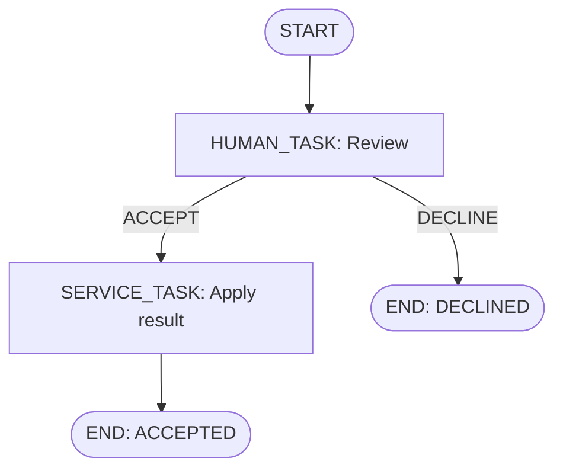

# Workflow Definition Language — JSON Design

## Standards research, conceptual model and proposed direction

| Document field | Value |
| --- | --- |
| Version | 0.1 |
| Date | 25 October 2026 |
| Status | Design draft for discussion; language contract not frozen |
| Project | Reusable workflow engine, initially embedded in APOLO |
| Current documentation path | `docs/architecture/workflow-definition-language-design.md` |
| Architecture baseline | Workflow engine design v0.8, 24 October 2026 |
| Later design input | Workflow engine database design v1.4, 25 October 2026 |
| Scope of this revision | Standards assessment, inherited constraints, conceptual semantics, candidate notation and decisions to resolve |
| Relationship to F003 | Design input for later specification work; creation of this document does not start or implement F003 |

**Recommended direction:** develop a compact JSON workflow language informed by BPMN, with explicit human-work contracts, registered host integrations and the existing single-position execution model. Use JSON Schema for document structure and a separate semantic validator for graph, contract and host-capability checks. This recommendation does not claim BPMN conformance or executable interchange.

This revision gives the language design a stable discussion baseline. Exact field names, encodings, validation codes, limits and completion-policy details remain proposals unless identified as established decisions below.

## Contents

1. [Purpose and decision status](#1-purpose-and-decision-status)
2. [Inherited architecture and revised constraints](#2-inherited-architecture-and-revised-constraints)
3. [Goals, use cases and scope](#3-goals-use-cases-and-scope)
4. [Standards assessment](#4-standards-assessment)
5. [BPMN correspondence and deliberate differences](#5-bpmn-correspondence-and-deliberate-differences)
6. [Language strategy and compatibility](#6-language-strategy-and-compatibility)
7. [Conceptual model](#7-conceptual-model)
8. [Execution and graph semantics](#8-execution-and-graph-semantics)
9. [Human activities and collective completion](#9-human-activities-and-collective-completion)
10. [Data ownership, variables and bindings](#10-data-ownership-variables-and-bindings)
11. [Expressions and host capabilities](#11-expressions-and-host-capabilities)
12. [Document representation and versioning](#12-document-representation-and-versioning)
13. [Validation and diagnostics](#13-validation-and-diagnostics)
14. [Compatibility, limits and evolution](#14-compatibility-limits-and-evolution)
15. [Candidate minimal definition](#15-candidate-minimal-definition)
16. [Decision register and next design steps](#16-decision-register-and-next-design-steps)
17. [Design review scenarios](#17-design-review-scenarios)
18. [References and provenance](#18-references-and-provenance)
19. [Revision history](#19-revision-history)

## 1. Purpose and decision status

The language must describe what a workflow can represent and what execution means before implementation fixes its structure. It must support a Java/Spring interpreter, persisted immutable definitions, a future Angular designer and host-specific human screens without requiring the engine to understand APOLO business entities.

The design separates four concerns:

| Concern | Question |
| --- | --- |
| Process model | Which nodes, transitions, activities, tasks and outcomes exist? |
| Execution semantics | What happens on entry, submission, routing, failure and termination? |
| JSON representation | How are those concepts serialized, identified and referenced? |
| Designer representation | How are layout and presentation preserved without changing execution? |

### 1.1 Status vocabulary

| Status | Meaning in this document |
| --- | --- |
| **Established** | An explicitly selected architecture or owner decision carried forward from the source documents. |
| **Current baseline** | Behavior already described by the architecture, retained for this discussion; exact specification may still be pending. |
| **Proposed** | A concrete recommendation or existing design proposal that still requires review. |
| **Open** | A choice whose alternatives or exact contract have not been settled. |
| **Deferred** | A capability or host-owned business policy outside the current language increment. |

A detailed proposal is still a proposal. In particular, the database design specifies possible `SINGLE` and `ALL` behavior but explicitly does not mark those collective rules as approved APOLO policy. [A2, §1][A2]

### 1.2 Source precedence

Use the architecture document as the general baseline. Apply the later database document's **explicitly selected revisions** where they overlap. Do not treat all newer database proposals as approved, and do not let older illustrative JSON restore superseded decisions.

The research supplies comparisons and reasoning. It does not override selected project constraints. The source documents' illustrative schemas, interfaces and examples remain illustrative. [A1, introduction and §22][A1] [A2, introduction and §1][A2]

This file records a language design. Definition publication, database migrations, application code, a production validator and feature implementation artifacts belong to subsequent authorized work.

## 2. Inherited architecture and revised constraints

The following constraints shape the language.

| Area | Baseline to preserve | Source / status |
| --- | --- | --- |
| Deployment | Own embedded Spring/JPA library; APOLO is the first host. | Established — A1 §§2–4 |
| Definition authority | One canonical JSON definition; relational runtime state refers to its stable keys. | Current baseline — A1 §7.0 |
| Node types | `START`, `HUMAN_TASK`, `SERVICE_TASK`, `DECISION`, `END`. | Established — A1 §7.1, O6 |
| Process position | One active process position; multiple required tasks can exist inside its human activity. | Established — A1 §7.1; A2 §§1–2 |
| Definition lifetime | Published content is immutable; an instance pins one workflow version. | Established — A1 §10; A2 §2 |
| Human contract | Human node owns outcomes, inputs, structured result contract, comment requirements, guards and completion policy. | Selected revision — A2 §§1, 8.2 |
| Task type | Stable catalog code, without a separate task-type business version. | Selected revision — A2 §§1, 8 |
| Task evidence | Accepted task submissions are immutable and identified by exact task/activity. | Selected revision — A2 §§1, 11.1 |
| Variable types | Six scalar types plus `JSON` object/array values. | Selected revision — A2 §§1, 12 |
| Automated work | Registered synchronous service actions with declared, validated inputs/outputs. | Established — A1 O1 |
| Action placement | Workflow-driven business effects belong to service nodes; transitions route execution. | Established — A1 O1 |
| Transactions | Domain changes, workflow state, evidence, durable handoff and successful command receipt share the command transaction. | Established requirement — A1 §12; A2 §16 |
| Expressions | Restricted SpEL over explicitly supplied data; Boolean routing conditions. | Established direction — A1 §§5, 7; A2 §12.2 |
| Business ownership | APOLO owns booking membership, material changes, business authorization and aggregation policy. | Established — A1 §8; A2 §§1, 17 |

The table summarizes the two project design sources rather than observed implementation behavior. Transaction participation and other integration details still need their documented verification. [A1] [A2]

### 2.1 Superseded assumptions

The language must not revive the older architecture example's one-task limitation, `taskTypeVersion`, separately versioned task outcomes, or scalar-only variable model. The database revision also selects numeric JPA locking instead of the older SQL Server `ROWVERSION` proposal; this affects command APIs, not portable definition syntax. [A2, introduction and §§1, 8, 12][A2]

Business correlation is an optional immutable pair supplied at instance creation. It does not establish booking membership or grant access. A workflow must therefore remain usable without an APOLO-specific identifier or mandatory business association. [A2, §§1, 9.1][A2]

## 3. Goals, use cases and scope

### 3.1 Design goals

The language should make supported behavior easy to inspect, validate and explain:

- A reader can identify the current kind of work, possible outcomes and routes.
- A human activity can collect several required submissions without introducing parallel process branches.
- Data reads and writes have explicit ownership and validation boundaries.
- A published definition remains interpretable throughout the life of its instances.
- Host dependencies use logical capability identifiers.
- The future designer and backend exchange one contract.
- Errors identify the relevant document location and failed rule.
- Unsupported behavior is rejected during validation rather than silently approximated.

These are design objectives derived from the selected architecture.

### 3.2 Representative use cases

| Scenario | Capability the language must express |
| --- | --- |
| One sandbox review | Entry, one required task, a declared outcome and terminal result. |
| Manager followed by partner | Sequential human activities with distinct contracts. |
| Conditional additional review | Read-only routing over declared facts or variables. |
| Multiple reviewers at one stage | One activity, fixed task obligations, individual submissions and one aggregate outcome. |
| Structured review of several items | Per-task JSON evidence followed by explicit host aggregation. |
| Apply an approved business change | Registered service action with declared bindings and transactional failure behavior. |
| Revisit a human node | New activation and new evidence, without changing the published graph. |

The scenarios exercise generic engine behavior. The exact APOLO approval chain, approver sources, resubmission flow and material-field rules remain host decisions. [A1, §22.2][A1] [A2, §17][A2]

### 3.3 Initial exclusions

The current baseline excludes general parallel branches and joins, subprocesses, external workers, asynchronous service waiting, live definition migration, arbitrary scripts, candidate claiming, delegation, mutable task rosters, optional participants, `ANY`, `QUORUM` and weighted voting. A standalone business-decision engine remains deferred. [A1, §§1, 6, 22][A1] [A2, §1][A2]

Timers, reminders, escalation scheduling and task expiration also remain deferred. A due date is informational metadata in the current model. A future timeout field must not appear to promise scheduling until its execution and persistence semantics are specified. [A2, §1][A2]

## 4. Standards assessment

The specifications below address different layers. Some are formal standards, some are community specifications, and ASL is a published vendor language.

| Reference | Kind / reviewed baseline | Main relevance |
| --- | --- | --- |
| BPMN | OMG standard, 2.0.2 | Process concepts, activities, flow and interchange. |
| Amazon States Language | Published JSON state-machine language | Compact typed state definitions and explicit execution/data rules. |
| Open Workflow Specification | CNCF project; published DSL reference reviewed on 25 October 2026 | JSON/YAML workflow structure, versioning and data boundaries. |
| SCXML | W3C Recommendation, 1.0 | Precise state-machine processing steps. |
| DMN | OMG standard, formal version 1.6 | Business decisions independent of process routing. |
| CMMN | OMG standard, 1.1 | Case work with a different planning model. |
| JSON Schema | Draft 2020-12 | Structural validation and standard error-location concepts. |

Sources: [S1], [S3], [S5], [S6], [S7], [S8], [S9], [S10].

### 4.1 BPMN as the principal process reference

BPMN supplies a process model, execution semantics, graphical notation and XML interchange. Its published artifacts distinguish the semantic model from diagram interchange. The relevant concepts include user tasks, service tasks, sequence flows, gateways and events. [S1] [S2]

**Design consequence:** establish our model and execution rules before choosing property names. Familiar diagram shapes are useful, but each supported node still needs an exact behavioral contract.

### 4.2 Amazon States Language

ASL represents a state machine in JSON using named, typed states and an explicit entry state. Its specification distinguishes tasks, choices and terminal behavior, and defines data processing and failures. AWS Choice rules use ordered first matching selection. [S3] [S4]

**Design consequence:** use explicit identity, type-specific fields and clearly defined destinations. Keep human work visible as a first-class activity because assignment, submissions and collective completion are central to this engine.

AWS's documentation also distinguishes JSONPath and JSONata processing models. [S15] Our lesson is to keep the number and order of data transformations understandable. This does not reopen the selected SpEL implementation.

### 4.3 Open Workflow Specification

The Serverless Workflow project was renamed Open Workflow Specification; CNCF lists it at Sandbox maturity. [S5] [S17] Its DSL reference separates the language version from the workflow version and distinguishes input, output and context export. [S6]

**Design consequence:** explicitly separate language identity, workflow identity, command inputs, activity outputs and shared state updates. Borrowing these distinctions does not require adopting its integrations, runtime model or expression language.

The reviewed reference is a moving document. This design does not select a particular Open Workflow release as an implementation dependency.

### 4.4 SCXML

SCXML describes a macrostep as processing microsteps until a stable state is reached before the next external event is processed. [S7, §3.13 and glossary][S7]

**Design consequence:** explain one workflow command as bounded progression to a waiting or terminal position. SQL atomicity, idempotency and rollback remain our engine's requirements; they do not follow from the analogy.

### 4.5 DMN

DMN models business decisions and rules. The reviewed formal baseline is DMN 1.6. [S8] [S18]

**Design consequence:** a future business decision may produce a value such as `approvalLevel = PARTNER`; workflow routing then maps that value to a node or transition. A decision definition need not know workflow edge identifiers. The optional decision component remains deferred.

### 4.6 CMMN

CMMN addresses case models and work whose planning depends on evolving circumstances. [S9] [S19]

**Design consequence:** it is a useful scope boundary. Several reviewers do not by themselves require discretionary case planning. Our selected predefined graph and fixed activity roster fit the current approval requirements more directly.

### 4.7 JSON Schema

Draft 2020-12 is the proposed structural-validation baseline. JSON Schema provides constraints for object properties, alternatives, arrays and values, together with error-location concepts. Its `default` annotation does not initialize omitted application values during validation. [S10] [S11] [S12]

**Design consequence:** use separate layers for workflow-document structure, embedded data contracts, graph semantics and runtime checks. Initialization and default application must be defined by our language. Supporting a workflow schema does not imply unrestricted support for arbitrary embedded schemas.

## 5. BPMN correspondence and deliberate differences

### 5.1 Correspondence matrix

This is a conceptual mapping, not an interchange specification.

| Our concept | BPMN counterpart | Our intended restriction or difference |
| --- | --- | --- |
| `START` | None start event | One explicit entry for the initial language. |
| `HUMAN_TASK` | User task | Node owns our submission and completion contract. |
| `SERVICE_TASK` | Service task | Registered synchronous action in the host transaction. |
| `DECISION` | Exclusive gateway | Current baseline rejects overlapping true predicates. |
| `END` | None end event | Completes our single-position instance. |
| Transition | Sequence flow | Explicit routing; no transition business actions. |
| Several tasks in one activity | Multi-instance activity | Fixed required obligations with our own completion policy. |
| Designer metadata | Diagram interchange | Visual data cannot affect execution. |

The BPMN names are grounded in the standard; the restrictions are our project design. [S2]

An approval screen corresponds to a user task. A BPMN manual task denotes work outside process-runtime management, which is a different concept. [S2, §10.3.4.1][S2]

### 5.2 Decision routing: the most important difference

BPMN 2.0.2 specifies ordered evaluation for an exclusive gateway: the first true condition selects its flow and evaluation stops. If none matches, use the default; without a default, raise an exception. [S2, §13.4.2, Table 13.2][S2]

The current architecture instead evaluates non-default predicates and requires exactly one true result. Multiple matches, no match without a default, or an evaluation failure fail the command. [A1, §7.3][A1]

Example, using illustrative numeric facts:

| Route | Predicate | At amount 15,000 |
| --- | --- | --- |
| Partner review | amount ≥ 10,000 | True |
| Manager review | amount ≥ 5,000 | True |

Under the standard's ordered behavior, placing Partner first selects that route. Under our current rule, the command fails for ambiguity. Restricting the manager condition to `5,000 ≤ amount < 10,000` removes the overlap.

**Recommendation:** retain ambiguity rejection and document it prominently. It catches overlapping business conditions and prevents edge reordering from silently changing route priority. The tradeoff is that authors must express disjoint conditions.

The proposed rule is based on the set of successfully evaluated Boolean results. An expression failure cannot be converted into a non-match or a default route. Exact diagnostic ordering remains open; this is not a promise to continue evaluating after a fatal failure. This failure policy is our own rule, not a claimed BPMN requirement.

### 5.3 Multiple reviewers: analogy without adopting general parallelism

BPMN multi-instance activity semantics are a useful comparison. Camunda's documentation illustrates an enclosing multi-instance body, sequential or parallel instances, and completion conditions that may terminate outstanding work. [S13]

Our chosen model has one process position containing several required tasks. Those tasks do not independently traverse the workflow graph. Individual submissions resolve according to the human node's policy, which produces one activity outcome.

This distinction permits concurrent reviewers without requiring token joins, independently advancing branches or a general parallel execution model.

### 5.4 End behavior

An ordinary BPMN end event ends its execution path; completion also depends on other active paths. Camunda documents this explicitly. [S14]

Our instance has one process position, so reaching `END` can finish the instance once no active activity or open tasks remain. A result such as `REJECTED` is normal completion; technical command failure is separate. [A2, §§2, 9][A2]

### 5.5 Standard choice and engine choice

The project has chosen its own embedded engine. A process format and a runtime deployment model are separate design decisions. Using BPMN as a reference does not introduce a Camunda, Flowable or other third-party runtime dependency.

The design rationale for custom JSON is direct expression of our constrained execution and human-work model, together with control over language evolution. Avoid framing the choice as a limitation inherent in XML or BPMN.

## 6. Language strategy and compatibility

### 6.1 Alternatives

| Direction | Benefit | Responsibility / cost | Assessment |
| --- | --- | --- | --- |
| Canonical BPMN XML with a supported subset | Access to BPMN interchange and modeling conventions. | Restrict constructs, define host extensions and preserve execution behavior. | Reference alternative; conflicts with the selected canonical JSON direction. |
| Custom JSON representing a defined BPMN semantic subset | JSON with a deliberate semantic mapping. | Maintain both the JSON contract and a mapping that handles extensions and unsupported cases. | Useful if interchange becomes a real requirement. |
| Compact JSON informed by BPMN | Direct representation of the selected engine and human-task contracts. | Own semantics, validation, evolution and future adapters. | Recommended direction. |

This assessment is project reasoning. A custom language reduces the initial feature surface, but it creates long-term specification and compatibility work.

### 6.2 Compatibility goals

Treat the following as distinct goals:

| Goal | Promise | Current position |
| --- | --- | --- |
| Conceptual familiarity | Recognizable tasks, routes, starts and ends. | Recommended. |
| Diagram interchange | Exchange supported diagrams and layout. | Deferred. |
| Definition interchange | Import/export supported executable properties. | Deferred. |
| Execution portability | Equivalent outcomes and effects in another implementation. | Not promised. |

BPMN-style shapes alone establish none of the interchange guarantees. A future adapter must address assignment, expressions, data bindings, task contracts, aggregation, errors and transactions.

The `bpmn-js` toolkit is an existing browser BPMN modeler/viewer that imports BPMN XML. [S16] Using it for custom JSON would require an adapter and explicit handling of semantic differences. A graph library remains an open designer choice.

**Proposed wording:** “A compact JSON workflow language informed by BPMN, with a documented correspondence matrix and explicit deviations.”

## 7. Conceptual model

| Concept | Meaning | Identity / scope |
| --- | --- | --- |
| Workflow family | Stable named process definition family. | Workflow key. |
| Definition version | Immutable executable document after publication. | Workflow key + definition version. |
| Instance | One execution pinned to a definition version. | Runtime instance identity. |
| Node | Declared process position and its behavior. | Stable key within the definition. |
| Transition | Declared route between nodes. | Proposed definition-wide stable key. |
| Activity | One activation of a human node. | Runtime activity identity; repeated visits create new identities. |
| Task / work item | One required obligation within an activity. | Runtime task identity and activity-local task key. |
| Task outcome | Action/result key submitted for a task. | Declared by the pinned human node. |
| Activity outcome | Result of applying the completion policy. | Selects the outgoing route. |
| Process result | Value recorded at a normal end node. | Defined by the end node. |
| Submission | Immutable accepted outcome, comment, scalar inputs and optional structured result. | Exact completed task/activity. |
| Variable | Mutable declared execution data. | Instance + variable key. |
| Host capability | Registered guard, action, resolver, permission or data-provider contract. | Logical identifier resolved by the host. |

This model preserves the source designs' separation between definition, runtime, evidence and host data. [A1, §§7–10][A1] [A2, §§2, 4, 8–12][A2]

### 7.1 Outcomes are not lifecycle statuses

For a single review, all of the following can be true:

| Field / concept | Example |
| --- | --- |
| Task lifecycle | `COMPLETED` |
| Task outcome | `REJECT` |
| Activity lifecycle | `COMPLETED` |
| Activity outcome | `REJECT` |
| Transition key | `REVIEW_REJECTED` |
| Process result | `REJECTED` |
| Instance lifecycle | `COMPLETED` |

Administrative cancellation is another operation. A normal end result named `CANCELLED` does not itself mean the instance was administratively cancelled. [A2, §§2, 9][A2]

### 7.2 A small conceptual workflow

The following sandbox diagram illustrates routing responsibilities; it does not select APOLO business behavior.



The human node defines available outcomes. Transitions map the resolved activity outcome to the next node. The service node owns the registered business operation. The two end nodes record different normal process results.

## 8. Execution and graph semantics

### 8.1 One command reaches a stable position

**Current baseline:** a successful command completes its permitted mutation and advances automatic nodes until the instance waits in a human activity or terminates. A partial collective submission may leave the same activity waiting. Temporary automatic positions exist only within the command transaction. [A1, §§7.5, 12][A1] [A2, §§2, 9][A2]

Conceptually:

1. Resolve trusted actor and command identity, and validate the request shape.
2. Check for an identical committed successful-command receipt and reauthorize access to its result before state-dependent rejection; a legitimate retry may carry the old instance token.
3. For a new command, resolve the pinned definition and enforce state, assignment, authorization and concurrency rules.
4. Validate the submitted data and applicable guards.
5. Apply the permitted operation and its evidence.
6. If the activity resolves, follow one route and execute automatic nodes.
7. Create the next human activity or complete the instance.
8. Commit all participating changes and the successful command receipt atomically.

The exact command API and internal persistence sequence are outside this language draft. A rejected guard or failed action does not by itself persist a cancellation or invalidation.

### 8.2 Node responsibilities

| Node | Entry / execution | Exit |
| --- | --- | --- |
| `START` | Begin a new pinned execution after start checks and initialization. | Proposed one unconditional transition. |
| `HUMAN_TASK` | Resolve required obligations, validate them and create an activity with tasks. | Wait until its completion policy yields an activity outcome. |
| `SERVICE_TASK` | Build declared inputs, execute a registered action, validate outputs and apply permitted bindings. | Proposed one unconditional success transition. |
| `DECISION` | Read permitted data and evaluate routing conditions. | One selected transition or command failure. |
| `END` | Record normal completion and configured process result. | No outgoing transition. |

Synchronous service execution and explicit action placement are established; exact graph cardinalities remain proposals. [A1, §§7.1, 10.4][A1]

### 8.3 Proposed graph rules

| Rule | Design status |
| --- | --- |
| Exactly one start node; no incoming edges to it. | Existing proposal. |
| At least one end node; no outgoing edges from an end. | Existing proposal. |
| Every executable node reachable from the start. | Existing proposal. |
| Unique node keys; transitions reference existing nodes. | Existing validation direction. |
| Definition-wide transition-key uniqueness. | Existing proposal; confirm scope. |
| One outgoing route for every possible human activity outcome. | Existing database proposal. |
| Start/service nodes have one unconditional success edge. | Existing proposal. |
| Decision edges contain a predicate or a default, with at most one default. | Existing proposal. |
| Reject automatic-only cycles. | Current baseline; exact validation contract pending. |
| Each reachable node has a structural path to an end. | Additional proposal for review. |

The last rule proves only graph reachability. It cannot prove that runtime predicates will eventually allow termination. All semantic checks must be distinguished from stronger guarantees they cannot establish.

### 8.4 Loops and execution bounds

A return to a human node creates a new activity and new tasks; prior submissions remain historical evidence. A supported loop can therefore represent another review round without rewriting previous approvals. Its use for APOLO resubmission remains provisional. [A2, §2][A2] [A1, §22.2 O3][A1]

Automatic-cycle validation must detect a cycle made entirely of automatic nodes even when those nodes also belong to a larger graph region containing a human node. Merely finding one human node somewhere in that region is insufficient.

Retain a per-command progression limit as a second protection. The architecture's suggested 50 steps and the database design's suggested 100 tasks per activity are review inputs, not finalized language constants. [A1, §7.5][A1] [A2, §4.1][A2]

### 8.5 Failure, retry and atomicity

If the final task submission leads to a service action whose output is invalid, the enclosing command rolls back. That attempted submission is not accepted; earlier submissions committed by earlier commands remain. [A2, §§16–17][A2]

A business decline is a declared outcome. A conversion failure, failed action or conflicting mutation is a command failure. A default route is for valid non-matching conditions, not a technical fallback.

Successful-command replay follows the idempotency contract. There is no initial automatic retry of failed business commands. External delivery uses the host's durable handoff; SQL rollback cannot undo an email or remote HTTP effect already performed. [A1, §§12–13][A1]

## 9. Human activities and collective completion

### 9.1 The node owns the contract

The stable task-type code identifies host support and task presentation. The pinned human node defines the actual accepted actions and submission contract. Two nodes with the same task type can expose different outcomes or result requirements. [A2, §8][A2]

The language must eventually specify:

- Assignment resolver and declared resolver inputs.
- Permitted outcomes and presentation labels/order.
- Permissions, guards and comment requirements.
- Scalar completion-input contract.
- Structured result contract.
- Completion policy and its configuration.
- Routes for all possible aggregate outcomes.

**Proposed placement:** outcome-specific permission, guard and comment rules belong under the outcome declaration; transitions retain routing fields. Whether scalar/result contracts are node-wide, outcome-specific, or support both remains open.

### 9.2 Required obligations and assignment

The database design proposes one resolver returning a bounded nonempty collection of required task slots, each with a task key and direct assignee reference. The activity and its complete roster are created atomically. Missing assignees, duplicate task keys or invalid cardinality fail the entering command. [A2, §4.1][A2]

Task keys identify obligations rather than people. Two obligations may share an assignee unless the host forbids that arrangement. Distinct-person and no-self-approval requirements belong to explicit host policy.

The fixed-roster model preserves task identity during audited reassignment. It does not allow required work to disappear through individual waiver, deletion or cancellation while the activity remains active. [A2, §§2, 4.1][A2]

### 9.3 Proposed initial completion policies

**The entire exact policy contract in this subsection remains proposed.** Multiple tasks are selected scope; these aggregation details still require agreement. [A2, §§1, 4.2][A2]

| Policy | Cardinality | Proposed behavior |
| --- | --- | --- |
| `SINGLE` | Exactly one required task. | Its permitted task outcome becomes the activity outcome. |
| `ALL` | One or more required tasks, within a configured bound. | Every task must contribute one configured outcome; any other permitted outcome is immediately decisive. |

For the proposed `ALL` policy:

1. The contribution outcome is declared by the node.
2. A nonfinal contribution completes its task and records evidence without advancing the graph.
3. The final required contribution resolves the activity with that same outcome.
4. Any other permitted outcome resolves the activity immediately.
5. Still-open sibling tasks are cancelled with a resolution reason.
6. Earlier completed tasks stay completed; cancelled siblings are not represented as votes.
7. Every resulting activity outcome has exactly one route.

The proposal gives no intrinsic priority to `REJECT` over `REQUEST_CHANGES`. The first decisive command whose serialized transaction commits determines the result. A rolled-back command has not won. Node outcome display order is not a conflict-resolution priority. [A2, §4.2][A2]

### 9.4 “All submitted” and “all approved” mean different things

A node might use `APPROVE` as its contribution outcome. Another might use `REVIEW_SUBMITTED`, with individual item decisions in each task's JSON result.

In the second case, `ALL` establishes that every required reviewer submitted. A later host service aggregates the item decisions. A nested result field such as `"decision": "REJECT"` does not automatically become an activity outcome. [A2, §§11.1, 12][A2]

This permits structured multi-item review without embedding booking-specific aggregation in the engine.

### 9.5 Evidence and shared review material

Accepted submissions remain immutable. Shared variables are separate mutable execution data. Under the current proposal, partial reviewer completions cannot alter the shared review snapshot or workflow variables. [A2, §§4.3, 12][A2]

The APOLO baseline preserves one identified immutable approval basis across sequential approval activities within the same business attempt. APOLO determines the protected material, storage and enforcement. A generic variable may carry that basis or revision reference, but the engine assigns no special meaning to the variable name. [A2, §17][A2]

Authorized variable commands must still respect the host's freeze of that approval basis. Unrelated process variables need not all be frozen. Material changes require the host's invalidation/fresh-review policy; changing a mutable variable cannot silently extend an earlier approval to new material. Exact edit restrictions and transaction-time checks remain host integration work. [A2, §§12, 17][A2]

Later activities and services must read exact prior activity submissions. “Latest completion for this node” is ambiguous when a node can be revisited. Downstream code in the same command must also see the final just-accepted submission before commit. [A2, §11.1][A2]

## 10. Data ownership, variables and bindings

### 10.1 Separate data categories

| Category | Owner and purpose | Mutation / use |
| --- | --- | --- |
| Business data | APOLO or another host; authoritative domain records and associations. | Updated through host policy and services. |
| Start input | Declared data accepted when creating an execution. | Validated, then used through explicit initialization. |
| Facts | Host-prepared values for a check or decision. | Explicit snapshot/live provenance; read-only to expressions. |
| Workflow variables | Declared process-owned execution state. | Controlled, version-checked writes or declared bindings. |
| Scalar task inputs | Fields submitted with one completion. | Accepted as task-local evidence under the node contract. |
| Structured task result | Node-declared structured JSON submission. | Immutable accepted submission; no implicit merge. |
| Actor/context | Trusted execution metadata. | Derived by the host; not caller-writable workflow data. |

The scalar/JSON variable model and immutable submission distinction are selected. The task-result baseline describes a structured object with nested objects and arrays; exact root constraints, wire encoding and omitted/null behavior still require specification. [A2, §§1, 8.2, 11.1, 12][A2]

### 10.2 Variable types and exact values

| Type | Meaning | Contract still to settle |
| --- | --- | --- |
| `STRING` | Text. | Length, Unicode and identifier-specific rules. |
| `LONG` | Signed integer. | Wire representation and exact range handling across Java/TypeScript. |
| `DECIMAL` | Exact decimal value. | Precision, scale, wire encoding and rejected conversions. |
| `BOOLEAN` | True or false. | Strict encoding without truthiness. |
| `DATE` | Calendar date. | Exact format and validation. |
| `DATETIME` | Unambiguous timestamp. | Offset requirements, precision and normalization. |
| `JSON` | Non-null object or array root, with nested content. | Bounded schema profile, access rules and exact nested numeric handling. |

The six scalar types plus JSON are established. Database sizes and SQL storage choices must be reconciled with the final language, rather than silently treated as the entire wire contract. [A1, §5.2][A1] [A2, §12][A2]

Preserve numeric precision through authoring, transfer, interpretation and evidence. String encoding for decimals and potentially unsafe-size integers remains a proposal. Ordinary JSON number parsing alone is not a complete exact-number policy. [A1, §5.2][A1]

### 10.3 Missing, null and empty values

The variable model distinguishes uninitialized/absent, typed explicit null, and a populated value. Within JSON, missing properties, nested nulls, empty objects and empty arrays are also distinct. A JSON variable's non-null root is an object or array; primitive values use scalar types. [A2, §12][A2]

The language needs explicit rules for:

- Required versus nullable inputs.
- Default application and initialization order.
- Missing or null reads in expressions and bindings.
- Whether clearing a value to “absent” is supported.
- Root omission and explicit null in task results.

**Proposed default rule:** apply a valid typed default only at its defined initialization boundary when input is absent. Do not use defaults to replace invalid input, failed evaluation or an explicitly supplied null without a separately declared rule. JSON Schema's annotation does not implement this behavior. [S12]

### 10.4 Explicit bindings and permitted writes

A binding identifies a source and a declared destination, with type, presence and authorization checks. The language must settle which sources each location may read: start input, facts, variables, current action output or explicitly identified prior task submissions.

Current variable writes replace the complete declared value. Implicit deep merge, JSON Patch, append and in-place nested mutation are excluded from the initial contract. Individual reviewer results do not gain authority to write variables merely because their field names match. [A2, §§12.1–12.3][A2]

**Proposed service boundary:**

1. Resolve and validate all declared action inputs.
2. Execute the registered synchronous action.
3. Validate its returned outputs.
4. Construct and validate the proposed variable writes.
5. Apply permitted writes and continue execution within the same transaction.

The final contract must decide duplicate output targets, absent outputs and whether one output mapping may read a value produced by another mapping. Prefer mappings that read the same pre-update context and apply as one validated set, avoiding hidden order dependencies.

### 10.5 JSON Schema profiles

Keep these separate:

| Schema | Purpose |
| --- | --- |
| Workflow document schema | Structural contract for the language itself. |
| Variable data schema | Permitted shape of a declared JSON variable. |
| Task result schema | Shape accepted for one structured submission. |

**Proposed initial approach:** bounded embedded contracts or resolvable immutable references, with an explicit supported keyword profile. Reference resolution, recursion, format assertions, regex use, depth and total size need specified limits. Do not fetch arbitrary remote schemas during a command.

Shape validation cannot establish business membership, authorization or the validity of a booking decision. Those checks remain host responsibilities. [A2, §§11.1–12.3][A2]

## 11. Expressions and host capabilities

### 11.1 Expression policy is part of interpretation

Keep an explicit, separately versioned expression-policy identifier. Its contract must define permitted syntax, typed reads, operators, conversion behavior, evaluation bounds and error handling. Workflow-language version, expression policy and engine release are different compatibility dimensions. [A1, §§5, 10][A1] [A2, §7.2][A2]

The selected direction uses restricted SpEL with explicit `#facts` and `#vars` projections. The JSON extension adds bounded read-only access; exact path syntax and typing remain to be specified. [A1, §5][A1] [A2, §12.2][A2]

Spring describes `SimpleEvaluationContext` as restricting features and requiring explicit access configuration. It is not a complete guarantee of safe evaluation by itself. [S20] The project must define the narrower allowlist and permitted data projection.

### 11.2 Required distinctions

| Situation | Intended meaning |
| --- | --- |
| Boolean condition returns false | Valid non-match. |
| Guard denies a requested operation | Operation blocked with authorized reasons. |
| Expression parse/evaluation failure | Command or definition error. |
| Missing required value / invalid conversion | Error. |
| Non-Boolean routing result | Error. |
| Valid zero matches with a default | Take default. |
| Two true routing predicates | Ambiguity error under the current baseline. |

Expressions cannot call host services, access beans, instantiate classes, mutate state or obtain hidden clock/random/global values. Consequential time or live data must be supplied explicitly. These are project policy requirements; the exact AST allowlist and implementation verification remain open. [A1, §5][A1]

### 11.3 Registered capability contracts

| Capability | Responsibility |
| --- | --- |
| Authorization | Check operation permissions and business access using trusted actor context. |
| Guard | Check business preconditions without performing business effects. |
| Assignment resolver | Produce the required task slots. |
| Data provider | Prepare explicitly declared facts. |
| Service action | Apply an allowed host operation and return declared outputs. |
| Durable event recorder | Record delivery work in the transaction. |
| Task-type support | Render/handle a stable task code while respecting each pinned node contract. |

Identifiers resolve through host registries. They are not class names, general bean expressions or permission to call arbitrary code. Publication checks available capabilities; runtime still checks current authorization and actual values. [A1, §§7.2, 8.3, 10.4][A1]

A stable identifier alone does not pin the implementation behind it. Host upgrades must retain compatible behavior for published definitions and future activations in running instances. Capability version/fingerprint rules need specification.

## 12. Document representation and versioning

### 12.1 Proposed envelope

Retain the earlier vocabulary for discussion:

| Candidate field | Intended role | Status |
| --- | --- | --- |
| `schemaVersion` | Definition-language version. | Existing proposed notation. |
| `expressionPolicy` | Exact expression-policy identifier. | Existing proposed notation. |
| `key` | Workflow family identity. | Established concept; syntax proposed. |
| `version` | Immutable workflow definition version. | Established concept; syntax proposed. |
| `name`, optional description | Captured human-readable metadata. | Proposed. |
| `startNodeKey` | Explicit entry reference. | Proposed; redundant with exactly one START. |
| Start policy / input declarations | Start authorization, guards and accepted data. | Exact shape open. |
| Variable declarations | Types, initialization and allowed writers. | Exact shape open. |
| `nodes`, `transitions` | Typed graph and explicit routing. | Established concepts; shape proposed. |
| `designer` | Non-semantic layout/presentation metadata. | Existing proposal. |

Database IDs, publication lifecycle, validation timestamps, draft revisions and lock tokens belong to administration/runtime envelopes. Portable document identity must agree with indexed persistence metadata. [A2, §§6–7][A2]

### 12.2 Versions that must remain distinct

| Version / identifier | Changes when |
| --- | --- |
| Workflow language | Definition syntax or interpretation changes. |
| Workflow definition | This workflow's executable document changes. |
| Expression policy | Permitted expression semantics or restrictions change. |
| Engine release | Implementation is released. |
| Draft content revision | Editable content changes. |
| Technical lock token | A protected record/aggregate mutation occurs. |

A task-type code has no separate business version in the selected catalog. The published human node carries its contract through the workflow version. [A2, §§1, 5–8][A2]

### 12.3 Stable identity, order and metadata

**Proposed representation:** arrays of typed nodes and explicit transitions, using stable keys for references. This supports a direct graph model and useful JSON Pointers. Map-based alternatives remain reviewable before freezing the contract.

Do not use labels or array positions as persistent identity. Do not claim all array ordering is irrelevant: outcome presentation order can matter, and canonicalization preserves arrays. Under the current decision rule, transition order does not select route priority. [A1, §7.2][A1] [A2, §5.1][A2]

Layout does not affect execution. If it is embedded in the definition, however, it participates in the immutable document; even layout-only edits require a new draft/version under the current model. A separate mutable layout store would be a later explicit design change. [A1, §§10.4, 15.2][A1]

### 12.4 Content identity and normalization

Specify canonicalization before relying on content hashes for equivalent imports. Preserve accepted values, significant array order and exact numeric meaning. Reject duplicate properties before normalization can erase ambiguity.

The full published document includes node contracts and embedded designer metadata. Catalog display-name changes do not change that document. Hash-version changes must not silently rewrite historical published content. [A2, §5.1][A2]

## 13. Validation and diagnostics

### 13.1 Layered validation

| Stage | Checks | What it cannot establish |
| --- | --- | --- |
| Parse | Valid JSON, duplicate properties, encoding and document bounds. | Graph validity or authorization. |
| Structural | Supported version, required fields, node variants, types, local cardinality and unknown fields. | Cross-reference or host correctness. |
| Graph | Identity/reference checks, entry/end rules, reachability, routes and automatic cycles. | Runtime termination for arbitrary data. |
| Contract/type | Declarations, binding compatibility, outcomes, result schemas and initialization where provable. | Every possible runtime value. |
| Expression | Syntax, allowlist, declared accesses, expected result types and bounds. | Success for all future inputs. |
| Host compatibility | Registered types/actions/resolvers/guards, supported policies and contract capabilities. | Future actor permission or live domain validity. |
| Runtime | State, version, assignment, authorization, actual values, guards, action outputs and collective completion. | Future success of later commands. |

This follows the source designs' static/runtime split. JSON Schema is one layer of validation. [A1, §10.4][A1] [A2, §§7–8, 12][A2]

Some initialization and expression-type properties can only be partially established statically. Retain runtime checks and describe the validator's actual guarantees.

### 13.2 Diagnostic design

**Proposed diagnostic content:**

- Stable machine-readable code.
- Validation stage and severity.
- JSON Pointer to the offending value.
- Related node/transition/variable key where applicable.
- Clear message and bounded structured details.
- Optional related location when two declarations conflict.

JSON Pointer provides a standard location syntax; JSON Schema's output model also uses instance locations. [S11] [S21]

Illustrative error only; neither field names nor the code are approved:

```json
{
  "stage": "GRAPH",
  "code": "WF_GRAPH_TARGET_UNKNOWN",
  "instanceLocation": "/transitions/1/to",
  "transitionKey": "REVIEW_COMPLETED",
  "message": "Target node UNKNOWN_END is not declared."
}
```

Keep malformed JSON, unsupported language, invalid graph, unavailable capability, unauthorized command, stale state and runtime expression failure distinguishable. A failed command must not appear as a successful committed transition.

### 13.3 Definition validation and publication

Validation results belong to an exact draft revision and relevant schema/policy/capability context. Editing the content or changing that context can invalidate previous validation. Publication rechecks the current definition. [A1, §10.4][A1] [A2, §6][A2]

This document specifies no publication endpoint or persistence implementation. Those contracts follow once the language decisions are settled.

## 14. Compatibility, limits and evolution

### 14.1 Unknown and unsupported content

**Recommended policy:**

| Content | Behavior |
| --- | --- |
| Unknown executable field or node type | Reject. |
| Unsupported language or expression policy | Reject explicitly. |
| Unsupported completion policy or binding operation | Reject. |
| Registered capability unavailable | Report compatibility failure. |
| Documented non-semantic extension namespace | Follow its explicit bounded preservation rule. |
| Unknown semantics in the designer | Preserve original draft text and report the issue; never silently erase behavior. |

Exact extension names and preservation rules remain open. An extension is not non-semantic merely because its author calls it metadata.

### 14.2 Bounds to specify

| Resource | Required design decision |
| --- | --- |
| Definition | Total encoded bytes, nesting depth and number of declarations. |
| Graph | Node/transition counts and automatic progression bound. |
| Human activity | Task count, outcomes and submission contract complexity. |
| Values | String sizes, exact number bounds and date/time precision. |
| JSON payloads | Depth, properties, array lengths and combined payload budget. |
| Expressions | Length, AST complexity, path depth and evaluation count. |
| Embedded schemas | Supported keywords, references, nesting and validation cost. |
| Evidence retrieval | Bounded activity submissions and pagination/ordering rules. |
| Diagnostics | Maximum count and detail size. |

Choose limits against realistic workflows and the persistence budget. A task result shares its stored completion-event budget with scalar inputs, comment and envelope; these must not each independently consume the full event allowance. [A2, §5][A2]

### 14.3 Evolution rules

Retain executable language, expression-policy and host-capability support for published versions still eligible to start, running instances and every future node they may reach. Retain the contracts, readers and validators needed to interpret preserved task evidence. Retiring new starts alone does not end those existing execution and evidence obligations. Publishing a newer definition does not alter existing instances. [A2, §§8.2, 18–19][A2]

Adding JSON support must not silently expand older contracts. Changing `ALL` behavior, route priority, null semantics or implicit writes is a semantic change even if the JSON still parses. Host capability upgrades need the same behavioral scrutiny. [A1, §10][A1] [A2, §§7, 12.1][A2]

Do not silently reinterpret an unsupported document as the nearest supported version.

## 15. Candidate minimal definition

This example preserves the earlier discussion's notation as a **non-normative design sketch**. It is syntactically complete JSON, but it has no approved language schema or verified runtime implementation. Its policy identifier, start-policy shape, resolver shape, result mode and exact field requirements remain proposed.

```json
{
  "schemaVersion": 1,
  "expressionPolicy": "restricted-v1",
  "key": "sandbox-single-review",
  "version": 1,
  "name": "Sandbox single review",
  "startNodeKey": "START",
  "startPolicy": {
    "permission": "SANDBOX_START",
    "guards": []
  },
  "variables": [],
  "nodes": [
    {
      "key": "START",
      "type": "START",
      "name": "Start"
    },
    {
      "key": "REVIEW",
      "type": "HUMAN_TASK",
      "name": "Review",
      "taskType": "SANDBOX_REVIEW",
      "assignment": {
        "resolver": "sandboxReviewer"
      },
      "completion": {
        "policy": "SINGLE"
      },
      "inputContract": [],
      "resultContract": {
        "mode": "FORBIDDEN"
      },
      "outcomes": [
        {
          "key": "COMPLETE",
          "label": "Complete review",
          "permission": "SANDBOX_REVIEW_COMPLETE",
          "requiresComment": false,
          "guards": []
        }
      ]
    },
    {
      "key": "END",
      "type": "END",
      "name": "Review finished",
      "result": "REVIEWED"
    }
  ],
  "transitions": [
    {
      "key": "BEGIN_REVIEW",
      "from": "START",
      "to": "REVIEW"
    },
    {
      "key": "REVIEW_COMPLETED",
      "from": "REVIEW",
      "to": "END",
      "outcome": "COMPLETE"
    }
  ]
}
```

The intended behavior is small: start, create exactly one review task under proposed `SINGLE`, accept `COMPLETE`, then finish with process result `REVIEWED`. The host must separately provide the named capabilities.

Questions this example deliberately keeps visible:

| Question | Current position |
| --- | --- |
| Is `startNodeKey` required when exactly one START exists? | Open notation choice. |
| Must an empty start-input contract be explicit? | Open. This example does not settle omission semantics. |
| Is an empty `inputContract` an array or another schema form? | Proposed array notation only. |
| Does forbidden result require omission and reject explicit null? | Earlier recommendation; still open. |
| Are input/result contracts node-wide or outcome-specific? | Open. Example shows node-wide contracts. |
| Which empty/default fields are required? | Open. |
| Do language/policy identifiers use these exact values? | Open. |
| Is `SINGLE` the selected initial policy name and behavior? | Existing proposal, pending agreement. |

The example establishes a concrete review surface without turning exploratory notation into an implementation contract.

## 16. Decision register and next design steps

### 16.1 Language decisions

| ID | Decision | Status and recommendation |
| --- | --- | --- |
| L01 | Relationship to BPMN | Proposed: custom JSON informed by BPMN; no conformance/interchange promise. |
| L02 | Standards roles | Proposed: BPMN process reference; ASL/Open Workflow comparators; JSON Schema structural validation. |
| L03 | Decision matching | Current baseline: reject multiple matches. Recommend retaining it; first-match would be an explicit change. |
| L04 | Graph identity and shape | Explicit nodes/transitions established; arrays and definition-wide edge keys proposed. |
| L05 | Human contract ownership | Established on the pinned human node; exact nesting remains open. |
| L06 | Collective completion | Multiple tasks established; `SINGLE`, `ALL`, decisive outcomes and race semantics proposed. |
| L07 | Result variation | Open: node-wide versus outcome-specific inputs/results. |
| L08 | Data binding | Explicit validated bindings established; source syntax, output-write ordering and initialization open. |
| L09 | Graph validation | Existing entry/end/reachability proposals; review structural end-reachability addition. |
| L10 | Scalar and JSON codecs | Types selected; exact encodings, null/default rules and bounds open. |
| L11 | Embedded schemas | Bounded contracts selected in principle; profile and immutable reference scheme open. |
| L12 | Expression contract | Restricted SpEL established; exact policy syntax/operators/path rules open. |
| L13 | Designer metadata | Non-semantic; embedded data remains immutable with the document. Preservation rules open. |
| L14 | Canonicalization | Required for content identity; exact algorithm/version remains specification work. |
| L15 | Diagnostics | Proposed stable codes, stages and JSON Pointers; catalog/API shape open. |
| L16 | Resource limits | Explicit limits required; numeric values unapproved. |
| L17 | Compatibility of host code | Retain published-definition support; capability identity/fingerprint contract open. |

### 16.2 Host-owned decisions

The language should accommodate these policies without choosing them for APOLO:

| Policy | Owner / boundary |
| --- | --- |
| Which bookings belong to a review | APOLO associations, not an arbitrary JSON array. |
| What exact material an approval covers | APOLO's identified approval basis and material-change policy. |
| One immutable basis across sequential stages of the same attempt | APOLO baseline; exact protected fields, storage and enforcement remain host-owned. |
| Which users are required approvers | Host resolver and authorization policy. |
| Whether distinct people are required | Host checks, including reassignment and overrides. |
| How structured item decisions combine | Explicit host aggregation service. |
| Whether resubmission reuses an instance | Provisional business-flow decision. |
| Durable delivery and retention | Host infrastructure and audit policy. |

These boundaries derive from the project sources and are not new engine features. [A1, §§8, 13, 22][A1] [A2, §§11–12, 17][A2]

### 16.3 Recommended discussion sequence

1. Confirm the compatibility statement and retain or revise the current decision-matching rule.
2. Agree the activity/task model and exact `SINGLE`/`ALL` semantics.
3. Settle start inputs, variable initialization, bindings, nulls and result ownership.
4. Define the node contracts and permitted graph shapes.
5. Fix the expression-policy boundary and supported data-schema profile.
6. Finalize the minimal JSON notation, then extend it to service, decision and collective-review examples.
7. Specify compatibility, bounds, diagnostics and canonicalization.
8. Once decisions are agreed, produce the normative language specification, JSON Schema, valid/invalid fixtures and error catalog.

This is a sequence for completing the design. It does not create an implementation plan or change F003's status.

## 17. Design review scenarios

These scenarios are discussion and later acceptance inputs. They are not claims of implemented behavior or executed tests.

| Scenario | Expected interpretation / decision to verify |
| --- | --- |
| Minimal review | One task outcome resolves proposed `SINGLE` and follows one explicit route. |
| Two true decision conditions | Ambiguity failure under current baseline; edge order provides no priority. |
| Expression error with default present | Failure, not default selection. |
| First of three ALL contributions | Evidence commits; activity still waits; no downstream action. |
| Decisive non-contribution outcome | Proposed immediate resolution; open siblings cancelled without fabricated votes. |
| Different decisive commands race | Proposed first serialized successful commit wins; no implicit outcome ranking. |
| Final contribution followed by service failure | Last attempted submission and downstream effects roll back; prior committed evidence remains. |
| Two obligations share an assignee | Allowed by the generic model unless the host requires distinct people. |
| Structured result contains an item rejection | No automatic activity rejection; explicit aggregation interprets item decisions. |
| Reviewer submits a field named like a variable | No implicit variable write. |
| Approval basis changes between stages | Host detects material inconsistency; prior approval does not silently cover changed content. |
| Same human node visited again | New activity/tasks; prior submissions retrieved by exact identity. |
| Automatic cycle inside a larger human-containing region | Still rejected as an automatic-only cycle. |
| New definition version published | Existing instance remains pinned. |
| Unknown semantic field appears in editor | Report unsupported content; preserve original draft text. |
| Layout-only edit requested for published document | New draft/version under the embedded-metadata model. |
| Old task type becomes unselectable | New-authoring policy changes; required runtime compatibility is retained. |
| Optional business correlation omitted | Generic workflow execution remains possible. |

Later specification artifacts should trace each accepted rule to positive and negative examples. Their creation belongs to the subsequent specification stage.

## 18. References and provenance

### 18.1 Project sources

| ID | Source | How used |
| --- | --- | --- |
| A1 | [Reusable Workflow Engine — Technical Design — APOLO-first Embedded Library, v0.8][A1] | General architecture and existing proposals. Shared file: `workflow-engine-design(1).md`; internal path `architecture/workflow-engine-design.md`. |
| A2 | [Workflow engine database design, v1.4][A2] | Explicit later selections and detailed persistence/execution proposals. Shared filename remains `Workflow_Engine_Database_Design_v1.md`. |

Both documents were originally read from the shared project copies. This records the provenance of the design draft, not a new verification of its content. The active copies now live alongside this document in `docs/architecture/` in the engine repository.

### 18.2 External primary references

Research checked on **25 October 2026**. Versioned standards are identified explicitly; living documentation and repository references may change. Vendor implementation documentation is used as an illustration, not as a replacement for a normative standard.

| ID | Reference | Relevant subject |
| --- | --- | --- |
| S1 | [OMG BPMN 2.0.2 specification landing page][S1] | Normative artifacts and separate semantic/diagram schemas. |
| S2 | [OMG BPMN 2.0.2 normative PDF][S2] | §10.3 tasks; §12 diagram interchange; §13.4.2/Table 13.2 exclusive gateway. Table 13.2 is on printed p.435. |
| S3 | [Amazon States Language specification][S3] | State-machine structure, typed states, entry, transitions and data. |
| S4 | [AWS Choice state documentation][S4] | Ordered first matching routing. |
| S5 | [CNCF Open Workflow Specification project][S5] | Project identity and maturity. |
| S6 | [Open Workflow DSL reference][S6] | Document DSL/version fields; input, output and export. |
| S7 | [W3C SCXML 1.0 Recommendation][S7] | §3.13 selection/execution and glossary macrostep. |
| S8 | [OMG DMN 1.6 specification][S8] | Named formal decision-modeling baseline. |
| S9 | [OMG CMMN 1.1 specification][S9] | Named case-modeling baseline. |
| S10 | [JSON Schema specification index][S10] | Draft 2020-12 reference selection. |
| S11 | [JSON Schema 2020-12 Core][S11] | Schema processing and validation output locations. |
| S12 | [JSON Schema annotations][S12] | `default` is not application initialization. |
| S13 | [Camunda multi-instance documentation][S13] | Concrete activity-body/instance/completion illustration. |
| S14 | [Camunda none events documentation][S14] | Current path versus process completion. |
| S15 | [AWS JSONata data transformation documentation][S15] | Explicit data processing boundaries. |
| S16 | [bpmn-js walkthrough][S16] | Browser modeling, BPMN XML and toolkit architecture. |
| S17 | [Open Workflow rename announcement][S17] | Serverless Workflow to Open Workflow naming. |
| S18 | [OMG DMN overview][S18] | Business decisions and rules. |
| S19 | [OMG CMMN overview][S19] | Case-management model and intended context. |
| S20 | [Spring Framework expression evaluation][S20] | Evaluation-context capabilities and restriction responsibilities. |
| S21 | [RFC 6901 — JSON Pointer][S21] | Standard JSON value locations. |

[A1]: https://chatgpt.com/library?file_id=libfile_a43f36e5af1481918b29d8e716de6786&account_id=personal
[A2]: https://chatgpt.com/library?file_id=libfile_21bd68ceb48c81918012b2fd442c0295&account_id=personal
[S1]: https://www.omg.org/spec/BPMN/2.0.2
[S2]: https://www.omg.org/spec/BPMN/2.0.2/PDF
[S3]: https://states-language.net/spec.html
[S4]: https://docs.aws.amazon.com/step-functions/latest/dg/state-choice.html
[S5]: https://www.cncf.io/projects/open-workflow-specification/
[S6]: https://github.com/open-workflow-specification/specification/blob/main/dsl-reference.md
[S7]: https://www.w3.org/TR/scxml/
[S8]: https://www.omg.org/spec/DMN/1.6
[S9]: https://www.omg.org/spec/CMMN/1.1
[S10]: https://json-schema.org/specification
[S11]: https://json-schema.org/draft/2020-12/json-schema-core
[S12]: https://json-schema.org/understanding-json-schema/reference/annotations
[S13]: https://docs.camunda.io/docs/components/modeler/bpmn/multi-instance/
[S14]: https://docs.camunda.io/docs/components/modeler/bpmn/none-events/
[S15]: https://docs.aws.amazon.com/step-functions/latest/dg/transforming-data.html
[S16]: https://bpmn.io/toolkit/bpmn-js/walkthrough/
[S17]: https://open-workflow-specification.org/blog/general/announcing-rename-to-open-workflow-specification/
[S18]: https://www.omg.org/dmn/
[S19]: https://www.omg.org/cmmn/
[S20]: https://docs.spring.io/spring-framework/reference/core/expressions/evaluation.html
[S21]: https://www.rfc-editor.org/rfc/rfc6901

## 19. Revision history

| Version | Date | Change |
| --- | --- | --- |
| 0.1 | 25 October 2026 | Initial standards-informed design draft. Reconciles architecture v0.8 with explicitly selected database v1.4 revisions; records conceptual semantics, current routing, proposed collective completion, candidate minimal notation and open language decisions. |
