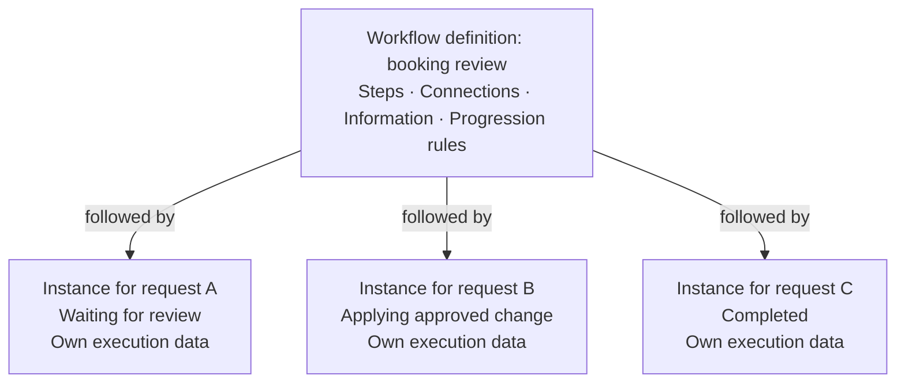
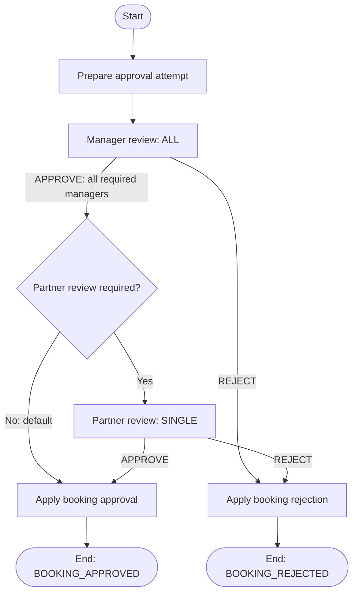
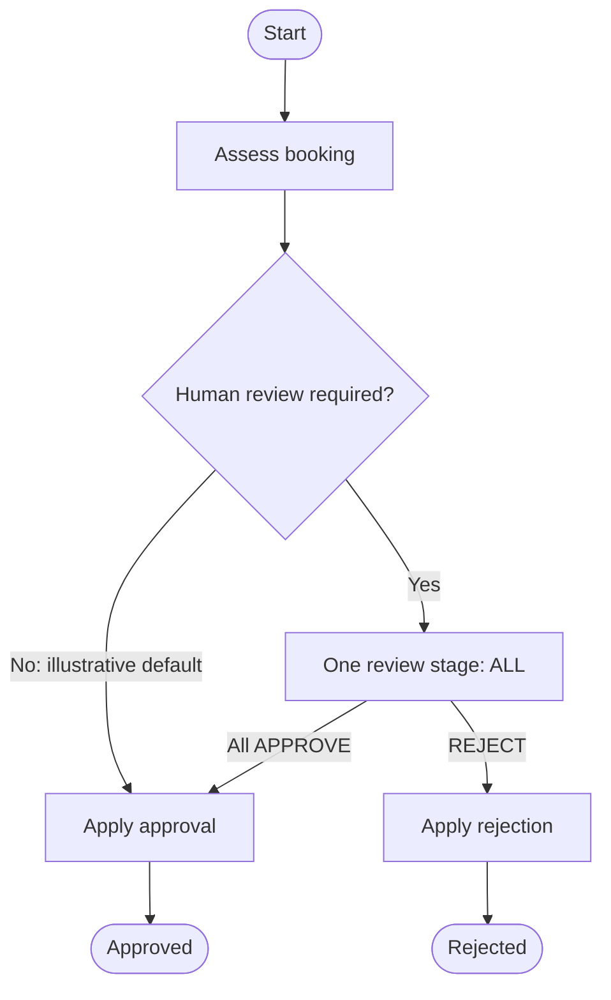

# Workflow Definition Language — JSON Design

## Standards research, conceptual model and proposed direction

| Document field | Value |
| --- | --- |
| Version | 0.2 |
| Date | 31 October 2026 |
| Status | Design draft for discussion; language contract not frozen |
| Project | Reusable workflow engine, initially embedded in APOLO |
| Current documentation path | `docs/architecture/workflow-definition-language-design.md` |
| Architecture baseline | Workflow engine design v0.9, 31 October 2026 |
| Later design input | Workflow engine database design v1.4, 25 October 2026 |
| Scope of this revision | Standards assessment, inherited constraints, conceptual semantics, candidate notation and decisions to resolve |
| Relationship to F003 | Design input for later specification work; creation of this document does not start or implement F003 |

**Agreed language direction (L01):** develop a compact JSON workflow language informed by BPMN, with explicit human-work contracts, registered host integrations and the existing single-position execution model. BPMN conformance and file interchange are outside the current commitment. The agreed validation approach uses JSON Schema for document structure and a separate engine semantic validator for graph, contract and host-capability checks (L02).

This revision gives the language design a stable discussion baseline. Exact field names, encodings, validation codes, limits and completion-policy details remain proposals unless identified as established decisions below.

## Contents

1. [Purpose and decision status](#1-purpose-and-decision-status)
2. [Existing design decisions](#2-existing-design-decisions)
3. [What the language should support](#3-what-the-language-should-support)
4. [Learning from existing workflow languages](#4-learning-from-existing-workflow-languages)
5. [BPMN correspondence and deliberate differences](#5-bpmn-correspondence-and-deliberate-differences)
6. [Language strategy and compatibility](#6-language-strategy-and-compatibility)
7. [Conceptual model](#7-conceptual-model)
8. [Execution and graph semantics](#8-execution-and-graph-semantics)
9. [Human activities and collective completion](#9-human-activities-and-collective-completion)
10. [Data ownership, variables and bindings](#10-data-ownership-variables-and-bindings)
11. [Expressions and host capabilities](#11-expressions-and-host-capabilities)
12. [Document representation and versioning](#12-document-representation-and-versioning)
13. [Validation and diagnostics](#13-validation-and-diagnostics)
14. [Compatibility, limits and evolution](#14-compatibility-limits-and-evolution)
15. [A complete booking workflow example](#15-a-complete-booking-workflow-example)
16. [Decision register and next design steps](#16-decision-register-and-next-design-steps)
17. [Design review scenarios](#17-design-review-scenarios)
18. [References and provenance](#18-references-and-provenance)
19. [Revision history](#19-revision-history)

## 1. Purpose and decision status

### 1.1 Context: describing a business process

Business processes often combine work performed by people, automated actions and decisions about what should happen next. For example, a booking request might require a review, follow a different path depending on the review outcome, and then apply an approved change. This is an illustration of the kind of process we need to describe; the actual APOLO approval steps and business rules require their own decisions.

The workflow engine is being developed to coordinate these processes, with APOLO as its first application. The application using the engine supplies the business data, permissions, screens and business operations. The engine's responsibility is to follow the defined process, track its progress and determine which work or route is allowed next.

A **workflow definition** describes a reusable process. It specifies:

- **Steps** — the human work, automated actions and decisions that make up the process.
- **Connections** — the possible routes between those steps.
- **Information** — the inputs and results needed by the steps.
- **Progression rules** — the conditions for completing work, choosing a route and ending the process.

A **workflow instance** is one execution of that definition, such as the process started for a particular request. Each instance tracks its own:

- **Progress** — where it is in the process and which work has been completed.
- **Execution data** — the values and results associated with that execution.

Several instances can follow the same definition while progressing independently. For example:



The diagram illustrates one shared process definition and three separate executions. The example step descriptions are illustrative.

The **workflow definition language** provides the shared vocabulary and rules for writing those definitions. It gives authors a way to describe a process and the engine a precise way to interpret that description. JSON is the selected format for representing it; the meaning of the process must also be defined.

### 1.2 Purpose of this document

This document develops the language design for review. Its purpose is to establish a shared understanding of what a workflow can express, what each concept means and how the engine should behave when following a definition. Those decisions will guide the detailed language specification, validation rules, engine implementation and future visual designer.

The review separates four concerns so that the process concepts and their behavior can be agreed before their exact fields and syntax are finalized:

| Concern | Question |
| --- | --- |
| Process model | What kinds of steps, human work, outcomes and connections can a workflow describe? |
| Execution semantics | What does the engine do when a step begins, work is completed, a route is chosen or an operation fails? |
| JSON representation | How are the agreed concepts written as fields, values and references in a definition? |
| Designer representation | How does a future visual editor preserve diagram layout and presentation while retaining the same process meaning? |

The following chapters introduce the existing architectural constraints, define the scope, compare relevant standards and develop the proposed language. Implementation technologies and persistence details appear where they constrain a specific design choice.

### 1.3 Status vocabulary

This is a design draft under review. The status of a statement determines whether it records an existing decision or introduces something we still need to resolve.

| Status | Meaning in this document |
| --- | --- |
| **Established** | An explicitly selected architecture or owner decision carried forward from the source documents. |
| **Current baseline** | Behavior already described by the architecture, retained for this discussion; exact specification may still be pending. |
| **Proposed** | A concrete recommendation or existing design proposal that still requires review. |
| **Open** | A choice whose alternatives or exact contract have not been settled. |
| **Deferred** | A capability or host-owned business policy outside the current language increment. |

A detailed proposal is still a proposal. The owner confirmed `SINGLE`, `ALL` and the fixed task list on 31 October 2026 (sections 9.2–9.3). Exact limits and API contracts still require specification. Neither generic engine policy selects APOLO's business approval rules. [A2, §1][A2]

### 1.4 Source precedence

Use the [architecture document](workflow-engine-design.md) as the general baseline. Apply the later [database document](Workflow_Engine_Database_Design_v1.md)'s **explicitly selected revisions** where they overlap, following the [project's source-precedence record](../design-sources.md). Do not treat all newer database proposals as approved, and do not let older illustrative JSON restore superseded decisions.

The owner-selected routing revision of 31 October 2026 supersedes the earlier requirement to reject overlapping conditions. Section 5.2 and constitution C08 now require ordered first-match routing. Other unresolved language choices remain proposals.

The research supplies comparisons and reasoning. It does not override selected project constraints. The source documents' illustrative schemas, interfaces and examples remain illustrative. [A1, introduction and §22][A1] [A2, introduction and §1][A2]

This file records a language design. Definition publication, database migrations, application code, a production validator and feature implementation artifacts belong to subsequent authorized work.

## 2. Existing design decisions

The workflow definition language builds on the engine architecture and database design developed so far. Those designs establish the kinds of work the engine supports, how it tracks a running process, and which responsibilities belong to the application using it. This section brings together the decisions and current design assumptions that guide the language review. The table records their source and status; detailed contracts and verification remain pending where indicated. Section 2.1 highlights changes from earlier designs so that older examples can be read in the right context.

| Area | Baseline to preserve | Source / status |
| --- | --- | --- |
| Deployment | Own embedded Spring/JPA library; APOLO is the first host. | Established — A1 §§2–4 |
| Definition authority | One canonical JSON definition; relational runtime state refers to its stable keys. | Current baseline — A1 §7.0 |
| Node types | `START`, `HUMAN_TASK`, `SERVICE_TASK`, `EXCLUSIVE_GATEWAY`, `END`. | Established — A1 §7.1, O6 |
| Process position | One active process position; multiple required tasks can exist inside its human activity. | Established — A1 §7.1; A2 §§1–2 |
| Definition lifetime | Published content is immutable; an instance pins one workflow version. | Established — A1 §10; A2 §2 |
| Human contract | Human node owns outcomes, inputs, structured result contract, comment requirements, guards and completion policy. | Selected revision — A2 §§1, 8.2 |
| Task type | Stable catalog code, without a separate task-type business version. | Selected revision — A2 §§1, 8 |
| Task evidence | Accepted task submissions are immutable and identified by exact task/activity. | Selected revision — A2 §§1, 11.1 |
| Variable types | Six scalar types plus `JSON` object/array values. | Selected revision — A2 §§1, 12 |
| Automated work | Registered synchronous service actions with declared, validated inputs/outputs. | Established — A1 O1 |
| Action placement | Workflow-driven business effects belong to service nodes; transitions route execution. | Established — A1 O1 |
| Transactions | Domain changes, workflow state, evidence, durable handoff and successful command receipt share the command transaction. | Established requirement — A1 §12; A2 §16 |
| Expressions | Restricted SpEL over explicitly supplied data; Boolean routing conditions. | Established direction — A1 §§5, 7; A2 §12.2 |
| Business ownership | APOLO owns booking membership, material changes, business authorization and aggregation policy. | Established — A1 §8; A2 §§1, 17 |

The table summarizes the two project design sources rather than observed implementation behavior. Transaction participation and other integration details still need their documented verification. [A1] [A2]

### 2.1 Changes from earlier designs

The language must not revive the older architecture example's one-task limitation, `taskTypeVersion`, separately versioned task outcomes, or scalar-only variable model. The database revision also selects numeric JPA locking instead of the older SQL Server `ROWVERSION` proposal; this affects command APIs, not portable definition syntax. [A2, introduction and §§1, 8, 12][A2]

Business correlation is an optional immutable pair supplied at instance creation. It does not establish booking membership or grant access. A workflow must therefore remain usable without an APOLO-specific identifier or mandatory business association. [A2, §§1, 9.1][A2]

## 3. What the language should support

The language should let us describe the processes needed for the first version of the workflow engine. This chapter explains what we want authors and developers to be able to do with it, then uses example processes to make those expectations concrete. It also identifies capabilities left for later work. Together, these provide a way to review whether the proposed language meets the current needs and stays within the agreed scope.

### 3.1 Design goals

When reviewing the language, we should assess it against the following goals:

- **Understand the process from its definition.** A reader should be able to follow the steps, see which require human work or automated actions, and understand how each possible outcome determines what happens next.
- **Describe a review involving several people.** A single review step should be able to collect submissions from multiple assigned reviewers. The process remains at that step until its completion rule is satisfied. The exact completion rules still require agreement.
- **Make information flow explicit.** A definition should identify each step's inputs and their sources, its outputs, and any workflow variables updated from those outputs.
- **Keep validation responsibilities clear.** The engine checks information against the workflow's declared contracts. The application checks permissions and business rules.
- **Keep existing processes consistent when definitions change.** A running instance should continue to follow the published version it started with. That version must remain understandable to the engine for the lifetime of the instance.
- **Connect to application functions through names.** The definition should refer to actions and other capabilities by names that the application registers with the engine. Application classes and database structures remain implementation details of those capabilities.
- **Use the same process description in the editor and engine.** The future visual designer should read and write the definition that the engine uses. A step or route must mean the same thing in both places.
- **Make validation errors actionable.** An error should identify the affected part of the definition and explain which rule it violates. For example, a route pointing to a missing step should identify that route and the missing destination.
- **Reject features the engine cannot execute.** Validation should report unsupported features before a definition is published, so authors can correct the process before it is used.

These goals guide the language design; they do not mean the corresponding engine or designer functionality is already implemented.

### 3.2 Representative use cases

| Scenario | Capability the language must express |
| --- | --- |
| One sandbox review | Entry, one required task, a declared outcome and terminal result. |
| Manager followed by partner | Sequential human activities with distinct contracts. |
| Conditional additional review | Read-only routing over declared facts or variables. |
| Multiple reviewers at one stage | One activity, fixed task obligations, individual submissions and one aggregate outcome. |
| Structured review of several items | Per-task JSON evidence followed by explicit host aggregation. |
| Apply an approved business change | Registered service action with declared bindings and transactional failure behavior. |
| Revisit a human node | New activation and new evidence, without changing the published graph. |

The scenarios exercise generic engine behavior. The exact APOLO approval chain, approver sources, resubmission flow and material-field rules remain host decisions. [A1, §22.2][A1] [A2, §17][A2]

**Successive stages and multiple reviewers are different structures.** Manager approval followed by partner approval requires separate `HUMAN_TASK` nodes. Putting both roles into one `ALL` activity creates their obligations together and does not enforce that order. Each stage can independently use `SINGLE` or `ALL`. Chapter 15 demonstrates manager review followed by conditional partner review, including what happens if entry to the second stage fails.

### 3.3 Initial exclusions

The current baseline excludes general parallel branches and joins, subprocesses, external workers, asynchronous service waiting, live definition migration, arbitrary scripts, candidate claiming, delegation, mutable task rosters, optional participants, `ANY`, `QUORUM` and weighted voting. A standalone business-decision engine remains deferred. [A1, §§1, 6, 22][A1] [A2, §1][A2]

Timers, reminders, escalation scheduling and task expiration also remain deferred. A due date is informational metadata in the current model. A future timeout field must not appear to promise scheduling until its execution and persistence semantics are specified. [A2, §1][A2]

## 4. Learning from existing workflow languages

Existing workflow languages offer useful ways to describe steps, decisions, information flow and execution rules. Reviewing them helps us choose concepts that fit our engine and understand the consequences of those choices. This chapter explains what each reference contributes to the proposed language, within the scope and design decisions established in the previous chapters. Using ideas from a standard does not by itself make our language compatible with that standard.

The references cover several related areas: workflow execution, business decisions, case management and JSON validation. Some are formal standards, some are community specifications, and Amazon States Language (ASL) is a published vendor language. The table gives an overview; the subsections explain the relevance of each reference to our design.

| Reference | Kind / reviewed baseline | Main relevance |
| --- | --- | --- |
| BPMN | OMG standard, 2.0.2 | Process concepts, activities, flow and interchange. |
| Amazon States Language | Published JSON state-machine language | Compact typed state definitions and explicit execution/data rules. |
| Open Workflow Specification | CNCF project; published DSL reference reviewed on 25 October 2026 | JSON/YAML workflow structure, versioning and data boundaries. |
| SCXML | W3C Recommendation, 1.0 | Precise state-machine processing steps. |
| DMN | OMG standard, formal version 1.6 | Business decisions independent of process routing. |
| CMMN | OMG standard, 1.1 | Case work with a different planning model. |
| JSON Schema | Draft 2020-12 | Structural validation and standard error-location concepts. |

Sources: [S1], [S3], [S5], [S6], [S7], [S8], [S9], [S10].

### 4.1 BPMN as the principal process reference

BPMN supplies a process model, execution semantics, graphical notation and XML interchange. Its published artifacts distinguish the semantic model from diagram interchange. The relevant concepts include user tasks, service tasks, sequence flows, gateways and events. [S1] [S2]

**Design consequence:** establish our model and execution rules before choosing property names. Familiar diagram shapes are useful, but each supported node still needs an exact behavioral contract.

### 4.2 Amazon States Language

ASL represents a state machine in JSON using named, typed states and an explicit entry state. Its specification distinguishes tasks, choices and terminal behavior, and defines data processing and failures. AWS Choice rules use ordered first matching selection. [S3] [S4]

**Design consequence:** use explicit identity, type-specific fields and clearly defined destinations. Keep human work visible as a first-class activity because assignment, submissions and collective completion are central to this engine.

AWS's documentation also distinguishes JSONPath and JSONata processing models. [S15] Our lesson is to keep the number and order of data transformations understandable. This does not reopen the selected SpEL implementation.

### 4.3 Open Workflow Specification

The Serverless Workflow project was renamed Open Workflow Specification; CNCF lists it at Sandbox maturity. [S5] [S17] Its DSL reference separates the language version from the workflow version and distinguishes input, output and context export. [S6]

**Design consequence:** explicitly separate language identity, workflow identity, command inputs, activity outputs and shared state updates. Borrowing these distinctions does not require adopting its integrations, runtime model or expression language.

The reviewed reference is a moving document. This design does not select a particular Open Workflow release as an implementation dependency.

### 4.4 SCXML

SCXML describes a macrostep as processing microsteps until a stable state is reached before the next external event is processed. [S7, §3.13 and glossary][S7]

**Design consequence:** explain one workflow command as bounded progression to a waiting or terminal position. SQL atomicity, idempotency and rollback remain our engine's requirements; they do not follow from the analogy.

### 4.5 DMN

DMN models business decisions and rules. The reviewed formal baseline is DMN 1.6. [S8] [S18]

**Design consequence:** a future business decision may produce a value such as `approvalLevel = PARTNER`; workflow routing then maps that value to a node or transition. A decision definition need not know workflow edge identifiers. The optional decision component remains deferred.

### 4.6 CMMN

CMMN addresses case models and work whose planning depends on evolving circumstances. [S9] [S19]

**Design consequence:** it is a useful scope boundary. Several reviewers do not by themselves require discretionary case planning. Our selected predefined graph and fixed activity roster fit the current approval requirements more directly.

### 4.7 JSON Schema

**AGREED — 31 October 2026 (L02):** workflow-language version 1 uses JSON Schema Draft 2020-12 for the workflow-document schema and embedded data schemas. JSON Schema provides constraints for object properties, alternatives, arrays and values, together with error-location concepts. Its `default` annotation does not initialize omitted application values during validation. [S10] [S11] [S12]

**Design consequence:** use separate layers for workflow-document structure, embedded data contracts, graph semantics and runtime checks. Initialization and default application must be defined by our language. Supporting a workflow schema does not imply unrestricted support for arbitrary embedded schemas.

## 5. BPMN correspondence and deliberate differences

### 5.1 Correspondence matrix

This is a conceptual mapping, not an interchange specification.

| Our concept | BPMN counterpart | Our intended restriction or difference |
| --- | --- | --- |
| `START` | None start event | One explicit entry for the initial language. |
| `HUMAN_TASK` | User task | Node owns our submission and completion contract. |
| `SERVICE_TASK` | Service task | Registered synchronous action in the host transaction. |
| `EXCLUSIVE_GATEWAY` | Exclusive gateway | Ordered first-match selection; route priority is explicit. |
| `END` | None end event | Completes our single-position instance. |
| Transition | Sequence flow | Explicit routing; no transition business actions. |
| Several tasks in one activity | Multi-instance activity | Fixed required obligations with our own completion policy. |
| Designer metadata | Diagram interchange | Visual data cannot affect execution. |

The BPMN names are grounded in the standard; the restrictions are our project design. [S2]

An approval screen corresponds to a user task. A BPMN manual task denotes work outside process-runtime management, which is a different concept. [S2, §10.3.4.1][S2]

### 5.2 Choosing a route in priority order

BPMN 2.0.2 specifies ordered evaluation for an exclusive gateway: the first true condition selects its flow and evaluation stops. If none matches, use the default; without a default, raise an exception. [S2, §13.4.2, Table 13.2][S2]

**AGREED — 31 October 2026:** adopt ordered first-match routing for `EXCLUSIVE_GATEWAY` nodes. This replaces the earlier architecture rule that rejected multiple matching conditions. Authors can express a sequence of choices as “if ... otherwise if ... otherwise,” with the first applicable choice taking priority. See [architecture section 7.3](workflow-engine-design.md#73-routing-alternatives) and [constitution C08](../constitution.md#c08--expressions-are-restricted-explicit-and-deterministic).

The engine follows these rules:

1. Evaluate non-default route conditions in the priority order declared by the definition.
2. Select the first condition that returns Boolean `true`, then stop evaluating conditions. Later conditions are not evaluated and must not be reported as false.
3. If every condition returns false, select the separately identified default route. At most one default is allowed, and it has no condition. Without a default, fail the command.
4. If an evaluated condition fails, including a missing required value, invalid conversion or non-Boolean result, fail the command. An error does not become a non-match and does not trigger the default.

Example, using illustrative numeric facts:

| Priority | Route | Condition | At amount 15,000 |
| --- | --- | --- | --- |
| 1 | Partner review | amount ≥ 10,000 | True; select this route. |
| 2 | Manager review | amount ≥ 5,000 | Not evaluated. |
| Default | Standard review | No condition | Not used. |

For an amount of 7,000, the first condition is false and the second selects Manager review. For an amount below 5,000, both conditions are false and Standard review is selected. The two conditions overlap for larger amounts; their declared order resolves that overlap.

**Authoring consequence:** order is part of the process meaning. Putting Manager review first would make Partner review unreachable in this example. The definition must preserve route order, and the future designer must display that priority and allow authors to change it deliberately. Moving diagram shapes or changing layout must not reorder routes. Section 12.1.16 defines the transition fields; relative order in the top-level transitions array determines each gateway's condition priority. Published definitions retain their order, and running instances keep their pinned version.

**Validation consequence:** validate every condition's syntax and permitted expression features before publication, including conditions that may be skipped during execution. Runtime evaluation stops at the first match or error. Authors may use mutually exclusive conditions where priority is unnecessary. Warnings for obvious unreachable routes are a possible authoring aid; complete detection of overlaps or unreachable conditions is not promised.

This decision adopts BPMN's route-selection behavior while retaining the project's strict expression-error and command-rollback policy. It does not introduce a decision-table engine, selectable matching policies or a BPMN interchange guarantee.

#### Why conditions belong to transitions

BPMN separates the connection between steps from the gateway's routing behavior. This gives us two useful design lessons:

1. **Keep each route and its condition together.** A sequence flow connects one step to the next, and its condition determines whether that route is eligible. The gateway determines how eligible routes are selected: one for exclusive routing, potentially several for inclusive routing. This separation is a useful modularity rationale for our design. [S2, §§8.4.13, 13.4.2][S2]
2. **BPMN can also route directly from an activity.** Conditional sequence flows may leave a task without a gateway; they carry a small diamond at the start of the connector. Several matching flows can be taken, so this is not equivalent to exclusive first-match routing. [S2, §8.4.13, Figure 8.33; §13.3.1][S2]

**Our initial scope is narrower:** conditional routing uses an explicit `EXCLUSIVE_GATEWAY`. START and SERVICE_TASK retain one unconditional outgoing transition, and HUMAN_TASK routes by its resolved outcome. Conditions on transitions do not authorize implicit branching from tasks or conditions on future parallel gateways; BPMN parallel gateways activate all outgoing routes without testing conditions. [S2, §10.6.4][S2] Future gateway types are discussed in section 12.1.9.

### 5.3 Multiple reviewers: analogy without adopting general parallelism

BPMN multi-instance activity semantics are a useful comparison. Camunda's documentation illustrates an enclosing multi-instance body, sequential or parallel instances, and completion conditions that may terminate outstanding work. [S13]

Our chosen model has one process position containing several required tasks. Those tasks do not independently traverse the workflow graph. Individual submissions resolve according to the human node's policy, which produces one activity outcome.

This distinction permits concurrent reviewers without requiring token joins, independently advancing branches or a general parallel execution model.

### 5.4 End behavior

An ordinary BPMN end event ends its execution path; completion also depends on other active paths. Camunda documents this explicitly. [S14]

Our instance has one process position, so reaching `END` can finish the instance once no active activity or open tasks remain. A result such as `REJECTED` is normal completion; technical command failure is separate. [A2, §§2, 9][A2]

### 5.5 Standard choice and engine choice

The project has chosen its own embedded engine. A process format and a runtime deployment model are separate design decisions. Using BPMN as a reference does not introduce a Camunda, Flowable or other third-party runtime dependency.

The design rationale for custom JSON is direct expression of our constrained execution and human-work model, together with control over language evolution. Avoid framing the choice as a limitation inherent in XML or BPMN.

## 6. Language strategy and compatibility

The project has selected its own JSON workflow language, drawing on familiar BPMN concepts without promising BPMN conformance or file interchange. This chapter explains that choice and distinguishes the agreed direction from additional compatibility features outside the current scope.

### 6.1 Alternatives

| Direction | Benefit | Responsibility / cost | Assessment |
| --- | --- | --- | --- |
| Canonical BPMN XML with a supported subset | Access to BPMN interchange and modeling conventions. | Restrict constructs, define host extensions and preserve execution behavior. | Reference alternative; conflicts with the selected canonical JSON direction. |
| Custom JSON representing a defined BPMN semantic subset | JSON with a deliberate semantic mapping. | Maintain both the JSON contract and a mapping that handles extensions and unsupported cases. | Useful if interchange becomes a real requirement. |
| Compact JSON informed by BPMN | Direct representation of the selected engine and human-task contracts. | Own semantics, validation, evolution and future adapters. | Agreed direction (L01). |

**AGREED — 31 October 2026 (L01):** use a compact JSON language informed by BPMN. It lets us describe the engine's supported steps, routing and human work directly while drawing on established process concepts. We own its specification, validation rules and compatibility between language versions. If exchange with BPMN tools becomes a requirement, we will need to define the supported mapping and evaluate its cost before promising that capability.

### 6.2 What compatibility with BPMN would mean

This section concerns the relationship between our language and BPMN tools or engines. The first distinction is between **using familiar concepts** and **being able to exchange or execute workflow definitions across systems**. These are different commitments.

The agreed direction is to use familiar process concepts where they fit: a task represents work, a decision chooses a route, and start and end points mark the boundaries of a process. Someone who knows BPMN should be able to recognize those ideas and then learn our supported behavior and limitations. This is what we mean by **conceptual familiarity**. It is a usability goal, not a claim of technical compatibility with BPMN.

We can also adopt particular BPMN behavior explicitly, as we have done with ordered first-match routing in section 5.2. That decision aligns one part of execution. It does not establish that an entire workflow can be transferred between our engine and a BPMN engine.

Technical compatibility would require us to make and fulfill one or more of these additional promises:

| Capability | What a user could expect | Current scope |
| --- | --- | --- |
| Exchange diagrams | Transfer supported shapes, connections and layout between our future designer and a BPMN modeling tool. A transferred diagram alone would not guarantee executable behavior. | Deferred. |
| Import and export workflow definitions | Translate supported steps, conditions, data bindings and other executable settings between our JSON format and BPMN, identifying anything that cannot be translated faithfully. | Deferred. |
| Run a workflow with equivalent behavior in another engine | Obtain equivalent routing, task behavior, business effects and failure handling after providing the required application integrations. | Not promised. |

**Deferred** means outside the current scope, with no commitment to implement it later. **Not promised** means we make no guarantee that another engine will execute a workflow equivalently, even if its diagram or definition can be transferred.

For the current design, authors should therefore expect a language with recognizable process concepts, its own JSON format and explicitly documented execution rules. A BPMN file cannot be assumed to work in our engine, and our JSON cannot be assumed to work in a BPMN tool. Any future conversion feature will need a defined supported subset and rules for handling differences in assignments, expressions, data, task completion, errors and transactions.

Compatibility between versions of our own language is a separate responsibility, addressed in chapters 12 and 14. The agreed relationship with BPMN does not remove the need to preserve the meaning of published definitions used by our engine.

## 7. Conceptual model

This chapter introduces the main concepts used to describe a workflow and track its execution. Some belong to the reusable definition, such as steps and routes; others are created when a process runs, such as instances, activities and tasks. The table explains each concept and how it is identified, so we can distinguish the process description from the work, data and results of a particular execution. These meanings provide a common vocabulary for the following chapters; exact JSON fields and structures are defined separately.

| Concept | Meaning | Identity / scope |
| --- | --- | --- |
| Workflow family | Stable named process definition family. | Workflow key. |
| Definition version | Immutable executable document after publication. | Workflow key + definition version. |
| Instance | One execution pinned to a definition version. | Runtime instance identity. |
| Node | Declared process position and its behavior. | Stable key within the definition. |
| Transition | Declared route between nodes. | Stable key, unique among transitions within the definition. |
| Activity | One activation of a human node. | Runtime activity identity; repeated visits create new identities. |
| Task / work item | One required obligation within an activity. | Runtime task identity and activity-local task key. |
| Task outcome | Action/result key submitted for a task. | Declared by the pinned human node. |
| Activity outcome | Result of applying the completion policy. | Selects the outgoing route. |
| Process result | Value recorded at a normal end node. | Defined by the end node. |
| Submission | Immutable accepted outcome, comment, scalar inputs and optional structured result. | Exact completed task/activity. |
| Variable | Mutable declared execution data. | Instance + variable key. |
| Host capability | Registered guard, action, resolver, permission or data-provider contract. | Logical identifier resolved by the host. |

This model preserves the source designs' separation between definition, runtime, evidence and host data. [A1, §§7–10][A1] [A2, §§2, 4, 8–12][A2]

### 7.1 Work status and decision outcome

A review can be finished even when the reviewer rejects the request. To describe that clearly, we need to record two different things:

- **Status answers “What stage is the work at?”** For example, a task can be open or completed. The term *lifecycle status* refers to these stages as work progresses.
- **Outcome answers “What was decided?”** For example, a reviewer may submit `APPROVE` or `REJECT`. The workflow uses the resolved review outcome to choose the next step.

`COMPLETED` therefore means the work is finished; it does not mean the request was approved. Likewise, `REJECT` is a valid business decision and does not indicate a technical execution failure.

Consider an illustrative workflow with one reviewer, where rejecting the request ends the process. After the rejection is accepted and the command commits, the records describe different parts of what happened:

| Concept | Example value | What it tells us |
| --- | --- | --- |
| Task status | `COMPLETED` | The reviewer has finished their assigned work. |
| Task outcome | `REJECT` | The reviewer chose to reject the request. |
| Activity status | `COMPLETED` | This review step has finished under its completion rule. |
| Activity outcome | `REJECT` | The resolved result of the review step is rejection. |
| Transition key | `REVIEW_REJECTED` | Identifies the route followed after that result. |
| Process result | `REJECTED` | Records the business result declared by the reached end node. |
| Instance status | `COMPLETED` | This execution reached a normal end. |

The task and activity outcomes coincide in this simple example. When a review has several tasks, completing one task may leave the activity waiting for others. The activity's completion rule determines when the review finishes and which outcome selects the next route. The process result is recorded when an end node is reached; it is not automatically copied from a task outcome.

The same distinction applies to cancellation. A workflow may reach a normal end whose business result is named `CANCELLED`; its instance has still completed normally. Administratively stopping an instance is a separate operation with its own lifecycle behavior. The name of a business result does not perform that operation. [A2, §§2, 9][A2]

### 7.2 A small conceptual workflow

This example brings the concepts from the previous sections together in a simple review process. A person reviews a request and either accepts or declines it. Acceptance leads to an automated operation before the process ends; declining ends the process immediately. The diagram describes the reusable workflow definition. Each request following it would have its own workflow instance. This is an illustrative sandbox process; APOLO's actual review steps and business rules remain separate decisions.


The process follows these steps:

1. **Start the review.** The instance enters the `Review` human step. Entering that step creates a review activity and its assigned task or tasks, according to the definition.
2. **Resolve the review.** Reviewers complete their assigned work. The human step defines the permitted task outcomes and the completion rule that determines the activity's outcome. The diagram shows the routes available once that outcome is resolved; it does not specify the number of reviewers or how their submissions are combined.
3. **Follow the selected route.** An activity outcome of `ACCEPT` leads to `Apply result`, where the engine invokes a business operation registered by the application. An outcome of `DECLINE` leads directly to the `DECLINED` end. The arrows select the next step; the automated operation belongs to the service step.
4. **Record the process result.** If `Apply result` succeeds, the instance reaches the `ACCEPTED` end. The other path reaches `DECLINED`. Both are normal completions, with different business results. If the automated operation fails, the command rolls back; the instance does not complete as accepted or switch to the declined route.

The labels serve different purposes: `ACCEPT` and `DECLINE` are review outcomes used to choose a route, while `ACCEPTED` and `DECLINED` are the process results declared by the end nodes. Their similar names help explain this example; the definition explicitly connects each outcome to its next step.

## 8. Execution and graph semantics

The workflow definition connects steps into a graph: nodes describe the work, and transitions describe the routes between them. This chapter explains how the engine follows that graph, when it waits for people, and how it handles completion and failures. It also identifies the structural rules and execution limits needed to keep a workflow valid and bounded.

### 8.1 How a command advances the workflow

A **command** is a request to change a workflow, such as starting an instance or completing a review task. One command may cause several steps to execute. For example, accepting the review in section 7.2 can complete the task, run `Apply result` and reach the `ACCEPTED` end as part of the same command.

**Current baseline:** when a command advances the process, the engine continues through automated actions and decisions until it reaches a human step that requires more input or an end node. It does not save an automatic step as a waiting position between commands. If one reviewer submits while other required work remains, the current review activity stays open and the accepted submission is saved without advancing to the next step. [A1, §§7.5, 12][A1] [A2, §§2, 9][A2]

Conceptually, the engine handles the request as follows:

1. **Identify the request and caller.** Validate the request format and obtain the caller's trusted identity and the command identifier used to recognize retries.
2. **Check whether this command already succeeded.** If the same identifier and request have a saved successful result, check the caller's permission to retrieve it and return it without repeating the work. Reusing the identifier with different input is an error. This check happens before rejecting an outdated instance version: a retry can legitimately refer to the version from before the original success.
3. **Check whether new work is allowed.** Use the instance's pinned definition, or the selected published version when starting an instance. For human-task completion, the engine executes the selected outcome's declared guards, including authorization only when configured, before accepting the submission. The engine checks assignment, the current workflow state and protection against conflicting updates. Validate submitted values and any business preconditions supplied by the application.
4. **Apply the requested change.** For example, accept a task submission and record its history. Determine whether the review activity can now finish under its completion rule or must keep waiting.
5. **Advance when appropriate.** If the command starts the process or resolves the current activity, follow the defined routes and run automatic steps within the execution limit. Create the next human activity and its tasks, or record normal process completion at an end node.
6. **Save the result together.** Commit the participating business changes, workflow state, submissions, history, durable event handoff and saved command result in the same transaction. These changes become accepted together; a failure rolls back the changes made by this command.

The resulting saved state therefore shows the instance waiting for human work or completed normally. Earlier commands' committed work remains intact if a later command fails. A failed permission check, business precondition or automated action does not by itself cancel the instance or mark it invalid. The exact command APIs and database operation order remain separate specification work.

### 8.2 Node responsibilities

| Node | Entry / execution | Exit |
| --- | --- | --- |
| `START` | Begin a new pinned execution after start checks and initialization. | Exactly one unconditional transition. |
| `HUMAN_TASK` | Resolve required obligations, validate them and create an activity with tasks. | Wait until its completion policy yields an activity outcome. |
| `SERVICE_TASK` | Build declared inputs, execute a registered action, validate outputs and apply permitted bindings. | Exactly one unconditional success transition. |
| `EXCLUSIVE_GATEWAY` | Read permitted data and evaluate routing conditions. | One selected transition or command failure. |
| `END` | Record normal completion and configured process result. | No outgoing transition. |

Synchronous service execution and explicit action placement are established. The agreed connection rules are listed in section 8.3. [A1, §§7.1, 10.4][A1]

### 8.3 Workflow graph validation rules

These rules define which workflow graphs are valid before publication. They reject broken connections, missing routes and paths with no way to finish. **AGREED — 31 October 2026 (L09):** validate the following rules alongside the key-identity rules agreed under L04.

| Area | Required rule |
| --- | --- |
| **Start** | Exactly one `START`, used as the entry point without `startNodeKey`. It has no incoming connections and exactly one unconditional outgoing route. |
| **Ends** | At least one `END`, with no outgoing connections. Multiple ends are allowed, for example accepted and declined. |
| **Connections** | Every transition must reference existing source and destination nodes. |
| **Keys** | Node keys are unique across the definition; transition keys are also unique across the definition, in a separate namespace (section 12.3). |
| **Service steps** | Exactly one unconditional success route. An action failure rolls back the command; it does not select another route. |
| **Human steps** | Exactly one outgoing route for every possible activity outcome. |
| **Decisions** | Each route has a condition or is the default. Evaluate conditions in declared order and take the first true result, with at most one separate unconditional default. An evaluated-condition error, or no match without a default, fails the command (section 5.2). |
| **Unreachable steps** | Every node must have a path from `START`. Disconnected draft work must be connected or removed before publication. |
| **Paths to completion** | Every node must have a possible path to an `END`. |
| **Loops** | Review loops that pass through a human step are allowed. Reject every cycle made entirely of automatic steps, including one inside a larger review loop (section 8.4). |

**A possible path to an end does not guarantee eventual completion.** These structural checks follow declared connections; they do not prove that runtime conditions will select an exit. For example, a review may return to a human step when changes are requested, provided it also has a route to an end. People could keep requesting changes, but the definition offers a way to finish. A closed review loop with no exit is rejected.

### 8.4 Loops and execution bounds

A return to a human node creates a new activity and new tasks; prior submissions remain historical evidence. A supported loop can therefore represent another review round without rewriting previous approvals. Its use for APOLO resubmission remains provisional. [A2, §2][A2] [A1, §22.2 O3][A1]

Automatic-cycle validation must detect a cycle made entirely of automatic nodes even when those nodes also belong to a larger graph region containing a human node. Merely finding one human node somewhere in that region is insufficient.

Retain a per-command progression limit as a second protection. L16 selects initial limits of 50 automatic steps per command and 100 required tasks per activity. Section 14.2 defines automatic-step counting; verification against representative workflows remains pending. [A1, §7.5][A1] [A2, §4.1][A2]

### 8.5 Failure, retry and atomicity

If the final task submission leads to a service action whose output is invalid, the enclosing command rolls back. That attempted submission is not accepted; earlier submissions committed by earlier commands remain. [A2, §§16–17][A2]

A business decline is a declared outcome. A conversion failure, failed action or conflicting mutation is a command failure. A default route is for valid non-matching conditions, not a technical fallback.

Successful-command replay follows the idempotency contract. There is no initial automatic retry of failed business commands. External delivery uses the host's durable handoff; SQL rollback cannot undo an email or remote HTTP effect already performed. [A1, §§12–13][A1]

## 9. Human activities and collective completion

### 9.1 What a human step defines

The **task type** tells the application what kind of task it must support and present to the user. The **human step in the workflow definition** sets the rules for completing that work. Two steps can use the same task type but allow different decisions or require different information. Each running instance uses the rules in its pinned definition version. [A2, §8][A2]

The language needs a way to describe:

- **Assignment:** how the application selects reviewers and what information it needs to do so.
- **Available decisions:** permitted outcomes, their labels and display order.
- **Checks before submission:** business preconditions and comments; action authorization belongs to APOLO.
- **Submitted information:** allowed simple fields and structured results, including what is required and how it is validated.
- **Completion:** when the step finishes and how reviewers' submissions determine its outcome.
- **Next steps:** a route for each possible outcome of the completed review.

**AGREED — 31 October 2026:** each human step has one explicit simple-input contract and one explicit structured-result contract, shared by every outcome. Outcome-specific input/result overrides are outside the initial contract. Guards and comment requirements belong to individual outcomes—for example, a required comment for `REJECT`. Routes remain in the transitions. Input descriptors and literal defaults are agreed in section 12.1.2. Additional field constraints are a deferred idea; section 12.1.12 defines resultContract.mode and embedded resultContract.schema.

#### Optional authorization through outcome guards

**AGREED — 31 October 2026:** use the same optional authorization-guard approach for starting a workflow and submitting a human-task outcome. Outcomes contain no dedicated `permission` field and there is no mandatory completion authorization hook. An outcome can declare a host guard such as `hasAuthorisation`; without an authorization guard on the selected outcome, the engine performs no additional business-permission check for that submission. Host endpoint/form access controls may still apply.

- **Declared authorization guards call APOLO.** The guard receives the trusted actor/task/outcome context and explicitly bound arguments, such as a fixed permission name and bookingId. APOLO applies its permission policy. A declared guard must be registered and must pass; denial or failure prevents completion without committed changes. The check does not apply business effects.
- **The engine enforces workflow rules.** It validates task/activity state, assignment, the declared outcome, comments, scalar inputs, structured results, guards and concurrency, then applies completion policy and routing. Authorization does not bypass those checks or implicitly grant an assignment override.
- **Form access is separate.** Any declared authorization guard runs at submission time, even if the form was accessible earlier. Actor identity comes from trusted server-side context, never ordinary request fields. Omission of a guard does not grant an assignment override or access to unrelated tasks.

For example: APPROVE declares hasAuthorisation with a literal BOOKING_REVIEW_APPROVE permission and a variable binding for bookingId. When Maria submits APPROVE, the engine checks the workflow rules and runs that guard before accepting her submission. If REJECT declares no authorization guard, the engine checks its workflow rules and any other declared guards without an additional permission lookup. Authorization does not automatically carry across outcomes.

Outcome guards run before submission acceptance or business effects. An authorized retry of an already successful command still follows receipt replay: the host reauthorizes access to the saved result without requiring the completed task to be open or rerunning completion guards. Exact guard API/context fields and replay access integration remain specification work. This decision supersedes the earlier mandatory completion hook; it does not remove host controls for querying records or replaying receipts.

### 9.2 Creating and assigning review tasks

When a human step begins, the engine asks one application-provided assignment function to identify the required tasks and who should perform each one. The following rules are **AGREED — 31 October 2026**: [A2, §4.1][A2]

- **Create the full task list together.** The review activity and all its tasks are created in the same transaction. An empty list, too many tasks, a missing assignee or duplicate task keys causes the command to fail. The agreed initial maximum is 100 tasks per activity; `SINGLE` still requires exactly one.
- **Identify the work separately from the person.** Each task has a key identifying its required contribution within the review. Two tasks may be assigned to the same person unless the application requires different reviewers. The application also enforces any rule against reviewing one's own request.
- **Keep required work when reassigning it.** A task may be reassigned with an audit record, while retaining its identity. While the review remains active, individual required tasks cannot be waived, deleted or cancelled to remove their contribution from the review.

This is the agreed **fixed task list** model: the required tasks are established when the review starts. Tasks cannot be added or removed while it remains active; their assignees can change through controlled reassignment. [A2, §§2, 4.1][A2]

**AGREED for assignment:** use a named registered resolver with explicitly declared, validated input bindings. Under `SINGLE`, it must return exactly one directly assigned task; under `ALL`, one to 100. Invalid cardinality, missing assignees or duplicate task keys fail the command entering the step. Section 12.1.10 defines the assignment fields and variable bindings; the exact resolver API and returned field names remain specification work.

### 9.3 Initial completion policies

**AGREED — 31 October 2026:** the initial policies are `SINGLE` and `ALL`. Both use the fixed task list from section 9.2. Submission, activity completion and resulting progression share the command transaction; a failure rolls them back together. [A2, §§1, 4.2][A2]

| Policy | Cardinality | Behavior | Status |
| --- | --- | --- | --- |
| `SINGLE` | Exactly one required task. | Its permitted task outcome becomes the activity outcome. | Agreed. |
| `ALL` | One or more required tasks, within a specified bound. | Every task must contribute one configured outcome; any other permitted outcome is immediately decisive. | Agreed. |

The `ALL` policy waits for every required task to return one designated outcome, unless someone submits another permitted outcome that ends the review early:

1. **Choose the outcome to collect.** The human step declares a *contribution outcome*, such as `APPROVE`. Every required task must submit this outcome for the review to finish with it.
2. **Record each contribution.** Complete that reviewer's task and save the submission. While other required tasks remain open, the review stays at the same step.
3. **Finish when everyone has contributed.** The last required contribution completes the review with the designated outcome, such as `APPROVE`.
4. **End early for another permitted outcome.** If a reviewer submits an outcome such as `REJECT` or `REQUEST_CHANGES`, complete the review with that outcome immediately. Cancel remaining open tasks and record why. Previously completed tasks keep their submissions; cancelled tasks do not count as votes or decisions.
5. **Follow the outcome's route.** The definition must provide exactly one route for each possible review outcome.

For example, with three required tasks collecting `APPROVE`, the first two approvals are saved while the review waits. The third approval completes it. A permitted `REJECT` instead ends the review early and cancels any tasks still open.

**Four consequences of this decision:**

1. **The required work stays fixed.** Reassignment preserves task identity and is audited. Adding, removing or waiving tasks cannot change the required contributions during an active review. `ALL` counts tasks, so one person may hold several unless the application forbids it.
2. **Early completion stops collection.** Cancelled tasks cannot accept new submissions. Earlier completed tasks keep their evidence; cancelled tasks are not votes. To collect everyone's feedback regardless of their answers, use a common contribution outcome such as `REVIEW_SUBMITTED` and interpret the results afterward (section 9.4).
3. **Competing decisions have no automatic priority.** Under concurrency protection, the first decisive command that successfully commits determines the result. A competing command receives a state or concurrency error and cannot overwrite it. A rolled-back command has not settled the review; neither click order nor outcome display order gives `REJECT` priority over `REQUEST_CHANGES`. An identical authorized retry of a previously successful command still returns its recorded result.
4. **Completion and progression succeed together.** The final or decisive submission, activity outcome, sibling cancellations, routing and synchronous downstream work share one transaction. If downstream work fails, all changes from that command roll back, including the submission and cancellations. Contributions committed by earlier commands remain. [A2, §4.2][A2]

### 9.4 “All submitted” and “all approved” mean different things

Under the `ALL` policy, the outcome being collected determines what completion means. Consider two required reviewers:

- **Collect `APPROVE`:** both must submit `APPROVE` for the review to finish as approved. A permitted `REJECT` outcome ends the review early with rejection.
- **Collect `REVIEW_SUBMITTED`:** both must submit their reviews, but their answers may differ. One could approve an item and the other reject it in their structured results. The review step still finishes with `REVIEW_SUBMITTED` because both submissions were received.

In the second example, a later application service interprets the answers and determines the business result. A value such as `"decision": "REJECT"` inside a submission is data; it does not automatically become the task or activity outcome. **Everyone has responded** therefore does not necessarily mean **everyone has approved**. [A2, §§11.1, 12][A2]

### 9.5 Keeping submissions and reviewed information consistent

An accepted submission records what a reviewer sent and cannot be edited afterward. Workflow variables hold execution data that may change through permitted operations. These serve different purposes:

- **Preserve each submission.** Later work must not rewrite an accepted reviewer's answer. Under the current proposal, submitting a task while the review still awaits others cannot change the shared review material or workflow variables. [A2, §§4.3, 12][A2]
- **Keep the reviewed material fixed.** APOLO identifies and protects the information covered by an approval attempt, including across successive review steps. A material change requires APOLO's invalidation and fresh-review rules. Unrelated variables may still change through authorized operations; the engine gives no special meaning to a variable named, for example, `approvalBaseline`. [A2, §§12, 17][A2]
- **Read the exact submissions needed.** Later steps must identify the relevant task or review activity, especially when a workflow revisits the same step. They must also be able to read the final accepted submission within the same transaction. [A2, §11.1][A2]

APOLO owns the choice of protected information and how it is stored and enforced. The exact edit restrictions and checks remain integration specification work.

## 10. Data ownership, variables and bindings

A workflow uses information from several sources: the application, the request that starts it, reviewers and automated actions. This chapter explains who controls that information, which values may change, and how steps receive inputs or store outputs. A **binding** is an explicit connection between a source value and where it will be used, such as a step input or a workflow variable.

### 10.1 Data ownership, variables and bindings

The following categories distinguish information by its role. They help us decide where a value comes from, who may change it and whether it represents current state or a saved submission.

| Category | What it contains | Who controls it and how it is used |
| --- | --- | --- |
| **Business data** | Application records, such as bookings and their associations. | The application owns the authoritative records and updates them through its business rules and services. |
| **Start input** | Values supplied when starting a workflow instance. | The engine validates the declared inputs and uses explicit mappings to initialize the workflow. |
| **Facts** | Values the application supplies for a check or decision, such as a booking amount. | Expressions can read them but cannot change them. The design must identify whether they come from a saved snapshot or current application data. |
| **Workflow variables** | Values retained by an instance for use in later steps. | The workflow declares them. Updates require authorized, version-checked commands or declared mappings. They may hold simple values or structured JSON. |
| **Simple task inputs** | Individual values submitted when completing a task, such as a confirmation flag. | The human step defines the allowed fields and validation rules. Accepted values belong to that task's submission. |
| **Structured task result** | A JSON submission containing detailed answers, such as decisions for several reviewed items. | The human step defines its requirements. Once accepted, it cannot be edited or automatically merged into workflow variables. |
| **Caller identity and execution context** | Trusted information about who is acting and the context of the command. | The application supplies it through trusted mechanisms; callers cannot establish their identity or permissions by setting ordinary workflow fields. |

The key distinction is that **variables describe changeable execution state**, while **accepted task submissions record what was submitted**. Both may contain JSON, but they have different rules. Task results use structured objects with nested objects and arrays; section 10.3 records their agreed presence rules. Exact schema features, encoding and size limits still require specification. [A2, §§1, 8.2, 11.1, 12][A2]

### 10.2 Variable types and exact values

**AGREED — 31 October 2026 (L10):** use the following JSON representations for declared workflow values. These rules do not change document fields such as integer `schemaVersion`, or automatically determine how numbers inside structured JSON are represented.

| Type | JSON representation | Example |
| --- | --- | --- |
| `STRING` | String; preserve its contents without automatic trimming. | `"Finance review"` |
| `LONG` | Signed integer encoded as a string, preserving precision across Java/TypeScript. | `"1234567890123456789"` |
| `DECIMAL` | Exact decimal encoded as a string. | `"1250.75"` |
| `BOOLEAN` | Only JSON `true` or `false`; no conversion from strings or numbers. | `true` |
| `DATE` | ISO 8601 calendar date in `YYYY-MM-DD` form, without a time or timezone. | `"2026-10-31"` |
| `DATETIME` | ISO 8601 date and time, separated by `T`, with seconds and a required `Z` or explicit `±HH:MM` offset. | `"2026-10-31T14:30:00Z"` |
| `JSON` | Object or array validated against its declared contract. | `{"approved": true}` |

The six scalar types plus JSON are established. Database sizes and SQL storage choices must be reconciled with the final language, rather than silently treated as the entire wire contract. [A1, §5.2][A1] [A2, §12][A2]

Preserve numeric precision through authoring, transfer, interpretation and evidence. Reject invalid or lossy conversions rather than rounding, trimming or guessing. Calendar dates must be valid. A `DATETIME` without an offset, such as `"2026-10-31T14:30:00"`, is rejected. `"2026-10-31T14:30:00Z"` and `"2026-10-31T16:30:00+02:00"` represent the same instant.

**Number spelling and capacity — AGREED, 31 October 2026 (L10)**

Both `LONG` and `DECIMAL` use JSON strings containing ordinary ASCII digits and an optional leading minus sign. Reject leading `+`, whitespace, digit separators, scientific notation and leading zeros except the single zero before a decimal point or zero itself. `LONG` has no decimal point; `DECIMAL` may have one, with at least one digit on each side. Reject negative zero, including `"-0"` and `"-0.00"`.

| Type | Capacity | Examples |
| --- | --- | --- |
| `LONG` | Signed 64-bit integer: `-9223372036854775808` through `9223372036854775807`, inclusive. | Accept `"0"`, `"12"`, `"-12"`; reject `"0012"`, `"+12"`, `"12.0"` and out-of-range values. |
| `DECIMAL` | Exactly representable in `DECIMAL(38,10)`: up to 28 digits before the decimal point and up to 10 fractional places needed to represent the value. | Accept `"12"`, `"12.50"`, `"0.5"`; reject `".5"`, `"12."`, `"1e3"` and values requiring rounding or overflowing the range. |

Trailing fractional zeros are allowed and do not change the numeric value: `"12.5"` and `"12.50"` are numerically equal. Extra fractional places are accepted only when they are trailing zeros removable without loss: `"0.12345678900"` is accepted, while `"0.12345678901"` is rejected. This numeric equivalence does not authorize rewriting strings in workflow documents or changing the content-comparison rules in section 12.4. Display formatting belongs to the application.

Validate exact representability before persistence; never rely on database conversion to round a value. Apply these declared-type rules consistently to inputs, defaults, variable writes and service outputs. Business-specific requirements, such as amounts having only two decimal places, remain application rules. Encoded-value size budgets remain under L16, including strings with many trailing zeros. The selected capacities align with the existing `BIGINT` and `DECIMAL(38,10)` storage. [A2, §5.1][A2]

**Timestamp precision and offsets — AGREED, 31 October 2026 (L10)**

Declared `DATETIME` values identify an instant. Accept the required explicit offset, then normalize the typed value to UTC for storage and return it with `Z`. For example, `"2026-10-31T16:30:00+02:00"` becomes `"2026-10-31T14:30:00Z"`. The typed value does not retain the supplied offset; any business timezone needed by a booking belongs to the application.

Support exact values needing at most seven fractional-second digits, matching `DATETIMEOFFSET(7)`. Accept extra fractional digits only when they are trailing zeros removable without loss. Reject values requiring rounding before persistence; return values without unnecessary trailing fractional zeros, omitting the fractional part when it is zero.

| Supplied value | Result |
| --- | --- |
| `"2026-10-31T14:30:00Z"` | Accepted; no fractional seconds are required. |
| `"2026-10-31T14:30:00.1234567Z"` | Accepted at the supported precision. |
| `"2026-10-31T14:30:00.123456700Z"` | Accepted; returned as `"2026-10-31T14:30:00.1234567Z"`. |
| `"2026-10-31T14:30:00.123456789Z"` | Rejected; exact storage would require more than seven fractional digits. |
| `"2026-10-31T14:30:00"` | Rejected; an offset is required. |

Apply this normalization when interpreting declared `DATETIME` values, not by rewriting published workflow documents or arbitrary JSON strings. `DATE` remains a calendar date with no timezone conversion. JSON Schema's `date-time` format retains its standard meaning under section 10.5; it does not implicitly apply this typed-value normalization. [A2, §5.1][A2]

**Numbers inside structured JSON — AGREED, 31 October 2026 (L10)**

Keep standard JSON and JSON Schema numeric meanings: `integer` accepts whole numeric values, including `1.0`; `number` accepts whole or fractional numeric values. Exponent notation is permitted for JSON numbers, subject to the capacity below. Numeric strings remain strings; do not automatically convert them to numbers or apply the declared LONG/DECIMAL spelling rules to JSON number tokens. [JSON Schema numeric types](https://json-schema.org/understanding-json-schema/reference/numeric).

Parse, validate and serialize nested numbers exactly, without an intermediate floating-point conversion that could round them. Every number in structured start inputs, task results and JSON variables must be exactly representable within `DECIMAL(38,10)`: up to 28 integer digits and 10 necessary fractional places. Extra trailing fractional zeros are harmless; reject overflow or required rounding. This is an engine validation limit, not a change to JSON storage or a requirement to declare these fields as workflow DECIMAL variables. Numeric schema checks must also use exact comparisons.

For example:

```json
{
  "reviewCount": 3,
  "score": 4.5,
  "amount": "1250.75"
}
```

The schema can declare `reviewCount` as `integer`, `score` as `number` and `amount` as `string`. APOLO validates the amount's decimal spelling and business rules; standard numeric constraints such as `minimum` do not validate a string. Use strings for large identifiers and precision-sensitive amounts exchanged with ordinary JavaScript clients. The engine preserves the number it receives but cannot recover digits lost by a client before submission. [JSON interoperability](https://www.rfc-editor.org/rfc/rfc8259#section-6).

**Remaining work:** encode and verify these agreed value rules in the validation and codec contracts. Initialization/read behavior is selected in section 10.3; aggregate size and processing limits remain under L16. L11's schema feature selection is complete.

### 10.3 Missing, null and empty values

The variable model distinguishes uninitialized/absent, typed explicit null, and a populated value. Within JSON, missing properties, nested nulls, empty objects and empty arrays are also distinct. A JSON variable's non-null root is an object or array; primitive values use scalar types. [A2, §12][A2]

**AGREED — 31 October 2026 (L10):**

- **Missing means no value was supplied or initialized.** It is distinct from explicit null, an empty string, an empty object or an empty array.
- **Null must be permitted explicitly.** Required and nullable are separate: a required input must be present, but may contain null if its declaration permits it.
- **Defaults apply only to missing values at the declared initialization boundary.** Use a valid typed default; never replace explicit null, invalid input or failed evaluation with a default. JSON Schema's `default` annotation does not perform application initialization. [S12]

For simple start/task inputs, section 12.1.2 permits literal defaults only on optional fields; a default cannot satisfy a required input. Variable initialization uses independent mappings in section 12.1.6, without a separate variable-default field. The agreed output-binding rules in section 10.4 continue to apply.

**Reading and clearing variables — AGREED, 31 October 2026 (L10):**

- **An evaluated read of an uninitialized variable fails the command.** Do not substitute zero, null or false, or select a gateway's default route because of the error. This applies even when the variable is nullable. Explicitly assigned null remains a value handled by normal SpEL null semantics; null-safe operations do not hide an uninitialized-variable error.
- **Only reads actually evaluated trigger this rule.** A branch skipped through short-circuit evaluation, or a route condition skipped after an earlier match, does not read its variables. This does not waive definition validation.
- **Do not clear an assigned variable back to uninitialized.** Permitted writes may replace it with a valid value or explicitly set it to null when nullable. There is no initial operation to remove its value entirely. This concerns whole workflow variables; replacing a JSON value may still omit optional properties allowed by its schema.

For example, a condition comparing `riskScore` with 50 fails if no step has assigned `riskScore`. A condition checking it for null also fails in that state. After assignment, a null check returns true for explicit null and false for a non-null value.

**Initialization order — AGREED, 31 October 2026 (L10):** for a new start command:

1. Check supplied inputs, required fields and applicable limits.
2. Apply declared defaults to missing optional inputs, producing validated, defaulted inputs.
3. Run start guards using those inputs.
4. Prepare and validate all initialization mappings, then apply them together.
5. Enter the workflow.

An omitted optional input without a default leaves its mapped variable uninitialized. All effects remain in the same transaction; a later failure rolls them back. For task completion, validate inputs/defaults, result and comment requirements before outcome guards, as specified in section 12.1.14. This ordering describes data validation and initialization; the detailed command protocol must also enforce the existing trusted-context, concurrency and idempotency rules.

**L10 behavior decisions complete — 31 October 2026:** sections 10.2–10.3 select value representations, exactness, presence, defaults and initialization/read behavior. Formal codec, accessor and command contracts and implementation verification remain work; resource limits and diagnostics remain under L16 and L15.

**Task-result presence — AGREED, 31 October 2026:** `FORBIDDEN` requires the result field to be absent. `OPTIONAL` allows absence, but a supplied result must be a valid object. `REQUIRED` requires a valid object. Explicit top-level null is rejected in all three cases; nested nulls follow the result schema. These rules apply to task results, not to nullable workflow variables.

### 10.4 Connecting inputs and updating variables

A **binding** declares where a value comes from and where it goes. For example, an automated action could receive a workflow variable as input and store its result in another variable. The engine checks that required values exist, types are valid and the operation is permitted.

Variable updates replace the whole value. The initial contract does not support merging objects, patching nested fields or appending to arrays. A submitted field does not update a variable just because their names match. [A2, §§12.1–12.3][A2]

**AGREED — 31 October 2026:** bindings follow these four rules:

1. **Declare the sources available at each stage.** Start inputs initialize workflow variables. Initial automated-action input bindings read declared workflow variables. Output mappings may read the action's returned outputs and permitted workflow variables. Every source must be explicitly identified and access must be authorized. Direct bindings to application facts or earlier task/activity submissions are deferred future extensions, superseding their earlier inclusion in the initial binding scope.
2. **Distinguish missing outputs from null values.** A missing required output fails the command and rolls it back. A missing optional output skips its associated variable update, preserving the existing value or leaving the variable uninitialized. An explicit `null` sets the destination to null only if its declaration permits it. Later use must still satisfy the variable's presence and type requirements.
3. **Allow only one mapping per destination in an action's outputs.** Two output mappings targeting the same workflow variable are rejected during definition validation before publication. Different steps may update that variable at different times.
4. **Keep mappings independent of each other's updates.** All output mappings read the same workflow-variable values from before those mappings are applied, alongside the action's returned outputs. Prepare and validate all updates before applying them together. A mapping cannot read a value written by another mapping in the same group; reordering mappings must not change the result.

For example, if `riskLevel` currently holds `LOW` and an action returns `HIGH`, an output mapping reading the variable sees `LOW`. A mapping needing the new value must read the action's output directly.

The action sequence is therefore: validate inputs, run the registered action synchronously, validate its outputs, then prepare and apply the permitted variable updates. The action and updates remain within the same transaction; a failure rolls back the command.

Start initialization and write boundaries are agreed in section 12.1.6; service-node fields and variable/action-output mappings are agreed in section 12.1.8. Direct fact and prior-submission bindings are future ideas, not prerequisites for the initial language. Remaining selected binding details, limits and diagnostic codes still require specification. These decisions do not claim an implemented binding mechanism.

### 10.5 Validating JSON structure

**JSON Schema is an existing standard for describing and validating JSON data.** It is separate from JSON itself; we are adopting its validation vocabulary, not inventing it. [Official introduction](https://json-schema.org/learn/getting-started-step-by-step)

**JSON writes the data.** It provides objects, arrays, strings, numbers, booleans and `null`. For example:

```json
{
  "bookingId": "B-42",
  "approved": true
}
```

JSON syntax alone does not say that `bookingId` is mandatory or that `approved` must be a boolean. `{"approved": "maybe"}` is also valid JSON, even though it is unsuitable for this submission.

**A schema describes the data we accept.** For this example, we want an object containing a required text `bookingId` and a required boolean `approved`, with no extra fields. JSON Schema gives us a standard way to express those rules, in a document that is itself written in JSON:

```json
{
  "type": "object",
  "properties": {
    "bookingId": {"type": "string"},
    "approved": {"type": "boolean"}
  },
  "required": ["bookingId", "approved"],
  "additionalProperties": false
}
```

Here, `type`, `properties`, `required` and `additionalProperties` have meanings defined by JSON Schema. The field names `bookingId` and `approved` are chosen by our application.

**A validator checks the data against the schema.** It is a library that reads both and reports whether the data satisfies the rules. The first submission passes. `{"approved": "maybe"}` fails because `bookingId` is missing and `"maybe"` is not a boolean. This checks the shape of the submission; application checks still decide whether the caller may approve that booking.

| Concept | Who defines it? | Purpose |
| --- | --- | --- |
| **JSON** | Existing data format. | Writes the documents and values. |
| **JSON Schema** | Existing validation standard. | Expresses rules for acceptable data. |
| **Our workflow language** | This project. | Defines steps, routes, tasks and execution behavior. |

In our project, schemas have four uses:

| Schema | What it checks |
| --- | --- |
| **Workflow document schema** | The structure of the definition itself, including its node, transition and variable declarations. Separate validation checks whether those declarations form a valid executable workflow. |
| **Variable data schema** | The structure allowed inside a particular JSON variable. |
| **Structured start-input schema** | The object or array accepted for a declared JSON start input. |
| **Task result schema** | The structure a reviewer may submit as a task's detailed result. |

A **schema profile** is the documented set of JSON Schema features and limits our engine supports. The L11 profile applies to variable, structured start-input and task-result schemas. References, discussed in example 8 below, are an additional JSON Schema feature for reusing rules; basic schemas such as the one above do not need them. Defining the profile lets authors know which rules they can use and keeps validation predictable and bounded.

**AGREED for L11 — 31 October 2026:** embed variable and task-result schemas in the workflow definition and allow local references within each embedded schema. Support declared properties, required fields, types, explicit nullability, fixed values, enumerations, nested objects/arrays and length/count/value bounds. Use closed objects, conditional requirements and alternatives with a required identifying field. Reject external and circular references; defer arbitrary text patterns. Only explicitly documented format checks are supported, and unsupported validation features are rejected before publication. Numeric limits in the examples below are illustrative.

The supported schema profile belongs to the workflow-language version. Publishing a definition freezes its embedded schemas, and engine upgrades must preserve that language version's validation behavior or explicitly reject the unsupported version. Incompatible profile changes require a new language version.

**Dialect selected under L02:** language version 1 fixes Draft 2020-12 for all embedded data schemas as well as the workflow-document schema. Authors cannot select a different dialect for an individual schema; conflicting dialect declarations must be rejected. This does not enable every Draft 2020-12 feature: embedded schemas still use the restricted L11 profile, while the engine-owned workflow-document schema validates our selected document structure. There is no additional workflow-level dialect-selection field. The complete feature selection and restrictions are recorded below.

**Selected basic keywords — AGREED, 31 October 2026**

These keywords use their Draft 2020-12 meanings within the embedded-data profile:

| Purpose | Supported keywords | Meaning |
| --- | --- | --- |
| Value type | `type` | Select string, boolean, integer, number, object or array, with explicit nullability as below. |
| Allowed values | `enum`, `const` | Restrict a value to listed choices or one fixed value. |
| Object fields | `properties`, `required`, `additionalProperties` | Declare fields, require selected ones and reject undeclared fields. |
| Object size | `minProperties`, `maxProperties` | Bound the number of supplied properties. |
| Text length | `minLength`, `maxLength` | Bound string length. |
| Array contents | `items` | Apply one schema to every array element. |
| Array size | `minItems`, `maxItems` | Bound the number of elements. |
| Numeric bounds | `minimum`, `maximum`, `exclusiveMinimum`, `exclusiveMaximum` | Apply inclusive or exclusive bounds to JSON numbers. |

The following restrictions apply:

- **Object-form schemas — AGREED, 31 October 2026:** write embedded schemas and their subschemas as JSON objects. Reject standalone Boolean schemas `true` (accept anything) and `false` (reject everything), with the explicit exception of the required `additionalProperties: false` used to close object shapes. This restricts schema notation, not Boolean data values; `"type": "boolean"` remains supported. [Boolean schemas](https://json-schema.org/understanding-json-schema/basics).
- **Closed objects:** complete object shapes explicitly declare `additionalProperties: false`. Arbitrary property names are unsupported; the selected conditional/alternative rules below preserve this closure.
- **Uniform arrays:** `items` uses one schema for every element. Position-specific tuple schemas are outside the initial profile.
- **Explicit nullability:** when `type` is used, select one concrete type, optionally combined with `null`, such as `"type": ["string", "null"]`. Other mixed-type unions are outside this basic form; alternative object structures follow the identified `oneOf` rules. The enclosing contract's root rules still apply: task results cannot be null, while root nullability for JSON variables/start inputs is controlled by their descriptors.
- **Numeric values retain standard meaning:** numeric bounds apply to actual JSON numbers, not numeric strings such as `"125.50"`. Apply the exact numeric handling and nested-number capacity selected in section 10.2; do not reinterpret a standard numeric keyword as a string comparison or silently coerce data.

These are features of embedded structured-data schemas. They do not reintroduce the deferred scalar input-field `constraints` object. Schema bounds cannot relax engine limits. The selected conditions, alternatives, references, formats and metadata rules are specified below. [Object rules](https://json-schema.org/understanding-json-schema/reference/object), [array rules](https://json-schema.org/understanding-json-schema/reference/array), [types](https://json-schema.org/understanding-json-schema/reference/type), [numeric bounds](https://json-schema.org/understanding-json-schema/reference/numeric).

**1. Objects — which fields may appear?**

A review item could require `bookingId` and `decision`, with an optional `comment`:

```json
{"bookingId": "B-42", "decision": "APPROVE"}
```

This item is accepted. An item containing only `bookingId` is rejected because the decision is missing. Under the agreed closed-object rule, an undeclared field such as `override` is also rejected. Authors must declare accepted fields and explicitly reject additional ones in the schema, using `additionalProperties: false` for a simple object. This is our policy, not JSON Schema's default. The selected composition rules below preserve the same closed-object behavior. [Object validation](https://json-schema.org/understanding-json-schema/reference/object)

Objects with arbitrary property names, such as `{"teamA": true, "teamB": false}`, are outside the initial profile unless those names are declared. A list of objects with explicit `team` and `value` fields is an alternative representation.

**2. Values — what type may each field contain?**

For a boolean `confirmed` field, `true` is accepted and `"true"` is rejected. Explicit `null` is accepted only if permitted; absence is accepted only if the field is optional. An optional comment can therefore allow absence while rejecting null. Validate the supplied type without guessing or converting it, following L10. Numbers nested in JSON follow the exactness rules and capacity selected in section 10.2.

**3. Allowed choices — which values are valid?**

A `decision` field could allow only `APPROVE`, `REJECT` and `REQUEST_CHANGES`. It accepts `"APPROVE"` but rejects `"MAYBE"` and `"approve"`. A fixed-value rule could require `"kind": "BOOKING_REVIEW"` in every submission. Enumerations and single fixed values are supported.

**4. Collections — can a submission contain several items?**

```json
{
  "items": [
    {"bookingId": "B-42", "decision": "APPROVE"},
    {"bookingId": "B-43", "decision": "REJECT"}
  ]
}
```

Each array item follows the same declared schema; an item missing `bookingId` is rejected. Nested objects and arrays are supported. The application still checks whether these bookings belong to the review and whether any required booking was omitted. A rejection inside this result is data, not an automatic activity outcome (section 9.4).

**5. Limits — how much data is allowed?**

For illustration, a schema could allow a comment of at most 2,000 characters, between 1 and 100 review items, or a percentage between 0 and 100. Engine-wide limits also bound total payload size and nesting depth, as selected under L16 in section 14.2. Numeric bounds must respect the value's representation: standard numeric schema keywords apply to JSON numbers, while declared string-encoded decimals use L10's selected rules.

**6. Conditional requirements and alternative structures**

**AGREED — conditional requirements:** support `if`/`then`/`else` rules that depend on submitted data. For example, a review item can require a nonempty `reason` when its `decision` is `REJECT`:

| Submitted item | Validation result for this example |
| --- | --- |
| `{"bookingId":"B-42","decision":"APPROVE"}` | Accepted; no reason is required. |
| `{"bookingId":"B-42","decision":"REJECT","reason":"Unavailable"}` | Accepted. |
| `{"bookingId":"B-42","decision":"REJECT"}` | Rejected: reason missing. |
| `{"bookingId":"B-42","decision":"REJECT","reason":""}` | Rejected: reason empty. |

These conditions validate data; they do not select workflow routes or call application code. Permissions and live booking availability remain application checks. JSON Schema defines the conditional keywords. [Conditional validation](https://json-schema.org/understanding-json-schema/reference/conditionals)

**Selected conditional rules — AGREED, 31 October 2026:** declare all possible fields in the surrounding closed object. `then` and optional `else` may require those fields or tighten their validation, but do not introduce fields absent from that object's properties. Reject `then` or `else` without `if`. For a condition testing a field's value, include that field in the condition's required list so absence does not count as a match. These are profile restrictions around standard conditional semantics.

For example, this complete schema keeps reason optional for approval and requires a nonempty reason for rejection:

```json
{
  "type": "object",
  "properties": {
    "decision": { "type": "string", "enum": ["APPROVE", "REJECT"] },
    "reason": { "type": "string", "minLength": 1 }
  },
  "required": ["decision"],
  "additionalProperties": false,
  "if": {
    "properties": { "decision": { "const": "REJECT" } },
    "required": ["decision"]
  },
  "then": { "required": ["reason"] }
}
```

**AGREED — alternative structures:** support `oneOf` alternatives when each shape requires the same identifying field with a distinct fixed value. Authors choose that field's name; `kind` is an example, not a reserved workflow field. A review item could take either of these shapes:

```json
{"kind": "BOOKING", "bookingId": "B-42", "decision": "APPROVE"}
```

```json
{"kind": "RESOURCE", "resourceId": "R-7", "decision": "APPROVE"}
```

The `BOOKING` shape requires `bookingId`; the `RESOURCE` shape requires `resourceId`. Missing or unknown `kind` values are rejected. Each alternative fixes its own distinct `kind` value, so a submitted item cannot satisfy both. In a closed-object schema, fields belonging only to the other shape are also rejected. JSON Schema's `oneOf` requires exactly one alternative to validate; alternatives without this explicit identifying-field arrangement are outside the initial selected support. [Schema alternatives](https://json-schema.org/understanding-json-schema/reference/combining)

**Selected alternative rules — AGREED, 31 October 2026:** every `oneOf` alternative defines a complete closed object, requiring the same identifying field with its own distinct string `const`. Declare that field as a string in each alternative. Each alternative declares all its accepted properties and its own additionalProperties false; do not rely on merging properties from another alternative or an outer closed object. Exactly one alternative must validate. General `allOf`, `anyOf` and `not` combinations remain outside the initial embedded profile and are rejected before publication.

Both features remain inside the single node-wide result schema; they do not introduce separate result contracts per task outcome. Outcome-level comment requirements remain part of the human-step contract. Section 14.2 selects the schema size/depth, alternative-count and evaluation-work limits; formal enforcement and diagnostic contracts remain specification work.

**Deferred in the initial profile:** recursive schemas and arbitrary text patterns. A group containing further groups must use a fixed-depth structure or another representation. A rule such as “booking code starts with `BK-` followed by six digits” is checked by the application.

**7. Unsupported features — when does an author learn about them?**

If an author supplies a schema containing `pattern`, reject the definition before publication and identify the unsupported feature. Do not publish it while silently omitting that check. This handling applies to unsupported validation features generally.

**Selected formats — AGREED, 31 October 2026:** initially support only the following standard `format` values for strings, enforced as validation checks rather than annotation-only hints:

| Format | Example | Meaning |
| --- | --- | --- |
| `date` | `"2026-10-31"` | A valid calendar date under the standard full-date format. |
| `date-time` | `"2026-10-31T14:30:00+02:00"` | An RFC 3339 timestamp with an offset. |
| `uuid` | `"550e8400-e29b-41d4-a716-446655440000"` | A standard plain UUID string. |

These formats retain Draft 2020-12 meanings; date/date-time use RFC 3339 and do not accept every ISO 8601 representation. Reject unsupported format names before publication, including email, URL-related and custom formats in the initial profile. Remaining precision, normalization and edge-case alignment with L10 must be specified without silently changing a standard format's meaning. [Format specification](https://json-schema.org/draft/2020-12/json-schema-validation#section-7.3)

**Selected metadata — AGREED, 31 October 2026:** support `title` and `description` as strings, and `examples` as an array of illustrative values. These annotations do not change validation or populate data. As an additional authoring rule, every example must satisfy the schema where it appears; invalid examples reject the definition before publication. Metadata and examples remain within schema/definition budgets under L16. [Schema annotations](https://json-schema.org/understanding-json-schema/reference/annotations)

```json
{
  "type": "string",
  "format": "date",
  "title": "Requested booking date",
  "description": "The calendar date requested for the booking.",
  "examples": ["2026-10-31"]
}
```

Embedded-schema `default`, `readOnly`, `writeOnly` and `deprecated` are unsupported initially and must be rejected. Workflow input-descriptor defaults and explicit variable-write rules remain separate; annotations must not imply those behaviors. This schema metadata is distinct from the workflow's `designer` metadata namespace.

Allow optional `$schema` only at the embedded schema's root, with exactly `https://json-schema.org/draft/2020-12/schema`. Omission uses the dialect fixed by workflow-language version 1. Reject another value or a nested declaration. The declaration cannot expand the L11 profile and does not authorize fetching a remote schema. No extra workflow-level `$schema` field is introduced. [Dialect declarations](https://json-schema.org/understanding-json-schema/reference/schema)

**8. References and freezing — how do we reuse rules safely?**

An embedded schema can define a reusable fragment in `$defs` and refer to it locally. This illustrative schema applies the same review-item rules to every element:

```json
{
  "type": "object",
  "properties": {
    "items": {
      "type": "array",
      "items": {"$ref": "#/$defs/reviewItem"}
    }
  },
  "required": ["items"],
  "additionalProperties": false,
  "$defs": {
    "reviewItem": {
      "type": "object",
      "properties": {
        "bookingId": {"type": "string"},
        "decision": {"enum": ["APPROVE", "REJECT", "REQUEST_CHANGES"]}
      },
      "required": ["bookingId", "decision"],
      "additionalProperties": false
    }
  }
}
```

Local references reuse a fragment without copying its rules. [Schema references](https://json-schema.org/understanding-json-schema/structuring)

**Selected reference rules — AGREED, 31 October 2026:** reusable fragments live in the root `$defs` of each embedded schema. `$ref` targets a named entry there, using a local JSON Pointer such as `#/$defs/reviewItem`; the pointer is relative to that embedded schema, not the surrounding workflow document. References to other schema locations or embedded contracts are outside the initial profile. A fragment may refer to another root definition, but every target must exist and the reference graph must be acyclic. Reusing one fragment from several places is allowed and is not itself a cycle.

Reject missing targets, direct or indirect reference cycles and external references, even if the application could resolve them without a network request. Commands must not fetch arbitrary remote schemas. These local-reference restrictions preserve standard $ref evaluation; they do not implement property merging or inheritance. Standard JSON Pointer escaping applies to definition names; exact malformed-reference diagnostics remain under L15.

**Rules beside a reference — AGREED, 31 October 2026:** supported keywords may appear alongside `$ref`, using standard Draft 2020-12 semantics. The referenced schema and any sibling validation rules all apply; sibling rules cannot replace or relax the referenced rules. For example, if `reason` defines a nonempty string, this reference also limits it to 500 characters:

```json
{
  "$ref": "#/$defs/reason",
  "maxLength": 500
}
```

The example is a fragment within an embedded schema whose root `$defs` contains `reason`. This does not allow adding properties to a referenced closed object; supported annotations remain descriptive. [Reference semantics](https://json-schema.org/draft/2020-12/json-schema-core#section-8.2.3.1).

Publishing a workflow freezes its embedded schemas. Changing them requires a new workflow-definition version; existing instances retain the old rules. This avoids a separate schema registry initially, but updating a schema used by several workflows requires updating and publishing each affected workflow.

**L11 feature selection complete — 31 October 2026:** the supported keywords, schema forms, composition, references, formats and metadata are agreed. Remaining work is to encode this profile in the formal validation contract and verify its implementation. Section 14.2 selects schema size and evaluation-work limits, including per-validation and shared-operation counters. Exhausting a work limit is a distinct failure, not a schema mismatch. Validation diagnostics belong to L15, and selected numeric/timestamp rules to L10. L02 fixes Draft 2020-12 for language version 1. These related implementation requirements do not reopen L11's feature selection.

A valid structure does not prove a valid business decision. A result may contain a correctly formatted booking identifier while referring to a booking the reviewer cannot access. The application must still check business membership, permissions and business rules. [A2, §§11.1–12.3][A2]

## 11. Expressions and host capabilities

Workflows use **expressions** to evaluate conditions over supplied data and **host capabilities** to access functions provided by the application, such as selecting reviewers or performing business operations. This chapter explains the rules for evaluating expressions and the responsibilities of those registered application functions.

### 11.1 Rules for evaluating expressions

**AGREED — 31 October 2026 (L12):** use standard Spring Expression Language (SpEL) syntax and semantics within a controlled, read-only evaluation context. Retain SpEL's documented operators, precedence, short-circuit evaluation and null handling within that context; do not invent a second expression language or impose a blanket ban on ordinary arithmetic. The engine supplies declared application facts under `#facts` and permitted workflow variables under `#vars`.

The engine's integration contract must specify:

- **Typed inputs:** decode values according to their declared workflow types before evaluation. For example, a string-encoded `DECIMAL` becomes a typed decimal value. Reconcile numeric operations and conversions with the agreed exactness rules; adopting SpEL does not permit silent precision loss.
- **Read-only access:** expose only declared, validated data, including permitted bounded JSON field/index access. Expressions cannot access application services, Spring beans or arbitrary Java objects, construct objects, invoke general methods, mutate data or fetch hidden time/random values. Existing restrictions on unrestricted regular expressions and collection traversal remain; they do not redefine the meaning of supported operators.
- **Results and errors:** routing conditions must produce a Boolean. Missing required inputs or paths and evaluation errors fail the command. An evaluated read of an uninitialized workflow variable fails even when nullable; skipped reads do not fail. Explicitly assigned null retains SpEL's null semantics, and null-safe operations cannot hide an uninitialized-variable error (section 10.3). The accessor implementation must enforce these rules while retaining the selected operator semantics.
- **Resource bounds:** enforce L16's selected source-length, parsed-size/depth, navigation, evaluation-count and per-evaluation operation limits (section 14.2). Configure enforcement locally for the workflow engine; dependency support and counter behavior must be verified before execution support is claimed.

Expression rules belong to the workflow-language version. Every definition using that version follows the same centrally enforced rules; authors cannot select a different policy or relax its restrictions. There is no separate `expressionPolicy` field. An engine upgrade must preserve the declared language version's behavior or explicitly reject it, including across Spring/SpEL upgrades. Incompatible behavior changes require a new language version. Context configuration, typed input conversion, necessary syntax/access restrictions, enforcement of the selected limits and diagnostics remain specification and verification work. See [architecture section 5.3](workflow-engine-design.md#53-restricted-spel-execution-rules) and [source precedence](../design-sources.md).

Spring's restricted evaluation context is a starting point; the engine must still explicitly enforce its supported operations and data access. [S20]

### 11.2 Condition results and errors

An expression returning `false` is a normal result. An expression that cannot be evaluated is an error. The engine must keep these cases distinct so that invalid data or a failed check cannot accidentally select a route.

| Situation | What the engine does |
| --- | --- |
| A condition returns `true` | Select its route and stop evaluating later conditions. Declared priority resolves overlaps. |
| A condition returns `false` | Continue to the next condition in priority order. |
| Every condition returns `false` | Take the declared default route, or fail the command if none exists. |
| An application guard rejects the operation | Block the requested operation and reveal only reasons the caller may see. This is not a routing result. |
| A condition has invalid syntax | Reject the definition during validation before publication, even if that condition might be skipped at runtime. |
| An evaluated condition has missing required data, an invalid conversion, a non-Boolean result or another evaluation error | Fail the command. Do not try later routes or use the default. |

Conditions after a match are **not evaluated**, rather than treated as false. Within each condition, SpEL's standard operator, short-circuit and null semantics apply to the validated data exposed by the context. This does not turn missing required data into an allowed null or waive the Boolean-result requirement. Expressions only read explicitly supplied data: they cannot call application services, access Spring beans, create objects, change state or fetch time, random values or other hidden data. Context enforcement and compatibility with the workflow's typed-value rules still require specification and verification. [A1, §5][A1]

### 11.3 Functions provided by the application

A **registered capability** is a function or type of support the application makes available to the engine under a known name. For example, a workflow can refer to an action named `applyBookingChange`; the application provides its implementation. The name identifies an approved integration, not arbitrary code to execute.

| Capability | What the application provides |
| --- | --- |
| **Authorization** | Checks whether the authenticated caller may perform the operation and access the business data. |
| **Guard** | Checks business preconditions without changing business data. |
| **Assignment resolver** | Determines the required review tasks and their assignees. |
| **Data provider** | Supplies the declared facts needed by the workflow. |
| **Service action** | Performs a business operation and returns its declared results. |
| **Durable event recorder** | Records work for later delivery in the same transaction as the workflow change. |
| **Task-type support** | Presents and handles tasks identified by a stable task-type code, following the rules of each workflow step. |

Before publication, the engine checks that the required capabilities are registered and compatible. During human-task execution, the host checks current action authorization and the engine validates actual data and workflow rules. Capability names are resolved through the application's registrations; they are not Java class names or Spring bean expressions. [A1, §§7.2, 8.3, 10.4][A1]

**AGREED — 31 October 2026 (L17):** a capability identifier represents a stable contract. Use new identifiers for breaking changes rather than introducing a separate capability-version system initially.

| Rule | Example / consequence |
| --- | --- |
| Keep the contract stable under its identifier. | Preserve accepted inputs, promised outputs and documented behavior for workflows using that identifier. |
| Keep the identifier for compatible implementation changes. | Refactoring or improving performance is allowed when the contract remains compatible. |
| Give breaking changes a new identifier. | An action accepting a list of booking IDs can use `applyBookingChanges`, while `applyBookingChange` continues accepting a single booking ID. These names are illustrative. |
| Check compatibility before publication and application upgrades. | Detect missing registrations and incompatible declared input/output contracts for required capabilities. |
| Retain old capabilities while needed. | Support published definitions that may still start and existing instances, including steps they have not reached yet. |
| Fail explicitly when required support is unavailable. | Do not substitute another capability, skip a required step or report the failed command as successful. Command changes roll back together. |

These rules apply to actions, assignment resolvers, guards and data providers. They do not freeze current user permissions or business data: authorization and business checks still use the applicable runtime context. The task-type catalog retains its existing stable-code model, and the pinned human node still owns its submission contract.

Declared-contract comparison can detect structural incompatibilities, but cannot prove that application code preserves the promised behavior. The application must verify behavioral compatibility during upgrades; a contract fingerprint cannot replace that responsibility. Exact registration metadata, compatibility-check mechanisms and diagnostics remain specification work.

## 12. Document representation and versioning

This chapter describes how a workflow definition could be organized as a JSON document. It separates the information that defines the process from metadata used to manage publication and execution, and explains the different versions used to identify the language, the workflow and changes to editable content.

### 12.1 Top-level document structure

The **envelope** is the top-level structure of the definition: it identifies the workflow and its language version, then contains the process declarations, nodes and routes. **AGREED — 31 October 2026 (L18):** use the fields below and the nested structures in sections 12.1.1–12.1.16. L18 settles field names, placement and permitted combinations; formal schemas, host APIs and remaining validation/encoding details are separate specification work (section 16.3).

| Field | JSON type | Required? | Purpose |
| --- | --- | --- | --- |
| `schemaVersion` | Integer | Yes | Workflow-language version, including expression rules; initially `1`. |
| `key` | String | Yes | Stable workflow family identity, using L04's case-sensitive key rules and L16's 100-character limit. |
| `version` | Integer | Yes | Positive workflow-definition version; allocation rules remain specification work. |
| `name` | String | Yes | Nonempty human-readable workflow name. |
| `description` | String | No | Additional explanation for authors and administrators. |
| `startPolicy` | Object | Yes | Groups accepted start inputs, initialization and optional guards, including authorization when declared. |
| `variables` | Array | Yes | Declares workflow variables using section 12.1.5; use `[]` when none exist. |
| `nodes` | Array | Yes | Declares the steps, including exactly one `START`; common fields and START/END structures are defined in section 12.1.7. |
| `transitions` | Array | Yes | Declares connections and routing rules. |
| `designer` | Object | No | Non-executable diagram information governed by L13. |

Omit unused optional top-level fields rather than supplying `null`. Required fields must be present with the declared type; use explicit empty collections where meaningful, such as `variables: []`. Node and transition arrays must still satisfy the agreed graph rules. Reject unknown top-level fields; L13's bounded allowance for unknown metadata applies inside `designer`.

Keep `startPolicy` at the top level because it describes the requirements for starting the whole workflow. The `START` node identifies where graph execution begins and does not duplicate those requirements. There is no separate `startNodeKey`.

Database IDs, publication lifecycle, validation timestamps, draft revisions and lock tokens belong to administration/runtime envelopes. Portable document identity must agree with indexed persistence metadata. [A2, §§6–7][A2]

The existing F001 schema includes an `expression_policy` column from the earlier design. It does not imply a field in the revised JSON contract. Its removal or transitional handling requires a separate persistence specification and forward migration; this document does not change the applied schema or existing feature evidence.

#### 12.1.1 Start requirements: `startPolicy`

**AGREED — 31 October 2026 (L18):** the required top-level `startPolicy` object groups the checks and input contract for starting the workflow.

| Field | JSON type | Required? | Meaning |
| --- | --- | --- | --- |
| `inputContract` | Array | Yes | Declares scalar and structured start-input fields using sections 12.1.2 and 12.1.4. An explicit `[]` accepts no additional input fields. |
| `guards` | Array | No | Registered application checks that must all pass in array order. Omission means `[]`; entries follow section 12.1.3. |
| `initialize` | Object | No | Maps declared variable names to start-input or literal sources (section 12.1.6). Omission means no initialization mappings. |

```json
{
  "inputContract": [],
  "guards": []
}
```

**AGREED — 31 October 2026:** remove `startPolicy.permission`. Start authorization is optional and expressed through a declared host guard, such as `hasAuthorisation`; there is no mandatory start authorization hook. If no authorization guard is declared, the engine performs no start authorization check. Host endpoint access controls may still apply. Input validation, declared guards and other workflow rules remain enforced.

Reject unknown fields, including the removed `permission` field, and explicit null values for these fields. Invalid input or any declared guard's rejection or failure fails the start command; no partial instance or tasks may be committed. Guards can read validated start inputs after defaults or fixed literal arguments as described in section 12.1.3. Human-task outcomes use the same optional authorization-guard approach (section 9.1).

#### 12.1.2 Simple input-field descriptors

An input-field descriptor declares one value the caller may supply. **AGREED — 31 October 2026 (L18):** use the same basic descriptor structure for simple start inputs and simple human-task inputs.

| Field | JSON type | Required? | Meaning |
| --- | --- | --- | --- |
| `key` | String | Yes | Input name, unique within this input contract. |
| `type` | String | Yes | One of `STRING`, `LONG`, `DECIMAL`, `BOOLEAN`, `DATE` or `DATETIME`, using L10 representations. |
| `required` | Boolean | Yes | Whether the caller must supply the field. |
| `nullable` | Boolean | Yes | Whether explicit null is accepted as its value. |
| `label` | String | No | Human-readable name for presentation. |
| `description` | String | No | Explanation or guidance for the input. |
| `default` | Literal in the declared type's JSON representation, or permitted null | No | Value used only when an optional input is omitted. |

For example, an input contract can declare:

```json
[
  {
    "key": "bookingId",
    "type": "STRING",
    "required": true,
    "nullable": false,
    "label": "Booking"
  },
  {
    "key": "urgent",
    "type": "BOOLEAN",
    "required": false,
    "nullable": false
  }
]
```

The caller supplies values, not descriptors:

```json
{
  "bookingId": "B-42",
  "urgent": true
}
```

This example rejects a missing `bookingId`, explicit null for either field, a non-Boolean `urgent` such as `"yes"`, and undeclared inputs. Omitting `urgent` is valid: without a declared default, it remains absent rather than automatically becoming false. Required and nullable are independent; a required nullable field must be supplied but may contain null.

Input declarations do not automatically create or update workflow variables; explicit bindings remain required. Structured task submissions use the separate `resultContract`. Start inputs additionally support the JSON descriptor extension in section 12.1.4; simple human-task inputs remain scalar.

**AGREED — input defaults:** an optional `default` provides a literal value when the caller omits an optional input. For example:

```json
{
  "key": "urgent",
  "type": "BOOLEAN",
  "required": false,
  "nullable": false,
  "default": false
}
```

- Apply the default only when the input is absent. In this example, omission yields false, but an explicitly supplied true stays true.
- Never replace explicit null or invalid input with the default. Null remains valid only when `nullable` is true.
- Allow defaults only when `required` is false. Reject a descriptor combining `required: true` with `default` during definition validation; required inputs must be supplied by the caller.
- Validate the default against its declared type, nullability and applicable engine limits before publication. Use L10 representations, including strings for LONG and DECIMAL. An explicit `default: null` is allowed only for a nullable optional field; omitting `default` means no default exists.
- Accept literal defaults only. Do not evaluate expressions or resolve references to other fields. A STRING default containing expression-like text remains literal text.

**Future idea — additional field constraints (DEFERRED):** a later extension could add a `constraints` object with `enum`, STRING length bounds and inclusive LONG/DECIMAL bounds. These fields are not part of the initial descriptor contract and must not be accepted or silently ignored now. A future proposal must define typed comparison, reject contradictory or inapplicable constraints, validate defaults against them and prevent relaxing engine limits. For now, type, presence, nullability and engine limits still apply; additional business checks belong to the application. This deferral does not remove the agreed JSON Schema features for structured variables and task results.

#### 12.1.3 Start guard entries and inputs

**AGREED — 31 October 2026 (L18):** each entry in `startPolicy.guards` is an object identifying one registered application check and its explicit input bindings.

| Field | JSON type | Required? | Meaning |
| --- | --- | --- | --- |
| `guard` | String | Yes | Nonempty identifier of the registered check. |
| `inputs` | Object | Yes | Maps guard argument names to declared value sources; use `{}` when no declared arguments are needed. |

For a start input named `bookingId`, the guards array can contain:

```json
[
  {
    "guard": "bookingNotUnderReview",
    "inputs": {
      "bookingId": {
        "source": "startInput",
        "key": "bookingId"
      }
    }
  }
]
```

This passes the validated start input `bookingId` as the registered guard's `bookingId` argument. A `startInput` binding requires a `key` identifying a declared start input and reads its value after defaults. A `literal` binding instead requires a `value`, validated against the registered guard argument type and bounds; it has no key or expression. This allows fixed configuration such as a permission identifier without taking it from caller input. Trusted caller and execution context are supplied separately by the application; input bindings cannot establish the caller's identity or grant permissions.

For an optional start authorization check, declare an ordinary host guard:

```json
{
  "guard": "hasAuthorisation",
  "inputs": {
    "permission": { "source": "literal", "value": "BOOKING_REQUEST_START" },
    "bookingId": { "source": "startInput", "key": "bookingId" }
  }
}
```

APOLO implements this example guard by checking the trusted actor against the requested permission and booking. The permission is fixed in the definition, not selected by the caller. `hasAuthorisation` is a registered capability name, not a special engine keyword; its inputs belong to the host contract. Authors include it where authorization is needed and can put it before eligibility guards. Omitting it means no engine-side start authorization check; once declared, it must pass like every other guard. Literal bindings are also supported for outcome guards (section 12.1.14); they do not automatically extend assignment or service inputs.

- Run guards in array order and continue only when the current guard passes.
- Stop on the first rejection or technical failure and fail the start command. Later guards do not run, and no partial start changes may commit.
- Guards check conditions without changing business or workflow state.
- Reject unknown guards, invalid bindings and incompatible argument types before publication where detectable; validate actual argument values at runtime.
- A missing required argument is an error, not an implicit null. Supplied null must satisfy the guard's declared input contract.

These are the selected bindings for start guards, not a blanket source restriction on other capability bindings. Section 10.3 selects the data-validation and initialization order. Exact guard-registration contracts, diagnostics and the detailed start-command protocol still require specification.

#### 12.1.4 Structured start inputs

**AGREED — 31 October 2026 (L18):** keep one `startPolicy.inputContract` array containing both scalar and structured descriptors. A structured start input uses the fields from section 12.1.2 with `type: "JSON"` and a required embedded `schema` object. This extension applies only to start inputs; human-task structured submissions remain in `resultContract`.

For example, a descriptor can accept a nonempty list of booking identifiers:

```json
{
  "key": "bookingIds",
  "type": "JSON",
  "required": true,
  "nullable": false,
  "schema": {
    "type": "array",
    "items": {"type": "string"},
    "minItems": 1
  }
}
```

The caller supplies the structured value directly:

```json
{
  "bookingIds": ["B-42", "B-43"]
}
```

- **Use the agreed schema profile.** The embedded schema follows L11, including closed objects, local noncircular references, supported features and limits. Every non-null root must be an object or array. The descriptor's `schema` is required for JSON start inputs and is not an additional constraint field for scalar descriptors.
- **Keep presence and nullability separate.** `required` and `nullable` govern absence and top-level null. Validate non-null values against the embedded schema; schema content cannot override the descriptor's presence/null rules. Nested nulls follow the schema.
- **Reuse literal-default rules.** An optional JSON input may declare a literal object/array default that passes its schema and applicable limits, or null when nullable. Defaults apply only to absent optional inputs and never replace invalid input or explicit null.
- **Bind the whole value.** Start guards can receive a structured input using the existing `source: "startInput"` and `key` binding. Nested-path bindings are outside this initial start-guard structure.
- **Keep business checks in the application.** A structurally valid booking list does not establish review membership, record existence or authorization.
- **Require explicit persistence bindings.** Accepting a structured input does not automatically create or update a workflow variable. Initialization bindings must declare that transfer.

Structured start inputs remain subject to depth, collection and combined request/evidence budgets. Section 14.2 selects 64 KiB UTF-16 per structured start-input value, 128 KiB UTF-16 for the complete input object after defaults and 256 KiB UTF-8 for the complete runtime command request. The detailed start-command envelope remains specification work and must fit all applicable budgets. The scalar `constraints` extension remains deferred.

#### 12.1.5 Variable declarations

Variables retain execution data for later steps. **AGREED — 31 October 2026 (L18):** each entry in the top-level `variables` array declares the values a variable may contain.

| Field | JSON type | Required? | Meaning |
| --- | --- | --- | --- |
| `key` | String | Yes | Variable name, unique among variable declarations in the definition. |
| `type` | String | Yes | One of `STRING`, `LONG`, `DECIMAL`, `BOOLEAN`, `DATE`, `DATETIME` or `JSON`, using L10 representations. |
| `nullable` | Boolean | Yes | Whether an explicitly stored null is allowed. |
| `schema` | Object | For `JSON` only | Required embedded validation schema following L11; not allowed for scalar declarations. |
| `label` | String | No | Human-readable name. |
| `description` | String | No | Explanation of the variable's purpose. |

For example, the `variables` array can contain:

```json
[
  {
    "key": "urgent",
    "type": "BOOLEAN",
    "nullable": false
  },
  {
    "key": "bookingIds",
    "type": "JSON",
    "nullable": false,
    "schema": {
      "type": "array",
      "items": {"type": "string"},
      "minItems": 1
    }
  }
]
```

Variables do not have a `required` field. That input-descriptor field specifies what a caller must submit; a workflow variable may instead be populated later by an automated step. A non-nullable variable can remain uninitialized until assigned, but cannot be assigned null. An evaluated read of an uninitialized variable fails, whether nullable or not. Once assigned, a variable cannot be cleared back to uninitialized (section 10.3). JSON variables have object/array non-null roots, validated against their schemas; explicit top-level null is governed by `nullable`.

The declaration defines what a variable may contain, not its initial value or who may write it. Section 12.1.6 defines initialization and permitted-write boundaries, and section 12.1.8 defines service output mappings. Separate variable-update commands remain specification work. An input and variable sharing a key do not create an implicit binding. There is no separate variable-default field initially.

#### 12.1.6 Initializing variables and permitting writes

**AGREED — 31 October 2026 (L18):** use an optional `initialize` object inside `startPolicy`. Its property names identify destination variables and each value specifies one source. Omitting it, or supplying `{}`, means no initialization mappings.

For declared variables `urgent` (BOOLEAN) and `reviewCount` (LONG), an initializer can be:

```json
{
  "urgent": {
    "source": "startInput",
    "key": "urgent"
  },
  "reviewCount": {
    "source": "literal",
    "value": "0"
  }
}
```

| Source | Fields | Meaning |
| --- | --- | --- |
| Start input | `source: "startInput"`, `key` | Copy the whole validated start-input value after its input default has been applied, if any. |
| Literal | `source: "literal"`, `value` | Use a literal in the destination variable's L10 representation, including an object/array for JSON or null if permitted. |

- Every destination must be declared and occur only once. Reject duplicate destination properties before parsing can discard an occurrence.
- Initializers do not contain expressions, read other variables or depend on other initializers. Reordering mappings cannot change the result.
- A missing optional start-input source leaves its destination uninitialized. A reference to an undeclared input is invalid; explicit null is accepted only if the destination is nullable.
- Validate source compatibility, literal values and variable type/schema/limit requirements before publication where possible, and validate actual values at runtime. Prepare and validate all updates before applying them together in the start transaction.
- Do not add a separate variable `default` field initially. Input defaults handle omitted inputs; literal initialization supplies independent starting values. Invalid input is never replaced by an initializer fallback.

The following boundaries identify permitted writes without duplicating initialization/output mappings in a separate `writers` list:

| Operation | Permitted variable writes |
| --- | --- |
| Start | Only destinations declared in `startPolicy.initialize`. |
| Service step | Only destinations in that step's declared output mappings. |
| Guards and expressions | None; they read supplied data without changing it. |
| Task submission | No implicit writes. Retain submission evidence; a subsequent service step may perform declared updates. |
| Separate variable-update command | Requires its own explicit authorization and write contract. A variable declaration alone grants no permission. |

All writes replace whole values and obey type/schema/limit validation, concurrency protection and transaction rules. Application policies protecting reviewed material still apply. Section 10.3 selects the start data-validation order: supplied inputs, defaults, guards, atomic initialization, then workflow entry. Service-output notation is defined in section 12.1.8; separate variable-update command contracts and detailed command protocols remain specification work. Assigned variables cannot be cleared back to uninitialized. No partial start or downstream failure may leave committed initialization changes.

#### 12.1.7 Common node fields, START and END

**AGREED — 31 October 2026 (L18):** all nodes use the following common fields. Reject fields that do not belong to the selected node type. Connections remain in the top-level `transitions` array.

| Field | JSON type | Required? | Meaning |
| --- | --- | --- | --- |
| `key` | String | Yes | Stable node identifier, unique among nodes in the definition and following L04/L16 key rules. |
| `type` | String | Yes | One of `START`, `HUMAN_TASK`, `SERVICE_TASK`, `EXCLUSIVE_GATEWAY` or `END`. |
| `name` | String | Yes | Nonempty human-readable node name. |
| `description` | String | No | Additional explanation. |

**START** has only these common fields:

```json
{
  "key": "BEGIN",
  "type": "START",
  "name": "Start review"
}
```

Its key need not be `START`; the engine identifies the entry node by its type, and exactly one is required. Start authorization, input contracts, guards and initialization stay in `startPolicy`. The graph rules require no incoming transitions and exactly one unconditional outgoing transition.

**END** adds a required `result` string containing a nonempty business-result code:

```json
{
  "key": "ACCEPTED_END",
  "type": "END",
  "name": "Request accepted",
  "result": "ACCEPTED"
}
```

The engine records this result when the instance completes normally. It is distinct from task outcomes and lifecycle status: `result: "REJECTED"` still means normal workflow completion, with a rejected business result. An END node performs no business action; required business work belongs in a preceding service node. END has no outgoing transitions, and a definition may have several END nodes.

SERVICE_TASK adds the fields in section 12.1.8. EXCLUSIVE_GATEWAY uses only the common fields, as described in section 12.1.9. HUMAN_TASK fields are defined in sections 12.1.10–12.1.15; exact host API contracts and diagnostics remain specification work.

#### 12.1.8 Service nodes: `SERVICE_TASK`

**AGREED — 31 October 2026 (L18):** SERVICE_TASK uses the common node fields and these three required fields:

| Field | JSON type | Meaning |
| --- | --- | --- |
| `action` | String | Nonempty identifier of a registered application action. |
| `inputs` | Object | Maps action argument names to explicit value sources. Use `{}` when none are needed. |
| `outputs` | Object | Maps destination workflow variable names to explicit values to store. Use `{}` when no variables are updated. |

```json
{
  "key": "APPLY_CHANGE",
  "type": "SERVICE_TASK",
  "name": "Apply booking change",
  "action": "applyBookingChange",
  "inputs": {
    "bookingId": {
      "source": "variable",
      "key": "bookingId"
    }
  },
  "outputs": {
    "bookingStatus": {
      "source": "actionOutput",
      "key": "status"
    }
  }
}
```

This reads workflow variable `bookingId`, passes it as the action's `bookingId` argument, then stores returned `status` in declared variable `bookingStatus`. **Input property names identify action arguments; output property names identify destination variables.** The output structure follows the same destination-to-source arrangement as `startPolicy.initialize`.

The selected binding forms are `source: "variable"` with a declared variable `key`, and `source: "actionOutput"` with a returned output `key`. Variable sources can also be used in output mappings, reading pre-update values under section 10.4. Action-output sources are only available after the action, in output mappings.

**Future idea — additional input sources (DEFERRED):** direct bindings to application fact providers and exact earlier task/activity submissions may be added later. No `fact`, `activitySubmissions` or automatic `completedActivity` binding is selected now, for service tasks or other node/capability inputs. Reject unsupported source forms rather than silently resolving them. This deferral concerns declarative input bindings; it does not remove existing application-owned business-data access, authorized exact-task/activity retrieval APIs or the separate declared `#facts` expression context. Any application integration still needs explicit, authorized data access and exact review identity; no “latest review for node” shortcut is introduced.

The registered application action owns its input/output type contract; the node does not duplicate it. Before publication, check the action registration, argument/output names and binding compatibility with that contract and variable declarations where detectable. Validate actual values at runtime, including required/optional output behavior from section 10.4.

Execute synchronously: validate inputs, run the action, validate outputs, then prepare and apply variable updates together. Every destination must be declared and occur once; mappings do not depend on each other's updates. A failure rolls back the command, including participating action effects. Success follows the single unconditional transition declared separately in `transitions`; the node has no error route or automatic retry configuration. L17's stable-capability rules apply to the action identifier.

#### 12.1.9 Choosing one route: `EXCLUSIVE_GATEWAY`

An exclusive gateway chooses the next step using information already available to the workflow. It does not calculate or store a business decision result. **AGREED:** rename the former `DECISION` node to `EXCLUSIVE_GATEWAY` and keep Boolean conditions on its outgoing transitions.

```json
{
  "key": "APPROVAL_ROUTE",
  "type": "EXCLUSIVE_GATEWAY",
  "name": "Which approval is required?"
}
```

The node uses only the common fields from section 12.1.7. Its transitions declare the destinations, conditions and routing priority; there is no node-level expression or output mapping. Evaluate non-default conditions in declared order and take the first true result. Use the optional unconditional default only when all conditions are false. An evaluated-condition error, or no match without a default, fails the command. Section 12.1.16 defines transition JSON notation and relative array order under L03/L18.

**Calculating a result is a separate step.** For example, a registered `SERVICE_TASK` action can calculate an approval level and map its output to variable `approvalLevel`. The gateway then routes on conditions such as `#vars.approvalLevel == 'MANAGER'`. The calculation returns business data; it does not need to know workflow node or transition keys.

**Future idea — decision tables (DEFERRED):** a later business-rule capability could evaluate a table and expose its result through explicit output mappings. The gateway would still route using that result. Table formats, matching policies and decision-version binding require a separate design; they are not part of the initial language.

**Future idea — additional gateway types (DEFERRED):** keep exclusive routing explicit so inclusive and parallel gateways can be introduced as distinct node types later. Inclusive branching would select multiple matching routes; parallel branching would activate all outgoing routes. Their branch and join behavior, active execution positions, persistence, concurrency and failure rules require a separate design. The current engine retains one active process position and rejects unsupported gateway types; it must not approximate them with exclusive routing. No placeholder fields or parallel-execution storage are introduced now.

#### 12.1.10 Human-task assignment

**AGREED — 31 October 2026 (L18):** each `HUMAN_TASK` requires an `assignment` object describing how the host determines the required tasks and their direct assignees when the step begins.

| Field | JSON type | Required? | Meaning |
| --- | --- | --- | --- |
| `resolver` | String | Yes | Nonempty logical identifier of a registered host assignment function. |
| `inputs` | Object | Yes | Maps resolver argument names to explicit variable bindings; use `{}` when no arguments are needed. |

```json
{
  "assignment": {
    "resolver": "bookingReviewers",
    "inputs": {
      "bookingId": {
        "source": "variable",
        "key": "bookingId"
      }
    }
  }
}
```

The resolver's `bookingId` argument receives the declared workflow variable `bookingId`. Initially, each binding uses `source: "variable"` and a declared variable `key`; direct fact and prior-submission bindings remain deferred. Actor identity and trusted execution context are supplied separately, not established through these inputs.

Validate the resolver registration, argument names and binding types before publication where detectable. On entry, resolve and validate actual input values, invoke the resolver and validate its complete returned task list before committing the activity and tasks together. A missing required argument, invalid result or resolver failure fails the entering command. Unknown fields, unsupported binding sources and explicit null in place of required assignment fields are rejected.

The result identifies each required obligation and its direct assignee. SINGLE requires exactly one task; ALL permits one to 100, with unique task keys within the activity and no missing assignees. The fixed-list and audited-reassignment rules in section 9.2 apply. APOLO owns distinct-person and no-self-approval policies. Exact resolver API/result field names remain open; the earlier illustrative `taskKey` and `assigneeId` names are not a finalized API. The selected HUMAN_TASK field structure is assembled in section 12.1.15.

#### 12.1.11 Human-task completion

**AGREED — 31 October 2026 (L18):** each `HUMAN_TASK` requires a `completion` object. Assignment determines the required tasks; completion determines when their submissions finish the activity. The behavior remains the SINGLE/ALL contract in section 9.3.

For one required task:

```json
{
  "completion": {
    "policy": "SINGLE"
  }
}
```

The task's accepted outcome becomes the activity outcome and selects its corresponding transition.

For all required tasks:

```json
{
  "completion": {
    "policy": "ALL",
    "contributionOutcome": "APPROVE"
  }
}
```

Every required task must submit the contribution outcome to finish with it. Any other declared, accepted outcome finishes the activity immediately and cancels still-open sibling tasks. Earlier completed submissions remain intact.

Both `completion` and its string `policy` are required, with no default policy. Initially, only `SINGLE` and `ALL` are supported. `contributionOutcome` is required for ALL, must be a string identifying an outcome declared by this node, and is invalid for SINGLE. Reject unknown fields, unsupported policies and explicit null in place of required values before publication.

Fixed task lists, concurrency protection and atomic rollback are engine rules, not additional configuration fields. This structure does not introduce voting priorities, optional tasks or other completion policies.

#### 12.1.12 Human-task submission contracts

**AGREED — 31 October 2026 (L18):** each `HUMAN_TASK` requires `inputContract` and `resultContract`. They describe what each reviewer submits, not the business data APOLO displays in its form. Both contracts apply to every outcome; outcome-specific overrides are unsupported. Outcome and comment are separate from these input/result values.

`inputContract` is an array of the scalar field descriptors and literal defaults from section 12.1.2. Use `[]` when no additional scalar inputs are accepted. Structured submissions belong in `resultContract`, not JSON-typed human-task input descriptors.

For a review accepting only an outcome and possibly a comment:

```json
{
  "inputContract": [],
  "resultContract": {
    "mode": "FORBIDDEN"
  }
}
```

When a structured result is allowed, place its embedded schema directly under `resultContract.schema`:

```json
{
  "inputContract": [],
  "resultContract": {
    "mode": "REQUIRED",
    "schema": {
      "type": "object",
      "properties": {
        "summary": { "type": "string" }
      },
      "required": ["summary"],
      "additionalProperties": false
    }
  }
}
```

| Required string `mode` | Submission requirement | `schema` field |
| --- | --- | --- |
| `FORBIDDEN` | Result must be absent. | Must be absent. |
| `OPTIONAL` | Result may be absent; if supplied, it must be a valid object. | Required embedded schema object. |
| `REQUIRED` | A valid result object must be supplied. | Required embedded schema object. |

Reject explicit top-level result null in every mode. Schemas use the restricted profile in section 10.5, including local references, and must describe object results; nested arrays and nulls follow the schema. Missing contracts/mode, unsupported modes, invalid schema placement and unknown fields fail definition validation. Submission validation enforces the selected presence rule, schema and bounds. Accepted values remain immutable submission evidence and do not automatically update workflow variables.

#### 12.1.13 Human-task outcomes

**AGREED — 31 October 2026 (L18):** each `HUMAN_TASK` requires a nonempty `outcomes` array. Each entry describes an action a reviewer can submit; transitions separately declare where the activity goes once its completion policy resolves an outcome.

| Field | JSON type | Required? | Meaning |
| --- | --- | --- | --- |
| `key` | String | Yes | Stable technical key used by commands, completion policy and transitions; unique within this node. |
| `label` | String | Yes | Nonempty human-readable action label. |
| `requiresComment` | Boolean | Yes | Whether acceptance requires a nonblank comment. |
| `guards` | Array | No | Registered business checks; omission means an empty array. |

```json
{
  "outcomes": [
    {
      "key": "APPROVE",
      "label": "Approve",
      "requiresComment": false
    },
    {
      "key": "REJECT",
      "label": "Reject",
      "requiresComment": true
    },
    {
      "key": "REQUEST_CHANGES",
      "label": "Request changes",
      "requiresComment": true
    }
  ]
}
```

Outcome keys follow section 12.3's technical-key rules. Different nodes may each declare APPROVE. Array order controls presentation, never priority between competing submissions. When requiresComment is true, reject missing, empty or whitespace-only comments; false still permits a comment. Every possible activity outcome requires exactly one separate transition. Every submission uses the node-wide input/result contracts and its outcome's declared guards; an authorization guard is optional.

Each guard entry uses the existing `guard` identifier and explicit `inputs` object structure, with `{}` when no arguments are needed. For example, bookingReadyForApproval can check business readiness for APPROVE. Authorization determines whether this actor may act; a guard checks a business precondition. Section 12.1.14 defines the allowed guard input sources.

Reject missing required fields, invalid field types, duplicate outcome keys and unknown fields, including `permission` and outcome-specific input/result overrides. Explicit null does not substitute for required fields or for the optional guards array. Exact guard API and diagnostic details remain specification work.

#### 12.1.14 Outcome guard inputs

**AGREED — 31 October 2026 (L18):** outcome guards may read workflow variables and the submission currently being checked through explicit bindings. Current submission values are not yet accepted evidence; bindings to earlier task/activity submissions remain deferred.

| `source` | Binding fields | Value supplied |
| --- | --- | --- |
| `variable` | Required `key` identifying a declared workflow variable. | Its current whole value. |
| `taskInput` | Required `key` identifying a scalar field in this node's inputContract. | Its validated value from the current submission, after any default. |
| `taskResult` | No `key` or path. | The complete validated structured result from the current submission. |
| `literal` | Required `value`, with no key or expression. | Fixed configuration, such as a permission name, validated against the registered guard argument type and bounds. |

```json
{
  "guards": [
    {
      "guard": "reviewMatchesBooking",
      "inputs": {
        "bookingId": {
          "source": "variable",
          "key": "bookingId"
        },
        "review": {
          "source": "taskResult"
        }
      }
    }
  ]
}
```

This passes bookingId and the submitted result to the registered APOLO check, which can verify that reviewed items belong to that booking. APOLO may read its business data through its own services; no direct fact binding is introduced.

- Validate input/default, result and comment requirements before running outcome guards. Trusted actor, task and selected-outcome context comes separately from the engine, not from input bindings.
- Check guard registration, argument names, declared source references and type compatibility before publication where detectable; validate actual values at runtime. A taskResult source requires a node contract that permits results. Reject unsupported source forms and nested-path bindings.
- A missing required guard argument fails the command. An optional argument may remain absent only if the registered guard contract permits it; never substitute null for absence. Explicit null must satisfy the guard's input contract. An absent OPTIONAL task result follows these same missing-argument rules.
- Execute guards in array order, stopping on the first rejection or error. Do not accept the submission or commit its effects on failure.
- Guards inspect values without mutating workflow or business state. Bind whole values only; prior-submission bindings and more elaborate navigation remain deferred.

These sources apply to human-task outcome guards, not automatically to assignment resolvers, service actions or start guards. Exact guard API/context fields and diagnostics remain specification work.

#### 12.1.15 Human-task type and assembled structure

**AGREED — 31 October 2026 (L18):** each `HUMAN_TASK` requires a nonempty string `taskType` directly on the node, referencing an existing task-type catalog code. The node's `key` identifies this workflow step; `taskType` identifies the kind of task the host must support and present. Two nodes can use the same task type with different assignments, outcomes and completion policies.

The code remains stable and has no separate `taskTypeVersion`. Node rules remain authoritative: catalog metadata cannot override outcomes, input/result contracts or completion. APOLO selects the presentation; the definition does not contain a frontend component name, URL or form identifier. Disabling a type for new authoring must not invalidate published definitions, their future starts or running instances. The host must retain the support those definitions require.

The assembled human-node fields are:

| Field | Required? | Contract |
| --- | --- | --- |
| `key`, `type`, `name` | Yes | Common node fields; type is HUMAN_TASK (section 12.1.7). |
| `description` | No | Common optional description. |
| `taskType` | Yes | Existing stable catalog code, as above. |
| `assignment` | Yes | Resolver and explicit input bindings (section 12.1.10). |
| `completion` | Yes | SINGLE or ALL configuration (section 12.1.11). |
| `inputContract`, `resultContract` | Yes | Explicit shared submission contracts (section 12.1.12). |
| `outcomes` | Yes | Nonempty declared outcomes, with optional guards (sections 12.1.13–12.1.14). |

Reject missing required fields, null in place of required values, unknown task-type codes and unsupported node fields. Authorization, when needed, uses an optional outcome guard from section 9.1, not a dedicated permission field or mandatory hook. Routes remain in the top-level transitions array. This settles the human-node field placement; exact host API contracts and diagnostics remain specification work.

#### 12.1.16 Transitions and routing order

**AGREED — 31 October 2026 (L03/L18):** the top-level `transitions` array connects nodes. Every transition requires string fields `key`, `from` and `to`. Keys follow section 12.3 and are unique across the definition's transition namespace; from/to reference existing node keys. The source node determines which additional fields are valid.

| Source node | Transition fields beyond key/from/to | Rule |
| --- | --- | --- |
| START or SERVICE_TASK | None. | Exactly one unconditional outgoing transition; service failure fails the command. |
| HUMAN_TASK | Required string `outcome`. | Exactly one route for each declared activity outcome; no condition or default. |
| EXCLUSIVE_GATEWAY | Either a nonempty string `condition` or `default: true`. | Evaluate conditions in relative array order; at most one unconditional default. |
| END | No outgoing transitions. | Reject any transition from an END. |

An unconditional route:

```json
{
  "key": "BEGIN_REVIEW",
  "from": "START",
  "to": "REVIEW"
}
```

A human activity outcome route:

```json
{
  "key": "REVIEW_APPROVED",
  "from": "REVIEW",
  "to": "APPLY_CHANGE",
  "outcome": "APPROVE"
}
```

This route is taken when the activity resolves with APPROVE, not on every individual contribution under ALL.

A gateway's conditional and default routes:

```json
[
  {
    "key": "REQUIRE_MANAGER",
    "from": "APPROVAL_ROUTE",
    "to": "MANAGER_REVIEW",
    "condition": "#vars.requiresManagerReview == true"
  },
  {
    "key": "NO_REVIEW_REQUIRED",
    "from": "APPROVAL_ROUTE",
    "to": "APPLY_CHANGE",
    "default": true
  }
]
```

For a gateway, consider only transitions whose from matches its key. Evaluate its conditional transitions in their relative order in the top-level array, stopping at the first true result or evaluation error. There is no numeric priority field. Consider the default only after all conditions return false, regardless of its array position. No match without a default fails the command. Definition serialization and designer editing must preserve this order independently of layout.

Reject missing/invalid required values, unknown fields and fields inappropriate for the source node. Gateway routes must have exactly one of condition or default; default must be Boolean true, not false or null. Transitions contain no business actions, guards or permission identifiers. Graph rules and expression validation from sections 8.3 and 11 still apply. The examples above illustrate individual forms, not a complete workflow.

### 12.2 What each version tracks

Several version values appear in the system because they track different kinds of change. Editing a workflow, changing the language and upgrading the engine are separate events; their version values do not need to match.

| Version / identifier | What it tracks |
| --- | --- |
| **Workflow-language version** | The definition format and execution rules, including expression rules. Incompatible changes require a new language version. |
| **Workflow-definition version** | A particular version of a named process. Once published, its content is fixed; each instance keeps using the version it started with. |
| **Engine release** | The software implementing the language. A new release may still support the same language versions. |
| **Draft content revision** | Edits within a draft. Validation applies to the exact revision checked; further edits can invalidate that result. |
| **Technical lock token** | Changes to a protected record or instance. It helps reject updates based on outdated state; it does not identify workflow behavior. |

For example, workflow version 3 could use language version 1 and run on a newer engine release that still supports language version 1.

Task types have stable codes, with no separate business version. Their technical lock token protects catalog updates; the human step's completion rules belong to the published workflow-definition version. [A2, §§1, 5–8][A2]

### 12.3 Identifying elements and preserving order

The definition must identify each workflow element reliably, preserve meaningful ordering and store any diagram information without changing execution. **AGREED — 31 October 2026 (L04):** `nodes` and `transitions` are JSON arrays, and each element has a stable `key` used for references.

- **Identify elements by keys.** A transition refers to a node's key, not its display label or position in a list. Renaming a label or moving a diagram shape must not break that reference.
- **Use simple technical keys.** Workflow, node and transition keys are case-sensitive. They start with an ASCII letter and contain only ASCII letters, digits, dots, underscores or hyphens afterward; spaces are not allowed. For example, `REVIEW`, `review.finance` and `review-approved` are valid. Human-readable labels may contain spaces and Unicode. Maximum key length is 100 ASCII characters, as selected under L16.
- **Keep keys unique within their scope.** Node keys are unique among all nodes in a definition; transition keys are unique among all transitions in that definition, even when routes connect the same nodes. Nodes and transitions have separate key namespaces, so a node and a transition may share a key.
- **Preserve meaningful order.** Outcome order controls presentation. Decision-route priority controls which matching route is selected, as agreed in section 5.2. Saving or normalizing the document must preserve declared ordering; moving diagram shapes must not change route priority. [A1, §§7.2–7.3][A1] [A2, §5.1][A2]
- **Keep layout separate from behavior.** Coordinates and other diagram metadata do not affect execution. However, if stored inside a published definition, they are part of its fixed content. Changing them requires a new draft/version. A separate editable layout store would need a later design decision. [A1, §§10.4, 15.2][A1]

For each exclusive gateway, the relative order of its conditional transitions in the top-level transitions array determines evaluation priority. Its default is considered only after all conditions are false, regardless of array position (section 12.1.16). There is no separate numeric priority field.

**AGREED — 31 October 2026 (L13):** store designer information in a dedicated optional `designer` section, with element-specific layout associated with stable node or transition keys.

- **Keep execution independent of layout.** A definition without designer metadata remains executable. Moving nodes, changing colours or reshaping connections must not change route priority or other execution rules.
- **Preserve metadata through edits.** Editors and backend tools retain metadata they do not understand when opening and saving a definition. For example, an older editor must retain an unfamiliar colour setting, and a tool editing a draft's description must retain its diagram layout.
- **Block saves that would lose information.** If a tool cannot preserve metadata safely, it must explain the unsupported information and block the save rather than silently discard it.
- **Preserve JSON values, not original formatting.** Whitespace and object-property order need not remain identical. Metadata values and array order must be retained unless deliberately edited by a tool that understands them; exact numeric values must not be lost during a save.
- **Apply structure and size limits.** Unknown fields are permitted only within the explicitly designated metadata area and remain subject to its validation and resource limits. Unknown executable fields are rejected. Exact layout fields and structural rules belong to the designer specification; numeric limits belong to L16.
- **Keep published metadata immutable.** Even a layout-only change to a published definition requires a new draft/version. L13 does not introduce a separate editable layout store.

### 12.4 Content identity and normalization

**Canonicalization** means producing one consistent representation of a JSON document so formatting differences do not affect content comparison. For example, `{"key":"review","version":1}` and `{"version":1,"key":"review"}` contain the same data, even if one is also formatted with indentation and line breaks. The engine can calculate a content fingerprint, or hash, from that consistent representation. The fingerprint does not replace the workflow's `key` and `version`.

**AGREED — 31 October 2026 (L14):**

| Rule | Effect on content comparison |
| --- | --- |
| Ignore insignificant whitespace and object-property order. | Pretty-printing or reordering object fields does not change the fingerprint. Whitespace inside string values remains part of the value. |
| Preserve array order. | Reordering array elements changes the content, including route and outcome ordering. |
| Preserve actual values and numeric exactness. | Do not trim strings, insert defaults, remove nulls or round numbers during canonicalization. Missing properties and explicit null remain distinct. |
| Include the entire workflow definition, including embedded designer metadata. | Moving a diagram node changes document content even though execution is unchanged. |
| Reject duplicate object properties before normalization. | A document declaring `version` twice is rejected rather than silently retaining one value. |
| Version the canonicalization rules. | An algorithm change must not silently replace fingerprints associated with published definitions or rewrite historical published content. |

This compares **document content, not equivalent workflow behavior**. Two differently written expressions may return the same result and still produce different document fingerprints. Catalog display-name changes do not change the definition document. [A2, §5.1][A2]

The exact canonicalization algorithm, fingerprint algorithm/format and version representation remain specification work. They must preserve the numeric precision required by L10 and be settled before fingerprints are relied on for content comparison or import checks.

## 13. Validation and diagnostics

Validation checks whether a definition is well formed, its declared behavior is supported and a requested operation can proceed with the available data. Diagnostics explain any problems so authors or callers can act on them. This chapter describes the checks needed before publication and during execution, along with how their results should be reported.

### 13.1 Layered validation

Different checks need different information. The engine can inspect document structure and references before publication, while permissions and actual submitted values must also be checked when an operation runs. The stages below separate these responsibilities and show what each check can—and cannot—establish.

**AGREED — 31 October 2026 (L02):** use JSON Schema Draft 2020-12, fixed by workflow-language version 1, to check document structure, such as required fields, allowed node types and value types. Use a separate engine semantic validator to check relationships and meaning, including node references, outcome routes, data contracts and registered application capabilities. For example, structural validation checks that a transition destination is a string; semantic validation checks that the destination node exists. Embedded data schemas use the same dialect with L11's restricted profile. Exact profile features and detailed validation rules remain specification work, and runtime checks still apply.

**Implementation candidate — NetworkNT:** its Jackson 2 release line supports Draft 2020-12 and Java 8+, fitting the project's Java 17 target and Jackson 2 baseline in principle. This is a candidate, not a selected dependency or verified integration. The inspected project uses Spring Boot 3.4.5 with managed Jackson 2.18.3; NetworkNT 2.0.4 declares Jackson 2.18.4. Select and verify an exact compatible dependency set during implementation. Keep the language contract independent of the validator library. [NetworkNT documentation](https://github.com/networknt/json-schema-validator), [2.0.4 dependency declaration](https://github.com/networknt/json-schema-validator/blob/2.0.4/pom.xml)

The implementation must enforce the selected dialect/profile, local-only embedded references and supported format assertions explicitly, preserve exact values, and leave workflow default application to engine logic. NetworkNT documents that formats are annotations by default for modern drafts and provides assertion configuration; simply selecting Draft 2020-12 is not sufficient to enforce our format rules. [NetworkNT 2.0.4 configuration](https://github.com/networknt/json-schema-validator/blob/2.0.4/README.md) No validator dependency, formal schema or runtime implementation is introduced by this selection.

| Stage | Checks | What it cannot establish |
| --- | --- | --- |
| Parse | Valid JSON, duplicate properties, encoding and document bounds. | Graph validity or authorization. |
| Structural | Supported version, required fields, node variants, types, local cardinality and unknown fields. | Cross-reference or host correctness. |
| Graph | Identity/reference checks, entry/end rules, reachability, routes and automatic cycles. | Runtime termination for arbitrary data. |
| Contract/type | Declarations, binding compatibility, outcomes, result schemas and initialization where provable. | Every possible runtime value. |
| Expression | Syntax, allowlist, declared accesses, expected result types and bounds. | Success for all future inputs. |
| Host compatibility | Registered types/actions/resolvers/guards, supported policies and contract capabilities. | Future actor permission or live domain validity. |
| Runtime | State, version, assignment, authorization, actual values, guards, action outputs and collective completion. | Future success of later commands. |

This follows the source designs' static/runtime split. JSON Schema is one layer of validation. [A1, §10.4][A1] [A2, §§7–8, 12][A2]

Some initialization and expression-type properties can only be partially established statically. Retain runtime checks and describe the validator's actual guarantees.

### 13.2 Diagnostic design

Diagnostics explain what failed and where, so authors can fix definitions and applications can respond to command failures. For example, “Transition REVIEW_COMPLETED points to a node that does not exist” is more useful than “Invalid workflow.”

**AGREED — 31 October 2026 (L15):** provide the following information, where applicable:

| Information | Purpose | Example |
| --- | --- | --- |
| Stable machine-readable code | Lets applications identify a problem without interpreting message text. | `WF_GRAPH_TARGET_UNKNOWN` |
| Stage | Identifies the check that failed. | Graph validation. |
| Severity | Distinguishes blocking errors from advisory warnings. | Error. |
| Document location | Identifies the relevant JSON value using a JSON Pointer. | `/transitions/1/to` |
| Element key | Identifies the affected node, transition or variable. | `REVIEW_COMPLETED` |
| Readable message and bounded details | Explains the problem using information the caller may see. | Target node `UNKNOWN_END` is not declared. |
| Optional related location | Identifies another declaration involved in a conflict. | The first occurrence of a duplicated node key. |

A JSON Pointer such as `/transitions/1/to` identifies the `to` field of the second transition; array positions start at zero. JSON Pointer provides a standard location syntax, also used by JSON Schema's output model. [S11] [S21]

The diagnostic content is agreed; the following field names and code remain illustrative pending the API contract and error catalog:

```json
{
  "stage": "GRAPH",
  "code": "WF_GRAPH_TARGET_UNKNOWN",
  "severity": "ERROR",
  "instanceLocation": "/transitions/1/to",
  "transitionKey": "REVIEW_COMPLETED",
  "message": "Target node UNKNOWN_END is not declared."
}
```

The following behavior is also agreed:

- **Errors block publication; warnings do not.** Warnings are advisory and do not make otherwise valid content invalid.
- **Report multiple independent validation errors when possible, within a limit.** Skip checks that depend on invalid information rather than generating misleading follow-up errors. Numeric diagnostic limits belong to L16.
- **Use locations only when meaningful.** Malformed JSON may require a line/column instead of a JSON Pointer. Authorization failures may have no document location; do not invent one.
- **Keep failure categories distinguishable.** Malformed JSON, unsupported language, invalid graph, unavailable capability, invalid runtime input, denied access, stale state and expression failure must not collapse into one generic error. A failed command must not appear as a successful committed transition.
- **Keep diagnostics safe and useful.** Do not expose internal stack traces, secrets or unauthorized data. Applications rely on stable codes, not exact message wording.

Section 14.2 selects the diagnostic count, text and byte limits and the behavior when details are omitted. The complete error-code catalog, exact response fields and HTTP mapping remain specification work. HTTP mapping belongs to the host-facing API contract and does not introduce endpoints into core.

### 13.3 Definition validation and publication

Validation results belong to an exact draft revision and the relevant language-version, validator and host-capability context. The language version includes the expression rules. Editing the content or changing the validation context can invalidate previous validation. Publication rechecks the current definition. [A1, §10.4][A1] [A2, §6][A2]

This document specifies no publication endpoint or persistence implementation. Those contracts follow once the language decisions are settled.

## 14. Compatibility, limits and evolution

The language and engine will evolve while published workflows may still be in use. This chapter explains how to preserve their meaning, handle unsupported content and set limits on definitions and execution. New features must have explicit rules so upgrades do not silently change existing behavior.

### 14.1 Unknown and unsupported content

An unfamiliar field may be a typing mistake, a feature from a newer language version or optional descriptive information. The engine needs explicit rules for each case, especially when ignoring content could change what a workflow does. The table below describes how to handle unknown fields and unsupported features.

The metadata-preservation rules below are **AGREED — 31 October 2026 (L13)**. The other entries retain the document's existing unsupported-content policy.

| Content | Behavior |
| --- | --- |
| Unknown executable field or node type | Reject. |
| Unsupported workflow-language version, including its expression rules | Reject explicitly; never substitute newer rules. |
| Unsupported completion policy or binding operation | Reject. |
| Registered capability unavailable | Report compatibility failure. |
| Unknown fields within the dedicated `designer` metadata section | Allow within the section's structure/size limits and preserve their JSON values through saves; they have no execution effect. |
| Tool cannot safely preserve designer metadata | Explain the unsupported information and block the save; never silently discard or alter it. |
| Unknown field outside an explicitly designated metadata area | Reject; do not assume it is harmless metadata. |
| Unknown semantics in the designer | Preserve original draft text and report the issue; never silently erase behavior. |

Preservation does not require identical whitespace or object-property order, but must retain values, numeric exactness and array order unless deliberately edited by a tool that understands them. Missing `designer` metadata does not prevent execution. Published metadata remains immutable, including for layout-only edits (section 12.3). Additional metadata namespaces require an explicit future contract; an extension is not non-semantic merely because its author calls it metadata.

### 14.2 Size and execution limits

Workflows must fit documented size and execution limits. For workflow authors, the important rules are:

- Keep definitions, declarations and submitted data within the documented allowances. The selected graph limits are 200 nodes and 500 transitions, with at most 100 required tasks per human activity. Invalid definitions are rejected before publication; invalid inputs are rejected before acceptance.
- A command may execute at most 50 automatic steps. Exceeding the limit fails and rolls back that command; earlier committed work remains.
- Never truncate submitted data, drop required tasks or omit required execution evidence to make a workflow fit. Individual values and their complete stored records must both fit their budgets.
- Limits are centrally enforced. A definition cannot raise them, and engine changes must preserve support for published definitions and running instances.

**Implementation scope — owner revision, 31 October 2026:** retain the detailed decisions below as a reference, not a checklist that must be fully implemented before the first working workflow. Author-facing constraints and existing storage ceilings remain agreed. Parser/validator counters, diagnostic formatting and other internal mechanisms are engineering guidance to apply and verify when the relevant feature is built; implementation-specific numbers are starting points subject to evidence, not additional language features. Refinements must preserve the agreed observable behavior and published-workflow compatibility. Resolve concrete implementation issues in that feature's specification instead of reopening a language decision for every detail.

<details>
<summary>Detailed limits and engineering reference</summary>

The following tables retain the previously recorded values, counting rules and rationale. Read them with the implementation-scope note above.

| Area | Enforcement rule |
| --- | --- |
| Definitions | Reject excessive size or complexity before publication, including graph, schema and designer metadata limits. |
| Runtime inputs | Validate submission size, collection depth and resolved task counts before acceptance. Never silently truncate data or omit required tasks. |
| Automatic execution | Bound automatic steps and expression evaluations per command. Exceeding a limit fails and rolls back the command; earlier committed work remains. |
| Combined storage budgets | Validate the complete stored record, including its envelope and evidence. Individual fields do not each receive the full record allowance. |
| Reads and diagnostics | Paginate large result sets and cap diagnostic output. Clearly indicate when additional diagnostics were omitted. |

**Agreed initial numeric limits:** these are project choices, not universal defaults or evidence of measured capacity. All applicable limits apply together.

| Resource | Initial limit | Scope / rationale |
| --- | --- | --- |
| Workflow graph | 200 nodes; 500 transitions | Per definition, including start and end nodes. |
| Required tasks | 100 | Per activity; matches the existing storage ceiling. SINGLE requires exactly one. |
| Automatic progression | 50 automatic steps | Per command; count each visit to START, SERVICE_TASK, EXCLUSIVE_GATEWAY or END using the rules below. |
| Technical keys | 100 ASCII characters | Matches existing technical-key storage and L04 character rules. |
| Structured task result | 64 KiB of serialized UTF-16 | Per result, still subject to the complete history-event budget. |
| Individual JSON variable | 64 KiB of serialized UTF-16 | Per value; aggregate instance, command and evidence budgets also apply. |
| Runtime JSON nesting | 16 container levels | Root object/array is level 1; each nested container adds one. Count each runtime value separately from its command envelope. |
| Runtime JSON collections | 100 properties per object; 1,000 items per array | Applies alongside byte/depth limits; does not set collection limits for definitions or designer metadata. |
| Expression source | 2,000 Unicode code points | Per decoded expression string; operation/complexity and per-command evaluation budgets are also required. |
| Alternative schemas | 16 alternatives per `oneOf` | Nested alternatives remain subject to total schema complexity and validation-work budgets. |
| Read page size | 50 by default; 100 maximum | Items per page, also bounded by a response-byte limit. |
| Returned diagnostics | 100 maximum | Report when additional diagnostics were omitted; total bytes and per-detail limits also apply. |

**Automatic-step counting — AGREED, 31 October 2026 (L16):** count each visit to an automatically executed node within the command, rather than counting distinct node keys or transitions.

| Node type | Automatic-step cost |
| --- | --- |
| `START` | 1 |
| `SERVICE_TASK` | 1, including its action; do not count the action separately. |
| `EXCLUSIVE_GATEWAY` | 1, regardless of how many route conditions are checked. Expression limits also apply. |
| `END` | 1 |
| `HUMAN_TASK` | 0; entering it creates the activity/tasks and pauses progression. |

Transitions do not count separately. Each new command receives a fresh allowance of 50; the allowance is not shared across the instance's lifetime or review rounds. A nonfinal `ALL` contribution uses zero automatic steps because it does not advance the graph. Task counts, expression evaluation and payload sizes retain their own limits.

For example, `START → SERVICE_TASK → EXCLUSIVE_GATEWAY → HUMAN_TASK` uses three automatic steps and pauses. A later completion command following `HUMAN_TASK → SERVICE_TASK → END` uses two steps from its own allowance.

Allow the 50th automatic step, but fail before executing a 51st, including before invoking its service action. Reaching a human task after 50 automatic steps may still create its tasks and pause, subject to all other checks. An END visit itself must fit within the allowance. Exceeding the limit rolls back the entire command, including service changes and any triggering task completion; effects from earlier successful commands remain committed. Never commit a partial progression merely because the allowance ran out.

**Counting and measurement — AGREED, 31 October 2026 (L16):**

- **JSON depth:** the root object or array is level 1. Each nested object or array adds one level; scalar values add none. Empty containers still count. Measure the maximum container depth within each runtime JSON value, excluding its surrounding command envelope. Accept level 16; reject level 17. For example, `{"approved":true}` has depth 1, `{"review":{"approved":true}}` depth 2 and `{"reviews":[{"approved":true}]}` depth 3.
- **Collection counts:** count immediate properties in each object and every element in each array, including nulls and repeated array values. Nested collections have their own counts. Reject duplicate property names before parsing can discard them. The 100-property and 1,000-item limits apply alongside combined size limits; they are not allowances for unlimited totals.
- **Character counts:** limits expressed in characters use Unicode code points in the decoded string, including expression source and JSON Schema string-length validation. `A` and `😀` each count as one code point; a visible symbol composed of several code points counts as several. Do not trim or normalize text before counting. Reject malformed Unicode, including unpaired surrogates. Technical keys remain ASCII. Storage-byte and physical-column limits still apply independently. [JSON Schema string length](https://json-schema.org/draft/2020-12/json-schema-validation#section-6.3.1).
- **Stored bytes:** use a consistent compact JSON serializer and measure the exact serialized text that will be persisted as UTF-16 bytes, including property names, quotes, escaping, punctuation and the complete applicable envelope. Validate and persist the same serialization; counting only decoded text fields is insufficient. This matches the existing SQL Server `DATALENGTH` checks. Serializer details must be fixed in the codec contract without losing numeric precision or rewriting existing published documents. [Storage byte measurement](https://learn.microsoft.com/en-us/sql/t-sql/functions/datalength-transact-sql).
- **Network bytes:** measure actual UTF-8 request/response bytes separately from stored UTF-16 bytes. Every applicable network, value and stored-envelope limit must pass; one does not replace another.
- **Boundaries and scope:** the maximum itself is allowed; anything larger is rejected. KiB means 1,024 bytes and MiB means 1,048,576 bytes. Runtime depth and collection limits do not automatically apply to schema documents or designer metadata; their separate budgets are selected below. Formal codec/validator implementation and verification remain work.

**Combined size budgets — AGREED, 31 October 2026 (L16):** these initial project limits apply together with individual-value limits and physical storage ceilings. They are not evidence of measured capacity.

| Resource | Limit | Measurement scope |
| --- | --- | --- |
| One structured start input | 64 KiB UTF-16 | Its complete compact serialized JSON value. |
| All start inputs | 128 KiB UTF-16 | The complete compact input object, including field names and applied defaults. |
| Current variables per instance | 1 MiB UTF-16 | One compact object containing all initialized variable names and values, including scalars and explicit nulls; omit uninitialized variables. This is a measurement projection, not a new storage format. |
| Runtime command request | 256 KiB UTF-8 | The complete JSON request body. Definition uploads use the separate allowance below. |
| Runtime read response | 1 MiB UTF-8 | The complete response body, including its envelope and pagination information. |

- **Measure the resulting variable state.** Prepare all proposed updates, then measure the complete resulting variable object before applying the updates atomically. Count each variable's resulting value once, not both old and new versions. This budget covers current state, not accumulated history or separately recorded submissions.
- **Paginate by bytes and item count.** A requested page may contain fewer items than its requested count to stay within the response-byte limit. Return continuation information whenever more items remain; never truncate an individual submission. Detailed pagination fields and ordering remain API specification work.
- **Keep all evidence within its own budget.** Each complete stored history event and receipt remains subject to the existing 256 KiB UTF-16 ceiling. Reject and roll back a command whose required evidence cannot fit, even if its request and individual values fit. Never discard required evidence to make a command succeed.

For example, 100 reviewers may each submit a valid 64 KiB result, subject to each command/event's other checks. The separate submissions are retrieved in pages and do not consume the current-variable budget unless explicitly copied into variables. A smaller read response does not remove the requirement to retain complete accepted submissions.

**Definition, schema and designer budgets — AGREED, 31 October 2026 (L16):** these limits apply together; schemas and designer metadata share the definition's total allowance.

| Resource | Limit | Measurement scope |
| --- | --- | --- |
| Complete workflow definition | 2 MiB UTF-16 | Complete compact stored definition, matching the existing physical ceiling. |
| Definition upload request | 4 MiB UTF-8 | Complete request body, including its envelope; the stored definition must independently fit 2 MiB UTF-16. |
| One embedded schema | 64 KiB UTF-16 | Complete compact schema as written, including its root `$defs`. |
| All embedded schemas | 512 KiB UTF-16 | Sum of the serialized sizes of every embedded schema occurrence in the definition. |
| Complete definition JSON depth | 64 container levels | Root definition object is level 1; each nested object/array adds one, including schema and designer containers. |
| Designer metadata | 256 KiB UTF-16 | Complete compact `designer` value. |
| Designer metadata depth | 16 container levels | Count from the designer value's own root container using the agreed container-depth convention. |
| Designer collections | 100 properties per object; 1,000 items per array | Count each collection locally, including null-valued properties and all array elements. |

The definition-depth allowance accommodates schema containers such as `properties`; it does not increase the runtime-data limit of 16. Count embedded schemas as written: a local `$ref` does not expand or duplicate its target for byte measurement. Separate embedded copies each count toward the combined schema budget. Repeated reference evaluation consumes the separate validation-work budget selected below.

Designer metadata remains opaque to execution. Its size/shape limits do not prescribe diagram fields or authorize dropping unfamiliar metadata. Every applicable budget must pass; fitting the upload limit alone does not establish that the definition fits storage. Formal serializer contracts and verification against representative workflows remain work.

**Expression and schema-validation work — AGREED, 31 October 2026 (L16):** use structural checks and documented evaluation counters alongside the selected byte, collection and automatic-step limits. These are initial project limits requiring verification against representative workflows, not measured capacity guarantees.

| Expression resource | Limit | Counting rule |
| --- | --- | --- |
| Parsed expression size | 256 syntax nodes | Count parsed elements such as literals, accesses and operators. |
| Parsed expression nesting | 32 levels | Root syntax node is level 1; each parent/child edge adds a level. |
| Property/index navigation | 16 accesses per path | Count each property or index access along a navigation path. |
| Expression evaluations | 500 per command | Count every expression evaluation actually started; repeated evaluations count separately. |
| Operations in one evaluation | 10,000 | Enforce the verified SpEL operation counter for each evaluation. |

The existing 2,000-code-point source limit also applies. Validate structural limits before publication. Skipped route conditions do not consume an evaluation; operations in short-circuited branches are not executed. A gateway still costs one automatic step, independently of how many condition evaluations it starts. Do not reset the per-command evaluation count between nodes.

Spring exposes a configurable operation counter in newer versions, including 6.2.19. Configure it locally for the workflow engine, not through global host settings. Verify support and counting behavior in the actual dependency version; the currently selected project dependencies are not evidence that these controls are already available or enforced. [Spring parser configuration](https://docs.spring.io/spring-framework/docs/6.2.19/javadoc-api/org/springframework/expression/spel/SpelParserConfiguration.html).

| Schema-validation resource | Limit | Counting rule |
| --- | --- | --- |
| Active evaluation depth | 128 frames | Include the root and active reference/schema-processing frames; this is not JSON container depth. |
| Work for one value/schema validation | 100,000 steps | Count schema entry and keyword dispatch, including repeated work through references and alternatives. |
| Combined schema-validation work | 1,000,000 steps | Share one allowance across a runtime command or a definition-validation request. |

All applicable per-validation and combined counters apply together. Include every schema validation performed by the operation, including checks of defaults, examples and service outputs where applicable. Starting another validation does not reset the shared allowance. Byte measurement does not expand `$ref` targets, but repeated evaluation through them consumes work.

NetworkNT remains an implementation candidate. Its current documentation describes evaluation-step and depth controls; availability and counting behavior must be verified in the release selected for implementation. Counters do not bound all work inside an individual keyword, so payload, collection and supported-feature limits remain necessary. Do not substitute a returned-error cap or fail-fast output mode for an evaluation-work limit. [NetworkNT execution controls](https://github.com/networknt/json-schema-validator#execution-configuration).

**Limit failure:** stop before exceeding an applicable allowance and report a distinct evaluation-limit failure. Block publication or roll back the runtime command; never treat exhaustion as a false condition, an ordinary schema mismatch, or permission to try a default route or another schema alternative. Do not automatically retry with a larger allowance. Exact diagnostic codes remain under L15.

Timeouts may provide an additional operational safeguard, but documented counters define these language-versioned work limits. Fix the mapping to parser/validator counters in the implementation contract and preserve its observable behavior across upgrades; verification remains required before claiming enforcement.

**Declaration counts — AGREED, 31 October 2026 (L16):** the owner delegated the final recommendations to close L16. Use the following initial limits alongside the selected graph, document-size and work budgets.

| Declaration | Maximum | Scope |
| --- | --- | --- |
| Workflow variables | 100 | Per definition. |
| Start input fields | 50 | In `startPolicy.inputContract`. |
| Human-task scalar input fields | 50 | Per node's `inputContract`. |
| Human-task outcomes | 16 | Per human node. |
| Guards | 8 | Per start-policy or outcome guard list. |
| Capability input bindings | 32 | Per guard, service-action or assignment-resolver call. |
| Initialization mappings | 100 | Also limited to one mapping per declared destination variable. |
| Service output mappings | 100 | Per service node, also limited to one mapping per declared destination variable. |

Count declarations as written, not only those used on a particular route. Nested properties of a structured input are governed by its schema and runtime-data limits, not by the 50-field input-contract limit. Schema fragments, examples and enumerations remain bounded by the selected schema bytes, container depth and validation-work budgets; no additional collection-specific count is introduced for them.

**Text and encoded-value limits — AGREED, 31 October 2026 (L16):** character counts mean decoded Unicode code points. For fields with a raw UTF-16 byte limit below, measure the decoded text without JSON quotes or escaping; serialized value/envelope limits still apply separately. Apply the more specific field limit where one exists.

| Text or value | Maximum | Scope |
| --- | --- | --- |
| Names, presentation labels and schema titles | 200 code points and 400 raw UTF-16 bytes | Workflow/node names, input/outcome labels and schema titles. |
| Descriptions, submission comments and command reasons | 2,000 code points and 4,000 raw UTF-16 bytes | Includes schema descriptions; longer review material belongs in bounded structured data or host records. |
| Declared scalar `STRING` values | 4,000 code points and 8,000 raw UTF-16 bytes | Start/task inputs, defaults, initialized variables and service values supplied under a STRING contract. |
| Other strings inside structured JSON or designer metadata | 16,000 code points | Existing per-value and combined byte limits may reject a shorter value. |
| Property names inside structured JSON, schemas or designer metadata | 256 code points | Technical identifiers retain their separate 100-character rules. |
| Logical capability identifiers and capability argument names | 100 code points | Existing technical-key grammar still applies wherever already required; this length rule does not introduce a new identifier grammar. |
| Opaque external references used by the engine | 200 code points and 400 raw UTF-16 bytes | For example direct assignee/actor references; existing field-specific restrictions still apply. |
| Correlation identifier | 100 code points and 200 raw UTF-16 bytes | Existing runtime trace context. |
| Declared numeric/date/time encodings and JSON number tokens | 128 code points | Includes signs, separators, fractional zeros and any exponent permitted for JSON numbers; L10 grammar and exact capacity also apply. |

The raw-byte checks align names, descriptions and STRING values with existing `NVARCHAR(200)`, `NVARCHAR(2000)` and `NVARCHAR(4000)` capacities. For example, 4,000 ASCII characters fit a scalar STRING, while 4,000 supplementary Unicode characters exceed its byte limit. Never trim, normalize or truncate submitted values to fit. SQL Server sizes these columns in UTF-16 byte-pairs, not Unicode code points. [SQL Server Unicode storage](https://learn.microsoft.com/en-us/sql/t-sql/data-types/nchar-and-nvarchar-transact-sql).

Check encoded-number length and exact capacity before allocating expanded numeric representations; a short exponent token must not cause unbounded expansion. The 128-code-point limit also bounds the otherwise permitted extra trailing zeros in declared decimals/timestamps. JSON strings that merely contain numeric text remain strings unless a declared contract says otherwise. Expression source retains its separate 2,000-code-point limit. These rules define the V1 language/runtime contract and do not modify applied migrations or claim changes to existing catalog APIs.

**Diagnostic budgets — AGREED, 31 October 2026 (L16):**

| Diagnostic resource | Maximum | Measurement scope |
| --- | --- | --- |
| Returned diagnostic count | 100 | Existing limit, shared by errors and warnings. |
| Readable message | 1,000 code points | Per diagnostic; the engine generates a bounded explanation rather than echoing arbitrary input. |
| One diagnostic | 8 KiB UTF-8 and 8 KiB UTF-16 | Complete serialized diagnostic, including code, stage, locations and related details. Both limits apply. |
| Complete diagnostic response | 128 KiB UTF-8 and 128 KiB UTF-16 | Includes envelope, diagnostics and omission indicators; both limits apply. |

Reserve space for the overall failed/passed status and omission indicators before adding diagnostics. Prefer blocking errors over warnings, and include a bounded error summary whenever validation fails. Stop retaining additional details when any count or byte budget is reached; report that more diagnostics/details were omitted without pretending the unknown total was counted. Bound accumulation during validation, not only final serialization, while retaining the separate evaluation-work limits.

Preserve stable codes and failure categories. If an individual message/detail would exceed its budget, generate a shorter explanation or omit optional excerpts/related locations and indicate the omission. Never output a truncated JSON Pointer as though it were a valid location; if a full location cannot fit, omit it explicitly and retain the applicable element key when available. Do not alter submitted data or discard required execution evidence. Omitted diagnostics never turn failed validation into a pass or allow publication. The complete stored validation record, including capability provenance, must still fit its existing 256 KiB UTF-16 ceiling. Exact response fields and error codes remain L15 work.

**L16 direction settled — 31 October 2026:** preserve the author-facing limits and failure behavior. Use the retained engineering details when implementing the relevant feature, checking dependency support and realistic boundary cases then. A complete set of codec, counter, pagination and diagnostic specifications is not a prerequisite for starting the minimal workflow slice. Existing physical ceilings and published-workflow compatibility remain mandatory.

Validate the initial limits against realistic workflows and the persistence budget, including large reviews, Unicode text, nested results and downstream aggregation. A task result shares its stored completion-event budget with scalar inputs, comment and envelope; these must not each independently consume the full event allowance. A result or variable within its individual limit must still be rejected if the complete command or required evidence exceeds a combined budget. [A2, §5][A2]

The applied [F001 storage contract](../features/F001-initial-database-schema/schema-contract.md) already caps definitions at 2 MiB and validation/history/receipt documents at 256 KiB each, measured in stored UTF-16 bytes, and activity task counts at 100. These are physical ceilings, not a complete runtime limit profile. Runtime limits must fit them or require a separately specified forward migration. Network byte limits must name their encoding; a UTF-8 request limit is not interchangeable with the stored UTF-16 limit. No migration or runtime enforcement is implemented by these design decisions.

</details>

### 14.3 Preserving behavior during upgrades

The engine, language and application can evolve while older workflows remain in use. Upgrades must preserve the meaning of published definitions and the records of work already performed:

- **Keep required support available.** Published versions that can still start, and instances already running, need compatible language rules and application capabilities—including for steps they have not reached yet. Publishing a newer definition does not change existing instances.
- **Check application capabilities before upgrades (L17).** Preserve contracts under their stable identifiers. Breaking changes receive new identifiers, and existing identifiers remain supported while published definitions or running instances need them. Check declared contracts and verify application behavior; matching names or fingerprints alone do not establish compatibility. No separate capability-version system is introduced initially (section 11.3).
- **Preserve access to past submissions.** Keep the readers, validators and contracts needed to interpret retained task records. Preventing new starts does not remove this responsibility or the need to support running instances. [A2, §§8.2, 18–19][A2]
- **Treat behavior changes explicitly.** Changing completion rules, route priority, null handling or variable updates changes the contract even if the JSON still parses. New features must not silently alter older definitions, and application upgrades must respect the same rule. [A1, §10][A1] [A2, §§7, 12.1][A2]

If a language version is unsupported, reject it clearly. Never guess its meaning by applying another version's rules.

<a id="15-a-simple-workflow-definition"></a>

## 15. A complete booking workflow example

The principal example demonstrates **manager review followed, when required, by partner review**. Separate human nodes enforce the order: the partner's task is created only after the manager stage resolves with APPROVE. Putting managers and partners into one ALL activity would create their obligations together; it would not enforce successive stages.

**Illustrative business policy:** one booking starts an approval attempt. APOLO prepares the review material and determines whether partner review will be required. The manager stage uses ALL for its fixed required manager obligations; the partner stage uses SINGLE for one required partner. Either stage may reject. Final booking approval is applied only after all required stages have approved. The roles, reviewer sources, conditions and permission identifiers are examples, not confirmed APOLO production policy.

This uses existing node types and completion policies. It is the broader booking illustration; section 16.3's first implementation remains the minimal SINGLE workflow.



### 15.1 Proposed JSON

The definition uses section 12.1's selected fields. APOLO supplies the illustrative capabilities in section 15.3. Both human stages accept an outcome and an optional or required comment; scalar submission fields and structured results are not used. Start/outcome authorization is explicitly configured through guards in this example and remains optional in the language.

```json
{
  "schemaVersion": 1,
  "key": "booking-approval",
  "version": 1,
  "name": "Booking approval in successive stages",
  "startPolicy": {
    "inputContract": [
      {
        "key": "bookingId",
        "type": "STRING",
        "required": true,
        "nullable": false
      }
    ],
    "guards": [
      {
        "guard": "hasAuthorisation",
        "inputs": {
          "permission": {
            "source": "literal",
            "value": "BOOKING_REQUEST_START"
          },
          "bookingId": {
            "source": "startInput",
            "key": "bookingId"
          }
        }
      },
      {
        "guard": "bookingCanEnterApproval",
        "inputs": {
          "bookingId": {
            "source": "startInput",
            "key": "bookingId"
          }
        }
      }
    ],
    "initialize": {
      "bookingId": {
        "source": "startInput",
        "key": "bookingId"
      }
    }
  },
  "variables": [
    {
      "key": "bookingId",
      "type": "STRING",
      "nullable": false
    },
    {
      "key": "requiresPartnerReview",
      "type": "BOOLEAN",
      "nullable": false
    },
    {
      "key": "bookingStatus",
      "type": "STRING",
      "nullable": false
    }
  ],
  "nodes": [
    {
      "key": "START",
      "type": "START",
      "name": "Start booking approval"
    },
    {
      "key": "PREPARE_APPROVAL",
      "type": "SERVICE_TASK",
      "name": "Prepare booking approval attempt",
      "action": "prepareBookingApproval",
      "inputs": {
        "bookingId": {
          "source": "variable",
          "key": "bookingId"
        }
      },
      "outputs": {
        "requiresPartnerReview": {
          "source": "actionOutput",
          "key": "requiresPartnerReview"
        }
      }
    },
    {
      "key": "MANAGER_REVIEW",
      "type": "HUMAN_TASK",
      "name": "Manager review",
      "taskType": "BOOKING_MANAGER_REVIEW",
      "assignment": {
        "resolver": "bookingManagers",
        "inputs": {
          "bookingId": {
            "source": "variable",
            "key": "bookingId"
          }
        }
      },
      "completion": {
        "policy": "ALL",
        "contributionOutcome": "APPROVE"
      },
      "inputContract": [],
      "resultContract": {
        "mode": "FORBIDDEN"
      },
      "outcomes": [
        {
          "key": "APPROVE",
          "label": "Approve",
          "requiresComment": false,
          "guards": [
            {
              "guard": "hasAuthorisation",
              "inputs": {
                "permission": {
                  "source": "literal",
                  "value": "BOOKING_MANAGER_APPROVE"
                },
                "bookingId": {
                  "source": "variable",
                  "key": "bookingId"
                }
              }
            },
            {
              "guard": "bookingReviewMaterialUnchanged",
              "inputs": {
                "bookingId": {
                  "source": "variable",
                  "key": "bookingId"
                }
              }
            }
          ]
        },
        {
          "key": "REJECT",
          "label": "Reject",
          "requiresComment": true,
          "guards": [
            {
              "guard": "hasAuthorisation",
              "inputs": {
                "permission": {
                  "source": "literal",
                  "value": "BOOKING_MANAGER_REJECT"
                },
                "bookingId": {
                  "source": "variable",
                  "key": "bookingId"
                }
              }
            }
          ]
        }
      ]
    },
    {
      "key": "ADDITIONAL_REVIEW_ROUTE",
      "type": "EXCLUSIVE_GATEWAY",
      "name": "Is partner review required?"
    },
    {
      "key": "PARTNER_REVIEW",
      "type": "HUMAN_TASK",
      "name": "Partner review",
      "taskType": "BOOKING_PARTNER_REVIEW",
      "assignment": {
        "resolver": "bookingPartner",
        "inputs": {
          "bookingId": {
            "source": "variable",
            "key": "bookingId"
          }
        }
      },
      "completion": {
        "policy": "SINGLE"
      },
      "inputContract": [],
      "resultContract": {
        "mode": "FORBIDDEN"
      },
      "outcomes": [
        {
          "key": "APPROVE",
          "label": "Approve",
          "requiresComment": false,
          "guards": [
            {
              "guard": "hasAuthorisation",
              "inputs": {
                "permission": {
                  "source": "literal",
                  "value": "BOOKING_PARTNER_APPROVE"
                },
                "bookingId": {
                  "source": "variable",
                  "key": "bookingId"
                }
              }
            },
            {
              "guard": "bookingReviewMaterialUnchanged",
              "inputs": {
                "bookingId": {
                  "source": "variable",
                  "key": "bookingId"
                }
              }
            }
          ]
        },
        {
          "key": "REJECT",
          "label": "Reject",
          "requiresComment": true,
          "guards": [
            {
              "guard": "hasAuthorisation",
              "inputs": {
                "permission": {
                  "source": "literal",
                  "value": "BOOKING_PARTNER_REJECT"
                },
                "bookingId": {
                  "source": "variable",
                  "key": "bookingId"
                }
              }
            }
          ]
        }
      ]
    },
    {
      "key": "APPLY_APPROVAL",
      "type": "SERVICE_TASK",
      "name": "Apply booking approval",
      "action": "approveBooking",
      "inputs": {
        "bookingId": {
          "source": "variable",
          "key": "bookingId"
        }
      },
      "outputs": {
        "bookingStatus": {
          "source": "actionOutput",
          "key": "status"
        }
      }
    },
    {
      "key": "APPLY_REJECTION",
      "type": "SERVICE_TASK",
      "name": "Apply booking rejection",
      "action": "rejectBooking",
      "inputs": {
        "bookingId": {
          "source": "variable",
          "key": "bookingId"
        }
      },
      "outputs": {
        "bookingStatus": {
          "source": "actionOutput",
          "key": "status"
        }
      }
    },
    {
      "key": "APPROVED_END",
      "type": "END",
      "name": "Booking approved",
      "result": "BOOKING_APPROVED"
    },
    {
      "key": "REJECTED_END",
      "type": "END",
      "name": "Booking rejected",
      "result": "BOOKING_REJECTED"
    }
  ],
  "transitions": [
    {
      "key": "START_PREPARATION",
      "from": "START",
      "to": "PREPARE_APPROVAL"
    },
    {
      "key": "PREPARATION_DONE",
      "from": "PREPARE_APPROVAL",
      "to": "MANAGER_REVIEW"
    },
    {
      "key": "MANAGER_APPROVED",
      "from": "MANAGER_REVIEW",
      "to": "ADDITIONAL_REVIEW_ROUTE",
      "outcome": "APPROVE"
    },
    {
      "key": "MANAGER_REJECTED",
      "from": "MANAGER_REVIEW",
      "to": "APPLY_REJECTION",
      "outcome": "REJECT"
    },
    {
      "key": "PARTNER_REQUIRED",
      "from": "ADDITIONAL_REVIEW_ROUTE",
      "to": "PARTNER_REVIEW",
      "condition": "#vars.requiresPartnerReview == true"
    },
    {
      "key": "PARTNER_NOT_REQUIRED",
      "from": "ADDITIONAL_REVIEW_ROUTE",
      "to": "APPLY_APPROVAL",
      "default": true
    },
    {
      "key": "PARTNER_APPROVED",
      "from": "PARTNER_REVIEW",
      "to": "APPLY_APPROVAL",
      "outcome": "APPROVE"
    },
    {
      "key": "PARTNER_REJECTED",
      "from": "PARTNER_REVIEW",
      "to": "APPLY_REJECTION",
      "outcome": "REJECT"
    },
    {
      "key": "APPROVAL_APPLIED",
      "from": "APPLY_APPROVAL",
      "to": "APPROVED_END"
    },
    {
      "key": "REJECTION_APPLIED",
      "from": "APPLY_REJECTION",
      "to": "REJECTED_END"
    }
  ]
}
```

### 15.2 Reading the definition

Only `bookingId` is initialized at start. Preparation supplies `requiresPartnerReview`; the final business action supplies `bookingStatus`. The gateway reads the prepared policy result after manager approval, rather than accepting a caller-selected way to bypass a stage.

| Part | What happens |
| --- | --- |
| Start | Validate bookingId, run the declared authorization and eligibility guards, then initialize the bookingId variable. |
| Preparation | prepareBookingApproval establishes the approval attempt and protected review material in APOLO, and returns a required non-null Boolean requiresPartnerReview. |
| Manager assignment | bookingManagers returns one to 100 required manager obligations. Create their complete fixed roster atomically; no partner activity or task exists yet. |
| Manager submissions | APPROVE contributes to ALL; nonfinal contributions commit without advancing. REJECT resolves the stage early and routes to rejection, cancelling only its still-open sibling tasks. |
| Between stages | Only aggregate manager APPROVE reaches the gateway. True requiresPartnerReview enters PARTNER_REVIEW; false takes the default to APPLY_APPROVAL. Missing/invalid data or an evaluation error fails the command, not the condition. |
| Partner review | Resolve the partner assignment on entry and create exactly one task. Its APPROVE routes to final approval; its REJECT routes to rejection. |
| Final business action | approveBooking or rejectBooking changes the booking in the same host transaction and returns the required status string mapped to bookingStatus. |
| End | Complete the instance normally with BOOKING_APPROVED or BOOKING_REJECTED. An END result does not itself change the booking. |

Each stage owns its own task type, assignment, completion policy and accepted outcomes. Both check assignment/state/submission rules and the selected outcome's guards; REJECT requires a nonblank comment. The manager and partner activities remain separate even if APOLO permits the same person to hold both roles.

The outcome APPROVE means that a stage approved its work. It does not by itself mean that the booking is finally approved. Manager submissions remain immutable evidence if a later partner rejects; the earlier activity is not rewritten as rejected.

**When entry to the partner stage fails**

Suppose earlier manager contributions have committed, and the last manager now submits APPROVE:

1. In that completion transaction, the engine tentatively records the contribution, resolves the manager activity and selects the partner route.
2. If bookingPartner fails or returns an invalid assignment, the whole current completion command rolls back.
3. The last manager's attempted submission is not accepted: their task remains OPEN and the manager activity remains active. No partner activity or task is committed.
4. Earlier manager contributions remain completed with their original evidence. The caller receives a failure and can submit again after the assignment problem is resolved; the engine does not automatically retry.

If the partner activity was created successfully in an earlier command and the partner later rejects, that rejection does not undo the committed manager approvals. If applying the rejection fails, only the partner's current command rolls back.

### 15.3 What the application supplies

These identifiers describe illustrative host contracts, not implemented APIs or forms.

| Capability | Illustrative host contract |
| --- | --- |
| hasAuthorisation | Check the trusted actor and booking access using the supplied fixed permission identifier. The example uses BOOKING_REQUEST_START and separate manager/partner APPROVE/REJECT permissions; declared checks must be registered and pass. |
| bookingCanEnterApproval | Check that the booking exists and may enter a new approval attempt, without applying business effects. |
| prepareBookingApproval | Establish the approval attempt and protected review material; return required BOOLEAN requiresPartnerReview according to APOLO policy. Its changes share the start transaction and roll back if manager entry fails. |
| BOOKING_MANAGER_REVIEW / BOOKING_PARTNER_REVIEW | Registered task-type catalog codes for the two forms/presentations. The pinned nodes own their workflow contracts. |
| bookingManagers | Return a complete bounded nonempty manager task list with unique obligation keys and direct assignees. |
| bookingPartner | Return exactly one directly assigned partner obligation when the partner stage is entered. Missing or invalid assignment fails entry. |
| bookingReviewMaterialUnchanged | Before an approval contribution, check that the review still concerns the protected material for this attempt. It does not apply effects. |
| approveBooking | Enforce domain preconditions and apply final approval after the required stages. Return a required non-null STRING status, illustrated as APPROVED. |
| rejectBooking | Apply rejection under domain preconditions and return a required non-null STRING status, illustrated as REJECTED. |

APOLO establishes the booking-to-instance link in the start transaction before preparation needs it. A bookingId input or variable does not establish membership or access. Trusted actor, task and workflow context comes from the integration, not caller-supplied bindings.

APOLO identifies and protects the material covered by the approval attempt across both stages. Material changes require its invalidation/fresh-review policy; the JSON does not select a snapshot implementation. Reviewer membership, distinct-person requirements and no-self-approval rules remain host decisions. The same fixed roster applies within each activity; creating a later activity is not an addition to the earlier roster.

Service actions own the final booking status changes, so endpoints must not duplicate them. Comments remain task evidence and are not implicitly copied to variables or passed to actions. No direct prior-submission binding or new node type is introduced; exact host APIs and authorized evidence access remain integration work.

### 15.4 Agreed decisions and remaining details

The language behavior is agreed; the booking roles and policies are illustrative. These scenarios show the user-visible consequences of stage ordering and atomic commands.

| Situation | Expected behavior |
| --- | --- |
| Start succeeds | Commit the prepared approval attempt and complete manager roster, waiting at MANAGER_REVIEW. No partner tasks exist. |
| Start guard, preparation or manager assignment fails | Roll back the start command, including the instance, preparation effects and any newly established booking link/tasks. |
| Two of three managers approve | Commit each contribution; keep the manager stage active and create no partner activity or final approval. |
| Final manager approves and partner review is required | In one transaction, accept that contribution, resolve the manager activity and create the partner activity/task. Pause for the partner. |
| Final manager approves and partner review is not required | In one transaction, resolve the manager stage, apply final approval and reach APPROVED_END. This skips only the partner stage, not all human review. |
| Partner assignment fails after final manager APPROVE | Roll back the current manager completion, leaving that task open; retain earlier committed manager contributions. No partner activity/task is committed. |
| A manager rejects | Resolve manager REJECT, cancel its open siblings, apply rejection and end. No partner activity is created; earlier manager evidence remains. |
| Partner rejects after the manager stage committed | Apply rejection and end; retain completed manager tasks and their approvals as evidence. |
| Partner approves | Resolve the partner stage, apply final approval and end in the same transaction. |
| Comment is missing, a declared guard denies access or material checks fail | Reject the submission without committing task completion or progression. |
| Final approval/rejection action or its output validation fails | Roll back the triggering completion and all downstream effects in that command. Preserve work committed by earlier commands. |
| Concurrent decisive manager commands | The first successful commit under instance concurrency protection wins; outcome display order gives no priority. |
| Authorized replay of a successful completion | Return the saved result without recreating the next stage or repeating booking effects. |

The graph has one START, two END nodes, nine nodes and ten transitions. Every node is reachable and has a path to an end; there are no cycles. Each human node has one route per outcome. Both final service nodes may write bookingStatus, but each mapping has only one writer per destination.

The structures and resource rules remain those of sections 12.1 and 14.2. Exact host APIs, diagnostics and formal codecs still need feature-level specification and verification. This example is not runtime evidence or an expansion of the first implementation slice.

### 15.5 Additional example: one review stage

The earlier example remains useful for a **single** ALL activity. All required reviewers belong to one stage and their tasks are created together. Returning a manager and partner in that roster does not make their reviews successive.

Its optional automatic-approval branch is a secondary illustration only, pending an APOLO policy that requires it. In that variant, assessBookingApproval supplies requiresReview; true creates the one ALL activity, while false goes directly to the approval action. It does not replace the staged principal example.



<details>
<summary>Complete single-stage JSON example</summary>

This retains the earlier structure under a distinct illustrative workflow key. Its host identifiers are independent of the staged example: assessBookingApproval returns required BOOLEAN requiresReview; bookingReviewers returns the fixed roster for BOOKING_REVIEW; bookingReadyForApproval checks business readiness. Approval/rejection actions return required STRING status. BOOKING_REVIEW_APPROVE and BOOKING_REVIEW_REJECT are optional authorization guard arguments explicitly chosen here. An automatic path is permitted only by the illustrative host assessment, not by caller input; a failure rolls back its command.

```json
{
  "schemaVersion": 1,
  "key": "booking-approval-single-stage",
  "version": 1,
  "name": "Single-stage booking approval",
  "startPolicy": {
    "inputContract": [
      {
        "key": "bookingId",
        "type": "STRING",
        "required": true,
        "nullable": false
      }
    ],
    "guards": [
      {
        "guard": "hasAuthorisation",
        "inputs": {
          "permission": {
            "source": "literal",
            "value": "BOOKING_REQUEST_START"
          },
          "bookingId": {
            "source": "startInput",
            "key": "bookingId"
          }
        }
      },
      {
        "guard": "bookingCanEnterApproval",
        "inputs": {
          "bookingId": {
            "source": "startInput",
            "key": "bookingId"
          }
        }
      }
    ],
    "initialize": {
      "bookingId": {
        "source": "startInput",
        "key": "bookingId"
      }
    }
  },
  "variables": [
    {
      "key": "bookingId",
      "type": "STRING",
      "nullable": false
    },
    {
      "key": "requiresReview",
      "type": "BOOLEAN",
      "nullable": false
    },
    {
      "key": "bookingStatus",
      "type": "STRING",
      "nullable": false
    }
  ],
  "nodes": [
    {
      "key": "START",
      "type": "START",
      "name": "Start booking approval"
    },
    {
      "key": "ASSESS_BOOKING",
      "type": "SERVICE_TASK",
      "name": "Determine whether review is required",
      "action": "assessBookingApproval",
      "inputs": {
        "bookingId": {
          "source": "variable",
          "key": "bookingId"
        }
      },
      "outputs": {
        "requiresReview": {
          "source": "actionOutput",
          "key": "requiresReview"
        }
      }
    },
    {
      "key": "REVIEW_ROUTE",
      "type": "EXCLUSIVE_GATEWAY",
      "name": "Is human review required?"
    },
    {
      "key": "REVIEW_BOOKING",
      "type": "HUMAN_TASK",
      "name": "Review booking",
      "taskType": "BOOKING_REVIEW",
      "assignment": {
        "resolver": "bookingReviewers",
        "inputs": {
          "bookingId": {
            "source": "variable",
            "key": "bookingId"
          }
        }
      },
      "completion": {
        "policy": "ALL",
        "contributionOutcome": "APPROVE"
      },
      "inputContract": [],
      "resultContract": {
        "mode": "FORBIDDEN"
      },
      "outcomes": [
        {
          "key": "APPROVE",
          "label": "Approve",
          "requiresComment": false,
          "guards": [
            {
              "guard": "hasAuthorisation",
              "inputs": {
                "permission": {
                  "source": "literal",
                  "value": "BOOKING_REVIEW_APPROVE"
                },
                "bookingId": {
                  "source": "variable",
                  "key": "bookingId"
                }
              }
            },
            {
              "guard": "bookingReadyForApproval",
              "inputs": {
                "bookingId": {
                  "source": "variable",
                  "key": "bookingId"
                }
              }
            }
          ]
        },
        {
          "key": "REJECT",
          "label": "Reject",
          "requiresComment": true,
          "guards": [
            {
              "guard": "hasAuthorisation",
              "inputs": {
                "permission": {
                  "source": "literal",
                  "value": "BOOKING_REVIEW_REJECT"
                },
                "bookingId": {
                  "source": "variable",
                  "key": "bookingId"
                }
              }
            }
          ]
        }
      ]
    },
    {
      "key": "APPLY_APPROVAL",
      "type": "SERVICE_TASK",
      "name": "Apply booking approval",
      "action": "approveBooking",
      "inputs": {
        "bookingId": {
          "source": "variable",
          "key": "bookingId"
        }
      },
      "outputs": {
        "bookingStatus": {
          "source": "actionOutput",
          "key": "status"
        }
      }
    },
    {
      "key": "APPLY_REJECTION",
      "type": "SERVICE_TASK",
      "name": "Apply booking rejection",
      "action": "rejectBooking",
      "inputs": {
        "bookingId": {
          "source": "variable",
          "key": "bookingId"
        }
      },
      "outputs": {
        "bookingStatus": {
          "source": "actionOutput",
          "key": "status"
        }
      }
    },
    {
      "key": "APPROVED_END",
      "type": "END",
      "name": "Booking approved",
      "result": "BOOKING_APPROVED"
    },
    {
      "key": "REJECTED_END",
      "type": "END",
      "name": "Booking rejected",
      "result": "BOOKING_REJECTED"
    }
  ],
  "transitions": [
    {
      "key": "START_ASSESSMENT",
      "from": "START",
      "to": "ASSESS_BOOKING"
    },
    {
      "key": "ASSESSMENT_DONE",
      "from": "ASSESS_BOOKING",
      "to": "REVIEW_ROUTE"
    },
    {
      "key": "REVIEW_REQUIRED",
      "from": "REVIEW_ROUTE",
      "to": "REVIEW_BOOKING",
      "condition": "#vars.requiresReview == true"
    },
    {
      "key": "REVIEW_NOT_REQUIRED",
      "from": "REVIEW_ROUTE",
      "to": "APPLY_APPROVAL",
      "default": true
    },
    {
      "key": "REVIEW_APPROVED",
      "from": "REVIEW_BOOKING",
      "to": "APPLY_APPROVAL",
      "outcome": "APPROVE"
    },
    {
      "key": "REVIEW_REJECTED",
      "from": "REVIEW_BOOKING",
      "to": "APPLY_REJECTION",
      "outcome": "REJECT"
    },
    {
      "key": "APPROVAL_APPLIED",
      "from": "APPLY_APPROVAL",
      "to": "APPROVED_END"
    },
    {
      "key": "REJECTION_APPLIED",
      "from": "APPLY_REJECTION",
      "to": "REJECTED_END"
    }
  ]
}
```

</details>

## 16. Decision register and next design steps

This chapter brings together the decisions discussed throughout the document: what is agreed, what is still proposed and what remains open. It also identifies the policies owned by the application and suggests an order for resolving the remaining questions before writing the language specification.

### 16.1 Language decisions

This table summarizes the language choices and the questions still to resolve. **Agreed** means the stated direction is settled, not that every field or API is finalized; **proposed** means the recommendation still needs review. The IDs provide stable references for later specifications.

| ID | Status | Decision in plain language | Still to resolve |
| --- | --- | --- | --- |
| L01 | Agreed | **Relationship to BPMN:** use our own JSON language, drawing on BPMN concepts without promising BPMN compliance or file exchange. | None for this decision. Future interchange would require a separate scope decision. |
| L02 | Agreed | **Validating definitions:** workflow-language version 1 fixes JSON Schema Draft 2020-12 for the document schema and embedded data schemas. Use a separate engine semantic validator for graph, contract and application-capability checks (section 13.1). | Formal document schema and detailed validation rules; exact embedded feature profile under L11. NetworkNT remains an implementation candidate pending dependency selection and verification. |
| L03 | Agreed | **Choosing a route:** `EXCLUSIVE_GATEWAY` (formerly `DECISION`) uses Boolean conditions on outgoing transitions, with no node-level calculation or output. Take the first true condition in declared order. Use the default only if all are false. An evaluated-condition error, or no match without a default, fails the command. | Route order is settled by relative array position (section 12.1.16). Decision tables and inclusive/parallel gateways remain deferred (section 12.1.9). |
| L04 | Agreed | **Identifying a definition:** use integer `schemaVersion` (initially `1`), `key`, `version` and exactly one `START`; omit `startNodeKey`. Store nodes and transitions in arrays with stable, case-sensitive keys following section 12.3. Each collection has definition-wide key uniqueness in its own namespace. | None for these choices. Maximum key length belongs to L16; route-priority notation is defined in section 12.1.16. |
| L05 | Agreed | **Where human-step rules live:** each human step defines its allowed outcomes, submission requirements and completion rules in the workflow definition. Running instances keep using those rules from their original workflow version. | Field placement is defined in sections 12.1.10–12.1.15. Exact host APIs belong to the integration specification coordinated with L17. |
| L06 | Agreed | **Completing human steps:** use `SINGLE` or `ALL` with a fixed task list. `ALL` waits for every contribution or ends early on another permitted outcome. The first decisive command to commit wins; completion and progression succeed or roll back together (section 9.3). | Field placement and initial task bounds are selected. Resolver APIs and runtime command details remain specification work (section 16.3). |
| L07 | Agreed | **What reviewers submit:** each node shares one input/result contract across its outcomes. Guards and comments can differ by outcome. Authorization is optional through declared guards; outcomes contain no dedicated permission field. Results are forbidden, optional or required; a supplied result must be an object, never top-level `null`. | Field descriptions and supported schema features. |
| L08 | Agreed | **Reading and updating data:** use explicit sources, defined missing/null rules and one mapping per destination. Prepare all updates from the same pre-update values (section 10.4). Direct fact/prior-submission input bindings are deferred. | Runtime binding behavior and separate variable-update command authorization/write contracts; limits and errors under L16/L15. Additional sources require a future scope decision. |
| L09 | Agreed | **Checking workflow paths:** apply the [graph rules in section 8.3](#83-workflow-graph-validation-rules) before publication, covering connections, routes, start/end nodes, reachability and loops. Every node must have a possible path to an end; eventual completion is not guaranteed. | Detailed validation diagnostics remain under L15; route-priority notation is defined in section 12.1.16. |
| L10 | Agreed | **Representing values:** use the exact formats and capacities in section 10.2, including string-encoded integers/decimals, UTC timestamps and exact nested JSON numbers. Section 10.3 distinguishes missing/null/defaults, rejects evaluated reads of uninitialized variables, prohibits clearing assigned variables back to uninitialized and specifies input/default/guard/initialization order. | No remaining behavior decisions for this scope. Formal codec, accessor and command contracts and implementation verification remain. Schema features: L11; resource limits: L16; diagnostics: L15. |
| L11 | Agreed | **Validating structured data:** use the complete language-versioned profile in section 10.5: object-form embedded schemas, local noncircular references with supported sibling rules, closed objects, basic constraints, conditional requirements, identified alternatives and selected formats/metadata. Reject external references, arbitrary patterns and unsupported features. | No remaining feature-selection decisions. Formal validation contract and implementation verification remain. Diagnostics: L15; numeric limits: L16; numeric/time details: L10; Draft 2020-12 dialect: L02. |
| L12 | Agreed | **Evaluating expressions:** use standard SpEL semantics within a controlled, read-only context over typed `#facts` and `#vars`. Preserve Boolean routing, strict errors, access restrictions and language-version compatibility; no separate `expressionPolicy` field (section 11.1). | Context/access enforcement, typed conversion and precision/missing-data reconciliation, necessary restrictions and diagnostics. Numeric execution limits: L16. |
| L13 | Agreed | **Designer information:** use an optional `designer` section independent of execution. Preserve unknown metadata values within its limits; block saves that cannot preserve them. Published metadata stays immutable (sections 12.3 and 14.1). | Exact layout fields and structural validation in the designer specification; numeric limits under L16. |
| L14 | Agreed | **Comparing document content:** ignore formatting and object-property order while preserving values and array order. Include designer metadata, reject duplicate properties and version the canonicalization rules without silently replacing published fingerprints (section 12.4). | Exact canonicalization and fingerprint algorithms, fingerprint format and version representation, consistent with L10 numeric precision. |
| L15 | Agreed | **Explaining errors:** provide stable codes, stages, severity, useful messages and applicable locations/element keys. Errors block publication; warnings do not. Report bounded independent errors, preserve distinct failure categories and avoid exposing internal or unauthorized data (section 13.2). | Complete error catalog, exact response fields and host HTTP mapping. Numeric diagnostic limits: L16. |
| L16 | Agreed | **Keep workflows bounded:** enforce documented author-facing limits, reject oversized input and roll back commands that exceed execution limits. Preserve complete required evidence and support for published workflows. | No further language decision is needed now. Apply and verify the relevant safeguards as each feature is built; section 14.2 retains the detailed engineering reference. |
| L17 | Agreed | **Keeping application support compatible:** stable identifiers represent stable contracts; breaking changes use new identifiers. Check compatibility before publication and application upgrades, retain required old support and fail explicitly rather than substitute capabilities. No separate capability-version system initially (sections 11.3 and 14.3). | Host resolver/guard/action API signatures and registration metadata in the integration specification, compatibility-check mechanisms and diagnostics. Application behavior still requires upgrade verification. |
| L18 | Agreed | **Complete JSON document structure:** section 12.1 defines the envelope, start policy, inputs/defaults, variables/initialization, all five node types, human-task contracts, guard/binding forms and transitions with relative array ordering. Start and outcome authorization use optional declared guards. Additional scalar constraints and fact/prior-submission bindings remain deferred. | None for the selected document structure. Formal schemas belong to L02/L11; values/limits to L10/L16; diagnostics to L15; host APIs to the integration specification coordinated with L17; separate variable-update commands to the runtime specification coordinated with L08. |

### 16.2 Host-owned decisions

The **host application** is the application that embeds the workflow engine—initially APOLO. The engine manages workflow steps, tasks and execution rules; the application supplies the business policies and infrastructure those workflows rely on. The table identifies what APOLO must decide or enforce. Some policies are already agreed, while others still need business or integration decisions.

| Business or operational question | What the application owns |
| --- | --- |
| **Which bookings are included in this review?** | APOLO stores and authorizes the links between bookings and workflow instances. Listing booking IDs in a workflow variable does not establish those links or grant access. |
| **What information is being approved?** | APOLO identifies the information covered by an approval and defines which changes invalidate it and require a fresh review. The exact protected fields remain a business decision. |
| **Do successive reviewers approve the same information?** | The agreed APOLO policy keeps the reviewed information fixed across stages of one approval attempt. APOLO chooses how to identify, store and protect that information. |
| **Who must review, and who may act?** | The application's assignment resolver identifies the required reviewers. Its authorization rules determine who may submit or perform an override. |
| **Must approvals come from different people?** | The application enforces distinct-person and no-self-approval rules where required, including during reassignment and overrides. Multiple required tasks alone do not guarantee different reviewers. |
| **How do individual item decisions produce a business result?** | An application service explicitly combines submitted answers. For example, it decides what a mixture of approved and rejected bookings means for the request; the engine does not infer that policy from the JSON. |
| **Does a revised request reuse the same workflow instance?** | This remains a provisional business-flow decision. The engine's support for review loops does not choose APOLO's resubmission policy. |
| **How are notifications and external events delivered reliably?** | The host supplies delivery infrastructure using the durable handoff recorded with the workflow command. Delivery occurs after commit. |
| **How long are submissions and history retained?** | The host defines retention and any redaction arrangements while preserving the evidence and access required by the agreed audit contract. Exact operational rules remain integration work. |

These boundaries derive from the project sources and are not new engine features. [A1, §§8, 13, 22][A1] [A2, §§11–12, 17][A2]

### 16.3 Completing the language specification

The next deliverable is one minimal workflow we can validate and execute: `START → HUMAN_TASK (SINGLE) → END`, with one assigned task and one completion outcome. The agreed design is the reference; we do not need to specify every future API or internal mechanism before building this slice.

1. **Specify the example and its acceptance criteria.** Use the agreed document fields and behavior. Define the inputs, assignment, completion outcome and expected failures needed for this workflow.
2. **Build the smallest complete path.** Add the validation and host integration needed to load a valid definition, start an instance, inspect its assigned task, complete it and reach END. Apply the relevant data, transaction, concurrency, idempotency and resource rules. Explicitly reject features not yet supported; do not claim full language support from this slice.
3. **Demonstrate the result and record evidence.** Show successful execution, rejection of invalid definitions/commands, rollback without partial effects and replay without duplicate effects. Use the applicable chapter 17 scenarios and record what remains unverified.

Extend from that working baseline to service tasks, gateway routing and collective review. Specify additional APIs, diagnostics and engineering controls when those features need them. Chapter 15 remains the broader booking example, not the first implementation requirement.

This section sets the next delivery scope. The present document revision does not start implementation, authorize automated tests or change F003's status.

## 17. Design review scenarios

These scenarios turn the design rules into concrete situations: what should happen when a workflow runs successfully, when a definition is invalid or when a command fails. Use them to check that the intended behavior is clear and consistent, and later as acceptance criteria for the relevant feature.

Start with the scenarios needed for the minimal `START → HUMAN_TASK (SINGLE) → END` workflow in section 16.3. Review the others as those capabilities are introduced; completing every scenario is not a prerequisite for the first working workflow. The expected results describe the design, not implemented behavior or executed tests.

| Scenario | Expected interpretation / decision to verify |
| --- | --- |
| Start the minimal workflow with valid inputs and a valid SINGLE assignment | Commit one ACTIVE instance, one active human activity and exactly one OPEN task assigned to the resolved assignee. Pause at the human step. |
| Complete the minimal workflow's assigned task with a valid outcome | Complete the task, resolve the SINGLE activity, follow its route to END and mark the instance COMPLETED in the same transaction. No partial completion is committed. |
| Authorized replay of the same successful start or completion command | Return the saved result without creating another instance/task, recording another submission or repeating effects. Resolve the receipt before state-dependent checks, even if completion has already closed the task. |
| Reuse a successful command ID with changed semantic input | Report an idempotency conflict; do not overwrite the saved result or apply the changed command. |
| New completion command supplies a stale expected instance version | Reject without committed task, activity, instance or evidence changes. This is a new attempt, not replay of an earlier successful command. |
| Exclusive gateway after an approval calculation | Read the explicitly mapped result variable and select the first matching transition; the gateway does not write a business result. |
| Node uses the former DECISION type or an unsupported inclusive/parallel gateway type | Reject rather than silently alias or approximate it as EXCLUSIVE_GATEWAY. |
| Zero or multiple START nodes | Reject the definition; no separate startNodeKey can override entry selection. |
| Incoming route to START, or outgoing route from END | Reject the definition. |
| START or SERVICE_TASK lacks exactly one unconditional outgoing route | Reject the definition. Service failure remains a command rollback, not an alternative route. |
| Transition references a missing source or destination | Reject the definition. |
| Human activity outcome has no route or several routes | Reject the definition. |
| Disconnected node or no END node | Reject at publication. |
| Review loop has an exit path to END | Structurally allowed if it contains no automatic-only cycle; eventual completion is not guaranteed. |
| Reachable review loop has no path to END | Reject even though it includes a human step. |
| Nodes or transitions supplied as a map | Reject: both collections must be JSON arrays with stable element keys. |
| Duplicate node keys or duplicate transition keys | Reject duplicates within each collection, including transition keys reused under different source nodes. A node and a transition may share a key. |
| Technical key characters and case | Accept `REVIEW`, `review.finance` and `review-approved`; reject leading digits, spaces and non-ASCII characters. `REVIEW` and `review` are distinct keys. |
| SINGLE resolver returns zero or multiple tasks, or no assignee | Fail the command entering the human step; do not create a partial activity. |
| Input contract missing versus explicitly empty | Missing required declaration is invalid; an empty contract rejects additional input fields. |
| Declared LONG or DECIMAL supplied as a JSON number | Reject: these declared types use strings for their JSON representation; schemaVersion remains an integer field. |
| BOOLEAN supplied as `"true"` or `1` | Reject rather than convert. |
| DATE is invalid or DATETIME has no offset | Reject; valid ISO forms follow section 10.2. |
| Default configured and input is explicit null or invalid | Do not apply the default. Accept null only where permitted; reject invalid input. |
| Task result forbidden, optional or required | FORBIDDEN rejects every supplied result, including a valid object. OPTIONAL permits absence or a valid object; REQUIRED needs a valid object. Top-level null is rejected in every mode. |
| Different outcomes of one human step | Apply the same input/result contracts, while the engine executes the selected outcome's declared guards and checks its comment rules; authorization is checked only when configured. |
| Form access allowed, but a declared authorization guard denies completion | Run that guard at submission time; reject completion without committed submission, task changes or effects. |
| Declared outcome authorization guard is unregistered or fails | Reject the invalid registration before publication where detectable; runtime failure prevents completion. |
| Missing completion policy, unsupported policy, ALL without a declared contribution outcome, or SINGLE with contributionOutcome | Reject the definition before publication. |
| Host authorization allows an invalid workflow command | Still reject an invalid state, assignment, outcome or submission; authorization cannot bypass workflow rules. |
| Human-task outcome contains a permission field | Reject the dedicated permission field; a permission argument may instead appear under a declared authorization guard's inputs. |
| Guards omitted | Treat as an empty list; no engine-side business authorization check is performed. Assignment, state, outcome and submission rules remain enforced. |
| Engine upgrade with an older supported language version | Preserve that version's expression rules; no separate policy selection is needed. |
| Definition declares an unsupported language version | Reject explicitly instead of interpreting its expressions under another version. |
| Required action output missing | Fail and roll back the command. |
| Optional action output missing | Skip its variable update; preserve the existing value or leave it uninitialized. |
| Expression evaluates a read of an uninitialized variable | Fail the command, even if nullable or used in a null check; do not substitute a value or take a default route. |
| Short-circuited expression branch or skipped route would read an uninitialized variable | No runtime read occurs; that skipped read does not fail the command. Definition validation still applies. |
| Attempt to clear an assigned variable back to uninitialized | Reject; permitted writes can replace its value or assign null only when nullable. |
| Action output explicitly null | Accept only if both the registered action's output contract and the destination variable permit null. Otherwise fail and roll back; a nullable destination cannot excuse an invalid action output. |
| Two output mappings target the same variable | Reject the definition before publication. |
| Output mappings reordered | Same result: all read the same pre-update variables and returned action outputs. |
| Output mapping needs a newly returned value | Read the action output directly; reading a workflow variable returns its pre-update value. |
| Overlapping decision conditions | First true condition in declared order selects the route; later conditions are not evaluated. |
| Priority order reversed in a new draft | The earlier matching route wins; publication creates a new version and existing instances retain their pinned order. |
| Diagram layout changed | Route priority is unchanged. |
| All conditions false | Use the default, or fail the command when none is declared. |
| Evaluated expression fails with default present | Command failure; no later condition or default is selected. |
| Earlier condition matches; later condition would fail for the current data | Later condition is not evaluated; do not report it as false or as an evaluation failure. |
| Invalid syntax in a later condition | Publication validation rejects it even if an earlier route would always match. |
| First of three ALL contributions | Evidence commits; activity still waits; no downstream action. |
| Manager and partner obligations returned for one ALL activity | Both belong to the same stage and exist together; the roster does not enforce manager approval before partner review. Use separate human nodes for successive stages. |
| Manager stage has not yet resolved with APPROVE | No partner activity/task is created in the staged chapter 15 example; nonfinal manager contributions do not advance the graph. |
| Final manager approval selects the partner stage, but partner assignment fails | Roll back the current manager completion and next-stage entry. The final manager task remains open, no partner activity/task is committed, and earlier committed manager contributions remain. |
| Partner rejects after the manager stage was committed | Follow the partner's rejection route and retain the earlier manager approvals as immutable evidence; do not rewrite their outcomes. If the rejection command fails, roll back that command only. |
| Partner review is not required in the staged example | Take the between-stage gateway's default only after manager APPROVE; apply final approval after the required manager stage, rather than bypassing all human review. |
| Decisive non-contribution outcome | Immediate resolution; open siblings cancelled without fabricated votes; earlier submissions preserved. |
| Different decisive commands race | First successful commit under concurrency protection wins; the other fails without overwriting the result; no implicit outcome ranking. |
| New submission to a cancelled sibling | Reject without changing evidence or the activity outcome; authorized replay of an earlier successful command remains supported. |
| Required tasks changed during an active review | Reject additions, removals and waivers; audited reassignment preserves the same task identity and obligation. |
| Final contribution followed by service failure | Last attempted submission and downstream effects roll back; prior committed evidence remains. |
| Decisive outcome followed by service failure | Submission, activity resolution, sibling cancellations and downstream effects roll back together; previously open tasks remain open and prior contributions remain committed. |
| Two obligations share an assignee | Allowed by the generic model unless the host requires distinct people. |
| Structured result contains an item rejection | No automatic activity rejection; explicit aggregation interprets item decisions. |
| Reviewer submits a field named like a variable | No implicit variable write. |
| Approval basis changes between stages | Host detects material inconsistency; prior approval does not silently cover changed content. |
| Same human node visited again | New activity/tasks; prior submissions retrieved by exact identity. |
| Automatic cycle inside a larger human-containing region | Still rejected as an automatic-only cycle. |
| START → SERVICE_TASK → EXCLUSIVE_GATEWAY → HUMAN_TASK | Count three automatic steps, create the human tasks and pause. |
| Final human contribution advances through SERVICE_TASK → END | Count two automatic steps within that completion command's fresh allowance. A nonfinal ALL contribution counts zero. |
| The 50th automatic step is END, or leads directly to a HUMAN_TASK | Permit completion or human-task entry, subject to all other checks. HUMAN_TASK entry adds no automatic step. |
| A command needs a 51st automatic step, including END | Fail before executing it; do not invoke a service action if that is the 51st step. Roll back all effects of this command, including its triggering task completion; retain earlier committed work. |
| New definition version published | Existing instance remains pinned. |
| Unknown semantic field appears in editor | Report unsupported content; preserve original draft text. |
| Older editor saves a draft with an unfamiliar designer setting | Preserve the setting's JSON value and array order within metadata limits; whitespace and object-property order may change. |
| Tool cannot preserve designer metadata safely | Explain the issue and block the save rather than discard or alter the metadata. |
| Definition omits designer metadata | Execution and route priority are unchanged. |
| Layout-only edit requested for published document | New draft/version under the embedded-metadata model. |
| Only whitespace outside strings or object-property order changes | Same canonical content and fingerprint under the same canonicalization/fingerprint versions. |
| Array order, an actual value or embedded designer metadata changes | Different canonical content; do not treat it as a formatting-only edit. |
| Object contains a duplicate property | Reject before normalization can discard either occurrence. |
| Runtime JSON reaches container depth 16 or 17 | Accept depth 16 if all other checks pass; reject depth 17. Count the value's root container as level 1, excluding the command envelope. |
| Runtime collection contains nulls or repeated array values | Count them normally: null-valued properties count toward 100 properties and all array elements count toward 1,000 items. |
| String contains a supplementary Unicode character such as 😀 | Count one code point for character limits; independently measure the actual serialized UTF-16 storage bytes. Reject unpaired surrogates. |
| Value fits its own size allowance but the complete stored envelope exceeds its allowance | Reject; measure and validate the same compact serialization that would be persisted. Network UTF-8 limits also apply independently. |
| Start defaults bring the complete input object above 128 KiB UTF-16 | Reject before start guards or initialization, even if the supplied request fits 256 KiB UTF-8. |
| Prepared variable updates exceed 1 MiB UTF-16 of resulting current state | Reject and roll back the command; do not apply a partial set of updates. Count replaced values only in their resulting form. |
| Requested read page fits its item count but exceeds 1 MiB UTF-8 | Return fewer whole items with continuation information; include envelope/pagination bytes in the limit. |
| Definition upload fits 4 MiB UTF-8 but its stored definition exceeds 2 MiB UTF-16 | Reject; network and stored-definition budgets apply independently. |
| Each embedded schema fits 64 KiB UTF-16 but their sum exceeds 512 KiB | Reject; count every embedded occurrence as written, including `$defs`, without expanding local references for size measurement. |
| Definition container depth reaches 65, or designer-relative depth reaches 17 | Reject; the respective maximum depths are 64 and 16. Runtime JSON still has its separate depth-16 limit. |
| Designer metadata contains unfamiliar fields within its budgets | Preserve them under L13; exceeding its size or collection limits is an error, not permission to discard fields. |
| Definition declares 101 variables, 51 input fields in one contract, 17 outcomes on one human node or 9 guards in one list | Reject before publication; count declarations even on routes not selected at runtime. |
| Capability call declares 33 input bindings | Reject before publication; initialization/output mappings instead follow their 100-mapping and unique-destination limits. |
| Scalar STRING contains 4,000 ASCII characters versus 4,000 supplementary Unicode characters | The ASCII value meets the character/raw-byte limits; the supplementary-character value exceeds 8,000 raw UTF-16 bytes and is rejected without truncation. Other budgets still apply. |
| Exact decimal/timestamp has harmless trailing zeros but its encoding exceeds 128 code points | Reject on encoded-length grounds, even if its numeric/time value would otherwise fit. |
| Diagnostic output reaches its count or byte budget while errors remain | Retain failed status and a bounded error summary, indicate omitted details and block publication; never report a pass because errors were omitted. |
| A complete diagnostic location cannot fit the per-diagnostic budget | Omit the location with an omission indicator and retain an applicable element key; never present a truncated pointer as valid. |
| Canonicalization rules change | Identify the new rule version; do not silently replace published fingerprints or rewrite historical definitions. |
| Old task type becomes unselectable | New-authoring policy changes; required runtime compatibility is retained. |
| Application introduces a breaking capability contract | Register a new identifier and retain the old contract while published definitions or running instances need it. |
| Required capability is missing or structurally incompatible | Publication/upgrade compatibility checks report the issue. At runtime, fail the affected command without silently substituting or skipping the capability. |
| Capability contract metadata is unchanged after a code update | Structural checks do not prove behavioral compatibility; application upgrade verification is still required. |
| Optional business correlation omitted | Generic workflow execution remains possible. |

**Implementation-reference scenarios**

Apply these when implementing expression and schema-validation controls. Use the applicable engine-configured budgets; section 14.2 retains initial engineering values, not additional author-configurable language fields. Verify refinements against the agreed behavior and published-workflow compatibility.

| Scenario | Expected behavior to verify |
| --- | --- |
| Expression exceeds an applicable parsed-size, syntax-depth or navigation budget | Reject before publication even if the expression could be skipped at runtime. |
| A command would exceed its expression-evaluation budget, or an evaluation would exceed its operation budget | Report an evaluation-limit failure and roll back the command; do not select a default route. Skipped conditions consume no evaluations. |
| Schema validation would exceed its active-frame or per-validation work budget | Stop with an evaluation-limit failure, not an ordinary mismatch that could permit another alternative. |
| Individually bounded schema validations collectively exceed the operation's shared work budget | Fail the definition-validation request or roll back the runtime command; starting another validation does not reset the shared counter. |

Later specification artifacts should trace each accepted rule to positive and negative examples. Their creation belongs to the subsequent specification stage.

## 18. References and provenance

### 18.1 Project sources

| ID | Source | How used |
| --- | --- | --- |
| A1 | [Reusable Workflow Engine — Technical Design — APOLO-first Embedded Library, v0.9][A1] | General architecture and existing proposals, including the owner-selected first-match revision. Original shared file: `workflow-engine-design(1).md`; current path `docs/architecture/workflow-engine-design.md`. |
| A2 | [Workflow engine database design, v1.4][A2] | Explicit later selections and detailed persistence/execution proposals. Shared filename remains `Workflow_Engine_Database_Design_v1.md`. |

Both documents were originally read from the shared project copies. This records the provenance of the design draft, not a new verification of its content. The active copies now live alongside this document in `docs/architecture/` in the engine repository.

### 18.2 External primary references

Research checked on **25 October 2026**. Versioned standards are identified explicitly; living documentation and repository references may change. Vendor implementation documentation is used as an illustration, not as a replacement for a normative standard.

| ID | Reference | Relevant subject |
| --- | --- | --- |
| S1 | [OMG BPMN 2.0.2 specification landing page][S1] | Normative artifacts and separate semantic/diagram schemas. |
| S2 | [OMG BPMN 2.0.2 normative PDF][S2] | §10.3 tasks; §12 diagram interchange; §13.4.2/Table 13.2 exclusive gateway. Table 13.2 is on printed p.435. |
| S3 | [Amazon States Language specification][S3] | State-machine structure, typed states, entry, transitions and data. |
| S4 | [AWS Choice state documentation][S4] | Ordered first matching routing. |
| S5 | [CNCF Open Workflow Specification project][S5] | Project identity and maturity. |
| S6 | [Open Workflow DSL reference][S6] | Document DSL/version fields; input, output and export. |
| S7 | [W3C SCXML 1.0 Recommendation][S7] | §3.13 selection/execution and glossary macrostep. |
| S8 | [OMG DMN 1.6 specification][S8] | Named formal decision-modeling baseline. |
| S9 | [OMG CMMN 1.1 specification][S9] | Named case-modeling baseline. |
| S10 | [JSON Schema specification index][S10] | Draft 2020-12 reference selection. |
| S11 | [JSON Schema 2020-12 Core][S11] | Schema processing and validation output locations. |
| S12 | [JSON Schema annotations][S12] | `default` is not application initialization. |
| S13 | [Camunda multi-instance documentation][S13] | Concrete activity-body/instance/completion illustration. |
| S14 | [Camunda none events documentation][S14] | Current path versus process completion. |
| S15 | [AWS JSONata data transformation documentation][S15] | Explicit data processing boundaries. |
| S16 | [bpmn-js walkthrough][S16] | Browser modeling, BPMN XML and toolkit architecture. |
| S17 | [Open Workflow rename announcement][S17] | Serverless Workflow to Open Workflow naming. |
| S18 | [OMG DMN overview][S18] | Business decisions and rules. |
| S19 | [OMG CMMN overview][S19] | Case-management model and intended context. |
| S20 | [Spring Framework expression evaluation][S20] | Evaluation-context capabilities and restriction responsibilities. |
| S21 | [RFC 6901 — JSON Pointer][S21] | Standard JSON value locations. |

[A1]: workflow-engine-design.md
[A2]: Workflow_Engine_Database_Design_v1.md
[S1]: https://www.omg.org/spec/BPMN/2.0.2
[S2]: https://www.omg.org/spec/BPMN/2.0.2/PDF
[S3]: https://states-language.net/spec.html
[S4]: https://docs.aws.amazon.com/step-functions/latest/dg/state-choice.html
[S5]: https://www.cncf.io/projects/open-workflow-specification/
[S6]: https://github.com/open-workflow-specification/specification/blob/main/dsl-reference.md
[S7]: https://www.w3.org/TR/scxml/
[S8]: https://www.omg.org/spec/DMN/1.6
[S9]: https://www.omg.org/spec/CMMN/1.1
[S10]: https://json-schema.org/specification
[S11]: https://json-schema.org/draft/2020-12/json-schema-core
[S12]: https://json-schema.org/understanding-json-schema/reference/annotations
[S13]: https://docs.camunda.io/docs/components/modeler/bpmn/multi-instance/
[S14]: https://docs.camunda.io/docs/components/modeler/bpmn/none-events/
[S15]: https://docs.aws.amazon.com/step-functions/latest/dg/transforming-data.html
[S16]: https://bpmn.io/toolkit/bpmn-js/walkthrough/
[S17]: https://open-workflow-specification.org/blog/general/announcing-rename-to-open-workflow-specification/
[S18]: https://www.omg.org/dmn/
[S19]: https://www.omg.org/cmmn/
[S20]: https://docs.spring.io/spring-framework/reference/core/expressions/evaluation.html
[S21]: https://www.rfc-editor.org/rfc/rfc6901

## 19. Revision history

| Version | Date | Change |
| --- | --- | --- |
| 0.2 | 31 October 2026 | Clarifies chapters and records owner-selected first-match routing, the four binding rules, and centrally enforced expression rules tied to the language version without expressionPolicy. Section 15.4 additionally selects integer schemaVersion, one START without startNodeKey, explicit empty-input/result declarations, node-wide submission contracts, strict result presence and SINGLE behavior. Sections 9.2–9.3 select ALL and the fixed task list, including early completion, competing commands and atomic rollback. Examples, decision register and review scenarios are aligned. Exact limits, remaining notation and persistence reconciliation stay open; no runtime implementation is claimed. |
| 0.1 | 25 October 2026 | Initial standards-informed design draft. Reconciles architecture v0.8 with explicitly selected database v1.4 revisions; records conceptual semantics, current routing, proposed collective completion, candidate minimal notation and open language decisions. |
