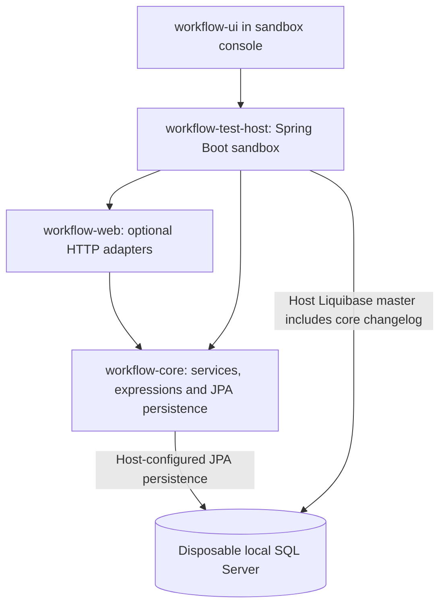
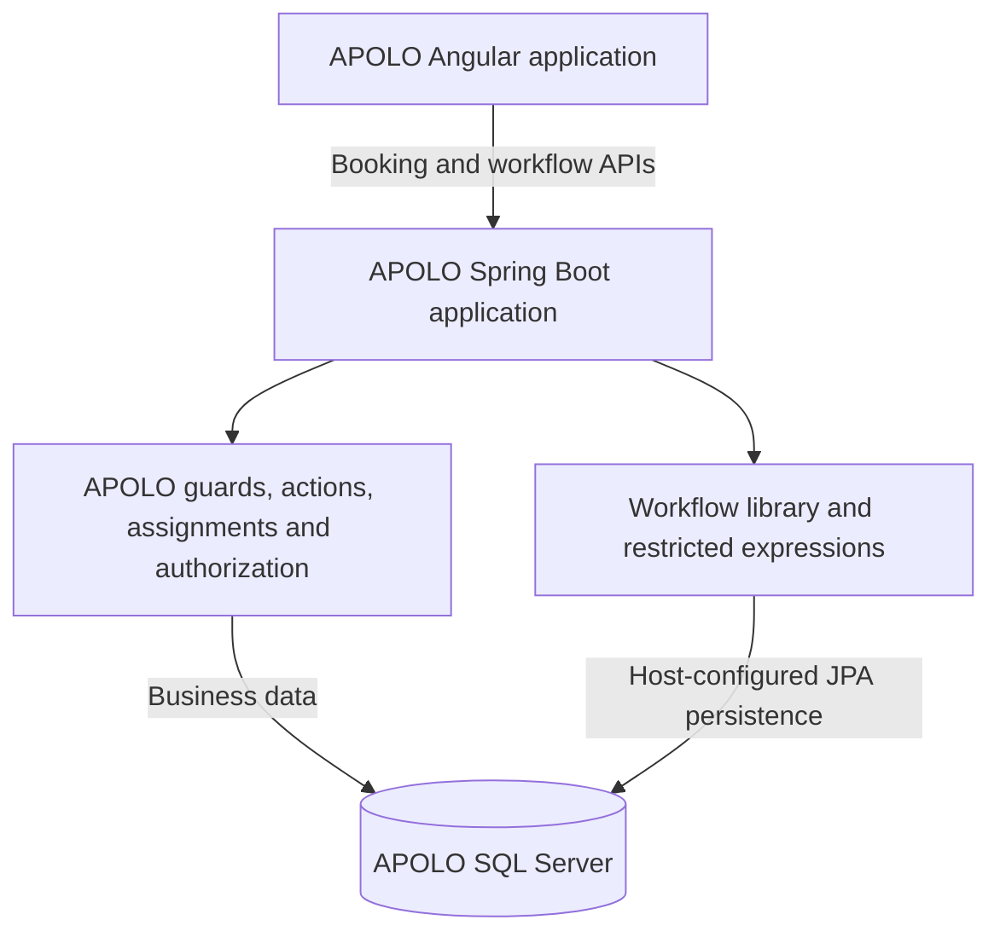
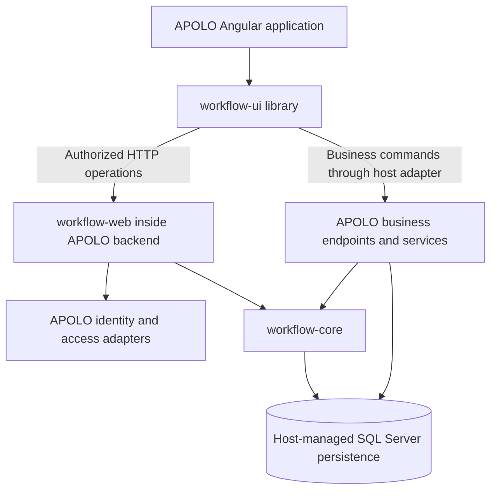

# Reusable Workflow Engine

The dated amendments below preserve decision history. The body records the current architecture through F022; feature specifications govern exact contracts and their implementation records govern verification. Historical implementation and capacity statements are scoped to their original revisions.

**Named-output extension — 2026-11-10:** Constitution 6.3.0 and [F019 revision 2](../features/F019-named-task-output-variables/spec.md) selected explicit human-node output names creating ordinary JSON variables at accepted SINGLE completion. No separate declaration or service action is required. Copies permit later replacement and use existing variable visibility; submission evidence remains immutable. Collision rejection and explicit absence are required. F019 also supports service input bindings to the original submission by human node key. F020 extends original-submission bindings to human inputs; F021 extends named outputs to resolved ALL collections. Sections 8–9 describe these implemented extensions.

**Claim/release decisions — 2026-11-09.** [F017](../features/F017-task-claim-release/spec.md) is IMPLEMENTED revision 3 with guarded SQL Server and live sandbox acceptance complete. The owner selected per-human-node OPTIONAL (default) or REQUIRED claiming for shared tasks, exclusive claimant completion subject to current eligibility/business access, owner release and host-authorized administrator release, and a separate nullable assignee_ref column preserving the original assignment. Direct USER tasks initialize assignee_ref from assignment_ref and complete without a claim action under either policy. Claim/release actions apply only to GROUP/ROLE tasks. Eligible peers retain claimed-task visibility; current assignees retain discovery/release after membership loss under business access. Own receipt recovery survives membership/admin-privilege loss under business access. Administrative release requires a recorded reason. Constitution 6.2.0 records this additive scope. O01–O06 are closed. Earlier no-claim wording describes the F016 baseline.

**Shared assignment amendment — 2026-11-07:** One SINGLE task has one stable USER, GROUP or ROLE assignment target. Any currently eligible member may complete it without claiming; one completion commits and records the actual actor. Hosts own membership and business authorization. Membership changes do not change the task roster or reopen completed tasks. At that F016 baseline claiming/releasing was pending; F017 subsequently implemented it. [F016](../features/F016-shared-group-role-task-assignment/spec.md) is IMPLEMENTED revision 2; see its implementation record for scoped verification. Constitution 6.1.0 supersedes earlier direct-user-only assignment and blanket candidate-group deferral for this SINGLE slice. F016 implements the closed assignment, membership, access and preserving-migration contracts; APOLO integration remains separate. Existing user-assignment examples remain valid.

**F009 test-baseline exception — owner decision, 2026-11-06:** [F009 revision 2, D17](../features/F009-json-execution-variables/spec.md) removes backward-compatibility obligations for pre-F009 Java APIs, formats and existing test data. Core/test-host callers may change together; old readers, compatibility overloads, dual limit profiles and old-data conversion are unnecessary. D15 capacities remain, but fresh test-schema/rebaseline or migration setup may establish them instead of a mandatory preserving forward migration. New executions still require history/evidence, pinned immutable definitions, concurrency, transactions and authorized idempotent replay. This scoped exception supersedes contrary older wording below; it grants no production compatibility waiver and authorizes no code/data changes in this documentation-only task.

**F009 capacity decision — 2026-11-06:** [F009 D15](../features/F009-json-execution-variables/spec.md) raises each JSON variable/start/service value to 256 KiB UTF-16 and retains the 1 MiB UTF-16 current-variable total. Its table specifies larger JSON-profile input/service/history envelopes, history-read capacity and a required history-only forward constraint migration. It supersedes older 64 KiB variable/input and smaller related-envelope wording only for that profile. Scalar legacy limits, task-result scope and receipt/handoff bounds remain unchanged. This was a planning decision; F009 subsequently implemented the slice, and F021 supersedes these value/map/history capacities under its coordinated capacity contract.

**D04 owner correction — 2026-11-06:** for F009, reading a missing property of an initialized JSON object returns null, just like explicit JSON null. APOLO may omit null-valued fields. This supersedes earlier missing-JSON-property failure wording only; undeclared/uninitialized variables and other evaluation errors remain failures. Stored missing/null distinctions remain. D05 subsequently selects explicit per-access `?.` property navigation; ordinary dot access on null fails. F009 subsequently specified and implemented array/index and normalization behavior; see section 5.2.

**Owner decision — 2026-11-06:** the initial JSON execution-data slice uses declared JSON variables and explicit start/service whole-value mappings without per-field structure schemas. APOLO supplies DTO-derived snapshots; core evaluates bounded read-only object/array navigation under `#vars`. Arbitrary nested fields are accepted within JSON validity, exact-value and resource constraints. Structure schemas are DEFERRED for these start inputs, service values and variables; workflow-document validation and task-result contracts are unchanged. This scoped amendment supersedes earlier mandatory embedded-schema wording for this slice, not the remaining schema design. See [F009](../features/F009-json-execution-variables/spec.md). That decision was documentation-only; F009 subsequently implemented this scope.

**Owner correction — 2026-11-05:** expression arithmetic follows native SpEL numeric behavior, including floating-point approximation, promotion, rounding and integral overflow. Do not reject a result solely for precision loss or compare it with an exact reference calculation. Declared DECIMAL variables enter evaluation as BigDecimal; decimal literals retain native SpEL types. Native evaluation errors and resource limits still fail the command. Exact decoding, transport, persistence and accepted-submission rules remain unchanged. This supersedes earlier expression-arithmetic exactness wording and the misinterpreted numeric owner decision.

## Technical Design — APOLO-first Embedded Library

| Document field | Value |
| --- | --- |
| Version | 0.12 — reconciled architecture through F022 |
| Status | Authoritative architecture; implemented contracts linked to feature specifications; deferred scope retained |
| Date | 2026-11-14 |
| Initial host application | APOLO |
| Development model | Implemented core/web/test-host and Angular UI libraries; sandbox consumer; APOLO consumption and source integration pending |
| Persistence target | Microsoft SQL Server through JPA persistence inside workflow-core |
| Definition formats | JSON workflows initially; JSON business decisions only with the optional later extension |
| Expression implementation | Restricted Spring Expression Language (SpEL) |
| Current document path | `docs/architecture/workflow-engine-design.md` |

> **Design direction:** Develop separately from APOLO for now, then move workflow-core into APOLO's source/module structure as a sibling of backend. Backend depends on core's ordinary library JAR; core retains its business-independent boundary while joining APOLO's build and release lifecycle. Deliver workflow execution first, using restricted expressions for simple routing. A reusable business decision engine is an optional later capability.

This document consolidates the [original technical design](../archive/original-technical-design.md) and subsequent [development discussion](../archive/development-discussion.md). It supersedes earlier suggestions that APOLO must supply the expression evaluator or that every business decision must return a workflow transition key.

Revision 0.8 restores compatible detail that was compressed during consolidation. The [original-design reconciliation](../archive/original-design-reconciliation.md) accounts for all 51 original sections. The complete example in section 7.4 is a **proposed design illustration**, not a finalized schema or implemented engine. This restoration preserves F4/F5 and O1/O2/O6; it does not approve the remaining JSON contracts or APOLO business policies.

Revision 0.9 records the owner's 2026-10-31 selection of ordered first-match workflow routing in section 7.3 and centrally enforced expression rules tied to the workflow-language version in section 5.3. These replace rejection of overlapping conditions and independent expression-policy selection. Exact JSON notation and legacy persistence reconciliation remain open. See constitution C08 and the source-precedence record for these revisions and the retained database-design amendments.

Revision 0.10 incorporates the owner's 2026-11-07 Angular 19 alignment decision and proposed reusable UI/web architecture into this main design. Sections 2–4, 14–19 and 22 distinguish the current implementation boundary from the proposed target. The [integration reference record](workflow-ui-web-integration.md) retains supplied APOLO evidence and preparation details; this document owns the consolidated architecture. Angular 19 alignment is AGREED; library extraction and a third Maven module remain PROPOSED. No implementation, dependency change, source move or F011 modification is authorized by this revision.

Revision 0.11 records the subsequent owner adoption on 2026-11-07: `workflow-ui`, `workflow-web`, the sandbox consumer shell and embedded designer packaging are now AGREED. Constitution 6.0.0 replaces the former two-module target with three Maven modules plus the Angular 19 library. This supersedes revision 0.10's proposal status, not its documentation-only boundary. Exact contracts and dependency versions remain OPEN; no implementation or F011 change is authorized.

Revision 0.12 reconciles the body with the retained catalog, numeric JPA versions, implemented expressions/runtime and F013–F022 web/UI and human-task contracts. Earlier revision paragraphs record what those revisions authorized and knew; they are not current delivery-status claims. No runtime behavior, migration or APOLO integration is introduced by this documentation update.

**Status convention:** **AGREED** identifies confirmed direction; **IMPLEMENTED** identifies delivered code within the linked feature scope, not blanket production acceptance; **PROPOSED** identifies illustrative contracts; **PROVISIONAL** identifies tentative preferences; **OPEN** identifies unresolved details; **DEFERRED — APOLO** identifies host-owned future decisions. Section 22 preserves decision history and current ownership. Exact implemented contracts and verification live in the [feature records](../features/README.md), under [source precedence](../design-sources.md).

**AGREED platform baseline:** Java 17 compilation target and JDK 21 runtime, confirmed by the project owner. APOLO's Java 17 POM settings are current and correct. The compiler JDK/toolchain is a separate setting to verify; this document does not claim a Java 21 compilation target. Other framework and dependency versions require verification against the application.

This revision supersedes the earlier JDBC persistence proposal and the `STATE`/`DECISION`/`FINAL` node model. Historical documents and examples must not override this baseline.

**AGREED packaging revision — 2026-11-07:** target three Maven modules, `workflow-core`, `workflow-web` and `workflow-test-host`, plus the separate Angular 19 `workflow-ui` library. F013 implements the three-module reactor and the shared read-only viewer; scoped runtime acceptance is complete. Core remains a Spring/JPA library; web is an optional host-consumed HTTP adapter. This supersedes the former two-module constraint without reviving the earlier six-module proposal. Public core contracts remain independent of APOLO and infrastructure-provider types. Core owns workflow changelogs; APOLO remains the single production migration owner.

**AGREED integration destination (F5):** independent development is the current phase, not a requirement for a permanently separate repository or independently published product. Eventually `workflow-core` becomes a Maven module inside APOLO, alongside `backend`, `frontend` and `configuration`. The source move's timing, final Maven coordinates and the test host's future location remain to be settled. No source move or POM reparenting into APOLO is implied by this documentation revision.

## Contents

1. [Purpose and scope](#1-purpose-and-scope)
2. [Architecture and deployment](#2-architecture-and-deployment)
3. [Modules and dependency direction](#3-modules-and-dependency-direction)
4. [Host responsibilities and dependency management](#4-host-responsibilities-and-dependency-management)
5. [Expression evaluation](#5-expression-evaluation)
6. [Business decision engine](#6-business-decision-engine)
7. [Workflow execution model](#7-workflow-execution-model)
8. [Workflow data and extension contracts](#8-workflow-data-and-extension-contracts)
9. [Human tasks and approvals](#9-human-tasks-and-approvals)
10. [Definition lifecycle and compatibility](#10-definition-lifecycle-and-compatibility)
11. [Persistence design](#11-persistence-design)
12. [Transactions, concurrency, and idempotency](#12-transactions-concurrency-and-idempotency)
13. [Events, audit, and operations](#13-events-audit-and-operations)
14. [Spring Boot integration](#14-spring-boot-integration)
15. [Reusable Angular UI and designer](#15-reusable-angular-ui-and-designer)
16. [Sandbox and playground](#16-sandbox-and-playground)
17. [Application and HTTP APIs](#17-application-and-http-apis)
18. [Repository and documentation structure](#18-repository-and-documentation-structure)
19. [Developing alongside APOLO](#19-developing-alongside-apolo)
20. [Testing and acceptance criteria](#20-testing-and-acceptance-criteria)
21. [Delivery roadmap](#21-delivery-roadmap)
22. [Decision register and open items](#22-decision-register-and-open-items)
23. [Technical references](#23-technical-references)

---

## 1. Purpose and scope

### 1.1 Workflow first: APOLO-first, reusable by design

Build a small workflow capability that satisfies real APOLO processes while keeping the engine independent of APOLO business classes, database entities, and permissions. APOLO's backend consumes the library; core must not depend on backend classes. Future inheritance from APOLO's root build parent does not change that code dependency boundary.

Workflow execution is the primary deliverable. Supporting expressions are limited to what the initial workflow requires; an independent business decision product must not delay that delivery.

| Capability | Delivery | Responsibility | Typical result |
| --- | --- | --- | --- |
| Workflow engine | First stage | Own process execution, human tasks, allowed operations, routing and history | Transition taken, task created or completed |
| Restricted expression evaluation | Supporting capability within the first stage | Evaluate simple workflow predicates against explicit inputs | Boolean routing result |
| Business decision engine | Optional later extension; not implemented in the first stage | Evaluate reusable business rules and decision tables independently of a workflow | approvalLevel = PARTNER |

The first workflow release must build, start, publish definitions and run processes without a business decision library, decision-definition database tables or decision-management APIs. Its EXCLUSIVE_GATEWAY node is a routing node: it can select an outgoing transition using restricted expressions without a separate business decision engine.

If the optional decision engine is introduced later, it should remain usable outside workflows and return business values that workflows map to transitions. That remains a future design direction, not an initial implementation requirement.

### 1.2 Initial scope

The implemented workflow scope includes immutable JSON definitions; explicit START, HUMAN_TASK, SERVICE_TASK, EXCLUSIVE_GATEWAY and END nodes; acyclic expression-based routing; SINGLE and fixed-roster ALL activities; USER/GROUP/ROLE task assignments and shared-task claiming; a retained task-type catalog; JPA runtime storage; optional declared guards; transactional business actions; durable event handoff; command idempotency; audit history; and a sandbox. Structured submissions, explicit named outputs, immutable human-task inputs and configured previous-decision context extend the human-task contract (sections 8–9).

Implemented restricted SpEL reads explicit `#vars` projections. A separate `#facts` namespace remains a historical/future illustration, not a supported workflow-routing input. Guards remain registered host checks. No decision-table evaluator, FIRST/UNIQUE table policies, separate decision-definition lifecycle, standalone decision simulation or decision-table editor is implemented.

The delivery sequence remains sandbox, then cross-team booking approval in APOLO, then the graphical workflow designer. Planning-like examples do not select APOLO business policy. The designer's agreed packaging is a reusable Angular feature hosted by APOLO or a development shell (section 15); it does not require a business decision editor. Catalog administration is already available through shared APIs/UI, without a task-type publication or versioned-import lifecycle.

### 1.3 Deliberate exclusions

V1 is not a BPMN implementation, a distributed orchestration service or a general-purpose rules product. The business decision engine is deferred and optional. Forward chaining, arbitrary scripting, generic parallel branches, compensation, subprocesses and live migration of running instances are also excluded.

The original exclusions of engine-owned business forms, arbitrary external workers, signal/message correlation and event subprocesses remain. Host adapters may translate domain inputs into ordinary commands, but that does not introduce a general message-correlating workflow runtime. Business forms remain host-owned; shared generic task controls display pinned contracts, read-only context and structured result editing.

Do not create placeholder decision modules, tables or administration endpoints solely to anticipate the optional extension. Keep boundaries clear and add an integration contract when a concrete later requirement justifies it.

### 1.4 Changes from earlier direction

- **Workflow first:** the earlier plan to deliver expressions, rules and workflow as three initial capabilities is superseded.
- **Routing remains in scope:** the EXCLUSIVE_GATEWAY node uses workflow expressions initially. It is not synonymous with a standalone decision engine.
- **Optional business decisions later:** business-value outputs, FIRST/UNIQUE policies and exact pinned decision versions remain design guidance only for that later component.
- **Initial definitions are workflows:** decision JSON schemas, storage, APIs, simulation and editor are deferred with the optional component.
- **Standalone development first, APOLO module later:** the test host exercises core while development is separate; core will later move into APOLO's source tree as a sibling module of backend. A permanently separate artifact publishing lifecycle is not required.

## 2. Architecture and deployment

### 2.1 Independent development environment



The initial sandbox provides configuration, controlled test identities, sample business services, database connections and HTTP endpoints. It exercises the production workflow library without a business decision engine. The workflow designer is added later.

### 2.2 Embedded deployment in APOLO



The engine runs inside the APOLO JVM. No network call is required between a business service and the workflow engine. Workflow UI and the later designer use host APIs, never direct SQL access. An optional business decision component is absent from this initial deployment.

At the agreed source-integration point, APOLO's root reactor includes `workflow-core` and backend declares a normal dependency on it. Core remains an ordinary JAR packaged into the backend application. Sharing a repository and release cycle does not allow core to depend on backend business entities, identity providers or messaging implementations.

**AGREED shared UI/web deployment:** APOLO's Angular application consumes `workflow-ui`; APOLO's backend explicitly activates selected `workflow-web` controllers and supplies their required host adapters. Both libraries run within the existing application lifecycle. The supplied frontend POM builds Angular resources into a frontend JAR under `static`, which the backend WAR consumes. Workflow UI participates in that frontend build rather than requiring a separate production application; this integration is not implemented yet.



This is the agreed target dependency/deployment view, not a verified integration. Host transaction and durable-handoff rules remain mandatory. The sandbox consumes the same libraries through its existing console shell and sample adapters; production never imports sandbox login, fixtures or failure-injection controls.

### 2.3 Ownership boundaries

| Owner | Owns |
| --- | --- |
| Workflow library | Execution semantics, workflow definitions and expression routing, task lifecycle, persistence contracts and audit structures |
| APOLO | Business meaning, domain entities, business permissions, users, infrastructure, deployment |
| Sandbox | Development fixtures and a reference host integration |
| Designer (later) | Workflow graph/JSON editing and validation; decision-table editing only if the optional component is added |
| Git repository | Source code, documentation, schemas, examples, test cases, release history |
| Host database | Imported and published definitions, active instances, tasks, command receipts, execution history |

Git is the source of truth for development artifacts. The host database is the runtime source of truth. Importing a JSON file is an explicit management operation; the runtime must not fetch a mutable Git branch during execution.

## 3. Modules and dependency direction

### 3.1 Current implementation and agreed target modules

| Module | Responsibility | Important dependencies |
| --- | --- | --- |
| workflow-core | Models, entities, repositories, workflow/task/registry services, restricted expressions, JSON codecs, integration interfaces/configuration and workflow Liquibase resources | Spring, Spring Data JPA, Jakarta Persistence and spring-expression; JSON/validation libraries as used |
| workflow-web | Implemented viewer, administration, runtime-read and optional command HTTP groups, transport mapping and scoped errors; explicit host activation | workflow-core and Spring MVC; required host policy adapters |
| workflow-test-host | Executable development host, sample endpoints/adapters, datasource and transaction configuration, migration execution against a local database | workflow-web, workflow-core, Spring Boot host starters, Liquibase and SQL Server JDBC driver; database test tooling belongs here |

During separate development, the workflow root POM is the parent/aggregator with `packaging=pom`. Core and web produce ordinary library JARs; only the test host produces an executable Spring Boot JAR. Preserve the current standalone root and development coordinates until the planned source move. Later, core joins APOLO's reactor and is intended to inherit its root parent after the effective build is reviewed. The Angular library has a separate frontend build and does not itself require a Maven module. Constitution 6.0.0 adopts the third Java module; F013 now registers all three modules, with the read-only viewer extracted and scoped runtime acceptance complete.

Keep models, persistence, services, expressions and integration concerns in separate packages within core. These are implementation boundaries, not separate Maven artifacts. A separate expression API, SpEL adapter artifact, persistence artifact or starter can be extracted later only when concrete reuse or dependency needs justify it. Implement expressions only as required for workflow routing.

### 3.2 Dependency rules

`workflow-test-host` and APOLO's backend each depend on `workflow-core`. Core never depends on either host, the designer or an optional business decision library. Restricted SpEL implementation and its contracts both live inside core; decision-table entities, configuration and migrations remain absent initially.

Core owns workflow, task, task-type and runtime persistence, including JPA entities and Spring Data repositories. It may depend on Spring/JPA and the libraries it directly uses, but must not inherit APOLO's entire infrastructure dependency stack. Keep execution models and integration interfaces separate from entity/JSON representations. Store external user/business references as stable identifiers without JPA relationships to APOLO-owned entities.

**Public API independence:** core interfaces, commands, results, events and context objects use Java standard types or workflow-owned models and identifiers. They must not expose APOLO classes, JPA entities, Keycloak objects, JWT implementation types, Spring Security `Authentication`, or infrastructure-specific types such as JMS messages, database connections or cache-provider objects. Host adapters translate authenticated identity and infrastructure data into these neutral contracts; the core never requires callers to supply provider-specific objects.

Hosts own endpoint exposure and policy, JDBC drivers, connection pooling, migration runners, logging configuration and security/messaging infrastructure. Generic controller implementation may be shared through the agreed web adapter in section 3.5; core remains independent of HTTP. Core ships changelog resources without configuring a migration runner or requiring Liquibase as a runtime dependency solely to package those resources. Use normal direct Spring/JPA dependencies where needed rather than importing APOLO's backend or its application starters wholesale.

### 3.3 Optional later business decision extension

A future workflow-rules component may provide standalone business decisions and integrate with workflows through an adapter. Its dependency direction must preserve the workflow engine's independent operation; do not make core depend on concrete rules models.

The exact optional adapter, persistence packaging and installation mechanism remain deferred. Business-decision definitions must be rejected as unsupported by the initial runtime rather than silently ignored or treated as simple expressions.

Do not introduce Spring Integration or a messaging broker as a mandatory library dependency. Spring Boot integration means host configuration and transaction participation here.

<a id="34-proposed-internal-components-and-dependency-flow"></a>

### 3.4 Internal components and dependency flow

Use the [layer-first package convention](../package-structure.md). These responsibilities are packages inside core, not additional Maven artifacts:

```text
workflow-core
  WorkflowConfiguration root import/scanning marker
  dto/definition         typed graph and definition contracts
  dto/runtime            neutral commands, results and read projections
  service/definition     codec, validation, publication and pinned loading
  service/runtime        traversal, tasks, bindings, history and host extension contracts
  service/expression     restricted routing evaluation
  service/tasktype        retained catalog administration
  entity/<feature>       internal JPA mappings
  repository/<feature>   internal persistence access
  exception/<feature>    documented workflow errors
  configuration          internal wiring
  db/changelog/workflow  packaged schema resources

workflow-test-host
  host endpoints and configuration
  synthetic planning records, guards/actions/resolvers and capability adapters
  datasource/transaction infrastructure, durable-handoff adapter and migration runner
```

Business controllers and business adapters belong in APOLO backend. The agreed web library shares only generic HTTP mapping and delegates host policy through explicit adapters. An application service coordinates the command transaction and calls focused execution/persistence components. The definition loader returns a typed graph, the executor dispatches by node type, and registered host contracts supply business behavior. Public contracts must not leak JPA entities. Avoid a second engine inside the sandbox, a service-locator context exposing all components, or new interfaces merely to mirror each class.

### 3.5 Agreed reusable UI and web libraries

| Component | Agreed responsibility | Boundary |
| --- | --- | --- |
| `workflow-core` | Existing execution, persistence, definitions and neutral contracts | Ordinary Java library; no dependency on HTTP adapter, UI or host implementation |
| `workflow-web` | Spring MVC controllers, transport DTO mapping, request validation and scoped error handling | Ordinary JAR depending on core; host opts into API groups and supplies required identity/access/business integration |
| `workflow-ui` | Generic workflow pages, embeddable components and later designer | Angular 19-compatible library consumed by APOLO and sandbox; no application bootstrap, login or APOLO-specific service imports |
| `workflow-test-host` and its console shell | Development application, sample domain/adapters, test infrastructure | Consume shared libraries; keep sandbox-specific operations outside reusable artifacts |
| APOLO | Application navigation, business pages/endpoints, contextual authorization, infrastructure and delivery | Consumes libraries inside its existing frontend/backend deployment |

Dependency direction is `host -> workflow-web -> workflow-core`, with a direct `host -> workflow-core` dependency when host business services call core. Frontend hosts consume `workflow-ui` separately. Core must never depend on web, Angular or APOLO. Do not restore the superseded six-module architecture or add an expression, persistence or starter artifact as part of this adopted architecture.

The owner adopted `workflow-web` through constitution 6.0.0 C03 and CON-02. F013–F015 subsequently implemented the three-module reactor, viewer, administration and runtime extraction. The [web integration guide](../../workflow-web/README.md) and [UI entry points](../../workflow-ui/README.md) document supported contracts. APOLO consumption and the later designer remain separate work.

## 4. Host responsibilities and dependency management

### 4.1 Dependency declarations versus runtime ownership

Every module declares the libraries its source code directly uses. The independently built project has its own tested dependency-management baseline. APOLO controls the versions selected in its application dependency graph through its own dependency management, subject to the library's compatibility requirements. Maven dependency management can control transitive versions; it does not remove the need for direct dependency declarations. [R1](#r1-maven-dependency-management)

After source integration, manage shared Spring/JPA/JSON versions and Java 17 compiler settings through APOLO's root parent so backend and core compile against the same intended baseline. Core continues to declare only its own dependencies. Backend-only version overrides are not automatically inherited by a sibling module; reconcile shared versions at the common parent. Audit inherited dependencies and plugin executions so reparenting does not add application infrastructure or executable Boot packaging to core.

Consequently, APOLO and the workflow project normally share the same Spring and SpEL artifacts at runtime. A separate workflow expression service means a separate configuration and execution policy, **not a second isolated copy of Spring**.

Do not mark all Spring dependencies `provided`. That scope changes transitivity and classpath availability; it is not a general expression of host ownership. Use normal dependencies and intentional optional dependencies where appropriate. [R1](#r1-maven-dependency-management)

### 4.2 Host-supplied infrastructure

The host supplies the `DataSource`, transaction manager, credentials, connection pool, logging configuration, authenticated actor, authorization implementation, and business extensions. It chooses how migrations are executed and how external events are delivered.

The library must not silently create another datasource, application context, transaction manager, security chain, or embedded web server. It must not mutate the host's global JSON mapper configuration; use a specifically configured codec for workflow documents. Decision-document codecs belong to the optional later extension.

### 4.3 Compatibility baseline

Java 17 is the confirmed compilation target and JDK 21 is the confirmed execution runtime. Before APOLO integration, verify its compiler JDK/toolchain and effective Spring Boot/Framework, Hibernate/JPA, JSON-library, SQL Server, JDBC-driver, and Liquibase versions and transaction arrangement. Versions copied into older notes are reference evidence, not newly verified compatibility guarantees.

Compile library and sandbox code to Java 17 compatibility and execute integration tests on JDK 21. Enforce the Java 17 API target in the build as well as the bytecode target. Managing dependencies to an older version cannot make code compiled against unavailable APIs compatible.

A sibling Maven aggregator used during separate development does not make APOLO's parent POM or dependency management apply to the library. Aggregation and inheritance are separate concepts. Each project retains its current parent during that phase; the eventual source move includes an explicit review and change of core's parent configuration. [R2](#r2-maven-aggregation-and-reactor)

**AGREED frontend target — 2026-11-07:** Angular 19, targeting APOLO’s declared 19.2.x Angular/Material/CDK line. F012 aligned the sandbox and F013–F015 implemented reusable library consumption and entry points. The [UI guide](../../workflow-ui/README.md) records the selected standalone toolchain and build ordering; Angular dependencies are peers. Supplied APOLO ranges are source evidence, not installed-version or integration verification. APOLO theme, translation, authentication and effective dependency compatibility remain integration gates; see the [reference record](workflow-ui-web-integration.md#evidence-from-the-supplied-apolo-references).

## 5. Expression evaluation

**Initial supporting scope:** implement the restricted evaluation needed for workflow routing. General typed-value and standalone decision examples below are proposed extension contracts; they do not require a standalone expression product before workflow delivery.

**AGREED — O6, implemented incrementally in F004–F011:** Workflow Definition v1 has five explicit node types, declared inputs/bindings, scalar and bounded JSON values, and restricted Boolean routing expressions. Unsupported schema versions and semantics fail explicitly. [F007](../features/F007-typed-bindings-service-tasks/spec.md), [F008](../features/F008-restricted-expressions-routing/spec.md) and [F009](../features/F009-json-execution-variables/spec.md) specify implemented values and expressions; arbitrary Java objects and broad scripting remain excluded.

### 5.1 Contract

The evaluator parses and validates expressions and evaluates them against explicit, typed inputs. Conditions must yield an actual Boolean; arbitrary truthiness and silent string-to-Boolean conversion are not part of the contract.

Illustrative API, with supporting types to be specified separately:

```java
public interface ExpressionEvaluator {
    ValidationResult validate(ExpressionDefinition expression,
                              InputSchema inputs);

    TypedValue evaluate(ExpressionDefinition expression,
                        EvaluationInputs inputs,
                        ValueType expectedType);
}
```

The evaluator has no persistence dependency and cannot fetch business data itself.

### 5.2 Expression syntax and input namespaces

Use explicit map access rather than relying on implicit bean-property resolution:

```text
#vars['amount'] >= #vars['approvalThreshold']
#vars['riskLevel'] == 'HIGH'
#vars['urgent'] == true
```

Implemented routing exposes `#vars` only. Host data enters through explicit start/service bindings before evaluation; the engine does not fetch facts during an expression. The earlier `#facts` namespace remains a conceptual standalone-decision illustration, not an enabled routing contract. Validation and runtime use the same central rules; a separate predicate-preview API is not implied.

Execution values cover `STRING`, `LONG`, `DECIMAL`, `BOOLEAN`, `DATE`, `DATETIME` and bounded `JSON`. Declared DECIMAL variables enter SpEL as BigDecimal; literals, promotion and arithmetic retain native SpEL semantics. Exact decoding/transport/storage is distinct from computed arithmetic. F007/F009 specify scalar encodings and immutable JSON tokens; frontend code must preserve numeric text rather than round values through JavaScript numbers.

F007/F009 define date/time, missing/null and exact-number behavior. JSON navigation is read-only and bounded. Missing object properties and out-of-range integer array reads return null; undeclared/uninitialized variables and invalid index types fail. Null-safe traversal must be explicit; ordinary property access on null fails. Stored absence remains distinct from explicit JSON null.

Missing required facts, disallowed null values, invalid conversions, and non-Boolean condition results are errors. A false condition means the business predicate evaluated successfully and did not match.

### 5.3 Restricted SpEL execution rules

Use `SimpleEvaluationContext` as the starting point. Spring documents that it supports a restricted subset and excludes Java type, constructor, and bean references, with explicit choices for property and method access. It is not a complete application security policy by itself. [R3](#r3-restricted-spel-context)

**AGREED — revised 2026-10-31:** the engine centrally enforces expression rules as part of each workflow-language version. Definitions do not declare an independent `expressionPolicy`, and host configuration cannot select different expression semantics for the same language version. Incompatible rule changes require a new language version. An engine must preserve the rules of a supported version or reject that version explicitly.

**Owner clarification — 31 October 2026 (L12):** retain standard SpEL syntax and operator, precedence, short-circuit and null semantics within the supported read-only context. Do not design a second expression language or exclude ordinary arithmetic by default. Decode supplied facts/variables into their declared types, preserve exact numeric values and missing-required-data errors, and require actual Boolean routing results. Necessary access/resource restrictions remain; specify and verify how context configuration and typed conversion satisfy those boundaries without silently changing supported SpEL semantics. Language-version compatibility also applies across Spring upgrades.

The rules must enforce the following restrictions:

- Expose only validated scalar values and bounded, immutable data structures. Never expose application services, persistence entities, class loaders, or arbitrary object graphs.
- Disable assignment, mutation, automatic collection growth, and general method invocation. Use narrowly defined read-only accessors; do not rely on arbitrary Java getters being harmless.
- Reject syntax outside the controlled context before publication. Enforce necessary access/resource restrictions structurally through supported AST constructs, rather than blacklisting a few strings or independently redefining ordinary SpEL operators.
- Impose limits on expression length, AST complexity, input size, and total evaluations per command. Table-size limits belong to the optional later decision component. Initially exclude potentially costly features such as unrestricted regular-expression matching and collection traversal.
- Return stable error codes without exposing internal objects, secrets, or stack traces to the caller.

A wall-clock timeout alone is not a guarantee that in-process computation stops safely. The initial trust model is authorized internal definition authors, restricted expressions, and bounded inputs—not arbitrary public code execution. Strong isolation for hostile authors would be a different architecture.

### 5.4 Parsing, caching, and determinism

Parse through the supported SpEL parser; do not implement a second expression language. SpEL distinguishes parsing failures from evaluation failures, which should be translated into distinct domain errors. [R4](#r4-spel-evaluation)

Reuse parsed expressions within one command or evaluation request. Do not start with an unbounded global cache. A bounded cache may be introduced after measurement, keyed by expression source, workflow-language version and relevant compilation configuration; never cache mutable evaluation contexts or previous input values.

Do not allow hidden reads of the current time, random values, or mutable application globals. When a decision needs a date or timestamp, supply it explicitly as a fact so the evaluated inputs can be explained later.

## 6. Business decision engine

**DEFERRED — optional later component.** This entire section preserves future design guidance, not requirements for the initial workflow release. References to V1 inside this section mean the first version of this optional component. Do not implement its rule evaluator, definitions, tables, APIs, simulation or editor in the first stage.

### 6.1 Responsibility

The decision engine evaluates a versioned definition against typed facts and returns business outputs plus an explanation of the evaluation. It does not select workflow nodes, update business objects, send messages, or start workflows.

Conceptual API:

```java
public interface DecisionEvaluator {
    DecisionResult evaluate(DecisionDefinition definition,
                            DecisionInputs inputs);
}

public interface DecisionService {
    DecisionResult evaluate(DecisionVersionRef version,
                            DecisionInputs inputs);
}
```

`DecisionEvaluator` is pure with respect to application side effects. `DecisionService` adds lookup through a supplied definition loader. Both are usable without `workflow-core`.

### 6.2 Two explicit condition formats

Support ordinary decision-table cells as the primary visual model, while retaining an explicit SpEL row format for compound predicates. A definition declares its condition format; do not infer it from ambiguous JSON.

| Format | Representation | Intended use |
| --- | --- | --- |
| `CELLS` | Conditions keyed by declared inputs | Standard business decision tables |
| `SPEL` | One Boolean `whenExpression` per non-default rule | Compound predicates requiring expression syntax |

For `CELLS`, proposed operators are equality, membership, ordered comparisons, and explicit null checks. Conditions within one row are ANDed. An omitted input condition is a wildcard, but it does not waive input-schema validation. Avoid implementing additional operators before a real table needs them.

For `SPEL`, rules invoke the same restricted expression evaluator as workflow conditions. A standard table need not be translated into user-visible SpEL strings, and the editor must not silently change its condition format.

### 6.3 Hit policies and errors

**`FIRST`:** Evaluate non-default rules in document order and return the first match. Rule order is semantic; do not add a second priority mechanism in V1. Trace later rules as not evaluated, not as false.

**`UNIQUE`:** Evaluate all non-default rules. Exactly one may match. Multiple matches are an error even when their outputs are identical.

**Default:** At most one separately marked default rule is allowed, positioned last. It is considered only when no non-default rule matches and does not participate in `UNIQUE` match counting.

**No match:** With no default, return `DECISION_NO_MATCH` as an explicit evaluation failure. Do not silently substitute an empty object or a favorable workflow route. This behavior must be compared with existing APOLO rules during migration.

**Evaluation failure:** A malformed predicate or missing required fact is not a false condition. Stop evaluation and report the failure; never continue to a permissive default after an evaluation error.

V1 excludes forward chaining, side-effecting rule actions, implicit rule dependencies, and `COLLECT` aggregation.

### 6.4 Proposed JSON decision definition

The following complete example uses standard table cells. `schemaVersion` describes the JSON contract; `version` identifies the business definition revision.

```json
{
  "schemaVersion": 1,
  "key": "approval-level",
  "version": 1,
  "name": "Required approval level",
  "type": "DECISION_TABLE",
  "conditionFormat": "CELLS",
  "hitPolicy": "FIRST",
  "inputs": [
    { "key": "amount", "type": "DECIMAL", "required": true },
    { "key": "riskLevel", "type": "STRING", "required": true,
      "allowedValues": ["LOW", "MEDIUM", "HIGH"] }
  ],
  "outputs": [
    { "key": "approvalLevel", "type": "STRING", "required": true,
      "allowedValues": ["DIRECT", "PARTNER"] }
  ],
  "rules": [
    {
      "key": "high-risk",
      "when": { "riskLevel": { "eq": "HIGH" } },
      "then": { "approvalLevel": "PARTNER" }
    },
    {
      "key": "large-budget",
      "when": { "amount": { "gte": "500000.00" } },
      "then": { "approvalLevel": "PARTNER" }
    },
    {
      "key": "default",
      "default": true,
      "then": { "approvalLevel": "DIRECT" }
    }
  ]
}
```

An expression-format row would instead use `whenExpression`, for example:

```json
{
  "key": "high-risk",
  "whenExpression": {
    "language": "SPEL",
    "source": "#facts['riskLevel'] == 'HIGH'"
  },
  "then": { "approvalLevel": "PARTNER" }
}
```

That row belongs to a definition declaring `conditionFormat: SPEL`; the formats are not mixed implicitly. V1 outputs are typed literals. Computed output expressions can be added later with a distinct representation rather than interpreting ordinary strings as executable expressions.

### 6.5 Evaluation result and standalone use

For amount `520000.00` and risk level `LOW`, the example yields:

```json
{
  "decisionKey": "approval-level",
  "decisionVersion": 1,
  "outputs": { "approvalLevel": "PARTNER" },
  "matchedRuleKeys": ["large-budget"],
  "defaultUsed": false
}
```

The complete internal result can also include the content checksum, evaluation policy version, row trace, and diagnostics. Persistence of a standalone evaluation is a host policy, not an unavoidable side effect of the pure evaluator. Workflow execution persists the relevant decision trace in its transaction.

### 6.6 Relationship with APOLO's existing rules

Review representative existing expressions and tables before freezing the new DSL. Compare missing-input behavior, null handling, number conversion, wildcard cells, partial outputs, rule ordering, and no-match behavior. Do not assume that using SpEL automatically makes the new service behavior-compatible.

Keep existing APOLO rule consumers unchanged initially. Migrate a selected rule only after explicit semantic mapping and regression tests; this project does not require a wholesale replacement of APOLO's current rule infrastructure.

## 7. Workflow execution model

### 7.0 Canonical definition language and typed execution model

The definition is a strongly typed JSON language, not an arbitrary collection of JSON properties. Store each published definition as one immutable document with indexed identity/version metadata. Do not normalize the graph into a second authoritative set of node/edge tables. Relational runtime records refer back to the pinned document and its stable keys.

The implemented definition codec converts documents into typed DTOs; validation and execution use those objects. Raw JSON remains appropriate at the import/codec boundary. Models remain separate from JPA entities and command/result DTOs. The following names are conceptual, not public Java class names:

```text
WorkflowDefinition
  schema version, workflow key/version, entry point
  declared variables and permitted inputs
  typed node definitions
  transition definitions
  optional non-semantic designer metadata

NodeDefinition
  StartNode / HumanTaskNode / ServiceTaskNode / ExclusiveGatewayNode / EndNode

Supporting definitions
  VariableDefinition / InputBinding / OutputBinding
  TaskTypeReference / AssignmentDefinition / TransitionDefinition
```

The supported fields and validation rules are specified by the definition/runtime feature contracts and bundled schemas. Restricted routing is part of this model; optional business-decision documents remain separate later work.

The same versioned JSON contract is used by import/export, the future TypeScript designer model and the Java codec. A derived in-memory graph index can speed node/transition lookup within a command; it is not another persisted definition or a second designer-specific format.

### 7.1 Graph and node semantics

**AGREED:** V1 uses explicit executable node types and one active process position. The compact `STATE`/`DECISION`/`FINAL` model is superseded.

| Node type | Responsibility |
| --- | --- |
| `START` | Explicit entry point for an instance |
| `HUMAN_TASK` | Create a SINGLE task or fixed ALL roster; accept outcomes and progress only when the activity resolves |
| `SERVICE_TASK` | Invoke a registered synchronous host action with declared inputs/outputs in the enclosing transaction |
| `EXCLUSIVE_GATEWAY` | Evaluate Boolean conditions on outgoing transitions in priority order and select one route; no node-level calculation or business-result output |
| `END` | Complete the instance with a defined result |

The supported graph has exactly one START with no incoming transitions, at least one END with no outgoing transitions, reachable nodes and no cycles, including cycles through human nodes. START/SERVICE_TASK have one unconditional success edge; each human outcome has its exact route. F008/F010/F011 specify branching and successive or conditional human stages. Re-entry/resubmission loops remain outside the executable slice.

Starting an instance resolves an eligible published version once and pins it. Start operations use the same authorization, transaction, idempotency, and audit guarantees as later commands. Stable technical keys are independent of display names.

**AGREED — O1 service tasks:** registered host actions execute synchronously in the enclosing host transaction. Explicit validated bindings supply inputs and map returned outputs to permitted variables, including named outputs after creation. Action, binding or output-validation failure rolls back host/workflow changes. No automatic business-action retry, asynchronous worker or distributed orchestration is introduced. F007/F009 and F019/F021 define the implemented binding contracts.

**AGREED — O1 action placement:** put workflow-driven business actions in explicit SERVICE_TASK nodes. Transitions select the next node and do not execute business actions in V1. APOLO's endpoint still owns request/domain validation and the enclosing transaction; business effects already performed there must not also execute in a service node. Assign each effect one owner. This decision does not move APOLO-specific policy into the engine.

### 7.2 Guards, actions, and decisions

A **guard** determines whether a requested operation is permitted and returns structured reasons when it is blocked. A **decision** chooses an outcome after valid inputs have been supplied. A **business action** performs an explicitly registered, synchronous domain operation.

Named guards, actions and assignment resolvers are extension references, not arbitrary executable Java stored in JSON. Start and human-task outcome authorization are optional through registered guards with fixed permission inputs; neither requires a mandatory authorization hook. Definitions cannot instantiate classes or access Spring beans by expression.

Available-action queries are advisory. Execution must recheck state, version, authorization, assignment, inputs, and guards inside the command's transactional path.

#### Stable keys, outcomes and transition properties

Preserve technical keys independently of names, translated labels and graph coordinates. Display labels do not select transitions. Published documents remain immutable even when a proposed change affects only a label or layout; edit a new draft version.

Transitions identify source and target nodes; a human transition selects an outcome declared by the pinned node. Guards and comment requirements belong to that outcome, not the transition; there is no outcome permission field. Declared guards run before acceptance, while host endpoint policy remains responsible for business access. Gateway transitions carry a condition or explicit default. START/SERVICE_TASK success edges are automatic. Transitions execute no business actions or event hooks.

Distinguish the task outcome from the route: two stages may both expose `APPROVE`, but the command addresses its exact task and outcome. The engine resolves the route from that pinned node; clients do not supply arbitrary destination nodes. Transition keys are definition-wide unique identities, but they are not completion-command fields.

When guards block an otherwise authorized action, return structured reasons suitable for the host UI. This illustrative response does not fix the final error schema:

```json
{
  "transitionKey": "MANAGER_APPROVE",
  "available": false,
  "reasons": [
    {"code": "PLANNING_INCOMPLETE", "message": "Required planning data is missing."}
  ]
}
```

Only expose reasons/details the caller is authorized to see. A guard denial means the requested operation is blocked; a false routing predicate is a valid non-match; an evaluation failure is an error. An advisory query must not execute service actions or create a durable command result.

### 7.3 Routing alternatives

**AGREED — revised 2026-10-31:** evaluate non-default outgoing conditions in the explicit priority order declared by the workflow definition. Select the first Boolean true result and stop; later conditions are not evaluated and must not be reported as false. Overlapping conditions are allowed and resolved by order. If all conditions are false, take the separately identified unconditional default, if present; otherwise fail the command. At most one default is allowed. A failure in an evaluated condition, including missing required values, invalid conversions or non-Boolean results, fails the command and never falls through to a later route or default.

Validate all conditions' syntax and permitted features before publication. Preserve evaluation order through serialization and designer editing; diagram layout must not change priority. Published order is immutable and instances retain their pinned definition version. The gateway's conditional routes use their relative order in the top-level transitions array; the default is considered only after all conditions are false, regardless of its position. F008 specifies the implemented JSON fields and routing diagnostics. Warnings for obvious unreachable routes are optional future authoring aids, not a promise of complete static overlap detection. This replaces the earlier exactly-one-match rule and does not require the deferred decision-table engine or selectable FIRST/UNIQUE policies.

**Optional later decision-table routing:** only when the deferred business decision component is implemented, evaluate its pinned definition and map a business output to a transition owned by the current node:

```text
approval-level version 1
    output approvalLevel = PARTNER
              |
              v
workflow routing map
    PARTNER -> PARTNER_REQUIRED
              |
              v
transition PARTNER_REQUIRED
    APPROVAL_ROUTE -> PARTNER_REVIEW
```

The workflow engine validates the mapping and the transition's source. An unknown output is a routing error, not a reason to choose a convenient default.

<a id="74-illustrative-sandbox-flow--not-a-frozen-json-contract"></a>

### 7.4 Complete proposed workflow example

**HISTORICAL proposed illustration — not an executable fixture or current JSON contract.** Retained to explain the original planning scenario and provisional resubmission idea. Its `factProvider`/`readFacts`, task-type versions, transition-level guards/comments and loop are obsolete or unsupported. These fields do not override current feature specifications. For executable examples use [sequential review](../features/F011-sequential-human-stages/sequential-review.json), [structured review](../features/F018-structured-task-submissions/sandbox-structured-review.json), and the examples linked from F021/F022. All notation, companion contracts and walkthrough claims within this subsection are historical proposals; section 7.5 resumes current architecture.

The scenario is a synthetic **sandbox planning review**, preserving the original example's explanatory purpose. It does not select planning as the first APOLO integration: that remains cross-team booking approval. Manager/partner routing, sample thresholds and the adjustment loop are fixtures, not confirmed APOLO business policy. In particular, same-instance resubmission remains PROVISIONAL under O3 and is shown only to explain possible re-entry semantics.

#### Graph and behavior

```text
START -> CAPTURE_REVIEW -> MANAGER_REVIEW
  APPROVE -> APPROVAL_ROUTE
    partner required -> PARTNER_REVIEW
      APPROVE ----------------------------+
    default/direct -----------------------+-> FINALIZE_APPROVAL -> APPROVED
  REJECT (either review) -> FINALIZE_REJECTION -> REJECTED
  REQUEST_CHANGES (either review) -> REQUEST_ADJUSTMENT -> REQUESTER_REVISION
    RESUBMIT -> CAPTURE_REVIEW -> a new MANAGER_REVIEW activity
    CANCEL -> FINALIZE_CANCELLATION -> CANCELLED
```

There is one directly assigned active human task at a time. The adjustment cycle crosses human tasks; it is not an automatic-only cycle. All final business effects are explicit SERVICE_TASK operations. Both successful approval paths execute the same `FINALIZE_APPROVAL` node, fixing the original example's direct path that reached APPROVED without calling the approval action.

#### Proposed notation used in this example

- The unique START node is the entry point. `startPolicy` describes explicit start inputs and optional guards. Start authorization is optional through a declared host guard, with no permission field or mandatory start hook. Drafting the business request occurs in the host before start; it is not a generic waiting STATE node.
- `factProvider` is a logical host extension key. Only `CAPTURE_REVIEW` requests its listed `readFacts`; resolve these at each entry in the command transaction. They are trusted host projections, not client-supplied approval results.
- `inputs` binds declared action inputs from named facts/variables or typed literals. These objects are binding metadata, not object-valued workflow variables. `outputs` maps action output names to declared variables. An empty object means that direction has no values. The action registry supplies matching input/output signatures, checked at publication and at runtime.
- Snapshot variables have `nullable: false`; CAPTURE_REVIEW initializes them before any read. Absence before initialization is distinct from a permitted null value. Every successful waiting position in this example has a complete review snapshot.
- Human-task `outcome` edges are linked to exact registry versions. The engine executes declared outcome guards before task completion; authorization guards are optional and outcomes contain no dedicated `permission` field. Guards and comment requirements follow the pinned human-node contract. Unspecified comment requirements are false for this illustration. The command envelope permits a comment, but its `input` object is empty for these sample outcomes; business form updates use the host endpoint.
- START and successful SERVICE_TASK nodes have one unconditional edge. EXCLUSIVE_GATEWAY has one predicate and one default. No edge contains business actions or executable event hooks. Service output-validation failure fails the command; it does not take the success edge.
- END `result` is a business outcome distinct from instance lifecycle status. Publication state, database IDs, draft revisions and publication audit metadata live in the definition-management envelope and are omitted from the portable graph illustration.

#### Complete definition

```json
{
  "schemaVersion": 1,
  "key": "sandbox-planning-approval",
  "name": "Sandbox planning approval",
  "version": 1,
  "startPolicy": {
    "inputContract": [],
    "guards": ["planningComplete", "noBlockingConflicts"]
  },
  "factProvider": "sandboxPlanningFacts",
  "facts": [
    {"key": "currentBudget", "type": "DECIMAL", "nullable": false},
    {"key": "approvalThreshold", "type": "DECIMAL", "nullable": false},
    {"key": "riskLevel", "type": "STRING", "nullable": false}
  ],
  "variables": [
    {"key": "budgetAtSubmission", "type": "DECIMAL", "nullable": false},
    {"key": "approvalThreshold", "type": "DECIMAL", "nullable": false},
    {"key": "riskLevel", "type": "STRING", "nullable": false}
  ],
  "nodes": [
    {"key": "START", "type": "START", "name": "Submit for review"},
    {
      "key": "CAPTURE_REVIEW", "type": "SERVICE_TASK", "name": "Capture review snapshot",
      "readFacts": ["currentBudget", "approvalThreshold", "riskLevel"],
      "action": "capturePlanningReview",
      "inputs": {
        "budget": {"source": "facts", "key": "currentBudget"},
        "threshold": {"source": "facts", "key": "approvalThreshold"},
        "risk": {"source": "facts", "key": "riskLevel"}
      },
      "outputs": {
        "budget": {"target": "variable", "key": "budgetAtSubmission"},
        "threshold": {"target": "variable", "key": "approvalThreshold"},
        "risk": {"target": "variable", "key": "riskLevel"}
      }
    },
    {
      "key": "MANAGER_REVIEW", "type": "HUMAN_TASK", "name": "Manager review",
      "taskType": "sandbox.review", "taskTypeVersion": 1,
      "assignment": {"resolver": "sandboxManager"}
    },
    {"key": "APPROVAL_ROUTE", "type": "EXCLUSIVE_GATEWAY", "name": "Partner review required?"},
    {
      "key": "PARTNER_REVIEW", "type": "HUMAN_TASK", "name": "Partner review",
      "taskType": "sandbox.review", "taskTypeVersion": 1,
      "assignment": {"resolver": "sandboxPartner"}
    },
    {
      "key": "REQUEST_ADJUSTMENT", "type": "SERVICE_TASK", "name": "Record adjustment request",
      "action": "setPlanningOutcome",
      "inputs": {"outcome": {"source": "literal", "type": "STRING", "value": "CHANGES_REQUESTED"}},
      "outputs": {}
    },
    {
      "key": "REQUESTER_REVISION", "type": "HUMAN_TASK", "name": "Revise planning",
      "taskType": "sandbox.revision", "taskTypeVersion": 1,
      "assignment": {"resolver": "sandboxRequester"}
    },
    {
      "key": "FINALIZE_APPROVAL", "type": "SERVICE_TASK", "name": "Approve planning",
      "action": "setPlanningOutcome",
      "inputs": {"outcome": {"source": "literal", "type": "STRING", "value": "APPROVED"}},
      "outputs": {}
    },
    {
      "key": "FINALIZE_REJECTION", "type": "SERVICE_TASK", "name": "Reject planning",
      "action": "setPlanningOutcome",
      "inputs": {"outcome": {"source": "literal", "type": "STRING", "value": "REJECTED"}},
      "outputs": {}
    },
    {
      "key": "FINALIZE_CANCELLATION", "type": "SERVICE_TASK", "name": "Cancel planning",
      "action": "setPlanningOutcome",
      "inputs": {"outcome": {"source": "literal", "type": "STRING", "value": "CANCELLED"}},
      "outputs": {}
    },
    {"key": "APPROVED", "type": "END", "name": "Approved", "result": "APPROVED"},
    {"key": "REJECTED", "type": "END", "name": "Rejected", "result": "REJECTED"},
    {"key": "CANCELLED", "type": "END", "name": "Cancelled", "result": "CANCELLED"}
  ],
  "transitions": [
    {"key": "BEGIN_REVIEW", "from": "START", "to": "CAPTURE_REVIEW"},
    {"key": "OPEN_MANAGER_REVIEW", "from": "CAPTURE_REVIEW", "to": "MANAGER_REVIEW"},
    {
      "key": "MANAGER_APPROVE", "from": "MANAGER_REVIEW", "to": "APPROVAL_ROUTE",
      "outcome": "APPROVE",
      "guards": ["noBlockingConflicts"]
    },
    {
      "key": "MANAGER_REJECT", "from": "MANAGER_REVIEW", "to": "FINALIZE_REJECTION",
      "outcome": "REJECT", "requiresComment": true
    },
    {
      "key": "MANAGER_REQUEST_CHANGES", "from": "MANAGER_REVIEW", "to": "REQUEST_ADJUSTMENT",
      "outcome": "REQUEST_CHANGES", "requiresComment": true
    },
    {
      "key": "PARTNER_REQUIRED", "from": "APPROVAL_ROUTE", "to": "PARTNER_REVIEW",
      "condition": "#vars['riskLevel'] == 'HIGH' || #vars['budgetAtSubmission'] >= #vars['approvalThreshold']"
    },
    {"key": "DIRECT_APPROVAL", "from": "APPROVAL_ROUTE", "to": "FINALIZE_APPROVAL", "default": true},
    {
      "key": "PARTNER_APPROVE", "from": "PARTNER_REVIEW", "to": "FINALIZE_APPROVAL",
      "outcome": "APPROVE",
      "guards": ["noBlockingConflicts"]
    },
    {
      "key": "PARTNER_REJECT", "from": "PARTNER_REVIEW", "to": "FINALIZE_REJECTION",
      "outcome": "REJECT", "requiresComment": true
    },
    {
      "key": "PARTNER_REQUEST_CHANGES", "from": "PARTNER_REVIEW", "to": "REQUEST_ADJUSTMENT",
      "outcome": "REQUEST_CHANGES", "requiresComment": true
    },
    {"key": "OPEN_REQUESTER_REVISION", "from": "REQUEST_ADJUSTMENT", "to": "REQUESTER_REVISION"},
    {
      "key": "REQUESTER_RESUBMIT", "from": "REQUESTER_REVISION", "to": "CAPTURE_REVIEW",
      "outcome": "RESUBMIT",
      "guards": ["planningComplete", "noBlockingConflicts"]
    },
    {
      "key": "REQUESTER_CANCEL", "from": "REQUESTER_REVISION", "to": "FINALIZE_CANCELLATION",
      "outcome": "CANCEL", "requiresComment": true
    },
    {"key": "APPROVAL_RECORDED", "from": "FINALIZE_APPROVAL", "to": "APPROVED"},
    {"key": "REJECTION_RECORDED", "from": "FINALIZE_REJECTION", "to": "REJECTED"},
    {"key": "CANCELLATION_RECORDED", "from": "FINALIZE_CANCELLATION", "to": "CANCELLED"}
  ],
  "designer": {
    "nodes": {
      "START": {"x": 0, "y": 0},
      "CAPTURE_REVIEW": {"x": 200, "y": 0},
      "MANAGER_REVIEW": {"x": 400, "y": 0},
      "APPROVAL_ROUTE": {"x": 600, "y": 0},
      "PARTNER_REVIEW": {"x": 800, "y": -160},
      "REQUEST_ADJUSTMENT": {"x": 600, "y": 320},
      "REQUESTER_REVISION": {"x": 400, "y": 320},
      "FINALIZE_APPROVAL": {"x": 1000, "y": 0},
      "FINALIZE_REJECTION": {"x": 1000, "y": 160},
      "FINALIZE_CANCELLATION": {"x": 1000, "y": 320},
      "APPROVED": {"x": 1200, "y": 0},
      "REJECTED": {"x": 1200, "y": 160},
      "CANCELLED": {"x": 1200, "y": 320}
    }
  }
}
```

#### Required host capabilities and registry content

The following are **proposed companion contracts**, not implementations or a finalized registry import format:

- Published `sandbox.review` version 1 supports APPROVE, REJECT and REQUEST_CHANGES. Published `sandbox.revision` version 1 supports RESUBMIT and CANCEL. Workflow publication checks both records and the deployed host's matching handlers/screens and outcomes. Their completion input objects are empty in this example; required comments are command-envelope fields.
- `sandboxPlanningFacts` reads the host business object using the trusted business reference and supplies currentBudget/approvalThreshold as DECIMAL and riskLevel as STRING. It validates the sample's accepted risk values HIGH/LOW and supplies all required facts. A missing/invalid fact fails; it is not treated as a default-route signal.
- `capturePlanningReview` accepts `(budget: DECIMAL, threshold: DECIMAL, risk: STRING)` and returns the same typed output names after validation. In this sample it also marks the host request UNDER_REVIEW within the command transaction. The engine writes only the three declared output bindings. Current review values can be refreshed on resubmission, while prior snapshot evidence remains in history.
- `setPlanningOutcome` accepts one STRING outcome from the declared sample set CHANGES_REQUESTED/APPROVED/REJECTED/CANCELLED, returns no outputs and applies the corresponding domain update in the same transaction. It verifies the appropriate domain state/version so unrelated business edits cannot bypass consistency checks. Neither the endpoint nor another action repeats its effect.
- `sandboxManager`, `sandboxPartner` and `sandboxRequester` resolve one direct assignee each. A missing resolver/eligible assignee fails the command. APOLO owns business access and no-self-approval policy; resubmission is performed by the requester. This older example declares no start authorization guard and therefore performs no engine-side start authorization check. This older example also declares no outcome authorization guards: it illustrates workflow checks, not a production permission policy. The complete booking example in the language design shows explicit optional authorization guards.
- `planningComplete` and `noBlockingConflicts` are host guard implementations with structured denial reasons. The host owns their business logic. Core knows only their logical keys.
- Core records workflow/task/transition events through its neutral durable event-recorder contract. The host actions own any planning-domain event records, such as planning approved, using the same transaction. Host delivery handles notifications after commit; there are no broker destinations or notification calls in the definition.

`workflow-test-host` would supply these synthetic business records/adapters; core supplies the graph, task, registry, expression and persistence behavior. The local host executes core migrations through its own master. For a future real APOLO scenario, backend supplies its domain endpoint/adapters and includes the same core master in its existing Liquibase master. Moving core into APOLO does not alter the definition/persistence boundary.

#### Worked command sequence and failure behavior

1. The requester saves the domain draft and submits through the host endpoint. A start command has a unique command ID and trusted actor/business reference. After start authorization/guards, CAPTURE_REVIEW reads and validates facts, records the snapshot and opens a manager task. Instance, domain update, task, history, durable handoff and receipt commit together.
2. With LOW risk, budget 480000 and threshold 500000, manager APPROVE selects DIRECT_APPROVAL and executes FINALIZE_APPROVAL before ending. With budget 520000 or HIGH risk, it opens PARTNER_REVIEW instead. The OR expression combines the original two table rows that had the same partner outcome into one condition. This example has one conditional route and a default. Definitions with several conditions must preserve their explicit priority order under section 7.3.
3. Partner APPROVE executes the same FINALIZE_APPROVAL service. A rejected review uses FINALIZE_REJECTION; a change request records the domain change through REQUEST_ADJUSTMENT and opens the requester task. Required comments and declared guards are enforced before closing the review task. Business-permission checks require an authorization guard or host endpoint policy.
4. In the illustrative adjustment variant, REQUESTER_RESUBMIT refreshes the snapshot and creates a new manager activity/task; earlier activities remain closed and visible. REQUESTER_CANCEL completes the requester task with its CANCEL outcome, updates the domain and ends the instance with result CANCELLED. This outcome is not an implicit administrative task-cancellation operation.
5. Each mutation uses its command ID and expected concurrency token. An identical retry returns the committed result without another task/action/event handoff; a changed request with the same ID conflicts. Tokens, request fingerprints and HTTP encodings remain to be specified.
6. If approval finalization, output validation, assignment, persistence flush or durable recording fails, roll back the whole command. The prior review task remains open and no successful receipt/transition is committed. Invalid predicates never take the default edge. Required evidence for these behaviors is still pending implementation; this document does not execute a workflow or tests.

An example history for the partner path would show start and snapshot capture, manager-task creation, manager APPROVE, the true predicate and captured values, partner-task creation, partner APPROVE, finalization and the APPROVED end result, correlated to their commands. Display labels may simplify this timeline, but must not discard automatic-step evidence.

### 7.5 Automatic execution and loop protection

Automatic routing must be bounded and recorded. Under the agreed synchronous service-task model, a command resolves start/service/decision nodes until a human task or end node is reached. A successful command cannot leave an instance stranded in a decision node.

Current publication rejects all graph cycles. Runtime additionally permits at most 50 automatic steps per command: each START, SERVICE_TASK (including its action), EXCLUSIVE_GATEWAY or END visit costs one; HUMAN_TASK and transitions cost zero. Human entry pauses progression, and a nonfinal ALL contribution uses none. Each new command has a fresh allowance. Allow step 50 but reject before step 51, rolling back that command and its triggering completion/service effects; earlier committed contributions remain. F007/F008/F021 specify these paths and record verification. Future human-node loops require separate contracts.

## 8. Workflow data and extension contracts

### 8.1 Domain data versus workflow data

APOLO remains authoritative for planning, budgets, projects, and employees. Workflow variables contain process-owned values, references, and deliberately captured snapshots—not serialized copies of domain entities.

Core optionally stores opaque `businessType`/`businessId` correlation, both present or both null, immutable from creation and nonunique. It is neither membership nor access authority. APOLO stores engine-issued instance IDs in its own associations and retains links/review membership for authorization and history. Required host links are established in the start transaction before dependent actions; no particular association table is mandated.

Guards and actions may call host business services using this reference. Expressions receive an already prepared data projection and cannot call those services themselves.

### 8.2 Snapshot policy

Capture facts at an explicit process boundary. The sandbox can snapshot supplied amount and risk facts. The APOLO-specific snapshot fields and material-change classification remain DEFERRED — APOLO.

**AGREED integration policy:** harmless edits may proceed; material booking changes invalidate the current review and require resubmission. APOLO defines which fields are material and performs the business validation. The engine preserves prior activities and decision evidence. **PROVISIONAL:** reuse the same workflow instance with refreshed snapshots and a new review activity; the exact adjustment/resubmission flow is not yet confirmed.

Live facts are allowed for checks that genuinely concern the present state, but their evaluated values and provenance must be recorded when they affect a consequential decision. Re-evaluating an old definition against today's domain data is not a historical replay.

For example, snapshot a sandbox budget of 520000 and threshold of 500000 at submission. A later live budget of 480000 does not rewrite the evidence for the earlier partner route. A guard checking whether the business object currently has blocking conflicts may use live host data, while routing uses the captured review snapshot. At a permitted resubmission boundary, capture a new snapshot and retain the prior activity's evaluated values in history. Never infer APOLO's material-field list or resubmission policy from these sample numbers.

### 8.3 Extension APIs

| Extension | Responsibility |
| --- | --- |
| `WorkflowGuard` | Check business preconditions and return structured blocking reasons |
| `WorkflowAction` | Perform allowed domain changes in the enclosing transaction |
| Assignment resolvers | Resolve one SINGLE task or the bounded ALL roster with task-owned USER/GROUP/ROLE targets |
| Authorization guard (for example, `hasAuthorisation`) | Optional registered host guard for start or a human outcome; receives trusted context and declared inputs. When present it must pass. No mandatory WorkflowAuthorization completion hook is required. |
| Start/service bindings | Supply explicit values to variables before expression evaluation; no general facts-fetching expression provider |
| `WorkflowEventBatchWriter` | Persist the ordered event batch in the existing command transaction |

Expose only the context needed by each extension. Read-only guards do not receive a mutable engine service. Actions receive declared inputs and return outputs for validated bindings, not unrestricted variable-update operations or engine internals.

Duplicate extension keys fail application startup. Unknown keys fail publication or execution readiness checks. No reflective class-name loading from workflow documents is allowed.

#### Controlled command context

Implemented workflow-owned contexts carry command/actor, pinned workflow and relevant instance/activity/task/business references. Start allocates the instance and invokes the host link callback before dependent traversal. Use documented runtime DTOs and extension contracts rather than persistence entities or a general service locator.

Actions return declared outputs for validated variable bindings; they do not receive an entity manager or writable map of engine state. Guards and assignment resolvers receive their documented context. Expressions receive only the bounded read-only `#vars` projection, never command contexts, repositories or host services.

Logical keys such as `sandboxManager` or `planningComplete` resolve through host-supplied registries. They are not Java class names, Spring bean identifiers or Keycloak roles embedded in the document. Registration can use explicit configuration; the old custom annotation examples do not require a new annotation framework.

### 8.4 Variable validation

Validate client-supplied values against a declared command input schema and a server-side allowlist. Clients cannot set arbitrary workflow variables, choose their own actor identity, or inject previously computed approval results.

Use exact type conversion and explicit nullability. Scalars use typed columns; JSON objects/arrays use `workflow_variable.json_value`, with SQL NULL for allowed top-level null. Nested JSON nulls remain data. Whole-value bindings replace values under the instance claim; no implicit merge, nested mutation, arbitrary Java serialization or indexed JSON-path query contract is introduced.

Variables normally have declared types, nullability and explicit initialization/writers. F019 adds human-node `outputVariable` without a separate declaration: its name must not collide with declarations or other producers. SINGLE creates it only when an accepted result is present; ALL creates it only at resolution as the original submission collection. Subsequent permitted service bindings may replace the whole copy. Missing outputs stay absent; original-submission bindings never read a mutable output copy.

Declarations and source-derived input types support authoring and static validation, not arbitrary client writes. F009 introduced schema-free bounded JSON values. F021 now permits 8 MiB UTF-16 per ordinary JSON value and 10 MiB for the complete initialized variable map; individual task results remain 64 KiB. Use [F021 C01–C03](../features/F021-all-collective-review/spec.md#c01--capacity-contract) for related transport/history/map limits and compatibility. These coordinated bounds are not a blanket increase to every endpoint.

## 9. Human tasks and approvals

### 9.1 Activity versus task instance

An activity is one activation of a pinned HUMAN_TASK node; tasks are its assigned obligations. SINGLE creates exactly one task. [F021](../features/F021-all-collective-review/spec.md) implements ALL with a fixed roster of 1–100 tasks, resolved and validated atomically at entry. Task keys are unique within the activity; assignments belong to tasks. One active process position may contain many tasks without parallel graph branches. The supported graph is acyclic; future re-entry and APOLO resubmission remain separate work.

<a id="92-collective-approval-extension"></a>

### 9.2 Collective approval

ALL declares one contribution outcome. An accepted contribution completes only its task; while another remains open, the activity and process position remain active, no output is created and no downstream action runs. The last contribution resolves to that outcome. Any other permitted outcome resolves immediately and cancels still-open siblings with ACTIVITY_RESOLVED, without fabricated outcomes or submissions. Earlier completed tasks retain their evidence.

The first decisive command that commits wins; there is no implicit rejection priority. Final submission, cancellations, resolution, optional output and synchronous progression share the host transaction. Failure rolls back that command while preserving prior committed contributions. A GROUP/ROLE target counts as one task, not one obligation per member. Repeated targets or one actor completing multiple tasks are permitted unless host policy forbids them. ANY, QUORUM, dynamic rosters, optional participants and waivers remain excluded.

<a id="93-task-lifecycle"></a>
<a id="assignment-and-task-activation-detail"></a>

### 9.3 Task lifecycle and ownership

Tasks use OPEN, COMPLETED and CANCELLED states. Approve/reject/request-changes are configured outcomes, not lifecycle states. Internal sibling cancellation is implemented; general administrative cancellation/reassignment, delegation, expiration and timers remain separate scope. Due dates are metadata only.

[F016](../features/F016-shared-group-role-task-assignment/spec.md) supplies stable USER/GROUP/ROLE targets. Membership is host-owned and checked currently; changes neither rewrite targets nor alter the roster. [F017](../features/F017-task-claim-release/spec.md) separates original assignment from nullable current assignee_ref and pins OPTIONAL (default) or REQUIRED claiming on the human node. USER tasks initialize their assignee and complete without claiming under either policy. GROUP/ROLE tasks can be claimed/released; REQUIRED needs a claim, while OPTIONAL allows eligible unclaimed completion. A claimed task permits completion only by its claimant, still subject to current eligibility and business access.

Eligible peers retain claimed-task visibility. Under business access, an owner who loses membership retains discovery/release; administrative release requires explicit host authorization and a recorded reason. Own receipt recovery uses business access and the original actor independently of current membership/admin privilege. Ownership commands share aggregate concurrency, history and receipt guarantees. Neither claiming nor membership grants a business-policy override. APOLO’s no-self-approval, country/access and future reassignment rules remain host responsibilities.

<a id="94-persistent-task-type-registry"></a>

### 9.4 Persistent task-type catalog

The retained workflow_task_type catalog replaces the historical versioned registry. Codes are immutable from creation; descriptive metadata and authoring selectability are editable under a technical concurrency version. There is no task-type business version, DRAFT/PUBLISHED/RETIRED lifecycle, outcome table or physical deletion operation. Nonselectability blocks new authoring selection, not execution of published definitions, including future starts.

Pinned human nodes own outcomes, claim/completion policy and result/input contracts. Activities hold the catalog reference; tasks inherit the type. Metadata contains no executable Java, frontend component names, routes or provider objects. Publication checks the catalog, pinned contract and deployed host capabilities. Hosts resolve business screens/handlers by stable code and retain compatibility with published contracts. V1 has no formKey/formVersion contract.

[F002](../features/F002-task-type-catalog/spec.md) defines catalog services and [F014](../features/F014-definition-catalog-administration/spec.md) shares administration APIs/UI. No versioned task-type import lifecycle is required. Workflow definition versioning remains separate (section 10).

<a id="95-host-owned-task-screens-and-completion-data"></a>

### 9.5 Task screens, inputs and accepted submissions

APOLO owns domain forms, business validation and navigation. Shared controls display metadata, outcomes, claims and read-only context and submit through the host’s business adapter. They do not bypass host checks or generate arbitrary business forms.

[F018](../features/F018-structured-task-submissions/spec.md) implements node-wide FORBIDDEN/OPTIONAL/REQUIRED structured results under a bounded supported schema profile. A supplied result must be an object, never top-level null/array/scalar. Core validates structure and exact-value bounds; the host validates business meaning. Each completed task has one immutable accepted submission in TASK_COMPLETED history; open/cancelled tasks have none. Exact-task/activity APIs apply host authorization. No result table/column, drafts or implicit variable merge is introduced.

The full result participates in versioned idempotency normalization. Downstream services can read the final submission before commit; rollback removes that command’s submission and effects. [F019](../features/F019-named-task-output-variables/spec.md) adds explicit original-submission bindings by human node key and optional mutable named outputs. SINGLE sources yield the original result; a resolved ALL source yields a task-key-ordered collection of completed tasks, including the decisive answer and excluding cancelled tasks. Unavailable/corrupt evidence fails explicitly; no latest-occurrence guessing or mutable-copy fallback is allowed.

[F020](../features/F020-human-task-input-bindings/spec.md) binds human inputs from variables or original submissions and captures immutable typed review data at entry. Types derive from sources; resultContract separately describes the answer. New authoring does not use human inputContract; published legacy empty fields remain readable and start input contracts are unchanged. ALL resolves one common snapshot for its roster. Opening, claiming or later variable replacement never refreshes it. Receiving-task authorization governs the copy, including retained history, without granting source-task access.

### 9.6 Previous-decision context

[F022](../features/F022-previous-decision-comments/spec.md) implements a pinned workflow default (NONE or ALL_PREVIOUS) and human-node override (INHERIT, NONE, ALL_PREVIOUS or SELECTED). Omission preserves hidden context. Selection uses completed earlier activities before the receiving activity’s entry-history cutoff, not current position or timestamps. ALL contributes each accepted individual decision; cancelled tasks and the receiving stage’s own peers are excluded. Skipped stages contribute nothing.

Each bounded page requires current receiving-task read access; source-task access is not required. The narrow projection contains pinned stage/outcome labels, actual actor/time and original comment, not source results, inputs or full history. It grants no source navigation rights. Comments render as safe text; completed/read-only tasks need no command provider. No discussion, comment editing, notifications or automatic copying into variables is introduced. Required evidence must remain operationally available; missing/corrupt facts fail explicitly.

## 10. Definition lifecycle and compatibility

### 10.1 Four different versions

Do not conflate:

| Version | Meaning |
| --- | --- |
| Library release | Version of the Java implementation |
| JSON `schemaVersion` | Version of the definition language, including its expression rules |
| Definition `version` | Immutable revision of a particular workflow or decision |
| Draft revision / row version | Concurrency token for an editable record |

The workflow-language version determines expression rules; definitions do not select an independent expression policy. Engine upgrades must preserve supported rules or reject unsupported versions. Publication validation and audit retain the applicable identities under their feature contracts. F004 implemented the empty-legacy-table-gated forward migration removing `expression_policy`; applied migration identities remain unchanged. APOLO compatibility still requires its own evidence.

### 10.2 Lifecycle

```text
DRAFT -> validate -> PUBLISHED -> RETIRED
           ^
           |
    edit a draft revision

Published version N -> clone -> draft version N+1
```

Validation is an operation whose result is stored against the exact draft revision; `VALIDATED` is not a lifecycle status. Editing a draft invalidates its earlier validation result, and publication must validate the current revision and host capabilities. Published definition content is immutable. Running instances remain pinned to their original workflow version. Retirement prevents new direct selection but does not delete definitions required by existing executions.

When the optional extension is introduced, pinned decision dependencies must remain available to published workflows that reference them. Retiring a decision is not an implicit change to every dependent workflow; preventing new use through those workflows requires an explicit lifecycle action on the dependents.

### 10.3 Pinning business decisions

**DEFERRED — optional extension only.** Initial workflows pin their workflow version and node contracts and reference retained catalog codes; they do not pin task-type business versions or separate decision definitions. The following dependency rules apply only if the optional decision extension is introduced.

A published workflow references exact decision versions, never `latest`. Publication resolves portable key/version references to local IDs and stores dependency metadata and content checksums.

Import must reject a conflicting document with an existing key/version but a different checksum. A byte-identical repeat import may be treated as idempotent. Hash the stored immutable document representation consistently and define canonicalization before using hashes across exports.

### 10.4 Validation pipeline

Initial validation covers JSON syntax/schema, duplicate keys, nodes/transitions, reachability, start/end constraints, acyclic graph validation, workflow routing expressions, registered host extensions and task policies. Reject decision-table references as unsupported. Business-decision bindings and output mappings are validated only by the optional later extension.

Under O1/O6, validate declared service input/output bindings and permitted variable targets. Reject transition business actions, asynchronous service execution and unsupported semantic features rather than silently ignoring them. Catalog references and deployed-host capabilities follow the current O2 checks.

Publishing validates against the target host's capabilities and requires publish permission. Successful publication cannot guarantee every future runtime input will be valid; execution must still handle input, authorization, and evaluation failures explicitly.

The complete published document, including any embedded `designer` metadata, is immutable. Layout-only changes do not change business semantics, but they must not edit a published document in place. Separate mutable presentation storage can be introduced later if necessary.

**Implemented publication responsibilities (exact contracts in the feature specifications):**

1. Parse JSON with duplicate-property detection; validate the schema version and supported fields/types.
2. Check document/key identity, unique node keys and definition-wide unique transition keys; resolve all source/target references.
3. Validate entry/end constraints, reachability, outcomes, gateway defaults and node-specific properties, including supported claim/completion, input/result and previous-decision contracts.
4. Reject all cycles in the supported graph and enforce fixed execution bounds. Human-task loops require a separately specified extension.
5. Check variable types and named-output collisions, source/destination bindings, initialization before required reads where determinable, and permitted writers.
6. Parse routing expressions and enforce the policy allowlist/limits; validate expected Boolean results and resolvable variable references.
7. Resolve registered extensions and retained catalog codes against deployed capabilities; check node-owned outcomes, assignment, claim/completion, input/result and comment contracts.
8. Bind the validation result to the current draft revision and relevant policy/capability context. Revalidate publication if that context changes.

Publication validates static structure. Execution still checks current identity, authorization, assignment, inputs, concurrency, live guards and action outputs. The original sentence saying validation happens only before publication must not be read as permission to omit those runtime checks.

## 11. Persistence design

### 11.1 Storage policy

Initially store workflow definitions as JSON documents with indexed identity/version/status metadata. Store instances, tasks, variables, history and command receipts relationally. Separate business decision documents and dependency metadata are added only with the optional extension.

The implemented SQL Server definition storage uses bounded `NVARCHAR(MAX)` with JSON-validity checks. Schema and semantic validation remain application responsibilities; a native JSON type is not required. [R5](#r5-sql-server-json-document-storage)

Current mappings and migrations use the `wf` schema; arbitrary deployment-time schema remapping is not an implemented configuration contract. The database stores definitions but does not execute SpEL or workflow business logic.

<a id="112-proposed-logical-tables"></a>

### 11.2 Implemented logical tables

The nine core tables are established by F001 and evolved through ordered forward migrations. Exact columns and constraints belong to the migration and persistence specifications.

| Table | Purpose |
| --- | --- |
| workflow_definition | Stable workflow identity and metadata |
| workflow_definition_version | Versioned immutable publication document, lifecycle, validation and publication metadata |
| workflow_task_type | Retained immutable code, editable metadata/selectability and technical version |
| workflow_instance | Pinned definition, optional immutable business correlation, current position/status and numeric version |
| workflow_variable | Current typed scalar/JSON values |
| workflow_activity | Human-node activation, catalog reference, completion policy, contribution outcome, required task count and resolution |
| workflow_task | Activity obligation, task key, original USER/GROUP/ROLE target, current assignee and lifecycle/outcome |
| workflow_history | Ordered immutable execution evidence, including accepted submissions and captured inputs |
| workflow_command_receipt | Command identity, versioned fingerprint and committed result |

No separate task-result or task-type-outcome table is used. TASK_COMPLETED retains each accepted submission once. ALL retains common review inputs in ACTIVITY_INPUTS_CAPTURED with task creation references rather than duplicating the large snapshot per sibling. ACTIVITY_COMPLETED records resolution outcome/closure reason, not aggregated answers. Original collections are reconstructed from authoritative submissions; explicitly named outputs are mutable variable copies.

Business-decision storage remains a proposal for the optional extension, not part of the nine-table implementation:

| Deferred table | Proposed purpose |
| --- | --- |
| decision_definition / decision_definition_version | Stable decision identity and immutable versioned documents |
| workflow_decision_dependency | Exact decision version referenced by a workflow node |
| decision_evaluation | Evaluation identity, command/history correlation and matched/default result |
| decision_evaluation_value | Typed input/output evidence and redaction metadata |
| decision_rule_trace | Ordered rule evaluation and match trace |

These tables are not needed for workflow expression evidence and must not be created merely to anticipate the extension.

### 11.3 Constraints and indexes

Require unique definition keys, unique `(definition_id, version)`, unique `(instance_id, variable_key)`, unique `(instance_id, sequence_number)`, and a unique command ID in the host's command namespace. Use foreign keys to immutable versions and activity/task relationships.

**Database independence:** reusable workflow migrations must create and evolve the workflow schema without requiring APOLO-owned tables or foreign keys to them. User, organization and business-object identifiers are logical external references; host adapters resolve them and enforce the relevant business validation and authorization. Foreign keys between workflow-owned tables remain required where they enforce the relationships above. The sandbox must be able to apply the same workflow migrations without creating APOLO domain tables.

Index business-object lookup, active instances, open tasks by assignee, history by instance/sequence, and (only for the optional extension) decision dependencies. Whether more than one active instance is allowed for a business object is a host business policy, not a universal library constraint.

Typed column/null rules and exact numeric/date/time encodings are specified by F001/F003 and F009. JSON remains bounded application data, not an implicit indexed-search contract.

### 11.4 Definition loading and migrations

Load the exact immutable workflow definition once per command. Loading separate referenced decision definitions applies only to the optional later extension. Do not preload every definition into an application-wide cache.

`workflow-core` ships versioned Liquibase resources under `db/changelog/workflow/`, with `db/changelog/workflow/workflow-master.xml` as the stable entry point. `workflow-test-host` includes that entry point from its own master and executes it against a disposable local SQL Server database. APOLO includes the same entry point from its existing Liquibase master and remains the single production migration owner.

Core must not declare a `SpringLiquibase` bean, global migration setting or independent runner. The host provides Liquibase, datasource and ordering. Fixtures remain host-owned. The current workflow master includes initial schema, definition management, JSON execution, shared assignment, claim/release and ALL collective-review migrations; it is no longer an empty scaffold.

Moving core into APOLO does not transfer changelog ownership to backend or introduce another runner. Keep the classpath entry point, included resource paths and already-applied changeset identities stable across the source move so Liquibase recognizes existing migrations.

The engine library version and required database schema version must be checked together. Migrations must preserve records referenced by running instances and retained audit history. Preserve already-applied Liquibase changesets; introduce subsequent schema changes through new changesets with stable identifiers and explicit ordering. Liquibase owns schema evolution; JPA mappings must not independently create or update the production schema.

### 11.5 Definition loader and concrete runtime record sketches

The internal pinned-definition reader loads immutable JSON and metadata through core persistence and decodes it with the workflow codec. Hosts use documented services/DTOs, not the reader’s persistence collaborators.

```text
command -> instance -> pinned definition-version ID
        -> SQL Server document + metadata -> workflow codec -> typed graph
        -> one command-local definition reused through automatic traversal
```

At start, select an eligible published version once and store its identity. Later commands load that pinned version, never resolve only the workflow key to the newest version. A missing or incompatible pinned document fails visibly; it must not fall back to a replacement version.

V1 has no global definition cache. Small documents and human-scale activity are planning expectations, not measured capacity guarantees. If profiling later justifies a bounded cache, place it behind the loader and key it by immutable version identity plus the needed codec/policy compatibility context; never cache mutable command state or runtime authorization decisions.

The following sketches summarize current record responsibilities; feature specifications and migrations own exact fields and physical constraints:

```text
instance:
  id, definition_version_id, business_type, business_id, current_node_key,
  status, started_at/by, completed_at, lock_version (BIGINT/Long @Version)

variable:
  instance_id, variable_key, value_type,
  string_value | long_value | decimal_value | boolean_value | date_value | datetime_value | json_value
  unique(instance_id, variable_key); only the declared type's value slot is used

activity:
  id, instance_id, node_key, task_type_id, activation sequence, completion_policy,
  contribution_outcome_key, required_task_count, status, entered_at, ended_at

task:
  id, activity_id, task_key, assignment_kind, assignment_ref, assignee_ref,
  status, created_at, optional due_at, completed_at/by, outcome

history:
  instance_id, sequence, command/correlation identity, activity/task references,
  source/target node, transition key, manual/automatic kind, actor/time,
  permitted comment, routing predicate/result and necessary snapshot evidence
```

Current variable rows describe current process state. Historical routing evidence must retain the values used by earlier decisions when current values are refreshed. Store this evidence using workflow-owned history/snapshot structures; the exact representation belongs in the persistence specification and requires no deferred decision-engine tables. The numeric row IDs in the original examples were illustrative; external business/user IDs remain opaque references.

## 12. Transactions, concurrency, and idempotency

### 12.1 Atomic command boundary

A workflow command must atomically cover synchronous domain changes, workflow state, variable changes, task completion/creation, history, decision traces, durable event handoff, and the successful command receipt.

Mutation services require an existing host transaction (`Propagation.MANDATORY`). The host application service establishes the boundary; core does not silently start a separate transaction for a caller lacking one. Synchronous domain effects, workflow writes and durable handoff participate together. `REQUIRES_NEW` is not the command policy. [R6](#r6-spring-transaction-propagation)

Sharing a database name is insufficient evidence of atomicity. Verify that workflow JPA repositories and APOLO business persistence participate in the same effective transaction. APOLO owns the transaction infrastructure; the library joins it through integration contracts. Entity-manager configuration and flush behavior remain OPEN integration details. Tests must prove rollback in both directions, including commit-time failures. A synchronous action must not independently commit its business update.

<a id="122-proposed-command-execution-sequence"></a>

### 12.2 Command execution sequence

In the initial implementation, decision traces mean the evaluated workflow routing conditions and selected transition. They do not require decision-engine trace tables.

This completion sequence illustrates the required atomic boundary under O1. Start uses its explicit version and host-link callback; claim/release use the same instance/receipt protection without task completion or traversal. Workflow-driven business actions execute only in service nodes; APOLO-owned orchestration must not duplicate those updates. Exact host integration ordering is verified under O7.

1. Authenticate the caller, validate command shape, and obtain the trusted actor context.
2. Enter or join the host transaction. Check for a committed receipt for the same command ID; verify caller access and request fingerprint before returning a previous result.
3. Load the instance and its exact definition version, validate the requested operation, and claim the instance for this mutation using a concurrency-checked database update.
4. Recheck host business access, current assignment eligibility/claim ownership, guards, comments and structured results against the pinned contract.
5. Record the accepted submission and complete only its task. Resolve SINGLE or a decisive/final ALL contribution; a nonfinal ALL contribution retains the active position and skips progression. Do not implicitly merge submission data into variables.
6. On resolution, cancel open ALL siblings, record resolution and create any explicit named output. Take the outcome route; execute synchronous actions only in SERVICE_TASK nodes, validate bindings/outputs and record routing until HUMAN_TASK or END.
7. Atomically create any next activity/roster and immutable inputs, or mark the instance completed. Persist history and durable metadata-only event records.
8. Capture the final managed version and persist the command receipt/result in the same transaction. Report success only after the enclosing host transaction commits.

A command failure rolls back all of these database effects. A rejected command can be logged separately for operations, but must not appear as a committed transition.

### 12.3 Optimistic concurrency

**AGREED and implemented:** Hibernate-managed numeric BIGINT/Java `Long` JPA versions replace the historical SQL Server ROWVERSION proposal. Existing-instance mutations make an early checked instance write/flush before child writes and host effects and capture the actual final managed version for their result. F005 and later runtime features record standalone verification; APOLO’s provider, transaction and isolation behavior remains an integration gate.

Require the expected numeric version on mutations. A stale version or failed optimistic write is a conflict. The early write protects the aggregate for completion, nonfinal ALL contributions and ownership mutations; child-only writes do not suffice. Exact locking behavior must also be verified under APOLO’s isolation settings.

Task and variable mutations must participate in the same instance-level serialization policy. Do not assume locking only the final state update protects separate task writes.

An instance lock does not serialize unrelated changes to its APOLO business object. Domain actions and guards must also enforce the appropriate business-row version checks, locks, or snapshot rules. Document a consistent lock order and test concurrent domain edits, not just duplicate approvals.

### 12.4 Idempotency

Commands carry a client-generated UUID. Persist the request fingerprint and committed result atomically. The same ID and same request returns the prior result; the same ID with different content returns a conflict.

Check a successful receipt before rejecting a retry for an old expected-version token: a legitimate retry often carries the token used before the successful operation. Reauthorize access to the previous result.

The command-receipt uniqueness constraint must handle concurrent duplicate requests. Treat a racing insertion as a conflict/retry condition, not as permission to run the operation twice. After a concurrency conflict caused by waiting behind another command, roll back and recheck for a committed receipt in a fresh transaction before returning a stale-version error. Failed, fully rolled-back commands do not leave successful receipts.

Idempotent database execution does not imply exactly-once external delivery. Under O1, the initial engine does not automatically retry failed business commands. Caller retries use the command ID and request fingerprint; receipt lookup/recheck is not permission to rerun business effects automatically. Durable event-delivery retries remain a separate host responsibility.

## 13. Events, audit, and operations

### 13.1 Reliable side effects

Initial embedded integration uses synchronous service calls for workflow commands. Workflow events describe completed facts for notifications and downstream reactions; internal task advancement does not require JMS.

The library owns the meaning and neutral contract of workflow/task events. APOLO owns booking-domain events, JMS/Artemis adapters, destinations, serialization, delivery/recovery and notification policy. If an APOLO domain event is later used as an input, a host adapter translates it into a neutral workflow command; the core does not depend on booking event classes.

Never send email, call an external API, or publish to a non-transactional broker as though that operation could be undone by SQL rollback. Instead, record an event handoff within the command transaction and deliver it after commit. Business updates required for an approval's atomic result must remain in the booking/workflow transaction; moving them to an asynchronous event consumer would change the agreed consistency guarantee.

The event contract contains a stable event ID, command ID, instance ID, definition reference, event type, actor, timestamp, and the minimum required payload. The [event catalog and core integration guide](../../workflow-core/README.md) describe the outgoing envelope, payload versions and writer lookup and replay rules. Authorized consumers obtain additional business data through host services. The host can connect `WorkflowEventBatchWriter` to an existing transactional outbox or publication registry. The sandbox supplies a reference implementation.

Design for at-least-once delivery, retry visibility, and idempotent consumers. A simple after-commit callback without durable storage is not the project's reliability contract. An outbox may serialize its payload, but workflow state remains in the relational model rather than being reconstructed from that payload.

### 13.2 Audit and privacy

Record manual and automatic transitions, the exact workflow version, evaluated routing conditions, relevant facts and authenticated/system actors. Separate business decision versions, matched table-rule keys and table outputs are added only with the optional extension. Use a command correlation ID to connect the events of one operation. Task history explains creation, assignment, claim/release, completion and cancellation (and must cover reassignment if introduced), including task/activity IDs, actor, timestamp, previous/resulting status or assignee, outcome and permitted comment. Forwarding events to host logging does not replace the authoritative persisted workflow/task history. Deferred task operations need audit semantics when introduced.

Only collect facts needed to explain the decision. Restrict access, retention, and redaction by host policy; never log arbitrary expression contexts or entire domain entities. A redacted value or hash may support integrity checks without making complete historical reproduction possible. State that limitation explicitly.

Append-only application history is not automatically tamper-proof storage. Audit-grade immutability, independent retention, or evidence signing would require additional controls outside the initial engine.

Normal workflow commands append history; they do not rewrite earlier decisions to reflect a new label, snapshot or resubmission. Corrections/reassignments need their own attributed records. Host-approved retention/redaction is a separate policy with explicitly documented evidence limitations. The UI may collapse automatic steps while retaining authorized inspection. Accepted results and immutable review inputs remain operational evidence. F022 shares only configured prior-decision attribution/comments under receiving-task access; that does not grant full source-history or submission access.

### 13.3 Operational visibility

Structured command/read errors are implemented. Host-integrated metrics for failures, conflicts, overdue tasks and delivery retries, and comprehensive schema/extension health checks remain operational integration work unless separately evidenced. Do not infer those capabilities from successful startup or structured errors alone.

An invalid decision leaves the instance in its previous stable state because the command rolls back. Surface the failure with a correlation ID; do not silently advance the process or mark it approved.

## 14. Spring Boot integration

Spring integration configuration lives inside `workflow-core`; there is no separate starter module. Hosts explicitly import the core configuration and supply business extension implementations. As implementations are added, register workflow services and configure workflow entities/repositories to participate in the host persistence context. If automatic registration is needed later, Boot supports conditional external-JAR auto-configuration; any such mechanism must match the verified host baseline. [R8](#r8-spring-boot-auto-configuration)

Configuration requirements:

- Reuse the selected host datasource and transaction manager. Require explicit selection when multiple candidates exist.
- Keep transaction handling at tested workflow service boundaries or transaction templates within core. Execution logic should remain independently testable. Do not rely on calls that bypass transaction interception.
- Keep JPA entities/repositories, JSON codecs, engine assembly, and extension registration separately testable. Explicitly configure workflow entity/repository scanning and participation in the host persistence context; do not create an independent transaction boundary by accident.
- Do not automatically expose administrative controllers or broaden the host's security configuration merely because the JAR is present.

The initial illustrative `workflow.enabled`, schema-remapping and configurable-step properties were not implemented. Use the documented explicit core/web imports and host configuration instead. The language’s 50-step limit is not a host-selectable semantic override.

Generic HTTP controllers are implemented in `workflow-web`; business endpoints remain in the sandbox/APOLO host. Explicit web configuration imports are separate from the root `WorkflowConfiguration` marker and must not narrow or replace host/core persistence scanning. Dependency presence or broad package scanning alone does not expose routes.

Independently import `WorkflowViewerConfiguration`, `WorkflowAdministrationConfiguration`, `WorkflowRuntimeReadConfiguration` and optional `WorkflowRuntimeCommandConfiguration`. Each requires its documented options and host adapters; missing adapters fail rather than permitting access. See the [web guide](../../workflow-web/README.md). Activation never substitutes for per-operation authorization. Advice/codecs remain scoped; authentication, CSRF, transactions and infrastructure stay host-owned. Boot auto-configuration remains deferred.

`workflow-core` and the agreed `workflow-web` are ordinary non-executable JARs. Only `workflow-test-host` is packaged as a standalone Spring Boot application in the workflow project. The UI is compiled through the frontend build; it is not a Java dependency of core or web.

<a id="15-standalone-angular-designer"></a>

## 15. Reusable Angular UI and designer

**AGREED and implemented packaging:** `workflow-ui` is an Angular 19.2 library with complete pages and embeddable components, consumed by the sandbox shell. APOLO consumption remains pending. The full graphical designer is a later library feature, not a separate production application; existing graph inspection/fragment editing does not close that milestone.

Implemented generic UI includes definition/catalog administration, instance/history/graph views, runtime task/activity/submission/variable views and optional command/recovery controls. Root, administration and runtime exports are documented in the [UI guide](../../workflow-ui/README.md). Tasks support claims, structured results, immutable inputs, ALL waiting/resolution and previous decisions. Business forms, navigation and submission remain host-owned; read-only task consumption requires no command provider.

APOLO's supplied AppModule owns Keycloak/user initialization, translations, date adapter, currency and Material defaults. Its NgModule routing structure can host library components/routes without an application-wide standalone migration. Keep host authentication, HTTP interceptors and provider configuration authoritative. Do not import APOLO's SharedModule, SecurityService or environment files into the library, register another login/bootstrap, or override root translation/theme settings. Use library message/style contracts and verify host translation/overlay integration; embedded components do not automatically inherit a correct visual theme.

Retain exact workflow identifiers/version tokens and JSON/decimal values across UI/API boundaries. Preserve frozen recovery payloads, explicit outcome selection and historical task identity; displaying a later stage must not retarget an earlier saved completion command.

### 15.1 Responsibilities

The first designer milestone edits workflow graphs and their canonical JSON definitions. A business-decision workspace is optional and deferred with the business decision engine; it is not a prerequisite for the workflow designer.

The workflow designer must preserve the supported five node types, transitions, catalog codes, node-owned contracts, assignment/claim/completion policies, bindings, previous-decision settings, variables and named extensions. Workflow routing expressions can be edited and validated without table rules. Typed decision columns, cell conditions, hit policies and a table-expression mode belong only to the optional later decision editor.

Provide JSON inspection/editing, validation errors located at specific fields/nodes, import/export, publication status, and test cases with evaluation traces. An expression failure must look different from a false condition.

### 15.2 Contract and round-trip guarantees

Maintain a versioned workflow JSON Schema initially. A separate decision schema is added only for the optional component. Java and TypeScript models must be tested against the same fixtures. Model generation is optional; contract consistency is mandatory.

Visual editing must preserve supported semantics. Reject unsupported schema versions, operators, node types, or completion policies instead of silently dropping fields. Treat unknown non-semantic extension metadata according to an explicit preservation policy.

Layout data may appear in an optional `designer` section and must never influence routing. The runtime ignores layout. Coordinates and colors do not replace stable technical keys.

The frontend never executes SpEL or makes authoritative authorization decisions. Backend validation, simulation, and execution provide the actual results. Displaying an available action is not permission to execute it.

#### Restored designer/runtime correspondence

```text
visual editor <-> TypeScript definition model <-> canonical workflow JSON
               <-> host definition API <-> immutable document in SQL Server
               -> workflow codec -> typed Java definition -> engine
```

Keep visual and JSON modes synchronized against that one contract. Until edited JSON parses and validates sufficiently for a graph, show the error and preserve the draft text rather than silently replacing it with an older graph. START/END use entry/terminal shapes, HUMAN_TASK a review node, SERVICE_TASK an action node and EXCLUSIVE_GATEWAY a routing node; transitions remain edges. These visual choices are proposals, not a selected graph library.

Node properties expose supported catalog codes and task assignment policies, service inputs/outputs and terminal result as appropriate to the node type. Human nodes expose outcomes, guards and comment requirements; their transitions select routes and contain no permission identifiers; decision edges expose conditions, explicit evaluation priority and a separately identified unconditional default. Authors must be able to inspect and deliberately change priority. Do not restore transition actions or a decision-table panel to initial scope. Type/variable declarations supply editor choices; backend errors identify the relevant field/node/edge. Optional layout coordinates are keyed by stable node keys and never affect routing.

### 15.3 Host connectivity and security

The host configures the UI library's API access and supplies permitted extension metadata and supported capabilities so the editor can show relevant choices without exposing arbitrary bean names or internal classes. API transport and host business navigation/submission use the implemented library adapters; APOLO-specific wiring and later designer adapters remain integration work.

Use the host-approved authentication flow. Prefer same-origin routing where practical; otherwise configure narrow cross-origin access and the appropriate credential protections. Do not store database credentials or long-lived infrastructure secrets in the designer.

Definition editing, simulation, publication, and runtime administration are separate permissions. Publishing is an explicit reviewed action, not an automatic consequence of saving a draft.

## 16. Sandbox and playground

The sandbox is a thin reference host and permanent development tool. Its implemented domain uses persisted sandbox requests, request data/status, sample capabilities, controlled accounts and transactional audit/outbox/effect fixtures. The planning/manager/partner model in historical examples is illustrative, not a copy of APOLO or a required sandbox schema.

It should support starting instances, submitting commands as controlled test actors, inspecting tasks/history, changing sample business facts, evaluating workflow routing predicates, and deliberately triggering errors. Test-only authentication and seed data must be clearly isolated from production configurations.

Distinguish implemented sandbox process execution from the proposed predicate-preview mode:

| Mode | Effect |
| --- | --- |
| Workflow predicate preview (proposed) | Pure evaluation with supplied data; no domain actions or task changes; not a delivered separate API |
| Sandbox process execution (implemented) | Real engine commands and transactions against sandbox tables |

Do not label execution of real business actions as a dry run merely because a transaction may later be rolled back. A workflow preview must either stub actions explicitly or restrict itself to side-effect-free operations.

The playground should expose a visible execution timeline early, even before the full graph editor. It is the primary way to inspect routing behavior while the language evolves.

The sandbox now consumes `workflow-ui` and explicitly activates appropriate `workflow-web` groups. Sample identities, requests, business starts/linking, service-effect inspection and failure injection remain host-specific. No second engine or new playground application is needed. F013–F015 extraction preserved F011 contracts and its historical evidence; APOLO integration is still separate.

## 17. Application and HTTP APIs

The reusable Java application services are the primary engine boundary. HTTP endpoints are host adapters.

**AGREED shared adapter:** `workflow-web` supplies generic runtime query and definition/catalog administration controllers. Generic command APIs are optional and require a specified host contract covering all applicable business checks. APOLO retains booking endpoints and transactional application services; reusable UI can invoke them through a host adapter. No generic start/completion route may bypass approval-basis, membership, eligibility or authorization checks.

The supplied APOLO controller uses contextual checks through `@auth.hasAuthorization(principal, resource, scope, projectId)`. A workflow ID is not a project ID. APOLO must resolve authorized business context through its own associations; correlation fields are not access authority. The reusable library must not hard-code APOLO's auth bean, permission catalogue or Keycloak types into core contracts. Specify exact task/history/submission and receipt-replay access, plus authorization-aware pagination; filtering an already paginated unrestricted result is not a complete query policy.

Preserve current wire encodings, bounded reads, full command fingerprints and successful-receipt lookup before new-command state/business checks. Host business checks and core progression must participate in the same transaction, with early aggregate protection and final managed version capture. Supplied APOLO documentation describes non-persistent Artemis messaging; that is not sufficient as the sole durable workflow handoff. Production delivery/recovery remains an explicit host integration gate.

**AGREED production entry point:** an APOLO booking-specific endpoint/service owns business orchestration and the transaction and invokes workflow operations. Generic workflow endpoints below illustrate sandbox or authorized administration APIs; they must not provide a bypass around booking validation. Under O1, workflow-driven actions belong in service nodes, not transitions. APOLO and engine adapters must assign each business effect one owner; exact host transaction integration and ordering remain subject to O7 verification.

APOLO owns infrastructure, external delivery/recovery, and audit-retention policy. The reusable library still defines the required atomicity and durable-handoff contracts; host ownership does not defer production reliability.

Implemented API groups are independently mounted through the web configurations. Exact paths, bodies and errors are documented in the [web guide](../../workflow-web/README.md) and F013–F018/F022 contracts; the summary below does not define another wire format.

| Area | Operations and boundary |
| --- | --- |
| Viewer | Instance metadata, graph, history summaries/exact events |
| Runtime reads | Authorized monitor, variables, tasks/contracts, activities/submissions and previous decisions |
| Runtime commands (optional) | Exact-task completion, claim, owner/admin release and matching lookup-only replay routes |
| Administration | Catalog create/read/update and workflow definition draft/import/edit/validate/publish/retire |
| Business start | Host-owned endpoint, transaction and business links; not a shared generic start controller |
| Host capabilities | Registered extensions and supported stable task codes/node contracts |
| Decision management/simulation | Deferred; no initial endpoint |

For completion, the configured runtime mount exposes POST /instances/{instanceId}/tasks/{taskId}/complete. Supply the expected numeric version as an exact decimal string in X-Expected-Lock-Version. A no-result body is:

```json
{
  "commandId": "81b3c0d4-31a0-443f-a6c5-36f16c7d91b2",
  "outcomeKey": "APPROVE",
  "comment": null
}
```

F018 adds the optional exact structured result according to the pinned contract. The actor comes from trusted host authentication, never the request body. Numeric IDs/version tokens use exact decimal strings, not Base64 ROWVERSION. Completion resolves the submitted task’s outcome route; it accepts neither transitionKey nor arbitrary destination nodes. Receipt snapshots identify that task even after current work advances.

The read group also exposes GET /tasks/{id}/previous-decisions with bounded sequence pagination. Receiving-task access permits its narrow configured context, not source-resource access. Task contracts and separate submission/input reads retain their own authorization and byte bounds. Consumers must follow continuation even when an authorized page is empty.

Return the documented scoped errors without stack traces. Viewer concealment and administration denial conventions differ; do not replace them with a blanket global exception handler. UI projections expose pinned labels, outcomes and server-derived action hints, not permission authority. Hosts still own business orchestration, access checks and post-rollback recovery; successful receipt lookup precedes new-command state checks.

## 18. Repository and documentation structure

The current project documentation is organized as shown in the [documentation guide](../README.md#documentation-and-feature-structure). The source project has its parent POM and three modules directly under the repository root. The tree below extends that standalone structure with planned artifacts; it is not the complete current layout or the final APOLO layout.

Use one independent engine repository initially, with separate Maven and frontend build lifecycles:

```text
workflow-engine/
├── pom.xml
├── README.md
├── AGENTS.md
├── workflow-core/                   # Ordinary library JAR; owns workflow changelogs
├── workflow-test-host/              # Executable Spring Boot host; runs migrations
├── workflow-web/                    # Implemented optional HTTP adapter JAR
├── workflow-ui/                     # Implemented Angular 19.2 library
├── dev/
│   └── workspace-pom.example.xml
└── docs/
    ├── constitution.md
    ├── constraints.md
    ├── assumptions.md
    ├── coding-standards.md
    ├── specification-driven-development.md
    ├── design-sources.md            # Local designs, supporting sources and precedence
    ├── architecture/
    │   ├── workflow-engine-design.md
    │   ├── Workflow_Engine_Database_Design_v1.md
    │   └── workflow-definition-language-design.md
    └── features/
        └── <feature-id>-<name>/     # Created when specification work begins
            ├── spec.md
            ├── plan.md
            ├── tasks.md
            ├── implementation.md
            ├── schemas/            # When required by the feature contract
            └── examples/
```

This tree combines existing modules/governance documents with optional development artifacts. The root reactor aggregates `workflow-core`, `workflow-web` and `workflow-test-host`; `workflow-ui` has its own frontend build. Feature work lives under `docs/features/`, active designs under `docs/architecture/`, APOLO references under `docs/integrations/apolo/` and historical material under `docs/archive/`. Maintain one authoritative copy of each design/implementation. Section 7.4 remains historical, non-loadable notation.

The eventual source/module destination is:

```text
apolo/
├── pom.xml                         # Common parent and reactor
├── frontend/
├── backend/                        # Depends on workflow-core
├── configuration/
└── workflow-core/                  # Ordinary JAR; owns workflow code and changelogs
```

Keep one authoritative copy of core after the move. `workflow-test-host` remains a development convenience with no production dependency from backend. Whether it moves into APOLO as an optional development module or remains outside the normal APOLO build is open; neither choice permits a second maintained copy of core. Under the adopted architecture, backend also consumes `workflow-web` and frontend consumes `workflow-ui`; their exact source locations and coordinates remain OPEN. Do not maintain separate sandbox and production copies of the reusable implementations.

`README.md` is the entry point. This design document records architecture; specifications define exact contracts; decision records preserve choices and reasons; evidence records distinguish observed behavior from pending checks. Do not copy the complete architecture into every file. The current verification policy in [AGENTS.md](../../AGENTS.md) authorizes isolated unit tests and integration tests on the dedicated local `apolo_workflow_test` database. Other targets require task-specific authorization; acceptance requirements remain documented and unperformed checks are marked NOT RUN.

Root `AGENTS.md` records module boundaries, safe build commands, the current verification policy, security invariants, definition-version rules and specification/evidence discipline. Keep affected schemas/examples consistent when their contracts change. Treat proposed design changes as proposals until reviewed; generated code must not silently redefine execution semantics.

Use a private, appropriately owned repository for work-related material, with organizational approval for its location and access. Do not commit credentials, production data, or unapproved proprietary material. This document does not select a public license or establish ownership rights.

## 19. Developing alongside APOLO

### 19.1 Sibling repositories and an optional workspace

This arrangement applies while the workflow project is developed separately, before core joins APOLO's module structure.

```text
C:\dev\
├── apolo\                          # APOLO Git repository
│   └── pom.xml
├── workflow-engine\                # Independent engine Git repository
│   └── pom.xml
└── pom.xml                         # Local development aggregator
```

Keep the projects separate during this development phase. No Git submodule or repeated source copying is required. The optional workspace POM coordinates a local build; it does not become either project's parent or replace the planned source integration.

Example aggregator:

```xml
<project xmlns="http://maven.apache.org/POM/4.0.0"
         xmlns:xsi="http://www.w3.org/2001/XMLSchema-instance"
         xsi:schemaLocation="http://maven.apache.org/POM/4.0.0 https://maven.apache.org/xsd/maven-4.0.0.xsd">
    <modelVersion>4.0.0</modelVersion>
    <groupId>dev.workspace</groupId>
    <artifactId>apolo-workspace</artifactId>
    <version>1.0.0-SNAPSHOT</version>
    <packaging>pom</packaging>
    <modules>
        <module>workflow-engine</module>
        <module>apolo</module>
    </modules>
</project>
```

For early integration while the projects remain separate, APOLO can declare a normal library dependency:

```xml
<dependency>
    <groupId>io.github.leontecristian</groupId>
    <artifactId>workflow-core</artifactId>
    <version>${workflow.version}</version>
</dependency>
```

These are the current standalone development coordinates. For an interim combined build, `${workflow.version}` must match the version in the engine reactor, currently `0.0.1-SNAPSHOT`; matching artifact names alone is insufficient. At the eventual source move, align core's coordinates and backend's dependency with the chosen APOLO group/version policy. No coordinate rename is selected now.

### 19.2 Combined build

The supplied backend POM declares artifact ID backend. If the actual integration checkout uses artifact ID `apolo-backend`:

```powershell
mvn -f C:\dev\pom.xml -pl :apolo-backend -am clean verify
```

Replace that selector with the actual APOLO artifact ID after inspecting its POM. The Maven reactor orders modules according to their dependencies; `-am` includes required projects available in that reactor. Modules not required by the selected application, such as the sandbox, need not be built. [R2](#r2-maven-aggregation-and-reactor)

The command uses the checked-out source, including uncommitted engine changes. Running Maven only inside APOLO does not automatically build a sibling checkout.

Import the workspace POM into the IDE and verify that the engine dependency resolves to the matching source module. This supports source-level development without copying engine code into APOLO. An APOLO process must still be rebuilt/restarted as required to load changed classes; a sibling checkout is not automatic hot deployment.

### 19.3 Independent engine and sandbox build

From the workflow repository:

```powershell
./mvnw.cmd -Dmaven.test.skip=true clean package
```

To prepare the sandbox and its dependencies, then run only the application:

```powershell
./mvnw.cmd -Dmaven.test.skip=true -pl :workflow-test-host -am install
./mvnw.cmd -Dmaven.test.skip=true -f workflow-test-host/pom.xml spring-boot:run
```

Select JDK 21 with Java 17 compilation. The package/install commands shown skip tests; use the README’s current host startup command, datasource and matching native-auth configuration. Startup runs migrations and requires authorization for its database target. Only the host has executable Boot packaging. For packaged console assets use the documented `console-ui` profile and library-before-consumer build order. Packaging alone does not verify database or runtime behavior.

### 19.4 Build and release lifecycle across the two phases

During separate development, use a combined reactor or locally installed artifacts for local integration. If cross-repository distribution is needed before the source move, publish a fixed library version and its parent/dependency metadata to an approved Maven repository. A separate artifact registry or independently released workflow product is not a prerequisite for the eventual APOLO module arrangement.

While builds span two repositories, pin both revisions for reproducibility and verify the supported host baseline. After source integration, APOLO's reactor builds core and backend from the same checkout/release revision, with core participating in APOLO's CI and release lifecycle. Preserve module boundaries and host compatibility checks. Artifact publication then follows APOLO's release policy; it does not require a separate workflow release process.

Under the agreed library arrangement, `workflow-ui` has its own library build and is compiled into the consuming frontend. APOLO's existing Maven frontend packaging can include those resources in the application release; the later designer need not have a separate production deployment artifact. The sandbox shell remains a development application. Exact build ordering, package distribution and source locations require specification; no new build executions are introduced here.

### 19.5 Planned source integration into APOLO

At the agreed integration point:

1. Move the authoritative `workflow-core` source module into APOLO alongside backend and add it to the root `<modules>` list. Retire the old authoritative source location rather than maintaining two copies.
2. Review the effective APOLO parent, then reparent core to that root parent and align the group/version and Java 17 release target. Use parent dependency management for shared libraries while keeping direct dependencies module-specific; do not use backend as core's parent.
3. Update backend's dependency to the reactor core artifact. Keep the direction `backend -> workflow-core`. Backend implements core's neutral integration interfaces; core never depends on backend.
4. Import core configuration and extend APOLO's existing entity/repository registration without dropping its current packages. Use the shared persistence context and transaction manager so business and workflow updates remain atomic.
5. Include the existing workflow master through APOLO's existing Liquibase master. Preserve resource paths and changeset identities; do not create another migration runner.
6. Settle the test host's development location and update its dependency/build instructions. It must consume the same core implementation and remain outside the production backend dependency graph.

The destination and dependency direction are agreed. Timing, final coordinates, detailed parent configuration and test-host placement remain integration work. The current standalone POMs stay in place until that move is performed.

## 20. Testing and acceptance criteria

### 20.1 Required test layers

Use isolated unit tests for graph/value/expression/UI logic and guarded SQL Server integration tests for real persistence, transactions and host wiring. Database-backed Spring context tests count as integration tests. Frontend library/NgModule and focused browser checks already exist; full designer round-trip checks remain a later milestone. Compile to Java 17 and use JDK 21 for the build/runtime.

A simplified in-memory repository is useful for fast engine tests, but it is not evidence that SQL Server concurrency or rollback behavior is correct. Run persistence tests against an isolated real SQL Server fixture.

### 20.2 Minimum acceptance matrix

| Area | Required proof |
| --- | --- |
| Default | Used only after successful evaluation produces no ordinary match |
| Failure handling | Missing facts, type errors, and expression errors do not become false or default approval |
| Expression restrictions | Type access, constructor calls, bean access, mutation, method invocation, and disallowed costly constructs are rejected |
| Precision | Decimal thresholds and large identifiers survive workflow JSON/backend round trips; editor round trips are tested at the later designer milestone |
| Routing | First true condition in declared priority order selects a route and stops evaluation; all false uses the explicit default or fails if absent; evaluated-condition errors fail without fallback; publication validates every condition |
| Completion | Both direct approval and partner approval perform the same required business finalization |
| Review invalidation | Material-change approval invalidation is enforced by the APOLO integration; same-instance resubmission tests await confirmation of the provisional flow |
| Publication | Invalid graphs, unresolved extensions, unsupported decision-table references and duplicate keys rejected |
| Versioning | An instance pinned to version 1 is unaffected by publication of version 2 |
| Transactionality | Domain failure rolls back workflow changes; workflow failure rolls back domain changes |
| Concurrency | Competing commands cannot complete the same task twice or commit contradictory activity resolutions; distinct ALL contributions remain valid |
| Idempotency | Identical retry returns the committed result; different request with the same ID conflicts |
| Crash recovery | A committed event handoff survives a process restart and can be retried |
| Security | No self-approval; host country/business checks; unauthorized actors cannot publish, simulate restricted facts, complete tasks, or execute transitions; overrides/reassignment audited |
| Host configuration | No additional datasource/security chain; intended bean overrides and manager selection work |
| Task catalog | Immutable codes, retained rows, version-checked metadata/selectability updates and host capability checks; disabling selection does not invalidate published workflows |
| UI/web integration | F012–F015 record standalone/NgModule and sandbox evidence for extraction; later features record affected extensions. APOLO theme/auth/dependency/transaction/delivery acceptance remains separate. |
| Task screens | Hosts resolve stable catalog codes and pinned node contracts; no formKey/formVersion; unsupported capabilities fail visibly; domain validation remains host-owned |
| Node model | Five explicit node types; synchronous service inputs/outputs validated; failures roll back; no transition business actions or automatic business-command retries; automatic-step limit enforced |
| Designer round trip (later milestone) | Supported semantics preserved; unsupported definitions rejected visibly |
| Independent workflow operation | Build/start/publish/execute without a business decision module, decision tables or decision-management APIs |

If the optional business decision engine is introduced, add FIRST/UNIQUE policy, output mapping, independent evaluation and pinned-definition tests at that time. They are not initial workflow acceptance criteria.

F017–F022 specify and record focused ownership, submission, input, ALL and previous-decision verification. Reuse applicable evidence with its source/revision; do not present historical NOT RUN checks as passing or standalone evidence as APOLO acceptance. The matrix above is a project-level set of guarantees, not a mandatory campaign for every change. Select fresh checks for changed behavior or concrete regression risk and stop when those pass, under [AGENTS.md](../../AGENTS.md). ANY/QUORUM remain deferred.

### 20.3 First end-to-end success criterion

In the standalone sandbox, submit a planning request, perform manager approval, route using a workflow predicate over supplied facts, complete any required partner task, and inspect a consistent history and business outcome. Then integrate one cross-team booking approval through an APOLO-owned endpoint and prove shared-transaction rollback. APOLO must supply the business rules needed by that scenario; unresolved overbooking and cross-border alternatives are not engine requirements.

No business decision engine, decision table or full graphical editor is required to validate this first end-to-end slice.

## 21. Delivery roadmap

The [project roadmap](../roadmap.md) is the maintained delivery plan, including current implementation status, acceptance gaps, proposed engine increments, dependencies and milestone exit conditions. The [feature index](../features/README.md) links to the actual specifications and evidence. This section preserves the architectural sequence without maintaining a second status table.

Deliver a working sandbox, then one APOLO cross-team booking integration, then the graphical workflow designer. Release hardening applies throughout; reliability is mandatory before any production deployment. Contracts are specified incrementally before dependent implementation, with host compatibility verified for the target environment.

Do not insert a standalone expression product or business decision engine ahead of the first working workflow. Implement and test the restricted expression support as part of the workflow slice. The optional business decision component has no committed delivery milestone and must not block sandbox, APOLO integration or workflow designer work.

ALL collective review is implemented by F021, beyond the historical minimal SINGLE baseline. Timers, advanced collective policies and orchestration remain deferred. Concurrency, atomicity and durable handoff remain mandatory. Start/outcome authorization uses optional declared guards; host business, query and receipt-access controls still apply.

## 22. Decision register and open items

### 22.1 Confirmed decisions — 2026-10-24

The Q identifiers trace the original questionnaire and F identifiers its follow-ups. This table preserves historical decisions with explicit supersession where needed. Current contracts are in the body and linked specifications; historical decisions do not reopen superseded choices.

| Question | AGREED decision |
| --- | --- |
| Q1 | Simple sandbox example, then cross-team booking approval in APOLO |
| Q2 | Java 17 compilation target; JDK 21 runtime; compiler JDK/toolchain verified separately |
| Q3, revised by F4/F6 | Spring/JPA-based core, optional workflow-web, executable test host and separate Angular workflow-ui; optional business decisions deferred by F3 |
| Q4–Q5 (initial slice, extended) | Originally one direct task. F016/F017/F021 now supply shared assignment, claiming and fixed SINGLE/ALL tasks within one process position; broader orchestration remains deferred. |
| Q6 (registry versioning superseded) | Retained catalog with immutable codes and editable metadata/selectability; pinned human-node contracts and host capability checks replace task-type versions. |
| Q7 | Visual designer after the first successful APOLO integration |
| Q8 | Explicit START, HUMAN_TASK, SERVICE_TASK, EXCLUSIVE_GATEWAY and END nodes |
| Q9 (implemented namespace scoped by F008/F009) | Restricted routing uses #vars, including bounded JSON navigation; #facts remains conceptual. FIRST/UNIQUE tables remain deferred with F3. |
| Q10 | DRAFT/PUBLISHED/RETIRED; validation results tied to exact draft revisions |
| Q11 | Atomic domain/workflow changes, concurrency protection, command idempotency, durable event handoff |
| Q12 | APOLO booking endpoint/service owns business orchestration and invokes the workflow library |
| Q17 | Harmless edits allowed; material changes invalidate approval and require resubmission; APOLO defines materiality |
| Q18 | No self-approval, host country/business access checks, audited reassignment and administrator overrides |
| Q19 | Versioned specifications, schemas and executable examples before substantial implementation |
| Q20 | APOLO owns transaction/delivery infrastructure and operations; library defines integration guarantees |
| Q21, clarified by F5 | Develop core and its host separately now; eventually move workflow-core into APOLO as a sibling Maven module of backend, retaining the library boundary |
| Follow-up F1 (version lookup superseded) | Hosts resolve stable task codes with pinned human-node contracts; no separate formKey/formVersion. |
| Follow-up F2 (versioned import superseded) | Catalog administration precedes the designer; F002/F014 implement retained-code services and shared APIs/UI without a publication lifecycle. |
| Follow-up F3 | Workflow engine first; business decision engine optional and not implemented in the first stage. Expressions support simple workflow routing; no initial rules-module/storage/API/editor dependency |
| Follow-up F4 (historical module count superseded by F6) | Originally exactly two Maven modules: workflow-core and workflow-test-host. Core is a Spring/JPA-based library owning entities, repositories, services, expressions, integration contracts/configuration and changelog resources. Test host executes migrations locally; APOLO includes the workflow master in its existing Liquibase master as the single production migration owner. Supersedes the framework-independent core artifact and separate expression/persistence/starter modules. |
| Follow-up F5 | Separate development is the initial phase. workflow-core will become a source/Maven module inside APOLO, alongside backend, and participate in its build/release lifecycle. Backend depends on core; core has no backend code dependency. A permanently separate repository/publishing lifecycle is not required. Move timing, final coordinates and test-host placement remain open. |
| UI baseline — 2026-11-07 | AGREED: align future reusable workflow UI with Angular 19, targeting APOLO's declared 19.2.x Angular/Material/CDK baseline. Exact patch/tool versions and compatibility require verification; no dependency changes are performed by this decision. |

**Follow-up F6 — AGREED, 2026-11-07:** constitution 6.0.0 adopted web/UI, three Maven modules and embedded designer packaging. That adoption was documentation-only; separately authorized F013–F015 subsequently implemented extraction. Generic reuse preserves host orchestration/policy. APOLO consumption and graphical designer remain separate work.

Immutable published workflow versions and pinned node contracts, JSON definitions with relational runtime, SQL Server first and host-owned business entities remain agreed. Task catalog rows are retained but not business-versioned. Equivalent business-decision versioning applies only if that optional component is introduced. No independent production workflow microservice is planned.

The sibling Maven workspace remains optional during separate development. The core/web/test-host target, Angular UI library and core's eventual destination inside APOLO are agreed. The source-move timing, test-host placement, final coordinates, repository access and release responsibilities remain open. Any interim artifact registry is conditional on a need to distribute artifacts before the move.

<a id="222-unresolved-questions-and-ownership"></a>

### 22.2 Review outcomes, remaining specifications and ownership

**Owner amendment — 2026-10-31:** O6 routing selected ordered first-match rather than multiple-match errors. F008 subsequently specified and implemented route order and diagnostics. Optional authoring warnings remain future work. The register below separates delivered engine contracts from remaining APOLO integration and deferred scope.

| ID | Status / owner | Question and required decision point |
| --- | --- | --- |
| O1 | IMPLEMENTED scoped engine contract | F007/F008 specify synchronous services, bindings, rollback, automatic progression and limits; F009/F019/F021 extend data paths. No automatic business-action retries. Future extensions require their own specification. |
| O2 | SUPERSEDED registry model; catalog IMPLEMENTED | The database/constitution decisions replaced task-type versions/import lifecycle with retained immutable codes and node contracts. F002/F004/F014 specify catalog, publication capability checks and shared administration. No versioned catalog import lifecycle is required. |
| O3 | PROVISIONAL — APOLO (Q15) | Return adjustment requests through the same instance, refresh snapshots and create a new review activity on resubmission. Confirm before implementing that business flow. |
| O4 | DEFERRED — APOLO (Q16) | Alternative-resource proposal, acceptance and reapproval behavior is undecided; no default selected. |
| O5 | DEFERRED — APOLO (Q13–Q14) | Excess-allocation calculations, partial confirmation, capacity intervals, approver sources/precedence/fallback and cross-border routing. Not part of current engine design; required only before integrating a scenario that needs them. |
| O6 | IMPLEMENTED supported language subset | F004–F011 specify definition management, scalar/JSON bindings, exact codecs, restricted Boolean expressions, outcomes and acyclic successive stages; F017–F022 extend human contracts. Unsupported semantics fail. Future extensions and optional business decisions remain separate. |
| O7 | PENDING APOLO VERIFICATION | Java 17/JDK 21 and numeric JPA versions are selected and implemented locally. Verify APOLO’s effective dependencies, persistence/transaction participation, flush/locking, final version capture and delivery before production. Standalone evidence does not close this gate. |
| O8 | DEFERRED — APOLO integration | Material fields/snapshots, country versus tenant boundaries, permissions and override policy details. The high-level Q17/Q18 policies are agreed; concrete mappings remain host-owned. |
| O9 | PARTLY AGREED — APOLO infrastructure | APOLO is the single production migration owner and includes core's workflow master in its existing Liquibase master (F4). Deployment-specific migration ordering/settings, durable-handoff adapter, delivery/recovery and retention/redaction remain deferred. Durability and atomicity remain mandatory. |
| O10 | PARTLY AGREED — source integration and ownership | F5 establishes separate development now and workflow-core inside APOLO later. The current development group is io.github.leontecristian. Settle move timing, final coordinates, test-host placement, access and release/compatibility owners before the move; select an interim artifact registry only if needed. |
| O11 | PARTLY IMPLEMENTED; APOLO/designer pending | Angular 19.2/toolchain alignment and standalone library/NgModule consumption have scoped F012–F015 evidence. APOLO theme/translation/auth integration and later graph-editor tooling/interactions remain open. |
| O12 | IMPLEMENTED extraction; host integration OPEN | F013–F015 specify API activation, required adapters, wire compatibility, authorized queries, frontend exports and standalone builds. Later features extend them. APOLO source/build placement and production consumption remain open. |

Claim/release (F017), structured submissions (F018), named outputs/original bindings (F019), immutable human inputs (F020), ALL review (F021) and previous decisions (F022) are implemented. Delegation, general administrative reassignment/cancellation commands, expiration, timers/reminders, policies beyond SINGLE/ALL, graph parallelism, subprocesses and live migration remain deferred. Internal ALL sibling cancellation does not supply a general cancellation API.

No migration of existing APOLO runtime instances, automatic replacement of existing rules, or universal database support is implied.

### 22.3 Next implementation artifacts

The supported Workflow Definition v1 subset, catalog/capability APIs, schemas and executable examples already exist across F002–F022. Follow the [roadmap](../roadmap.md) for the next selected increment, specifying new behavior before implementation. O7 and APOLO-owned decisions remain integration work; same-instance resubmission is still provisional. Decision Definition v1 and its tables/simulation/editor remain deferred.

## 23. Technical references

The project decisions above are design choices, not claims that a framework already implements them. The references below support the underlying Maven, Spring, and SQL Server mechanisms. Public documentation was checked on 2026-10-23; current documentation does not establish APOLO's installed versions. Use the matching versioned references after the compatibility baseline is confirmed.

The previous project document, **APOLO Workflow Engine – Design Document**, supplied the original JSON/relational architecture, graph concepts, extension model, and APOLO planning example. The present document adopts independent library development and workflow-first delivery, with business decisions retained as optional future guidance.

### R1. Maven dependency management

Apache Maven, *Introduction to the Dependency Mechanism*: direct/transitive dependencies, scopes, dependency management, and BOMs.

```text
https://maven.apache.org/guides/introduction/introduction-to-dependency-mechanism.html
```

### R2. Maven aggregation and reactor

Apache Maven, *Guide to Working with Multiple Modules*: aggregation, reactor ordering, and also-make behavior.

```text
https://maven.apache.org/guides/mini/guide-multiple-modules.html
```

### R3. Restricted SpEL context

Spring Framework API, *SimpleEvaluationContext*: supported access modes and excluded expression features.

```text
https://docs.spring.io/spring-framework/docs/current/javadoc-api/org/springframework/expression/spel/support/SimpleEvaluationContext.html
```

### R4. SpEL evaluation

Spring Framework Reference, *Evaluation*: parser, expression API, evaluation context, and error categories.

```text
https://docs.spring.io/spring-framework/reference/core/expressions/evaluation.html
```

### R5. SQL Server JSON document storage

Microsoft Learn, *Store JSON documents*: document storage and JSON-validity constraints.

```text
https://learn.microsoft.com/en-us/sql/relational-databases/json/store-json-documents-in-sql-tables
```

### R6. Spring transaction propagation

Spring Framework Reference, *Transaction Propagation*: participation in existing transactions and independent transaction scopes.

```text
https://docs.spring.io/spring-framework/reference/data-access/transaction/declarative/tx-propagation.html
```

<a id="r7-sql-server-rowversion"></a>

### R7. SQL Server rowversion (historical, not the selected mapping)

Retained only to explain the rejected proposal. The implemented mapping is numeric JPA @Version (section 12.3); this reference does not justify binary tokens. Microsoft Learn, *rowversion (Transact-SQL)* describes the historical alternative.

```text
https://learn.microsoft.com/en-us/sql/t-sql/data-types/rowversion-transact-sql
```

### R8. Spring Boot auto-configuration

Spring Boot Reference, *Creating Your Own Auto-configuration*: external JAR configuration, conditions, and registration.

```text
https://docs.spring.io/spring-boot/reference/features/developing-auto-configuration.html
```

---

**Baseline principle:** The project delivers reusable workflow behavior first; business decisions are an optional later capability. APOLO supplies business meaning and application infrastructure. The sandbox proves that the libraries work independently; the APOLO integration proves that they work in the intended host.
