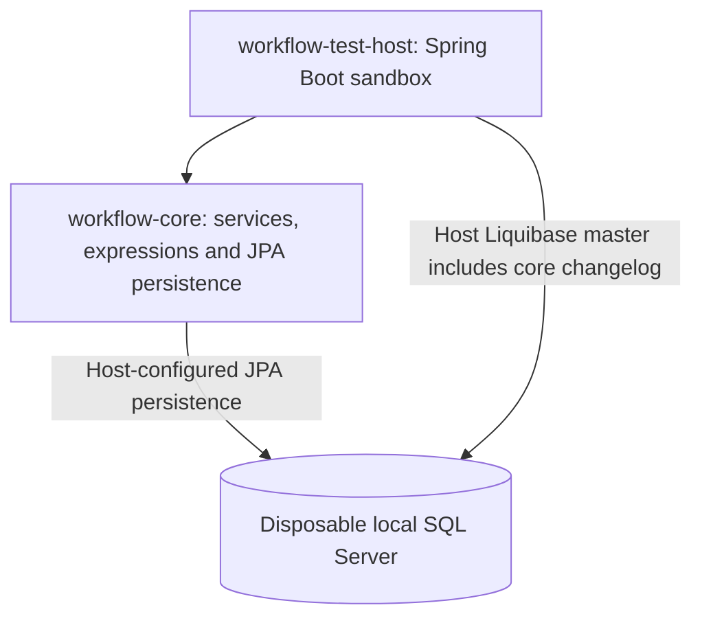
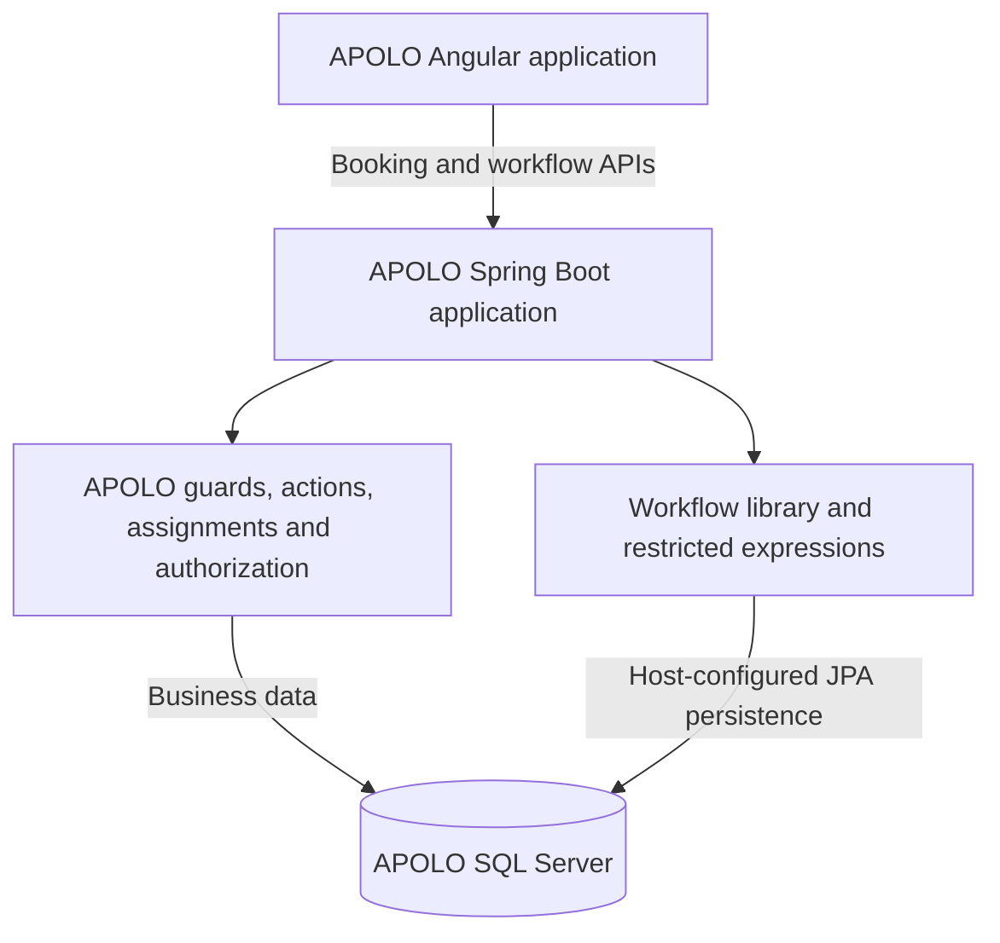

# Reusable Workflow Engine

## Technical Design — APOLO-first Embedded Library

| Document field | Value |
| --- | --- |
| Version | 0.9 — ordered first-match workflow routing |
| Status | Authoritative architecture baseline; exact contracts still require specification |
| Date | 2026-10-31 |
| Initial host application | APOLO |
| Development model | Initially separate workflow-core/workflow-test-host project; workflow-core later joins APOLO's Maven module structure |
| Persistence target | Microsoft SQL Server through JPA persistence inside workflow-core |
| Definition formats | JSON workflows initially; JSON business decisions only with the optional later extension |
| Expression implementation | Restricted Spring Expression Language (SpEL) |
| Current document path | `docs/architecture/workflow-engine-design.md` |

> **Design direction:** Develop separately from APOLO for now, then move workflow-core into APOLO's source/module structure as a sibling of backend. Backend depends on core's ordinary library JAR; core retains its business-independent boundary while joining APOLO's build and release lifecycle. Deliver workflow execution first, using restricted expressions for simple routing. A reusable business decision engine is an optional later capability.

This document consolidates the [original technical design](../../../apolo-docs/workflow-engine/archive/original-technical-design.md) and subsequent [development discussion](../../../apolo-docs/workflow-engine/archive/development-discussion.md). It supersedes earlier suggestions that APOLO must supply the expression evaluator or that every business decision must return a workflow transition key.

Revision 0.8 restores compatible detail that was compressed during consolidation. The [original-design reconciliation](../../../apolo-docs/workflow-engine/architecture/original-design-reconciliation.md) accounts for all 51 original sections. The complete example in section 7.4 is a **proposed design illustration**, not a finalized schema or implemented engine. This restoration preserves F4/F5 and O1/O2/O6; it does not approve the remaining JSON contracts or APOLO business policies.

Revision 0.9 records the owner's 2026-10-31 selection of ordered first-match workflow routing in section 7.3 and centrally enforced expression rules tied to the workflow-language version in section 5.3. These replace rejection of overlapping conditions and independent expression-policy selection. Exact JSON notation and legacy persistence reconciliation remain open. See constitution C08 and the source-precedence record for these revisions and the retained database-design amendments.

**Status convention:** This is the authoritative architecture document for the decisions confirmed on 2026-10-24 and the explicitly recorded later amendments. **AGREED** identifies confirmed direction; **PROPOSED** identifies illustrative contracts; **PROVISIONAL** identifies tentative preferences; **OPEN** identifies unresolved engine/integration details; **DEFERRED — APOLO** identifies business or infrastructure decisions owned by APOLO. The decision register in section 22 is the status reference. Exact names, interfaces, JSON fields, tables, limits, and API paths remain proposed unless stated otherwise.

**AGREED platform baseline:** Java 17 compilation target and JDK 21 runtime, confirmed by the project owner. APOLO's Java 17 POM settings are current and correct. The compiler JDK/toolchain is a separate setting to verify; this document does not claim a Java 21 compilation target. Other framework and dependency versions require verification against the application.

This revision supersedes the earlier JDBC persistence proposal and the `STATE`/`DECISION`/`FINAL` node model. Historical documents and examples must not override this baseline.

**AGREED packaging revision:** use two Maven modules, `workflow-core` and `workflow-test-host`. Core is a Spring/JPA-based feature library containing persistence, expressions and integration configuration. This supersedes the earlier six-module proposal and the requirement for a framework-independent core artifact. Public integration contracts remain independent of APOLO and infrastructure-provider types. Core owns workflow changelogs; APOLO remains the single production migration owner.

**AGREED integration destination (F5):** independent development is the current phase, not a requirement for a permanently separate repository or independently published product. Eventually `workflow-core` becomes a Maven module inside APOLO, alongside `backend`, `frontend` and `configuration`. The source move's timing, final Maven coordinates and the test host's future location remain to be settled. No source move or POM reparenting into APOLO is implied by this documentation revision.

## Contents

1. [Purpose and scope](#1-purpose-and-scope)
2. [Architecture and deployment](#2-architecture-and-deployment)
3. [Modules and dependency direction](#3-modules-and-dependency-direction)
4. [Host responsibilities and dependency management](#4-host-responsibilities-and-dependency-management)
5. [Expression evaluation](#5-expression-evaluation)
6. [Business decision engine](#6-business-decision-engine)
7. [Workflow execution model](#7-workflow-execution-model)
8. [Workflow data and extension contracts](#8-workflow-data-and-extension-contracts)
9. [Human tasks and approvals](#9-human-tasks-and-approvals)
10. [Definition lifecycle and compatibility](#10-definition-lifecycle-and-compatibility)
11. [Persistence design](#11-persistence-design)
12. [Transactions, concurrency, and idempotency](#12-transactions-concurrency-and-idempotency)
13. [Events, audit, and operations](#13-events-audit-and-operations)
14. [Spring Boot integration](#14-spring-boot-integration)
15. [Standalone Angular designer](#15-standalone-angular-designer)
16. [Sandbox and playground](#16-sandbox-and-playground)
17. [Application and HTTP APIs](#17-application-and-http-apis)
18. [Repository and documentation structure](#18-repository-and-documentation-structure)
19. [Developing alongside APOLO](#19-developing-alongside-apolo)
20. [Testing and acceptance criteria](#20-testing-and-acceptance-criteria)
21. [Delivery roadmap](#21-delivery-roadmap)
22. [Decision register and open items](#22-decision-register-and-open-items)
23. [Technical references](#23-technical-references)

---

## 1. Purpose and scope

### 1.1 Workflow first: APOLO-first, reusable by design

Build a small workflow capability that satisfies real APOLO processes while keeping the engine independent of APOLO business classes, database entities, and permissions. APOLO's backend consumes the library; core must not depend on backend classes. Future inheritance from APOLO's root build parent does not change that code dependency boundary.

Workflow execution is the primary deliverable. Supporting expressions are limited to what the initial workflow requires; an independent business decision product must not delay that delivery.

| Capability | Delivery | Responsibility | Typical result |
| --- | --- | --- | --- |
| Workflow engine | First stage | Own process execution, human tasks, allowed operations, routing and history | Transition taken, task created or completed |
| Restricted expression evaluation | Supporting capability within the first stage | Evaluate simple workflow predicates against explicit inputs | Boolean routing result |
| Business decision engine | Optional later extension; not implemented in the first stage | Evaluate reusable business rules and decision tables independently of a workflow | approvalLevel = PARTNER |

The first workflow release must build, start, publish definitions and run processes without a business decision library, decision-definition database tables or decision-management APIs. Its EXCLUSIVE_GATEWAY node is a routing node: it can select an outgoing transition using restricted expressions without a separate business decision engine.

If the optional decision engine is introduced later, it should remain usable outside workflows and return business values that workflows map to transitions. That remains a future design direction, not an initial implementation requirement.

### 1.2 Initial scope

The initial workflow release includes immutable JSON workflow definitions; explicit START, HUMAN_TASK, SERVICE_TASK, EXCLUSIVE_GATEWAY and END nodes; simple expression-based routing; one directly assigned task per activity; a persistent versioned task-type registry; JPA relational runtime storage; optional authorization guards; transactional business actions; durable event handoff; command idempotency; audit history; and a sandbox.

Restricted SpEL uses explicit #facts and #vars inputs. Guards remain registered host checks. No decision-table evaluator, FIRST/UNIQUE table policies, separate decision-definition lifecycle, standalone decision simulation or decision-table editor is implemented in this stage.

First deliver a simple sandbox workflow, then one cross-team booking approval integration in APOLO. Planning-like examples are sandbox fixtures. The standalone workflow designer follows the first successful APOLO integration; it does not require a business decision editor. Registry administration uses an API with versioned JSON import before the designer.

### 1.3 Deliberate exclusions

V1 is not a BPMN implementation, a distributed orchestration service or a general-purpose rules product. The business decision engine is deferred and optional. Forward chaining, arbitrary scripting, generic parallel branches, compensation, subprocesses and live migration of running instances are also excluded.

The original exclusions of embedded business forms, arbitrary external workers, signal/message correlation and event subprocesses remain. Host adapters may translate domain inputs into ordinary commands, but that does not introduce a general message-correlating workflow runtime. Task forms remain host-owned.

Do not create placeholder decision modules, tables or administration endpoints solely to anticipate the optional extension. Keep boundaries clear and add an integration contract when a concrete later requirement justifies it.

### 1.4 Changes from earlier direction

- **Workflow first:** the earlier plan to deliver expressions, rules and workflow as three initial capabilities is superseded.
- **Routing remains in scope:** the EXCLUSIVE_GATEWAY node uses workflow expressions initially. It is not synonymous with a standalone decision engine.
- **Optional business decisions later:** business-value outputs, FIRST/UNIQUE policies and exact pinned decision versions remain design guidance only for that later component.
- **Initial definitions are workflows:** decision JSON schemas, storage, APIs, simulation and editor are deferred with the optional component.
- **Standalone development first, APOLO module later:** the test host exercises core while development is separate; core will later move into APOLO's source tree as a sibling module of backend. A permanently separate artifact publishing lifecycle is not required.

## 2. Architecture and deployment

### 2.1 Independent development environment



The initial sandbox provides configuration, controlled test identities, sample business services, database connections and HTTP endpoints. It exercises the production workflow library without a business decision engine. The workflow designer is added later.

### 2.2 Embedded deployment in APOLO



The engine runs inside the APOLO JVM. No network call is required between a business service and the workflow engine. The later standalone workflow designer uses host APIs, never direct SQL access. An optional business decision component is absent from this initial deployment.

At the agreed source-integration point, APOLO's root reactor includes `workflow-core` and backend declares a normal dependency on it. Core remains an ordinary JAR packaged into the backend application. Sharing a repository and release cycle does not allow core to depend on backend business entities, identity providers or messaging implementations.

### 2.3 Ownership boundaries

| Owner | Owns |
| --- | --- |
| Workflow library | Execution semantics, workflow definitions and expression routing, task lifecycle, persistence contracts and audit structures |
| APOLO | Business meaning, domain entities, business permissions, users, infrastructure, deployment |
| Sandbox | Development fixtures and a reference host integration |
| Designer (later) | Workflow graph/JSON editing and validation; decision-table editing only if the optional component is added |
| Git repository | Source code, documentation, schemas, examples, test cases, release history |
| Host database | Imported and published definitions, active instances, tasks, command receipts, execution history |

Git is the source of truth for development artifacts. The host database is the runtime source of truth. Importing a JSON file is an explicit management operation; the runtime must not fetch a mutable Git branch during execution.

## 3. Modules and dependency direction

### 3.1 Agreed initial modules

| Module | Responsibility | Important dependencies |
| --- | --- | --- |
| workflow-core | Models, entities, repositories, workflow/task/registry services, restricted expressions, JSON codecs, integration interfaces/configuration and workflow Liquibase resources | Spring, Spring Data JPA, Jakarta Persistence and spring-expression; JSON/validation libraries as used |
| workflow-test-host | Executable development host, sample endpoints/adapters, datasource and transaction configuration, migration execution against a disposable local database | workflow-core, Spring Boot host starters, Liquibase and SQL Server JDBC driver; database test tooling belongs here |

During separate development, the workflow root POM is the parent/aggregator with `packaging=pom`. Core produces an ordinary library JAR; only the test host produces an executable Spring Boot JAR. Preserve the current standalone root and development coordinates until the planned source move. Later, core joins APOLO's reactor and is intended to inherit its root parent after the effective build is reviewed. The later Angular designer has a separate frontend build and is not a third workflow Maven module.

Keep models, persistence, services, expressions and integration concerns in separate packages within core. These are implementation boundaries, not separate Maven artifacts. A separate expression API, SpEL adapter artifact, persistence artifact or starter can be extracted later only when concrete reuse or dependency needs justify it. Implement expressions only as required for workflow routing.

### 3.2 Dependency rules

`workflow-test-host` and APOLO's backend each depend on `workflow-core`. Core never depends on either host, the designer or an optional business decision library. Restricted SpEL implementation and its contracts both live inside core; decision-table entities, configuration and migrations remain absent initially.

Core owns workflow, task, task-type and runtime persistence, including JPA entities and Spring Data repositories. It may depend on Spring/JPA and the libraries it directly uses, but must not inherit APOLO's entire infrastructure dependency stack. Keep execution models and integration interfaces separate from entity/JSON representations. Store external user/business references as stable identifiers without JPA relationships to APOLO-owned entities.

**Public API independence:** core interfaces, commands, results, events and context objects use Java standard types or workflow-owned models and identifiers. They must not expose APOLO classes, JPA entities, Keycloak objects, JWT implementation types, Spring Security `Authentication`, or infrastructure-specific types such as JMS messages, database connections or cache-provider objects. Host adapters translate authenticated identity and infrastructure data into these neutral contracts; the core never requires callers to supply provider-specific objects.

Web endpoints, JDBC drivers, connection pooling, migration runners, logging configuration and security/messaging infrastructure belong to the hosts. Core ships changelog resources without configuring a migration runner or requiring Liquibase as a runtime dependency solely to package those resources. Use normal direct Spring/JPA dependencies where needed rather than importing APOLO's backend or its application starters wholesale.

### 3.3 Optional later business decision extension

A future workflow-rules component may provide standalone business decisions and integrate with workflows through an adapter. Its dependency direction must preserve the workflow engine's independent operation; do not make core depend on concrete rules models.

The exact optional adapter, persistence packaging and installation mechanism remain deferred. Business-decision definitions must be rejected as unsupported by the initial runtime rather than silently ignored or treated as simple expressions.

Do not introduce Spring Integration or a messaging broker as a mandatory library dependency. Spring Boot integration means host configuration and transaction participation here.

### 3.4 Proposed internal components and dependency flow

The original component map remains useful after adapting it to the two-module structure. These are suggested package responsibilities inside core, not additional Maven artifacts or finalized class names:

```text
workflow-core
  model/definition       typed graph, variables, bindings and task-type references
  model/command          neutral commands, results, actor/business identifiers
  codec                  workflow JSON parsing and serialization
  validation             schema, graph, binding and publication checks
  service                definition/registry administration and command coordination
  runtime                node traversal and activity/task lifecycle
  expression             restricted routing evaluation and policy enforcement
  integration            guards, actions, assignment/data/capability/event contracts
  persistence            JPA entities, repositories and definition loader
  history                workflow/task audit recording
  db/changelog/workflow  packaged schema resources

workflow-test-host
  host endpoints and configuration
  synthetic planning records, guards/actions/resolvers and capability adapters
  datasource/transaction infrastructure, durable-handoff adapter and migration runner
```

Production controllers and business adapters belong in APOLO backend. An application service coordinates the command transaction and calls focused execution/persistence components. The definition loader returns a typed graph, the executor dispatches by node type, and registered host contracts supply business behavior. Public contracts must not leak JPA entities. Avoid a second engine inside the sandbox, a service-locator context exposing all components, or new interfaces merely to mirror each class.

## 4. Host responsibilities and dependency management

### 4.1 Dependency declarations versus runtime ownership

Every module declares the libraries its source code directly uses. The independently built project has its own tested dependency-management baseline. APOLO controls the versions selected in its application dependency graph through its own dependency management, subject to the library's compatibility requirements. Maven dependency management can control transitive versions; it does not remove the need for direct dependency declarations. [R1](#r1-maven-dependency-management)

After source integration, manage shared Spring/JPA/JSON versions and Java 17 compiler settings through APOLO's root parent so backend and core compile against the same intended baseline. Core continues to declare only its own dependencies. Backend-only version overrides are not automatically inherited by a sibling module; reconcile shared versions at the common parent. Audit inherited dependencies and plugin executions so reparenting does not add application infrastructure or executable Boot packaging to core.

Consequently, APOLO and the workflow project normally share the same Spring and SpEL artifacts at runtime. A separate workflow expression service means a separate configuration and execution policy, **not a second isolated copy of Spring**.

Do not mark all Spring dependencies `provided`. That scope changes transitivity and classpath availability; it is not a general expression of host ownership. Use normal dependencies and intentional optional dependencies where appropriate. [R1](#r1-maven-dependency-management)

### 4.2 Host-supplied infrastructure

The host supplies the `DataSource`, transaction manager, credentials, connection pool, logging configuration, authenticated actor, authorization implementation, and business extensions. It chooses how migrations are executed and how external events are delivered.

The library must not silently create another datasource, application context, transaction manager, security chain, or embedded web server. It must not mutate the host's global JSON mapper configuration; use a specifically configured codec for workflow documents. Decision-document codecs belong to the optional later extension.

### 4.3 Compatibility baseline

Java 17 is the confirmed compilation target and JDK 21 is the confirmed execution runtime. Before implementation, verify the compiler JDK/toolchain and APOLO's effective Spring Boot/Framework, Hibernate/JPA, JSON-library, SQL Server, JDBC-driver, and Liquibase versions and transaction arrangement. Versions copied into older notes are reference evidence, not newly verified compatibility guarantees.

Compile library and sandbox code to Java 17 compatibility and execute integration tests on JDK 21. Enforce the Java 17 API target in the build as well as the bytecode target. Managing dependencies to an older version cannot make code compiled against unavailable APIs compatible.

A sibling Maven aggregator used during separate development does not make APOLO's parent POM or dependency management apply to the library. Aggregation and inheritance are separate concepts. Each project retains its current parent during that phase; the eventual source move includes an explicit review and change of core's parent configuration. [R2](#r2-maven-aggregation-and-reactor)

## 5. Expression evaluation

**Initial supporting scope:** implement the restricted evaluation needed for workflow routing. General typed-value and standalone decision examples below are proposed extension contracts; they do not require a standalone expression product before workflow delivery.

**AGREED — O6:** use a small, strict Workflow Definition v1 including its expression rules: five explicit node types, explicit transitions, declared and validated inputs/output bindings, scalar typed values and restricted Boolean routing expressions. Reject unsupported schema versions and semantic features. Arbitrary object-valued variables and broad scripting are outside the initial contract. The exact schema fields, encodings, operator allowlist, numeric limits and error-code catalog still require specification; agreement on this scope does not mean those artifacts already exist.

### 5.1 Contract

The evaluator parses and validates expressions and evaluates them against explicit, typed inputs. Conditions must yield an actual Boolean; arbitrary truthiness and silent string-to-Boolean conversion are not part of the contract.

Illustrative API, with supporting types to be specified separately:

```java
public interface ExpressionEvaluator {
    ValidationResult validate(ExpressionDefinition expression,
                              InputSchema inputs);

    TypedValue evaluate(ExpressionDefinition expression,
                        EvaluationInputs inputs,
                        ValueType expectedType);
}
```

The evaluator has no persistence dependency and cannot fetch business data itself.

### 5.2 Expression syntax and input namespaces

Use explicit map access rather than relying on implicit bean-property resolution:

```text
#facts['amount'] >= #facts['approvalThreshold']
#facts['riskLevel'] == 'HIGH'
#vars['urgent'] == true
```

For initial workflow routing, `#facts` contains validated inputs prepared by the host data provider, and `#vars` contains the permitted workflow-variable projection. A future standalone decision evaluator can use `#facts` for its validated inputs. The same workflow expression contract is used in validation, predicate preview, sandbox execution, and APOLO.

Typed values initially cover `STRING`, `LONG`, `DECIMAL`, `BOOLEAN`, `DATE`, and `DATETIME`. Financial arithmetic uses decimal semantics, not floating-point approximations. The proposed JSON contract represents decimal and potentially unsafe-size integer values as strings validated against their declared types, avoiding precision loss in the designer. Final encodings must be fixed in the schema.

O6 confirms these initial scalar types and precision requirements. Dates must be explicit and timestamps unambiguous; specify formats, timezone/offset handling, precision and nullability in the schema before implementing the codecs. String encoding for decimals/large integers remains a proposed means of meeting the agreed precision requirement.

Missing required facts, disallowed null values, invalid conversions, and non-Boolean condition results are errors. A false condition means the business predicate evaluated successfully and did not match.

### 5.3 Restricted SpEL execution rules

Use `SimpleEvaluationContext` as the starting point. Spring documents that it supports a restricted subset and excludes Java type, constructor, and bean references, with explicit choices for property and method access. It is not a complete application security policy by itself. [R3](#r3-restricted-spel-context)

**AGREED — revised 2026-10-31:** the engine centrally enforces expression rules as part of each workflow-language version. Definitions do not declare an independent `expressionPolicy`, and host configuration cannot select different expression semantics for the same language version. Incompatible rule changes require a new language version. An engine must preserve the rules of a supported version or reject that version explicitly.

**Owner clarification — 31 October 2026 (L12):** retain standard SpEL syntax and operator, precedence, short-circuit and null semantics within the supported read-only context. Do not design a second expression language or exclude ordinary arithmetic by default. Decode supplied facts/variables into their declared types, preserve exact numeric values and missing-required-data errors, and require actual Boolean routing results. Necessary access/resource restrictions remain; specify and verify how context configuration and typed conversion satisfy those boundaries without silently changing supported SpEL semantics. Language-version compatibility also applies across Spring upgrades.

The rules must enforce the following restrictions:

- Expose only validated scalar values and bounded, immutable data structures. Never expose application services, persistence entities, class loaders, or arbitrary object graphs.
- Disable assignment, mutation, automatic collection growth, and general method invocation. Use narrowly defined read-only accessors; do not rely on arbitrary Java getters being harmless.
- Reject syntax outside the controlled context before publication. Enforce necessary access/resource restrictions structurally through supported AST constructs, rather than blacklisting a few strings or independently redefining ordinary SpEL operators.
- Impose limits on expression length, AST complexity, input size, and total evaluations per command. Table-size limits belong to the optional later decision component. Initially exclude potentially costly features such as unrestricted regular-expression matching and collection traversal.
- Return stable error codes without exposing internal objects, secrets, or stack traces to the caller.

A wall-clock timeout alone is not a guarantee that in-process computation stops safely. The initial trust model is authorized internal definition authors, restricted expressions, and bounded inputs—not arbitrary public code execution. Strong isolation for hostile authors would be a different architecture.

### 5.4 Parsing, caching, and determinism

Parse through the supported SpEL parser; do not implement a second expression language. SpEL distinguishes parsing failures from evaluation failures, which should be translated into distinct domain errors. [R4](#r4-spel-evaluation)

Reuse parsed expressions within one command or evaluation request. Do not start with an unbounded global cache. A bounded cache may be introduced after measurement, keyed by expression source, workflow-language version and relevant compilation configuration; never cache mutable evaluation contexts or previous input values.

Do not allow hidden reads of the current time, random values, or mutable application globals. When a decision needs a date or timestamp, supply it explicitly as a fact so the evaluated inputs can be explained later.

## 6. Business decision engine

**DEFERRED — optional later component.** This entire section preserves future design guidance, not requirements for the initial workflow release. References to V1 inside this section mean the first version of this optional component. Do not implement its rule evaluator, definitions, tables, APIs, simulation or editor in the first stage.

### 6.1 Responsibility

The decision engine evaluates a versioned definition against typed facts and returns business outputs plus an explanation of the evaluation. It does not select workflow nodes, update business objects, send messages, or start workflows.

Conceptual API:

```java
public interface DecisionEvaluator {
    DecisionResult evaluate(DecisionDefinition definition,
                            DecisionInputs inputs);
}

public interface DecisionService {
    DecisionResult evaluate(DecisionVersionRef version,
                            DecisionInputs inputs);
}
```

`DecisionEvaluator` is pure with respect to application side effects. `DecisionService` adds lookup through a supplied definition loader. Both are usable without `workflow-core`.

### 6.2 Two explicit condition formats

Support ordinary decision-table cells as the primary visual model, while retaining an explicit SpEL row format for compound predicates. A definition declares its condition format; do not infer it from ambiguous JSON.

| Format | Representation | Intended use |
| --- | --- | --- |
| `CELLS` | Conditions keyed by declared inputs | Standard business decision tables |
| `SPEL` | One Boolean `whenExpression` per non-default rule | Compound predicates requiring expression syntax |

For `CELLS`, proposed operators are equality, membership, ordered comparisons, and explicit null checks. Conditions within one row are ANDed. An omitted input condition is a wildcard, but it does not waive input-schema validation. Avoid implementing additional operators before a real table needs them.

For `SPEL`, rules invoke the same restricted expression evaluator as workflow conditions. A standard table need not be translated into user-visible SpEL strings, and the editor must not silently change its condition format.

### 6.3 Hit policies and errors

**`FIRST`:** Evaluate non-default rules in document order and return the first match. Rule order is semantic; do not add a second priority mechanism in V1. Trace later rules as not evaluated, not as false.

**`UNIQUE`:** Evaluate all non-default rules. Exactly one may match. Multiple matches are an error even when their outputs are identical.

**Default:** At most one separately marked default rule is allowed, positioned last. It is considered only when no non-default rule matches and does not participate in `UNIQUE` match counting.

**No match:** With no default, return `DECISION_NO_MATCH` as an explicit evaluation failure. Do not silently substitute an empty object or a favorable workflow route. This behavior must be compared with existing APOLO rules during migration.

**Evaluation failure:** A malformed predicate or missing required fact is not a false condition. Stop evaluation and report the failure; never continue to a permissive default after an evaluation error.

V1 excludes forward chaining, side-effecting rule actions, implicit rule dependencies, and `COLLECT` aggregation.

### 6.4 Proposed JSON decision definition

The following complete example uses standard table cells. `schemaVersion` describes the JSON contract; `version` identifies the business definition revision.

```json
{
  "schemaVersion": 1,
  "key": "approval-level",
  "version": 1,
  "name": "Required approval level",
  "type": "DECISION_TABLE",
  "conditionFormat": "CELLS",
  "hitPolicy": "FIRST",
  "inputs": [
    { "key": "amount", "type": "DECIMAL", "required": true },
    { "key": "riskLevel", "type": "STRING", "required": true,
      "allowedValues": ["LOW", "MEDIUM", "HIGH"] }
  ],
  "outputs": [
    { "key": "approvalLevel", "type": "STRING", "required": true,
      "allowedValues": ["DIRECT", "PARTNER"] }
  ],
  "rules": [
    {
      "key": "high-risk",
      "when": { "riskLevel": { "eq": "HIGH" } },
      "then": { "approvalLevel": "PARTNER" }
    },
    {
      "key": "large-budget",
      "when": { "amount": { "gte": "500000.00" } },
      "then": { "approvalLevel": "PARTNER" }
    },
    {
      "key": "default",
      "default": true,
      "then": { "approvalLevel": "DIRECT" }
    }
  ]
}
```

An expression-format row would instead use `whenExpression`, for example:

```json
{
  "key": "high-risk",
  "whenExpression": {
    "language": "SPEL",
    "source": "#facts['riskLevel'] == 'HIGH'"
  },
  "then": { "approvalLevel": "PARTNER" }
}
```

That row belongs to a definition declaring `conditionFormat: SPEL`; the formats are not mixed implicitly. V1 outputs are typed literals. Computed output expressions can be added later with a distinct representation rather than interpreting ordinary strings as executable expressions.

### 6.5 Evaluation result and standalone use

For amount `520000.00` and risk level `LOW`, the example yields:

```json
{
  "decisionKey": "approval-level",
  "decisionVersion": 1,
  "outputs": { "approvalLevel": "PARTNER" },
  "matchedRuleKeys": ["large-budget"],
  "defaultUsed": false
}
```

The complete internal result can also include the content checksum, evaluation policy version, row trace, and diagnostics. Persistence of a standalone evaluation is a host policy, not an unavoidable side effect of the pure evaluator. Workflow execution persists the relevant decision trace in its transaction.

### 6.6 Relationship with APOLO's existing rules

Review representative existing expressions and tables before freezing the new DSL. Compare missing-input behavior, null handling, number conversion, wildcard cells, partial outputs, rule ordering, and no-match behavior. Do not assume that using SpEL automatically makes the new service behavior-compatible.

Keep existing APOLO rule consumers unchanged initially. Migrate a selected rule only after explicit semantic mapping and regression tests; this project does not require a wholesale replacement of APOLO's current rule infrastructure.

## 7. Workflow execution model

### 7.0 Canonical definition language and typed execution model

The definition is a strongly typed JSON language, not an arbitrary collection of JSON properties. Store each published definition as one immutable document with indexed identity/version metadata. Do not normalize the graph into a second authoritative set of node/edge tables. Relational runtime records refer back to the pinned document and its stable keys.

**Restored implementation proposal:** a dedicated Jackson codec converts the document into typed definition objects; graph validation and execution operate on these objects rather than repeatedly navigating raw `JsonNode` trees. Raw JSON remains appropriate at the import/codec boundary. Keep definition models separate from JPA entities and command/result types. Suggested concepts are:

```text
WorkflowDefinition
  schema version, workflow key/version, entry point
  declared variables and permitted inputs
  typed node definitions
  transition definitions
  optional non-semantic designer metadata

NodeDefinition
  StartNode / HumanTaskNode / ServiceTaskNode / DecisionNode / EndNode

Supporting definitions
  VariableDefinition / InputBinding / OutputBinding
  TaskTypeReference / AssignmentDefinition / TransitionDefinition
```

These are conceptual Java types, not selected public class names. Workflow Definition v1 must fix their fields and validation rules. Restricted routing is part of this model; optional business-decision documents remain separate later work.

The same versioned JSON contract is used by import/export, the future TypeScript designer model and the Java codec. A derived in-memory graph index can speed node/transition lookup within a command; it is not another persisted definition or a second designer-specific format.

### 7.1 Graph and node semantics

**AGREED:** V1 uses explicit executable node types and one active process position. The compact `STATE`/`DECISION`/`FINAL` model is superseded.

| Node type | Responsibility |
| --- | --- |
| `START` | Explicit entry point for an instance |
| `HUMAN_TASK` | Create an activity with one directly assigned task; wait for a supported outcome |
| `SERVICE_TASK` | Invoke a registered synchronous host action with declared inputs/outputs in the enclosing transaction |
| `EXCLUSIVE_GATEWAY` | Evaluate Boolean conditions on outgoing transitions in priority order and select one route; no node-level calculation or business-result output |
| `END` | Complete the instance with a defined result |

**PROPOSED graph constraints:** one start node with no incoming transition; at least one end node with no outgoing transitions; all executable nodes reachable from start. Human-task outcomes select explicit outgoing transitions. These exact constraints and start/end semantics must be formalized in Workflow Definition v1.

Starting an instance resolves an eligible published version once and pins it. Start operations use the same authorization, transaction, idempotency, and audit guarantees as later commands. Stable technical keys are independent of display names.

**AGREED — O1 service tasks:** execute registered host actions synchronously within the enclosing command transaction. Declare and validate input/output bindings and permit updates only to declared workflow variables. An action or output-validation failure rolls back the command, including its domain and workflow changes, and returns a structured failure. Do not automatically retry failed business commands initially; caller retries use the command-idempotency contract. Asynchronous waiting, external workers and distributed orchestration remain outside the initial scope. Exact binding fields and error codes are specification work.

**AGREED — O1 action placement:** put workflow-driven business actions in explicit SERVICE_TASK nodes. Transitions select the next node and do not execute business actions in V1. APOLO's endpoint still owns request/domain validation and the enclosing transaction; business effects already performed there must not also execute in a service node. Assign each effect one owner. This decision does not move APOLO-specific policy into the engine.

### 7.2 Guards, actions, and decisions

A **guard** determines whether a requested operation is permitted and returns structured reasons when it is blocked. A **decision** chooses an outcome after valid inputs have been supplied. A **business action** performs an explicitly registered, synchronous domain operation.

Named guards, actions and assignment resolvers are extension references, not arbitrary executable Java stored in JSON. Start and human-task outcome authorization are optional through registered guards with fixed permission inputs; neither requires a mandatory authorization hook. Definitions cannot instantiate classes or access Spring beans by expression.

Available-action queries are advisory. Execution must recheck state, version, authorization, assignment, inputs, and guards inside the command's transactional path.

#### Stable keys, outcomes and transition properties

Preserve technical keys independently of names, translated labels and graph coordinates. Display labels do not select transitions. Published documents remain immutable even when a proposed change affects only a label or layout; edit a new draft version.

**Proposed transition contract:** key, source node, target node and optional display metadata; a human-task transition identifies an outcome declared by its pinned node. Guards and comment requirements belong to that outcome; permission identifiers do not. The engine executes the selected outcome's guards before accepting completion; authorization is checked only when a guard is declared for it. A decision transition carries a Boolean predicate or an explicit default marker. START/SERVICE_TASK success edges are automatic. Actions execute in SERVICE_TASK nodes and event delivery is governed by section 13, not executable transition hooks.

Distinguish the task outcome from the edge identity: both manager and partner tasks can produce `APPROVE`, while the complete example uses distinct `MANAGER_APPROVE` and `PARTNER_APPROVE` transition keys. Definition-wide edge-key uniqueness is the example's proposal; the final key scope must be specified. A command must resolve an edge belonging to the instance's current node and active task, rather than accepting an arbitrary destination node.

When guards block an otherwise authorized action, return structured reasons suitable for the host UI. This illustrative response does not fix the final error schema:

```json
{
  "transitionKey": "MANAGER_APPROVE",
  "available": false,
  "reasons": [
    {"code": "PLANNING_INCOMPLETE", "message": "Required planning data is missing."}
  ]
}
```

Only expose reasons/details the caller is authorized to see. A guard denial means the requested operation is blocked; a false routing predicate is a valid non-match; an evaluation failure is an error. An advisory query must not execute service actions or create a durable command result.

### 7.3 Routing alternatives

**AGREED — revised 2026-10-31:** evaluate non-default outgoing conditions in the explicit priority order declared by the workflow definition. Select the first Boolean true result and stop; later conditions are not evaluated and must not be reported as false. Overlapping conditions are allowed and resolved by order. If all conditions are false, take the separately identified unconditional default, if present; otherwise fail the command. At most one default is allowed. A failure in an evaluated condition, including missing required values, invalid conversions or non-Boolean results, fails the command and never falls through to a later route or default.

Validate all conditions' syntax and permitted features before publication. Preserve evaluation order through serialization and designer editing; diagram layout must not change priority. Published order is immutable and instances retain their pinned definition version. The gateway's conditional routes use their relative order in the top-level transitions array; the default is considered only after all conditions are false, regardless of its position. Language design section 12.1.16 defines the JSON fields. Diagnostic contracts remain specification work. Warnings for obvious unreachable routes are optional future authoring aids, not a promise of complete static overlap detection. This replaces the earlier exactly-one-match rule and does not require the deferred decision-table engine or selectable FIRST/UNIQUE policies.

**Optional later decision-table routing:** only when the deferred business decision component is implemented, evaluate its pinned definition and map a business output to a transition owned by the current node:

```text
approval-level version 1
    output approvalLevel = PARTNER
              |
              v
workflow routing map
    PARTNER -> PARTNER_REQUIRED
              |
              v
transition PARTNER_REQUIRED
    APPROVAL_ROUTE -> PARTNER_REVIEW
```

The workflow engine validates the mapping and the transition's source. An unknown output is a routing error, not a reason to choose a convenient default.

<a id="74-illustrative-sandbox-flow--not-a-frozen-json-contract"></a>

### 7.4 Complete proposed workflow example

**PROPOSED illustration — not a published specification or executable fixture.** This replaces the original section 38 example with the current five-node model. The owner selected integer `schemaVersion: 1` and a single START entry without startNodeKey on 31 October 2026; this does not mean a formal v1 schema exists. Remaining notation and host contracts still require specification. The later database and [language-design decisions](workflow-definition-language-design.md#154-agreed-decisions-and-remaining-details) take precedence over older task-contract illustrations here.

The scenario is a synthetic **sandbox planning review**, preserving the original example's explanatory purpose. It does not select planning as the first APOLO integration: that remains cross-team booking approval. Manager/partner routing, sample thresholds and the adjustment loop are fixtures, not confirmed APOLO business policy. In particular, same-instance resubmission remains PROVISIONAL under O3 and is shown only to explain possible re-entry semantics.

#### Graph and behavior

```text
START -> CAPTURE_REVIEW -> MANAGER_REVIEW
  APPROVE -> APPROVAL_ROUTE
    partner required -> PARTNER_REVIEW
      APPROVE ----------------------------+
    default/direct -----------------------+-> FINALIZE_APPROVAL -> APPROVED
  REJECT (either review) -> FINALIZE_REJECTION -> REJECTED
  REQUEST_CHANGES (either review) -> REQUEST_ADJUSTMENT -> REQUESTER_REVISION
    RESUBMIT -> CAPTURE_REVIEW -> a new MANAGER_REVIEW activity
    CANCEL -> FINALIZE_CANCELLATION -> CANCELLED
```

There is one directly assigned active human task at a time. The adjustment cycle crosses human tasks; it is not an automatic-only cycle. All final business effects are explicit SERVICE_TASK operations. Both successful approval paths execute the same `FINALIZE_APPROVAL` node, fixing the original example's direct path that reached APPROVED without calling the approval action.

#### Proposed notation used in this example

- The unique START node is the entry point. `startPolicy` describes explicit start inputs and optional guards. Start authorization is optional through a declared host guard, with no permission field or mandatory start hook. Drafting the business request occurs in the host before start; it is not a generic waiting STATE node.
- `factProvider` is a logical host extension key. Only `CAPTURE_REVIEW` requests its listed `readFacts`; resolve these at each entry in the command transaction. They are trusted host projections, not client-supplied approval results.
- `inputs` binds declared action inputs from named facts/variables or typed literals. These objects are binding metadata, not object-valued workflow variables. `outputs` maps action output names to declared variables. An empty object means that direction has no values. The action registry supplies matching input/output signatures, checked at publication and at runtime.
- Snapshot variables have `nullable: false`; CAPTURE_REVIEW initializes them before any read. Absence before initialization is distinct from a permitted null value. Every successful waiting position in this example has a complete review snapshot.
- Human-task `outcome` edges are linked to exact registry versions. The engine executes declared outcome guards before task completion; authorization guards are optional and outcomes contain no dedicated `permission` field. Guards and comment requirements follow the pinned human-node contract. Unspecified comment requirements are false for this illustration. The command envelope permits a comment, but its `input` object is empty for these sample outcomes; business form updates use the host endpoint.
- START and successful SERVICE_TASK nodes have one unconditional edge. EXCLUSIVE_GATEWAY has one predicate and one default. No edge contains business actions or executable event hooks. Service output-validation failure fails the command; it does not take the success edge.
- END `result` is a business outcome distinct from instance lifecycle status. Publication state, database IDs, draft revisions and publication audit metadata live in the definition-management envelope and are omitted from the portable graph illustration.

#### Complete definition

```json
{
  "schemaVersion": 1,
  "key": "sandbox-planning-approval",
  "name": "Sandbox planning approval",
  "version": 1,
  "startPolicy": {
    "inputContract": [],
    "guards": ["planningComplete", "noBlockingConflicts"]
  },
  "factProvider": "sandboxPlanningFacts",
  "facts": [
    {"key": "currentBudget", "type": "DECIMAL", "nullable": false},
    {"key": "approvalThreshold", "type": "DECIMAL", "nullable": false},
    {"key": "riskLevel", "type": "STRING", "nullable": false}
  ],
  "variables": [
    {"key": "budgetAtSubmission", "type": "DECIMAL", "nullable": false},
    {"key": "approvalThreshold", "type": "DECIMAL", "nullable": false},
    {"key": "riskLevel", "type": "STRING", "nullable": false}
  ],
  "nodes": [
    {"key": "START", "type": "START", "name": "Submit for review"},
    {
      "key": "CAPTURE_REVIEW", "type": "SERVICE_TASK", "name": "Capture review snapshot",
      "readFacts": ["currentBudget", "approvalThreshold", "riskLevel"],
      "action": "capturePlanningReview",
      "inputs": {
        "budget": {"source": "facts", "key": "currentBudget"},
        "threshold": {"source": "facts", "key": "approvalThreshold"},
        "risk": {"source": "facts", "key": "riskLevel"}
      },
      "outputs": {
        "budget": {"target": "variable", "key": "budgetAtSubmission"},
        "threshold": {"target": "variable", "key": "approvalThreshold"},
        "risk": {"target": "variable", "key": "riskLevel"}
      }
    },
    {
      "key": "MANAGER_REVIEW", "type": "HUMAN_TASK", "name": "Manager review",
      "taskType": "sandbox.review", "taskTypeVersion": 1,
      "assignment": {"resolver": "sandboxManager"}
    },
    {"key": "APPROVAL_ROUTE", "type": "EXCLUSIVE_GATEWAY", "name": "Partner review required?"},
    {
      "key": "PARTNER_REVIEW", "type": "HUMAN_TASK", "name": "Partner review",
      "taskType": "sandbox.review", "taskTypeVersion": 1,
      "assignment": {"resolver": "sandboxPartner"}
    },
    {
      "key": "REQUEST_ADJUSTMENT", "type": "SERVICE_TASK", "name": "Record adjustment request",
      "action": "setPlanningOutcome",
      "inputs": {"outcome": {"source": "literal", "type": "STRING", "value": "CHANGES_REQUESTED"}},
      "outputs": {}
    },
    {
      "key": "REQUESTER_REVISION", "type": "HUMAN_TASK", "name": "Revise planning",
      "taskType": "sandbox.revision", "taskTypeVersion": 1,
      "assignment": {"resolver": "sandboxRequester"}
    },
    {
      "key": "FINALIZE_APPROVAL", "type": "SERVICE_TASK", "name": "Approve planning",
      "action": "setPlanningOutcome",
      "inputs": {"outcome": {"source": "literal", "type": "STRING", "value": "APPROVED"}},
      "outputs": {}
    },
    {
      "key": "FINALIZE_REJECTION", "type": "SERVICE_TASK", "name": "Reject planning",
      "action": "setPlanningOutcome",
      "inputs": {"outcome": {"source": "literal", "type": "STRING", "value": "REJECTED"}},
      "outputs": {}
    },
    {
      "key": "FINALIZE_CANCELLATION", "type": "SERVICE_TASK", "name": "Cancel planning",
      "action": "setPlanningOutcome",
      "inputs": {"outcome": {"source": "literal", "type": "STRING", "value": "CANCELLED"}},
      "outputs": {}
    },
    {"key": "APPROVED", "type": "END", "name": "Approved", "result": "APPROVED"},
    {"key": "REJECTED", "type": "END", "name": "Rejected", "result": "REJECTED"},
    {"key": "CANCELLED", "type": "END", "name": "Cancelled", "result": "CANCELLED"}
  ],
  "transitions": [
    {"key": "BEGIN_REVIEW", "from": "START", "to": "CAPTURE_REVIEW"},
    {"key": "OPEN_MANAGER_REVIEW", "from": "CAPTURE_REVIEW", "to": "MANAGER_REVIEW"},
    {
      "key": "MANAGER_APPROVE", "from": "MANAGER_REVIEW", "to": "APPROVAL_ROUTE",
      "outcome": "APPROVE",
      "guards": ["noBlockingConflicts"]
    },
    {
      "key": "MANAGER_REJECT", "from": "MANAGER_REVIEW", "to": "FINALIZE_REJECTION",
      "outcome": "REJECT", "requiresComment": true
    },
    {
      "key": "MANAGER_REQUEST_CHANGES", "from": "MANAGER_REVIEW", "to": "REQUEST_ADJUSTMENT",
      "outcome": "REQUEST_CHANGES", "requiresComment": true
    },
    {
      "key": "PARTNER_REQUIRED", "from": "APPROVAL_ROUTE", "to": "PARTNER_REVIEW",
      "condition": "#vars['riskLevel'] == 'HIGH' || #vars['budgetAtSubmission'] >= #vars['approvalThreshold']"
    },
    {"key": "DIRECT_APPROVAL", "from": "APPROVAL_ROUTE", "to": "FINALIZE_APPROVAL", "default": true},
    {
      "key": "PARTNER_APPROVE", "from": "PARTNER_REVIEW", "to": "FINALIZE_APPROVAL",
      "outcome": "APPROVE",
      "guards": ["noBlockingConflicts"]
    },
    {
      "key": "PARTNER_REJECT", "from": "PARTNER_REVIEW", "to": "FINALIZE_REJECTION",
      "outcome": "REJECT", "requiresComment": true
    },
    {
      "key": "PARTNER_REQUEST_CHANGES", "from": "PARTNER_REVIEW", "to": "REQUEST_ADJUSTMENT",
      "outcome": "REQUEST_CHANGES", "requiresComment": true
    },
    {"key": "OPEN_REQUESTER_REVISION", "from": "REQUEST_ADJUSTMENT", "to": "REQUESTER_REVISION"},
    {
      "key": "REQUESTER_RESUBMIT", "from": "REQUESTER_REVISION", "to": "CAPTURE_REVIEW",
      "outcome": "RESUBMIT",
      "guards": ["planningComplete", "noBlockingConflicts"]
    },
    {
      "key": "REQUESTER_CANCEL", "from": "REQUESTER_REVISION", "to": "FINALIZE_CANCELLATION",
      "outcome": "CANCEL", "requiresComment": true
    },
    {"key": "APPROVAL_RECORDED", "from": "FINALIZE_APPROVAL", "to": "APPROVED"},
    {"key": "REJECTION_RECORDED", "from": "FINALIZE_REJECTION", "to": "REJECTED"},
    {"key": "CANCELLATION_RECORDED", "from": "FINALIZE_CANCELLATION", "to": "CANCELLED"}
  ],
  "designer": {
    "nodes": {
      "START": {"x": 0, "y": 0},
      "CAPTURE_REVIEW": {"x": 200, "y": 0},
      "MANAGER_REVIEW": {"x": 400, "y": 0},
      "APPROVAL_ROUTE": {"x": 600, "y": 0},
      "PARTNER_REVIEW": {"x": 800, "y": -160},
      "REQUEST_ADJUSTMENT": {"x": 600, "y": 320},
      "REQUESTER_REVISION": {"x": 400, "y": 320},
      "FINALIZE_APPROVAL": {"x": 1000, "y": 0},
      "FINALIZE_REJECTION": {"x": 1000, "y": 160},
      "FINALIZE_CANCELLATION": {"x": 1000, "y": 320},
      "APPROVED": {"x": 1200, "y": 0},
      "REJECTED": {"x": 1200, "y": 160},
      "CANCELLED": {"x": 1200, "y": 320}
    }
  }
}
```

#### Required host capabilities and registry content

The following are **proposed companion contracts**, not implementations or a finalized registry import format:

- Published `sandbox.review` version 1 supports APPROVE, REJECT and REQUEST_CHANGES. Published `sandbox.revision` version 1 supports RESUBMIT and CANCEL. Workflow publication checks both records and the deployed host's matching handlers/screens and outcomes. Their completion input objects are empty in this example; required comments are command-envelope fields.
- `sandboxPlanningFacts` reads the host business object using the trusted business reference and supplies currentBudget/approvalThreshold as DECIMAL and riskLevel as STRING. It validates the sample's accepted risk values HIGH/LOW and supplies all required facts. A missing/invalid fact fails; it is not treated as a default-route signal.
- `capturePlanningReview` accepts `(budget: DECIMAL, threshold: DECIMAL, risk: STRING)` and returns the same typed output names after validation. In this sample it also marks the host request UNDER_REVIEW within the command transaction. The engine writes only the three declared output bindings. Current review values can be refreshed on resubmission, while prior snapshot evidence remains in history.
- `setPlanningOutcome` accepts one STRING outcome from the declared sample set CHANGES_REQUESTED/APPROVED/REJECTED/CANCELLED, returns no outputs and applies the corresponding domain update in the same transaction. It verifies the appropriate domain state/version so unrelated business edits cannot bypass consistency checks. Neither the endpoint nor another action repeats its effect.
- `sandboxManager`, `sandboxPartner` and `sandboxRequester` resolve one direct assignee each. A missing resolver/eligible assignee fails the command. APOLO owns business access and no-self-approval policy; resubmission is performed by the requester. This older example declares no start authorization guard and therefore performs no engine-side start authorization check. This older example also declares no outcome authorization guards: it illustrates workflow checks, not a production permission policy. The complete booking example in the language design shows explicit optional authorization guards.
- `planningComplete` and `noBlockingConflicts` are host guard implementations with structured denial reasons. The host owns their business logic. Core knows only their logical keys.
- Core records workflow/task/transition events through its neutral durable event-recorder contract. The host actions own any planning-domain event records, such as planning approved, using the same transaction. Host delivery handles notifications after commit; there are no broker destinations or notification calls in the definition.

`workflow-test-host` would supply these synthetic business records/adapters; core supplies the graph, task, registry, expression and persistence behavior. The local host executes core migrations through its own master. For a future real APOLO scenario, backend supplies its domain endpoint/adapters and includes the same core master in its existing Liquibase master. Moving core into APOLO does not alter the definition/persistence boundary.

#### Worked command sequence and failure behavior

1. The requester saves the domain draft and submits through the host endpoint. A start command has a unique command ID and trusted actor/business reference. After start authorization/guards, CAPTURE_REVIEW reads and validates facts, records the snapshot and opens a manager task. Instance, domain update, task, history, durable handoff and receipt commit together.
2. With LOW risk, budget 480000 and threshold 500000, manager APPROVE selects DIRECT_APPROVAL and executes FINALIZE_APPROVAL before ending. With budget 520000 or HIGH risk, it opens PARTNER_REVIEW instead. The OR expression combines the original two table rows that had the same partner outcome into one condition. This example has one conditional route and a default. Definitions with several conditions must preserve their explicit priority order under section 7.3.
3. Partner APPROVE executes the same FINALIZE_APPROVAL service. A rejected review uses FINALIZE_REJECTION; a change request records the domain change through REQUEST_ADJUSTMENT and opens the requester task. Required comments and declared guards are enforced before closing the review task. Business-permission checks require an authorization guard or host endpoint policy.
4. In the illustrative adjustment variant, REQUESTER_RESUBMIT refreshes the snapshot and creates a new manager activity/task; earlier activities remain closed and visible. REQUESTER_CANCEL completes the requester task with its CANCEL outcome, updates the domain and ends the instance with result CANCELLED. This outcome is not an implicit administrative task-cancellation operation.
5. Each mutation uses its command ID and expected concurrency token. An identical retry returns the committed result without another task/action/event handoff; a changed request with the same ID conflicts. Tokens, request fingerprints and HTTP encodings remain to be specified.
6. If approval finalization, output validation, assignment, persistence flush or durable recording fails, roll back the whole command. The prior review task remains open and no successful receipt/transition is committed. Invalid predicates never take the default edge. Required evidence for these behaviors is still pending implementation; this document does not execute a workflow or tests.

An example history for the partner path would show start and snapshot capture, manager-task creation, manager APPROVE, the true predicate and captured values, partner-task creation, partner APPROVE, finalization and the APPROVED end result, correlated to their commands. Display labels may simplify this timeline, but must not discard automatic-step evidence.

### 7.5 Automatic execution and loop protection

Automatic routing must be bounded and recorded. Under the agreed synchronous service-task model, a command resolves start/service/decision nodes until a human task or end node is reached. A successful command cannot leave an instance stranded in a decision node.

Reject automatic-only cycles at publication and impose a per-command limit of 50 automatic steps, selected under L16 on 31 October 2026. Count each visit to START, SERVICE_TASK (including its action), EXCLUSIVE_GATEWAY or END as one step. HUMAN_TASK and transitions cost zero; entering a human task pauses progression. Each command has a fresh allowance, and a nonfinal ALL contribution uses none. Allow the 50th step, but fail before executing a 51st and roll back the entire command, including service changes and any triggering task completion; earlier successful commands remain committed. Language design section 14.2 defines the counting examples and boundary rules. The cycle-validation algorithm, error codes and verification against representative workflows remain specification work.

## 8. Workflow data and extension contracts

### 8.1 Domain data versus workflow data

APOLO remains authoritative for planning, budgets, projects, and employees. Workflow variables contain process-owned values, references, and deliberately captured snapshots—not serialized copies of domain entities.

Use an opaque business reference such as `businessType = PLANNING` and `businessId = "48521"`. Do not force every integrating application to use the same numeric primary-key type.

Guards and actions may call host business services using this reference. Expressions receive an already prepared data projection and cannot call those services themselves.

### 8.2 Snapshot policy

Capture facts at an explicit process boundary. The sandbox can snapshot supplied amount and risk facts. The APOLO-specific snapshot fields and material-change classification remain DEFERRED — APOLO.

**AGREED integration policy:** harmless edits may proceed; material booking changes invalidate the current review and require resubmission. APOLO defines which fields are material and performs the business validation. The engine preserves prior activities and decision evidence. **PROVISIONAL:** reuse the same workflow instance with refreshed snapshots and a new review activity; the exact adjustment/resubmission flow is not yet confirmed.

Live facts are allowed for checks that genuinely concern the present state, but their evaluated values and provenance must be recorded when they affect a consequential decision. Re-evaluating an old definition against today's domain data is not a historical replay.

For example, snapshot a sandbox budget of 520000 and threshold of 500000 at submission. A later live budget of 480000 does not rewrite the evidence for the earlier partner route. A guard checking whether the business object currently has blocking conflicts may use live host data, while routing uses the captured review snapshot. At a permitted resubmission boundary, capture a new snapshot and retain the prior activity's evaluated values in history. Never infer APOLO's material-field list or resubmission policy from these sample numbers.

### 8.3 Extension APIs

| Extension | Responsibility |
| --- | --- |
| `WorkflowGuard` | Check business preconditions and return structured blocking reasons |
| `WorkflowAction` | Perform allowed domain changes in the enclosing transaction |
| `AssignmentResolver` | Resolve one direct assignee for the initial task activity |
| Authorization guard (for example, `hasAuthorisation`) | Optional registered host guard for start or a human outcome; receives trusted context and declared inputs. When present it must pass. No mandatory WorkflowAuthorization completion hook is required. |
| `WorkflowDataProvider` | Prepare explicitly declared facts before expression evaluation |
| `WorkflowEventRecorder` | Persist a durable event handoff in the transaction |

Expose only the context needed by each extension. Read-only guards should not receive a mutable engine service. Actions receive controlled variable-update operations and the business reference, not unrestricted access to engine internals.

Duplicate extension keys fail application startup. Unknown keys fail publication or execution readiness checks. No reflective class-name loading from workflow documents is allowed.

#### Controlled command context

The original context concept is retained, with neutral identifiers and narrower capabilities. A proposed read-only context contains command/correlation identity, instance identity, pinned workflow reference, business type/ID, current node, relevant activity/task identity, trusted actor and a typed variable view. Instance identity is available after allocation during start; the start contract must define that timing. Exact Java signatures and identifier representations remain specification work.

An action receives declared inputs and returns declared outputs for validated variable bindings; it does not receive an unrestricted entity manager or writable map of all engine state. Guards and assignment resolvers receive only the read context they need. Host adapters resolve the business reference through their domain services. Expression evaluation receives only the permitted scalar `#facts`/`#vars` projection, not the command context, repositories or host services.

Logical keys such as `sandboxManager` or `planningComplete` resolve through host-supplied registries. They are not Java class names, Spring bean identifiers or Keycloak roles embedded in the document. Registration can use explicit configuration; the old custom annotation examples do not require a new annotation framework.

### 8.4 Variable validation

Validate client-supplied values against a declared command input schema and a server-side allowlist. Clients cannot set arbitrary workflow variables, choose their own actor identity, or inject previously computed approval results.

Use exact type conversion and explicit nullability. For the initial relational variable model, enforce one value column appropriate to the declared type. Arrays and arbitrary object-valued variables remain outside the initial persistent-variable contract.

**Restored declaration proposal:** each variable has a stable key and scalar type, with explicitly specified nullability, initialization/default behavior and permitted writers. A default is a typed initial value, not a fallback for malformed input or failed evaluation. Publication should detect undeclared references and incompatible bindings where statically possible; runtime validates actual values and required availability before reads. The sample initializes review variables through a service node before their first use.

Declarations also support documentation, editor field choices and expression completion. They do not authorize clients to set snapshot values or action results. Map only the input fields allowed by the particular command/task contract.

## 9. Human tasks and approvals

### 9.1 Activity versus task instance

Distinguish a **task activity**—a particular activation of a human-task node—from an assigned work item. The proposed runtime model creates a new activity identity on re-entry and preserves previous tasks; exact resubmission behavior remains provisional for APOLO.

The first vertical slice uses one activity with one assigned task and `SINGLE` completion. Keep the model capable of representing multiple participants in one activity without adding generic graph-level parallel execution.

### 9.2 Collective approval extension

The 31 October 2026 owner decision selects `SINGLE`, `ALL` and a fixed task list; see [language design sections 9.2–9.3](workflow-definition-language-design.md#92-creating-and-assigning-review-tasks). `ALL` collects one configured outcome from every required task, or resolves early on another permitted outcome and cancels open siblings. The first decisive command that successfully commits wins without implicit outcome priority. Submission, resolution, cancellations and synchronous progression share one transaction; failure preserves earlier committed contributions. Audited reassignment preserves the fixed obligations. Exact limits and runtime contracts remain specification work. `ANY`, `QUORUM`, abstention and dynamic task lists remain outside the initial scope.

A group of candidate users for one claimable task is different from separate required approvals. The schema and UI must not confuse these concepts. Unsupported completion policies must fail validation rather than degrade to `SINGLE`.

### 9.3 Task lifecycle

**AGREED initial scope:** directly assigned tasks with the selected SINGLE/ALL policies and fixed task list, task completion, cancellation, and history. Approve, reject, and request-changes are outcomes, not separate lifecycle statuses. `OPEN`, `COMPLETED`, and `CANCELLED` are the proposed status encoding. Claim/release, candidate groups, general delegation, expiration, timers, and collective policies beyond SINGLE/ALL are deferred. A due date, if included, is metadata and does not trigger automatic expiration.

For a human task, execution requires host business authorization and direct assignment, unless the host explicitly grants an audited override. APOLO enforces no self-approval and country/business access checks, with audited reassignment and administrator overrides. The engine exposes neutral authorization contracts and records the trusted actor; country rules are not hard-coded. Resolver failure or an empty required assignment is a visible error.

Leaving a human-task node completes or cancels its task according to the selected operation. Task completion and advancement are part of one transaction.

#### Assignment and task activation detail

Resolve an assignee when a human-task activity is entered, then persist that direct user reference on its task. A registered resolver may consult host organization data, but it must yield one eligible assignee for the initial policy. The old `ROLE` suggestion must not become an implicit candidate group or claim/release flow. Direct-user versus resolver JSON encodings remain proposed.

Queries should use the stored assignment. Do not silently reassign an open task because organization data or a resolver result changed; use the audited reassignment path. Unknown resolvers, missing assignees and unsupported task-type versions fail visibly and roll back the entering command.

Each re-entry creates a distinct activity/task record while retaining previous records. Completing an outcome closes the current task; cancellation must preserve who cancelled it and why under the eventual operation contract. A `CANCEL` outcome completing a requester task and terminating the process is distinguishable from an administrative operation that cancels an outstanding task. Exact task/instance status encodings remain proposed. A due date is metadata only; no timer is implied.

### 9.4 Persistent task-type registry

**AGREED:** persist versioned task-type metadata independently of runtime task instances. Each published task type has a stable key/version, display metadata, and supported outcomes. Published versions are immutable, and workflow definitions pin the exact version.

The registry is a design-time catalog, not executable business behavior. It must not contain Java class names, Spring bean names, frontend component names, APOLO routes, security-provider types, or messaging destinations. APOLO owns task screens and business implementations.

Before publication, verify both that the referenced task type/outcomes exist and that the target host supports that exact type/version. A catalog entry alone is insufficient. Unsupported task types must never fall back to a generic completion path that bypasses domain validation.

**AGREED — administration before the designer:** provide a registry administration API with versioned JSON import. Authorized administrators manage task-type metadata through this API; the later designer uses the same administration contract. Imported metadata is not proof that the host implements a task: publication still checks the exact supported task-type version and outcomes against host capabilities. Keep routine task execution independent of repeated catalog queries.

**AGREED — O2 lifecycle and imports:** use DRAFT → PUBLISHED → RETIRED. Import/edit drafts, then publish immutable task-type versions. Retirement removes a version from new selection without invalidating existing pinned references; retain records and compatible host support for active tasks. Reimporting the same key/version with equivalent content returns the existing result. Reject different content for an existing published version, including a subsequently retired version. Replacing draft content requires an explicit revision-checked update; import must not silently overwrite it. Define content normalization before using checksums to determine equivalence.

**AGREED — O2 host capabilities:** obtain supported task-type versions, outcomes and registered extensions from a capability provider supplied by the deployed host, rather than a separately maintained administrator list. Publication checks this provider in addition to registry metadata. Deployment compatibility must account for the screens and handlers required by active tasks. Metadata import does not create executable capabilities or prove frontend support.

**Specification work remaining:** exact API/import schema, normalization/checksum rules, revision-token representation and capability-provider interface. Automatic registration during host startup is not required. These details implement the agreed O2 behavior; the administration approach and lifecycle are no longer open choices.

### 9.5 Host-owned task screens and completion data

**AGREED:** APOLO resolves the task screen and business handler from `taskType + taskTypeVersion`. V1 does not add separate `formKey` or `formVersion` fields. A host can map several supported task-type versions to one compatible screen; a type version does not require a separate frontend component.

APOLO owns the task inbox/shell, domain-specific forms, business-data loading and validation. The workflow API supplies task metadata, supported outcomes and the business-object reference; the domain API supplies booking details. The registry must not hold frontend component names or API routes. Unknown or unsupported type/version combinations fail explicitly rather than opening a generic form that bypasses business rules.

Workflow completion history records the outcome, authenticated actor, timestamp, correlation and permitted comment/input evidence. Full booking form data remains in APOLO. Deliberate decision snapshots are permitted under section 8.2 and do not justify copying the complete business entity.

The host must retain compatible screen/handler support for task-type versions referenced by active tasks, or explicitly reject an incompatible deployment. The designer is a definition editor; it is distinct from APOLO's runtime task screens.

## 10. Definition lifecycle and compatibility

### 10.1 Four different versions

Do not conflate:

| Version | Meaning |
| --- | --- |
| Library release | Version of the Java implementation |
| JSON `schemaVersion` | Version of the definition language, including its expression rules |
| Definition `version` | Immutable revision of a particular workflow or decision |
| Draft revision / row version | Concurrency token for an editable record |

Record the workflow-language version and relevant engine/validator implementation identity in publication and audit metadata. The language version determines the expression rules; there is no independently selected expression-policy version. Engine upgrades must preserve those rules for supported versions. Compatibility evidence is required before claiming support, subject to the project's current verification instructions. The existing F001 `expression_policy` column requires separately specified persistence reconciliation; do not alter applied changesets or imply that a schema migration has already occurred.

### 10.2 Lifecycle

```text
DRAFT -> validate -> PUBLISHED -> RETIRED
           ^
           |
    edit a draft revision

Published version N -> clone -> draft version N+1
```

Validation is an operation whose result is stored against the exact draft revision; `VALIDATED` is not a lifecycle status. Editing a draft invalidates its earlier validation result, and publication must validate the current revision and host capabilities. Published definition content is immutable. Running instances remain pinned to their original workflow version. Retirement prevents new direct selection but does not delete definitions required by existing executions.

When the optional extension is introduced, pinned decision dependencies must remain available to published workflows that reference them. Retiring a decision is not an implicit change to every dependent workflow; preventing new use through those workflows requires an explicit lifecycle action on the dependents.

### 10.3 Pinning business decisions

**DEFERRED — optional extension only.** Initial workflows pin workflow and task-type versions and contain their routing expressions. They do not reference separate business decision definitions. The following dependency rules apply only if that extension is introduced.

A published workflow references exact decision versions, never `latest`. Publication resolves portable key/version references to local IDs and stores dependency metadata and content checksums.

Import must reject a conflicting document with an existing key/version but a different checksum. A byte-identical repeat import may be treated as idempotent. Hash the stored immutable document representation consistently and define canonicalization before using hashes across exports.

### 10.4 Validation pipeline

Initial validation covers JSON syntax/schema, duplicate keys, nodes/transitions, reachability, start/end constraints, automatic-cycle prevention, workflow routing expressions, registered host extensions and task policies. Reject decision-table references as unsupported. Business-decision bindings and output mappings are validated only by the optional later extension.

Under O1/O6, validate declared service input/output bindings and permitted variable targets. Reject transition business actions, asynchronous service execution and unsupported semantic features rather than silently ignoring them. Registry references and deployed-host capabilities follow the agreed O2 checks.

Publishing validates against the target host's capabilities and requires publish permission. Successful publication cannot guarantee every future runtime input will be valid; execution must still handle input, authorization, and evaluation failures explicitly.

The complete published document, including any embedded `designer` metadata, is immutable. Layout-only changes do not change business semantics, but they must not edit a published document in place. Separate mutable presentation storage can be introduced later if necessary.

**Restored publication checklist, to formalize in Workflow Definition v1:**

1. Parse JSON with duplicate-property detection; validate the schema version and supported fields/types.
2. Check document/key identity, unique node keys and the selected transition-key scope; resolve all source/target references.
3. Validate the selected entry/end constraints, reachability, human outcomes, decision defaults and node-specific properties. The complete example proposes one unconditional success edge for START/SERVICE_TASK and at most one default edge for EXCLUSIVE_GATEWAY; exact cardinalities remain specification work.
4. Detect automatic-only cycles and validate execution-bound configuration. Loops passing through a human task require new activity semantics and are distinct from automatic cycles.
5. Check declared variable types, input/output bindings, initialization before required reads where determinable, and permitted variable writers.
6. Parse routing expressions and enforce the policy allowlist/limits; validate expected Boolean results and resolvable variable references.
7. Resolve host permissions/extensions and pinned registry types/outcomes against deployed capabilities; check assignment and command-input/comment contracts.
8. Bind the validation result to the current draft revision and relevant policy/capability context. Revalidate publication if that context changes.

Publication validates static structure. Execution still checks current identity, authorization, assignment, inputs, concurrency, live guards and action outputs. The original sentence saying validation happens only before publication must not be read as permission to omit those runtime checks.

## 11. Persistence design

### 11.1 Storage policy

Initially store workflow definitions as JSON documents with indexed identity/version/status metadata. Store instances, tasks, variables, history and command receipts relationally. Separate business decision documents and dependency metadata are added only with the optional extension.

The initial SQL Server representation for definition documents is `NVARCHAR(MAX)` with `CHECK (ISJSON(definition_json) = 1)`, subject to confirming the host's JSON-function support. SQL Server documents this storage approach; JSON schema and business validation remain application responsibilities. A native JSON type is not a V1 prerequisite. [R5](#r5-sql-server-json-document-storage)

Use a dedicated schema such as `wf`, configurable at deployment. The database stores definitions but does not execute SpEL or workflow business logic.

### 11.2 Proposed logical tables

| Table | Principal fields / purpose |
| --- | --- |
| `workflow_definition` | ID, stable key, name, description |
| `workflow_definition_version` | Definition ID, version, schema version, status, JSON, checksum, publication metadata |
| `decision_definition` (deferred) | ID, stable key, name |
| `decision_definition_version` (deferred) | Decision ID, version, schema version, status, JSON, checksum, publication metadata |
| `workflow_decision_dependency` (deferred) | Workflow version, decision node key, exact decision version |
| `workflow_instance` | ID, workflow version, business type/ID, current node, status, timestamps, concurrency token |
| `workflow_variable` | Instance ID, variable key, value type, typed value columns |
| `workflow_activity` | Instance ID, node key, activation identity, task policy, status |
| `workflow_task` | Activity ID, task key, pinned task-type version, direct assignee, status, outcome and completion information |
| `workflow_task_type_version` | Stable task-type key/version, display metadata, publication metadata; DRAFT/PUBLISHED/RETIRED lifecycle |
| `workflow_task_type_outcome` | Supported outcome keys for an immutable task-type version |
| `workflow_history` | Instance ID, sequence, command ID, transition, source/target, actor, timestamp, comment |
| `decision_evaluation` (deferred) | Decision version, command/history correlation, matched/default result metadata |
| `decision_evaluation_value` (deferred) | Evaluation ID, input/output key, typed value, redaction metadata |
| `decision_rule_trace` (deferred) | Evaluation ID, rule key, order, evaluated/not-evaluated state, result |
| `workflow_command_receipt` | Command ID, request fingerprint, actor, instance, completion/result reference |

**Initial migration boundary:** decision_definition, decision_definition_version, workflow_decision_dependency, decision_evaluation, decision_evaluation_value and decision_rule_trace are deferred with the optional business decision engine; do not create or require them initially. Record simple expression routing and relevant facts in workflow history/snapshots. The remaining table list is still a proposed logical model, not final DDL.

### 11.3 Constraints and indexes

Require unique definition keys, unique `(definition_id, version)`, unique `(instance_id, variable_key)`, unique `(instance_id, sequence_number)`, and a unique command ID in the host's command namespace. Use foreign keys to immutable versions and activity/task relationships.

**Database independence:** reusable workflow migrations must create and evolve the workflow schema without requiring APOLO-owned tables or foreign keys to them. User, organization and business-object identifiers are logical external references; host adapters resolve them and enforce the relevant business validation and authorization. Foreign keys between workflow-owned tables remain required where they enforce the relationships above. The sandbox must be able to apply the same workflow migrations without creating APOLO domain tables.

Index business-object lookup, active instances, open tasks by assignee, history by instance/sequence, and (only for the optional extension) decision dependencies. Whether more than one active instance is allowed for a business object is a host business policy, not a universal library constraint.

For typed values, define legal type/column combinations and null semantics in database constraints and Java validation. Choose decimal precision/scale and timestamp encodings explicitly before physical schema implementation.

### 11.4 Definition loading and migrations

Load the exact immutable workflow definition once per command. Loading separate referenced decision definitions applies only to the optional later extension. Do not preload every definition into an application-wide cache.

`workflow-core` ships versioned Liquibase resources under `db/changelog/workflow/`, with `db/changelog/workflow/workflow-master.xml` as the stable entry point. `workflow-test-host` includes that entry point from its own master and executes it against a disposable local SQL Server database. APOLO includes the same entry point from its existing Liquibase master and remains the single production migration owner.

Core must not declare a `SpringLiquibase` bean, ship a global `spring.liquibase.change-log` setting or start its own migration lifecycle. The host provides Liquibase, datasource configuration and execution ordering. Test-host fixtures belong in the test host's changelogs, not the reusable workflow master. The initial master can be empty while the physical schema is still unspecified; it does not establish that workflow tables or runtime behavior have been implemented.

Moving core into APOLO does not transfer changelog ownership to backend or introduce another runner. Keep the classpath entry point, included resource paths and already-applied changeset identities stable across the source move so Liquibase recognizes existing migrations.

The engine library version and required database schema version must be checked together. Migrations must preserve records referenced by running instances and retained audit history. Preserve already-applied Liquibase changesets; introduce subsequent schema changes through new changesets with stable identifiers and explicit ordering. Liquibase owns schema evolution; JPA mappings must not independently create or update the production schema.

### 11.5 Definition loader and concrete runtime record sketches

Restore the loader seam as an internal core abstraction, conceptually `load(definitionVersionId) -> WorkflowDefinition`. Its database implementation reads immutable JSON and metadata through core persistence and decodes it with the workflow codec. Exact class names and identifier types remain proposed.

```text
command -> instance -> pinned definition-version ID
        -> SQL Server document + metadata -> workflow codec -> typed graph
        -> one command-local definition reused through automatic traversal
```

At start, select an eligible published version once and store its identity. Later commands load that pinned version, never resolve only the workflow key to the newest version. A missing or incompatible pinned document fails visibly; it must not fall back to a replacement version.

V1 has no global definition cache. Small documents and human-scale activity are planning expectations, not measured capacity guarantees. If profiling later justifies a bounded cache, place it behind the loader and key it by immutable version identity plus the needed codec/policy compatibility context; never cache mutable command state or runtime authorization decisions.

The following sketches restore implementation detail without selecting DDL, lengths, numeric precision, null encodings or concurrency-token mapping:

```text
instance:
  id, definition_version_id, business_type, business_id, current_node_key,
  status, started_at/by, completed_at, concurrency_token

variable:
  instance_id, variable_key, value_type,
  string_value | long_value | decimal_value | boolean_value | date_value | datetime_value
  unique(instance_id, variable_key); only the declared type's value slot is used

activity:
  id, instance_id, node_key, activation identity/sequence, status, entered_at, ended_at

task:
  id, activity_id, task_type_version_id, assigned_user_reference,
  status, created_at, optional due_at, completed_at/by, outcome

history:
  instance_id, sequence, command/correlation identity, activity/task references,
  source/target node, transition key, manual/automatic kind, actor/time,
  permitted comment, routing predicate/result and necessary snapshot evidence
```

Current variable rows describe current process state. Historical routing evidence must retain the values used by earlier decisions when current values are refreshed. Store this evidence using workflow-owned history/snapshot structures; the exact representation belongs in the persistence specification and requires no deferred decision-engine tables. The numeric row IDs in the original examples were illustrative; external business/user IDs remain opaque references.

## 12. Transactions, concurrency, and idempotency

### 12.1 Atomic command boundary

A workflow command must atomically cover synchronous domain changes, workflow state, variable changes, task completion/creation, history, decision traces, durable event handoff, and the successful command receipt.

Use host transaction participation equivalent to `PROPAGATION_REQUIRED`. Spring documents that this joins an existing transaction or starts one when absent; `REQUIRES_NEW` instead creates an independent transaction and is not the normal execution policy here. [R6](#r6-spring-transaction-propagation)

Sharing a database name is insufficient evidence of atomicity. Verify that workflow JPA repositories and APOLO business persistence participate in the same effective transaction. APOLO owns the transaction infrastructure; the library joins it through integration contracts. Entity-manager configuration and flush behavior remain OPEN integration details. Tests must prove rollback in both directions, including commit-time failures. A synchronous action must not independently commit its business update.

### 12.2 Proposed command execution sequence

In the initial implementation, decision traces mean the evaluated workflow routing conditions and selected transition. They do not require decision-engine trace tables.

This sequence illustrates the required atomic boundary under O1. Workflow-driven business actions execute only in service nodes; APOLO-owned orchestration must not duplicate those updates. Exact host integration ordering is verified under O7.

1. Authenticate the caller, validate command shape, and obtain the trusted actor context.
2. Enter or join the host transaction. Check for a committed receipt for the same command ID; verify caller access and request fingerprint before returning a previous result.
3. Load the instance and its exact definition version, validate the requested operation, and claim the instance for this mutation using a concurrency-checked database update.
4. Recheck business authorization, direct task assignment, guards, comments, and typed inputs against the current state.
5. Apply validated command input to permitted variables and complete the current activity as appropriate.
6. Take the transition; execute registered synchronous actions only in SERVICE_TASK nodes, validate their outputs and record routing traces until a HUMAN_TASK or END node is reached.
7. Create the resulting task activity or mark the instance completed. Persist history and durable event records.
8. Persist the command receipt and result reference in the same transaction. Report success only after the enclosing transaction commits.

A command failure rolls back all of these database effects. A rejected command can be logged separately for operations, but must not appear as a committed transition.

### 12.3 Optimistic concurrency

**AGREED:** optimistic concurrency must prevent duplicate advancement. **PROPOSED:** use SQL Server `ROWVERSION` as an opaque concurrency token, not as a date or a sequential workflow event number. Its JPA mapping, generated-value refresh, and flush behavior must be validated before selection; an alternative JPA version mapping requires an explicit contract decision. SQL Server describes it as an automatically generated binary row-version value. [R7](#r7-sql-server-rowversion)

Require an expected token for mutations. A conditional instance update with no affected row becomes a conflict. The proposed implementation claims the instance early so commands on the same instance serialize before business actions; all subsequent changes remain in the transaction. The exact SQL and lock behavior must be verified under APOLO's isolation settings.

Task and variable mutations must participate in the same instance-level serialization policy. Do not assume locking only the final state update protects separate task writes.

An instance lock does not serialize unrelated changes to its APOLO business object. Domain actions and guards must also enforce the appropriate business-row version checks, locks, or snapshot rules. Document a consistent lock order and test concurrent domain edits, not just duplicate approvals.

### 12.4 Idempotency

Commands carry a client-generated UUID. Persist the request fingerprint and committed result atomically. The same ID and same request returns the prior result; the same ID with different content returns a conflict.

Check a successful receipt before rejecting a retry for an old expected-version token: a legitimate retry often carries the token used before the successful operation. Reauthorize access to the previous result.

The command-receipt uniqueness constraint must handle concurrent duplicate requests. Treat a racing insertion as a conflict/retry condition, not as permission to run the operation twice. After a concurrency conflict caused by waiting behind another command, roll back and recheck for a committed receipt in a fresh transaction before returning a stale-version error. Failed, fully rolled-back commands do not leave successful receipts.

Idempotent database execution does not imply exactly-once external delivery. Under O1, the initial engine does not automatically retry failed business commands. Caller retries use the command ID and request fingerprint; receipt lookup/recheck is not permission to rerun business effects automatically. Durable event-delivery retries remain a separate host responsibility.

## 13. Events, audit, and operations

### 13.1 Reliable side effects

Initial embedded integration uses synchronous service calls for workflow commands. Workflow events describe completed facts for notifications and downstream reactions; internal task advancement does not require JMS.

The library owns the meaning and neutral contract of workflow/task events. APOLO owns booking-domain events, JMS/Artemis adapters, destinations, serialization, delivery/recovery and notification policy. If an APOLO domain event is later used as an input, a host adapter translates it into a neutral workflow command; the core does not depend on booking event classes.

Never send email, call an external API, or publish to a non-transactional broker as though that operation could be undone by SQL rollback. Instead, record an event handoff within the command transaction and deliver it after commit. Business updates required for an approval's atomic result must remain in the booking/workflow transaction; moving them to an asynchronous event consumer would change the agreed consistency guarantee.

The event contract contains a stable event ID, command ID, instance ID, definition reference, event type, actor, timestamp, and the minimum required payload. Specify event schema versioning, correlation and causation fields in the integration contract. Prefer task/business references over full entities; authorized consumers obtain additional business data through host services. The host can connect `WorkflowEventRecorder` to an existing transactional outbox/publication registry. The sandbox supplies a reference implementation.

Design for at-least-once delivery, retry visibility, and idempotent consumers. A simple after-commit callback without durable storage is not the project's reliability contract. An outbox may serialize its payload, but workflow state remains in the relational model rather than being reconstructed from that payload.

### 13.2 Audit and privacy

Record manual and automatic transitions, the exact workflow version, evaluated routing conditions, relevant facts and authenticated/system actors. Separate business decision versions, matched table-rule keys and table outputs are added only with the optional extension. Use a command correlation ID to connect the events of one operation. Task history must also explain creation, assignment, audited reassignment, completion and cancellation, including task/activity IDs, actor, timestamp, previous/resulting status or assignee, outcome and permitted comment. Forwarding events to host logging does not replace the authoritative persisted workflow/task history. Deferred task operations need audit semantics when introduced.

Only collect facts needed to explain the decision. Restrict access, retention, and redaction by host policy; never log arbitrary expression contexts or entire domain entities. A redacted value or hash may support integrity checks without making complete historical reproduction possible. State that limitation explicitly.

Append-only application history is not automatically tamper-proof storage. Audit-grade immutability, independent retention, or evidence signing would require additional controls outside the initial engine.

Normal workflow commands append history; they do not rewrite earlier decisions to reflect a new label, snapshot or resubmission. Corrections/reassignments need their own attributed records. Host-approved retention/redaction is a separate policy with explicitly documented evidence limitations. The UI may collapse automatic steps for readability while retaining them for authorized inspection.

### 13.3 Operational visibility

Expose structured errors and host-integrated metrics for command failures, concurrency conflicts, expression errors, decision failures, overdue tasks, and event delivery retries. Provide health/readiness checks for schema compatibility and required extension registrations.

An invalid decision leaves the instance in its previous stable state because the command rolls back. Surface the failure with a correlation ID; do not silently advance the process or mark it approved.

## 14. Spring Boot integration

Spring integration configuration lives inside `workflow-core`; there is no separate starter module. Hosts explicitly import the core configuration and supply business extension implementations. As implementations are added, register workflow services and configure workflow entities/repositories to participate in the host persistence context. If automatic registration is needed later, Boot supports conditional external-JAR auto-configuration; any such mechanism must match the verified host baseline. [R8](#r8-spring-boot-auto-configuration)

Configuration requirements:

- Reuse the selected host datasource and transaction manager. Require explicit selection when multiple candidates exist.
- Keep transaction handling at tested workflow service boundaries or transaction templates within core. Execution logic should remain independently testable. Do not rely on calls that bypass transaction interception.
- Keep JPA entities/repositories, JSON codecs, engine assembly, and extension registration separately testable. Explicitly configure workflow entity/repository scanning and participation in the host persistence context; do not create an independent transaction boundary by accident.
- Do not automatically expose administrative controllers or broaden the host's security configuration merely because the JAR is present.

Illustrative properties, to be formalized during implementation:

```properties
workflow.enabled=true
workflow.persistence.schema=wf
workflow.execution.max-automatic-steps=50
```

HTTP controllers initially live in the sandbox and APOLO integration packages, delegating to shared application services. A reusable web-adapter artifact can be extracted when both hosts demonstrate a genuinely common contract.

`workflow-core` is an ordinary non-executable JAR. Only `workflow-test-host` is packaged as a standalone Spring Boot application. The standalone Angular build is not a dependency of either Java module.

## 15. Standalone Angular designer

### 15.1 Responsibilities

The first designer milestone edits workflow graphs and their canonical JSON definitions. A business-decision workspace is optional and deferred with the business decision engine; it is not a prerequisite for the workflow designer.

The workflow view supports the five agreed node types, transitions, direct assignments, pinned registry task types, variable declarations, permissions, and named extension references. Workflow routing expressions can be edited and validated without table rules. Typed decision columns, cell conditions, hit policies and a table-expression mode belong only to the optional later decision editor.

Provide JSON inspection/editing, validation errors located at specific fields/nodes, import/export, publication status, and test cases with evaluation traces. An expression failure must look different from a false condition.

### 15.2 Contract and round-trip guarantees

Maintain a versioned workflow JSON Schema initially. A separate decision schema is added only for the optional component. Java and TypeScript models must be tested against the same fixtures. Model generation is optional; contract consistency is mandatory.

Visual editing must preserve supported semantics. Reject unsupported schema versions, operators, node types, or completion policies instead of silently dropping fields. Treat unknown non-semantic extension metadata according to an explicit preservation policy.

Layout data may appear in an optional `designer` section and must never influence routing. The runtime ignores layout. Coordinates and colors do not replace stable technical keys.

The frontend never executes SpEL or makes authoritative authorization decisions. Backend validation, simulation, and execution provide the actual results. Displaying an available action is not permission to execute it.

#### Restored designer/runtime correspondence

```text
visual editor <-> TypeScript definition model <-> canonical workflow JSON
               <-> host definition API <-> immutable document in SQL Server
               -> workflow codec -> typed Java definition -> engine
```

Keep visual and JSON modes synchronized against that one contract. Until edited JSON parses and validates sufficiently for a graph, show the error and preserve the draft text rather than silently replacing it with an older graph. START/END use entry/terminal shapes, HUMAN_TASK a review node, SERVICE_TASK an action node and EXCLUSIVE_GATEWAY a routing node; transitions remain edges. These visual choices are proposals, not a selected graph library.

Node properties expose supported task-type versions, direct assignment resolution, service inputs/outputs and terminal result as appropriate to the node type. Human nodes expose outcomes, guards and comment requirements; their transitions select routes and contain no permission identifiers; decision edges expose conditions, explicit evaluation priority and a separately identified unconditional default. Authors must be able to inspect and deliberately change priority. Do not restore transition actions or a decision-table panel to initial scope. Type/variable declarations supply editor choices; backend errors identify the relevant field/node/edge. Optional layout coordinates are keyed by stable node keys and never affect routing.

### 15.3 Host connectivity and security

Configure the designer for a particular sandbox or APOLO API environment. The host provides permitted extension metadata and supported capabilities so the editor can show relevant choices without exposing arbitrary bean names or internal classes.

Use the host-approved authentication flow. Prefer same-origin routing where practical; otherwise configure narrow cross-origin access and the appropriate credential protections. Do not store database credentials or long-lived infrastructure secrets in the designer.

Definition editing, simulation, publication, and runtime administration are separate permissions. Publishing is an explicit reviewed action, not an automatic consequence of saving a draft.

## 16. Sandbox and playground

The sandbox is a thin reference host and a permanent development tool. It contains a small planning-like domain with an amount, risk level, owner, manager, partner, and business approval status. These are test fixtures, not a copy of APOLO.

It should support starting instances, submitting commands as controlled test actors, inspecting tasks/history, changing sample business facts, evaluating workflow routing predicates, and deliberately triggering errors. Test-only authentication and seed data must be clearly isolated from production configurations.

Provide two distinct modes:

| Mode | Effect |
| --- | --- |
| Workflow predicate preview | Pure expression evaluation with supplied facts; no domain actions or task changes |
| Sandbox process execution | Real engine commands and transactions against sandbox tables |

Do not label execution of real business actions as a dry run merely because a transaction may later be rolled back. A workflow preview must either stub actions explicitly or restrict itself to side-effect-free operations.

The playground should expose a visible execution timeline early, even before the full graph editor. It is the primary way to inspect routing behavior while the language evolves.

## 17. Application and HTTP APIs

The reusable Java application services are the primary engine boundary. HTTP endpoints are host adapters.

**AGREED production entry point:** an APOLO booking-specific endpoint/service owns business orchestration and the transaction and invokes workflow operations. Generic workflow endpoints below illustrate sandbox or authorized administration APIs; they must not provide a bypass around booking validation. Under O1, workflow-driven actions belong in service nodes, not transitions. APOLO and engine adapters must assign each business effect one owner; exact host transaction integration and ordering remain subject to O7 verification.

APOLO owns infrastructure, external delivery/recovery, and audit-retention policy. The reusable library still defines the required atomicity and durable-handoff contracts; host ownership does not defer production reliability.

Proposed API groups:

| Area | Representative operation |
| --- | --- |
| Instances | `POST /api/workflows/instances`, `GET /api/workflows/instances/{id}` |
| Commands | `POST /api/workflows/instances/{id}/commands` |
| History and tasks | `GET /api/workflows/instances/{id}/history`, `GET /api/workflows/tasks` |
| Workflow definitions | Draft creation, revision update, validation, publication, retirement |
| Decision definitions (deferred) | Optional extension only; no initial administration API |
| Decision simulation (deferred) | Optional extension only; no initial endpoint |
| Host capabilities | Versioned supported task types, outcomes, and registered extensions |
| Task registry | Administration API with versioned JSON import before designer delivery; exact paths/schema OPEN |

Example mutation request:

```json
{
  "commandId": "81b3c0d4-31a0-443f-a6c5-36f16c7d91b2",
  "transitionKey": "MANAGER_APPROVE",
  "expectedVersion": "AAAAAAAAB9E=",
  "input": {},
  "comment": null
}
```

The host derives the actor from authentication, not from a client-supplied actor field. Draft updates also require a concurrency token.

Return structured error codes, field/node references where relevant, and correlation IDs. Proposed HTTP mappings are conflict for stale versions or reused command IDs with different input, forbidden for authorization failure, and a validation/business-error response for invalid definitions, blocked guards, or invalid routing. Do not leak internal stack traces.

List endpoints must be paginated and authorization-filtered. An instance response may include current state, tasks, and available actions with blocking reasons, but server-side execution remains authoritative.

**Restored runtime UI projection, proposed wire shape:**

```json
{
  "instanceId": "example-instance",
  "node": {"key": "MANAGER_REVIEW", "name": "Manager review"},
  "task": {"id": "example-task", "taskType": "sandbox.review", "taskTypeVersion": 1},
  "availableActions": [
    {"transitionKey": "MANAGER_APPROVE", "outcome": "APPROVE", "available": true},
    {"transitionKey": "MANAGER_REQUEST_CHANGES", "outcome": "REQUEST_CHANGES", "available": true, "requiresComment": true}
  ]
}
```

The host task shell renders this authorized projection and obtains business form data separately. It does not reproduce graph/permission logic in Angular. Assignment, graph position and an expected version may change after the query; the mutation path rechecks them. Reject an edge from another node even when its outcome label matches. Show human-friendly history by default while retaining authorized access to automatic routing details and recorded facts.

## 18. Repository and documentation structure

The current project documentation is organized as shown in the [documentation guide](../README.md#documentation-and-feature-structure). The source project has its parent POM and two modules directly under the repository root. The tree below extends that standalone structure with planned artifacts; it is not the complete current layout or the final APOLO layout.

Use one independent engine repository initially, with separate Maven and frontend build lifecycles:

```text
workflow-engine/
├── pom.xml
├── README.md
├── AGENTS.md
├── workflow-core/                   # Ordinary library JAR; owns workflow changelogs
├── workflow-test-host/              # Executable Spring Boot host; runs migrations
├── designer/                        # Standalone Angular application
├── dev/
│   └── workspace-pom.example.xml
└── docs/
    ├── constitution.md
    ├── constraints.md
    ├── assumptions.md
    ├── coding-standards.md
    ├── specification-driven-development.md
    ├── design-sources.md            # Local designs, supporting sources and precedence
    ├── architecture/
    │   ├── workflow-engine-design.md
    │   ├── Workflow_Engine_Database_Design_v1.md
    │   └── workflow-definition-language-design.md
    └── features/
        └── <feature-id>-<name>/     # Created when specification work begins
            ├── spec.md
            ├── plan.md
            ├── tasks.md
            ├── evidence.md
            ├── schemas/            # When required by the feature contract
            └── examples/
```

This tree combines existing modules/governance documents with planned feature folders, an optional workspace file and the later designer. The agreed source-repository layout nests feature work under `docs/features/`. Active engine designs live under `docs/architecture/` and are linked from `design-sources.md`; supporting APOLO documentation and historical discussions remain in the sibling `apolo-docs` repository. Maintain one authoritative copy of each design. Business-decision artifacts are deferred. The root POM aggregates exactly `workflow-core` and `workflow-test-host`; the designer builds separately. Proposed JSON in section 7.4 does not establish implemented workflow behavior or a finalized schema.

The eventual source/module destination is:

```text
apolo/
├── pom.xml                         # Common parent and reactor
├── frontend/
├── backend/                        # Depends on workflow-core
├── configuration/
└── workflow-core/                  # Ordinary JAR; owns workflow code and changelogs
```

Keep one authoritative copy of core after the move. `workflow-test-host` remains a development convenience with no production dependency from backend. Whether it moves into APOLO as an optional development module or remains outside the normal APOLO build is open; neither choice permits a second maintained copy of core. The designer's placement and frontend build remain separate decisions.

`README.md` is the entry point. This design document records architecture; specifications define exact contracts; decision records preserve choices and reasons; evidence records distinguish observed behavior from pending checks. Do not copy the complete architecture into every file. The current owner instruction is no automated tests; acceptance requirements remain documented and unperformed checks are marked NOT RUN.

Root `AGENTS.md` records module boundaries, safe build commands, the no-tests instruction, security invariants, definition-version rules and specification/evidence discipline. Keep affected schemas/examples consistent when their contracts change. Treat proposed design changes as proposals until reviewed; generated code must not silently redefine execution semantics.

Use a private, appropriately owned repository for work-related material, with organizational approval for its location and access. Do not commit credentials, production data, or unapproved proprietary material. This document does not select a public license or establish ownership rights.

## 19. Developing alongside APOLO

### 19.1 Sibling repositories and an optional workspace

This arrangement applies while the workflow project is developed separately, before core joins APOLO's module structure.

```text
C:\dev\
├── apolo\                          # APOLO Git repository
│   └── pom.xml
├── workflow-engine\                # Independent engine Git repository
│   └── pom.xml
└── pom.xml                         # Local development aggregator
```

Keep the projects separate during this development phase. No Git submodule or repeated source copying is required. The optional workspace POM coordinates a local build; it does not become either project's parent or replace the planned source integration.

Example aggregator:

```xml
<project xmlns="http://maven.apache.org/POM/4.0.0"
         xmlns:xsi="http://www.w3.org/2001/XMLSchema-instance"
         xsi:schemaLocation="http://maven.apache.org/POM/4.0.0 https://maven.apache.org/xsd/maven-4.0.0.xsd">
    <modelVersion>4.0.0</modelVersion>
    <groupId>dev.workspace</groupId>
    <artifactId>apolo-workspace</artifactId>
    <version>1.0.0-SNAPSHOT</version>
    <packaging>pom</packaging>
    <modules>
        <module>workflow-engine</module>
        <module>apolo</module>
    </modules>
</project>
```

For early integration while the projects remain separate, APOLO can declare a normal library dependency:

```xml
<dependency>
    <groupId>io.github.leontecristian</groupId>
    <artifactId>workflow-core</artifactId>
    <version>${workflow.version}</version>
</dependency>
```

These are the current standalone development coordinates. For an interim combined build, `${workflow.version}` must match the version in the engine reactor, currently `0.0.1-SNAPSHOT`; matching artifact names alone is insufficient. At the eventual source move, align core's coordinates and backend's dependency with the chosen APOLO group/version policy. No coordinate rename is selected now.

### 19.2 Combined build

The supplied backend POM declares artifact ID backend. If the actual integration checkout uses artifact ID `apolo-backend`:

```powershell
mvn -f C:\dev\pom.xml -pl :apolo-backend -am clean verify
```

Replace that selector with the actual APOLO artifact ID after inspecting its POM. The Maven reactor orders modules according to their dependencies; `-am` includes required projects available in that reactor. Modules not required by the selected application, such as the sandbox, need not be built. [R2](#r2-maven-aggregation-and-reactor)

The command uses the checked-out source, including uncommitted engine changes. Running Maven only inside APOLO does not automatically build a sibling checkout.

Import the workspace POM into the IDE and verify that the engine dependency resolves to the matching source module. This supports source-level development without copying engine code into APOLO. An APOLO process must still be rebuilt/restarted as required to load changed classes; a sibling checkout is not automatic hot deployment.

### 19.3 Independent engine and sandbox build

From the workflow repository:

```powershell
./mvnw.cmd -Dmaven.test.skip=true clean package
```

To prepare the sandbox and its dependencies, then run only the application:

```powershell
./mvnw.cmd -Dmaven.test.skip=true -pl :workflow-test-host -am install
./mvnw.cmd -f workflow-test-host/pom.xml spring-boot:run
```

These scaffold build commands skip test compilation and execution. Run on JDK 21 and configure a disposable SQL Server datasource before starting the host. Only `workflow-test-host` declares executable Spring Boot packaging. Do not apply `spring-boot:run` to the parent or core. The project's README documents database configuration and build commands. Packaging success alone does not verify SQL Server migrations or workflow behavior.

### 19.4 Build and release lifecycle across the two phases

During separate development, use a combined reactor or locally installed artifacts for local integration. If cross-repository distribution is needed before the source move, publish a fixed library version and its parent/dependency metadata to an approved Maven repository. A separate artifact registry or independently released workflow product is not a prerequisite for the eventual APOLO module arrangement.

While builds span two repositories, pin both revisions for reproducibility and verify the supported host baseline. After source integration, APOLO's reactor builds core and backend from the same checkout/release revision, with core participating in APOLO's CI and release lifecycle. Preserve module boundaries and host compatibility checks. Artifact publication then follows APOLO's release policy; it does not require a separate workflow release process.

The Angular designer has its own build and deployment artifact. Building APOLO's backend must not automatically compile or deploy the designer.

### 19.5 Planned source integration into APOLO

At the agreed integration point:

1. Move the authoritative `workflow-core` source module into APOLO alongside backend and add it to the root `<modules>` list. Retire the old authoritative source location rather than maintaining two copies.
2. Review the effective APOLO parent, then reparent core to that root parent and align the group/version and Java 17 release target. Use parent dependency management for shared libraries while keeping direct dependencies module-specific; do not use backend as core's parent.
3. Update backend's dependency to the reactor core artifact. Keep the direction `backend -> workflow-core`. Backend implements core's neutral integration interfaces; core never depends on backend.
4. Import core configuration and extend APOLO's existing entity/repository registration without dropping its current packages. Use the shared persistence context and transaction manager so business and workflow updates remain atomic.
5. Include the existing workflow master through APOLO's existing Liquibase master. Preserve resource paths and changeset identities; do not create another migration runner.
6. Settle the test host's development location and update its dependency/build instructions. It must consume the same core implementation and remain outside the production backend dependency graph.

The destination and dependency direction are agreed. Timing, final coordinates, detailed parent configuration and test-host placement remain integration work. The current standalone POMs stay in place until that move is performed.

## 20. Testing and acceptance criteria

### 20.1 Required test layers

Use pure Java tests for workflow graph and predicate-routing semantics; expression-rule tests against the chosen SpEL baseline; SQL Server integration tests for persistence and transactions; Spring context tests for host integration; and, at the later designer milestone, frontend round-trip/validation tests. Build to Java 17 compatibility and run the sandbox and integration checks on JDK 21.

A simplified in-memory repository is useful for fast engine tests, but it is not evidence that SQL Server concurrency or rollback behavior is correct. Run persistence tests against an isolated real SQL Server fixture.

### 20.2 Minimum acceptance matrix

| Area | Required proof |
| --- | --- |
| Default | Used only after successful evaluation produces no ordinary match |
| Failure handling | Missing facts, type errors, and expression errors do not become false or default approval |
| Expression restrictions | Type access, constructor calls, bean access, mutation, method invocation, and disallowed costly constructs are rejected |
| Precision | Decimal thresholds and large identifiers survive workflow JSON/backend round trips; editor round trips are tested at the later designer milestone |
| Routing | First true condition in declared priority order selects a route and stops evaluation; all false uses the explicit default or fails if absent; evaluated-condition errors fail without fallback; publication validates every condition |
| Completion | Both direct approval and partner approval perform the same required business finalization |
| Review invalidation | Material-change approval invalidation is enforced by the APOLO integration; same-instance resubmission tests await confirmation of the provisional flow |
| Publication | Invalid graphs, unresolved extensions, unsupported decision-table references and duplicate keys rejected |
| Versioning | An instance pinned to version 1 is unaffected by publication of version 2 |
| Transactionality | Domain failure rolls back workflow changes; workflow failure rolls back domain changes |
| Concurrency | Two simultaneous approvals cannot both complete the same activity |
| Idempotency | Identical retry returns the committed result; different request with the same ID conflicts |
| Crash recovery | A committed event handoff survives a process restart and can be retried |
| Security | No self-approval; host country/business checks; unauthorized actors cannot publish, simulate restricted facts, complete tasks, or execute transitions; overrides/reassignment audited |
| Host configuration | No additional datasource/security chain; intended bean overrides and manager selection work |
| Task registry | API/import works without the designer; DRAFT/PUBLISHED/RETIRED, equivalent reimports, conflicting published-content rejection and revision-checked draft updates verified; deployed-host capabilities checked at publication; existing references retained on retirement |
| Task screens | APOLO resolves taskType + taskTypeVersion; no formKey/formVersion in V1; unsupported versions fail visibly; domain data and validation remain host-owned |
| Node model | Five explicit node types; synchronous service inputs/outputs validated; failures roll back; no transition business actions or automatic business-command retries; automatic-step limit enforced |
| Designer round trip (later milestone) | Supported semantics preserved; unsupported definitions rejected visibly |
| Independent workflow operation | Build/start/publish/execute without a business decision module, decision tables or decision-management APIs |

If the optional business decision engine is introduced, add FIRST/UNIQUE policy, output mapping, independent evaluation and pinned-definition tests at that time. They are not initial workflow acceptance criteria.

Document verification scenarios for the agreed `ALL` behavior before implementation, including fixed obligations, concurrent submissions and rollback. The current owner instruction prohibits adding or running automated tests unless changed; unperformed checks remain NOT RUN. `ANY` and `QUORUM` remain deferred.

### 20.3 First end-to-end success criterion

In the standalone sandbox, submit a planning request, perform manager approval, route using a workflow predicate over supplied facts, complete any required partner task, and inspect a consistent history and business outcome. Then integrate one cross-team booking approval through an APOLO-owned endpoint and prove shared-transaction rollback. APOLO must supply the business rules needed by that scenario; unresolved overbooking and cross-border alternatives are not engine requirements.

No business decision engine, decision table or full graphical editor is required to validate this first end-to-end slice.

## 21. Delivery roadmap

| Milestone | Deliverable and exit condition |
| --- | --- |
| 0 — Workflow contracts and compatibility | Formalize agreed O1/O2/O6 in Workflow Definition v1 (including expression rules) and registry contracts, with schemas/examples; verify O7 against the host's Java 17 target/JDK 21 baseline |
| 1 — Working workflow in the sandbox | Five node types, one directly assigned task, registry/API/import, simple restricted routing, JPA/SQL Server persistence, audit, atomic commands, concurrency, idempotency and durable handoff |
| 2 — Early APOLO integration | Cross-team booking approval through its domain endpoint; host authorization, registry compatibility, dependency alignment and shared-transaction rollback |
| 3 — Workflow designer | Graph/JSON editing, registered task types, routing expressions, validation and controlled publication; no decision-table editor required |
| 4 — Release hardening | Operational/recovery tests, migrations, compatibility and fixed artifacts; reliability is mandatory for any earlier production deployment |
| Optional later — Business decisions | Only when justified: Decision Definition v1, standalone rules/table engine, FIRST/UNIQUE, storage/APIs/simulation, workflow adapter and optional decision editor |

Do not insert a standalone expression product or business decision engine ahead of the first working workflow. Implement and test the restricted expression support as part of the workflow slice. The optional business decision component has no committed delivery milestone and must not block sandbox, APOLO integration or workflow designer work.

Timers, collective approvals and advanced orchestration remain separate deferred capabilities. Concurrency, atomicity and durable handoff remain mandatory. Start/outcome authorization is optional through declared guards; host query and receipt-access controls still apply.

## 22. Decision register and open items

### 22.1 Confirmed decisions — 2026-10-24

The Q identifiers trace the decision questionnaire; F1/F2/F3 reconcile the development discussion, F4 records the two-module decision, and F5 records separate development followed by source integration into APOLO. Later Java clarification takes precedence over the earlier Java 21 compilation statement. The supplied discussion body matches the preserved [development discussion](../../../apolo-docs/workflow-engine/archive/development-discussion.md); its earlier alternatives do not reopen decisions already confirmed here.

| Question | AGREED decision |
| --- | --- |
| Q1 | Simple sandbox example, then cross-team booking approval in APOLO |
| Q2 | Java 17 compilation target; JDK 21 runtime; compiler JDK/toolchain verified separately |
| Q3, revised by F4 | Spring/JPA-based workflow-core with internal persistence, expression and integration packages, plus executable workflow-test-host; optional business decisions deferred by F3 |
| Q4–Q5 | Human tasks in the first working workflow; one direct assignee per activity; completion, cancellation and history; other task capabilities deferred |
| Q6 | Persistent versioned task-type registry with host compatibility checks before publication |
| Q7 | Visual designer after the first successful APOLO integration |
| Q8 | Explicit START, HUMAN_TASK, SERVICE_TASK, EXCLUSIVE_GATEWAY and END nodes |
| Q9 | #facts/#vars workflow expressions initially; business-value outputs and FIRST/UNIQUE retained only for the optional later decision component (F3) |
| Q10 | DRAFT/PUBLISHED/RETIRED; validation results tied to exact draft revisions |
| Q11 | Atomic domain/workflow changes, concurrency protection, command idempotency, durable event handoff |
| Q12 | APOLO booking endpoint/service owns business orchestration and invokes the workflow library |
| Q17 | Harmless edits allowed; material changes invalidate approval and require resubmission; APOLO defines materiality |
| Q18 | No self-approval, host country/business access checks, audited reassignment and administrator overrides |
| Q19 | Versioned specifications, schemas and executable examples before substantial implementation |
| Q20 | APOLO owns transaction/delivery infrastructure and operations; library defines integration guarantees |
| Q21, clarified by F5 | Develop core and its host separately now; eventually move workflow-core into APOLO as a sibling Maven module of backend, retaining the library boundary |
| Follow-up F1 | APOLO resolves screens/handlers from taskType + taskTypeVersion; no separate formKey/formVersion initially |
| Follow-up F2 | Registry administration API with versioned JSON import before the designer; later UI uses the same contract |
| Follow-up F3 | Workflow engine first; business decision engine optional and not implemented in the first stage. Expressions support simple workflow routing; no initial rules-module/storage/API/editor dependency |
| Follow-up F4 | Exactly two Maven modules: workflow-core and workflow-test-host. Core is a Spring/JPA-based library owning entities, repositories, services, expressions, integration contracts/configuration and changelog resources. Test host executes migrations locally; APOLO includes the workflow master in its existing Liquibase master as the single production migration owner. Supersedes the framework-independent core artifact and separate expression/persistence/starter modules. |
| Follow-up F5 | Separate development is the initial phase. workflow-core will become a source/Maven module inside APOLO, alongside backend, and participate in its build/release lifecycle. Backend depends on core; core has no backend code dependency. A permanently separate repository/publishing lifecycle is not required. Move timing, final coordinates and test-host placement remain open. |

Earlier boundaries still apply to workflows and task types: immutable published versions, pinned references, JSON definitions with relational runtime, SQL Server first and host-owned business entities. Equivalent business-decision versioning applies only if the optional component is later introduced. No independent production workflow microservice is planned.

The sibling Maven workspace remains optional during separate development. The two workflow module names and core's eventual destination inside APOLO are agreed. The source-move timing, test-host placement, final coordinates, repository access and release responsibilities remain open. Any interim artifact registry is conditional on a need to distribute artifacts before the move.

<a id="222-unresolved-questions-and-ownership"></a>

### 22.2 Review outcomes, remaining specifications and ownership

**Owner amendment — 2026-10-31:** O6 routing now uses ordered first-match selection as specified in section 7.3 and constitution C08. This supersedes the earlier multiple-match error rule. Exact route-order notation, expression diagnostics and optional authoring warnings remain specification work. Other unresolved contracts keep their recorded status.

| ID | Status / owner | Question and required decision point |
| --- | --- | --- |
| O1 | AGREED — engine contract; specification pending | Synchronous registered SERVICE_TASK actions in the enclosing transaction, declared/validated inputs and outputs, rollback on failure, no automatic business-command retries. Workflow business actions live in service nodes, not transitions; each effect has one owner. Continue automatic nodes to a human task/end with a step limit. Specify bindings, limits and error codes before implementation. |
| O2 | AGREED — registry/host contract; specification pending | API/import with DRAFT/PUBLISHED/RETIRED, immutable published versions, equivalent reimports returning the existing result, conflicting published content rejected and explicit revision-checked draft updates. Deployed host supplies capabilities; retain active-task compatibility. Specify API/schema, content normalization and provider interface before implementation. |
| O3 | PROVISIONAL — APOLO (Q15) | Return adjustment requests through the same instance, refresh snapshots and create a new review activity on resubmission. Confirm before implementing that business flow. |
| O4 | DEFERRED — APOLO (Q16) | Alternative-resource proposal, acceptance and reapproval behavior is undecided; no default selected. |
| O5 | DEFERRED — APOLO (Q13–Q14) | Excess-allocation calculations, partial confirmation, capacity intervals, approver sources/precedence/fallback and cross-border routing. Not part of current engine design; required only before integrating a scenario that needs them. |
| O6 | AGREED — strict initial contract; specification pending | Five node types, explicit transitions, declared bindings, scalar typed values and restricted Boolean routing. Preserve numeric precision, explicit dates and unambiguous timestamps; fail missing required inputs/invalid expressions and reject unsupported semantics. Specify exact JSON/encodings, nullability, operator allowlist, limits and errors. Business-decision contracts remain deferred. |
| O7 | PENDING VERIFICATION — host integration | Effective Spring/JPA/Hibernate/JSON/SQL Server/Liquibase versions, compiler toolchain, entity-manager participation, transaction manager, flush/locking and JPA concurrency-token mapping. No new toolchain or token mapping is selected. Prove atomicity and retries on SQL Server before production. |
| O8 | DEFERRED — APOLO integration | Material fields/snapshots, country versus tenant boundaries, permissions and override policy details. The high-level Q17/Q18 policies are agreed; concrete mappings remain host-owned. |
| O9 | PARTLY AGREED — APOLO infrastructure | APOLO is the single production migration owner and includes core's workflow master in its existing Liquibase master (F4). Deployment-specific migration ordering/settings, durable-handoff adapter, delivery/recovery and retention/redaction remain deferred. Durability and atomicity remain mandatory. |
| O10 | PARTLY AGREED — source integration and ownership | F5 establishes separate development now and workflow-core inside APOLO later. The current development group is io.github.leontecristian. Settle move timing, final coordinates, test-host placement, access and release/compatibility owners before the move; select an interim artifact registry only if needed. |
| O11 | OPEN — later designer milestone | Angular baseline, graph library and detailed editor interactions. Does not block the initial engine/sandbox. |

Deferred capabilities include claiming/releasing, candidate assignment, delegation, task expiration, timers/reminders, collective approval, general parallel orchestration, subprocesses and live migration of active instances. Audited administrative reassignment does not imply a general delegation feature.

No migration of existing APOLO runtime instances, automatic replacement of existing rules, or universal database support is implied.

### 22.3 Next implementation artifacts

Create **Workflow Definition v1**, including its expression rules, and registry API/import/capability contracts, with schemas and executable examples/tests. O1/O2/O6 direction is agreed; formalize its remaining exact fields, encodings, limits and interfaces before implementation. O7 remains pending verification; no compiler JDK, concurrency-token mapping or effective dependency versions are newly confirmed. APOLO concerns remain deferred, including the provisional O3 resubmission preference. **Decision Definition v1**, decision-table fixtures and their schemas remain deferred. These are planned artifacts, not files created by this update.

## 23. Technical references

The project decisions above are design choices, not claims that a framework already implements them. The references below support the underlying Maven, Spring, and SQL Server mechanisms. Public documentation was checked on 2026-10-23; current documentation does not establish APOLO's installed versions. Use the matching versioned references after the compatibility baseline is confirmed.

The previous project document, **APOLO Workflow Engine – Design Document**, supplied the original JSON/relational architecture, graph concepts, extension model, and APOLO planning example. The present document adopts independent library development and workflow-first delivery, with business decisions retained as optional future guidance.

### R1. Maven dependency management

Apache Maven, *Introduction to the Dependency Mechanism*: direct/transitive dependencies, scopes, dependency management, and BOMs.

```text
https://maven.apache.org/guides/introduction/introduction-to-dependency-mechanism.html
```

### R2. Maven aggregation and reactor

Apache Maven, *Guide to Working with Multiple Modules*: aggregation, reactor ordering, and also-make behavior.

```text
https://maven.apache.org/guides/mini/guide-multiple-modules.html
```

### R3. Restricted SpEL context

Spring Framework API, *SimpleEvaluationContext*: supported access modes and excluded expression features.

```text
https://docs.spring.io/spring-framework/docs/current/javadoc-api/org/springframework/expression/spel/support/SimpleEvaluationContext.html
```

### R4. SpEL evaluation

Spring Framework Reference, *Evaluation*: parser, expression API, evaluation context, and error categories.

```text
https://docs.spring.io/spring-framework/reference/core/expressions/evaluation.html
```

### R5. SQL Server JSON document storage

Microsoft Learn, *Store JSON documents*: document storage and JSON-validity constraints.

```text
https://learn.microsoft.com/en-us/sql/relational-databases/json/store-json-documents-in-sql-tables
```

### R6. Spring transaction propagation

Spring Framework Reference, *Transaction Propagation*: participation in existing transactions and independent transaction scopes.

```text
https://docs.spring.io/spring-framework/reference/data-access/transaction/declarative/tx-propagation.html
```

### R7. SQL Server rowversion

Microsoft Learn, *rowversion (Transact-SQL)*: concurrency tokens and their distinction from timestamps.

```text
https://learn.microsoft.com/en-us/sql/t-sql/data-types/rowversion-transact-sql
```

### R8. Spring Boot auto-configuration

Spring Boot Reference, *Creating Your Own Auto-configuration*: external JAR configuration, conditions, and registration.

```text
https://docs.spring.io/spring-boot/reference/features/developing-auto-configuration.html
```

---

**Baseline principle:** The project delivers reusable workflow behavior first; business decisions are an optional later capability. APOLO supplies business meaning and application infrastructure. The sandbox proves that the libraries work independently; the APOLO integration proves that they work in the intended host.
