# Workflow Engine — Project presentation

**For the APOLO team and developers · 16 November 2026**

> Reusable process execution, embedded in APOLO, with explicit business ownership and traceable decisions.

**Suggested duration:** 25–30 minutes, plus discussion.

This is a Markdown presentation: each horizontal rule starts a new slide-style section. Open it in a Markdown viewer with **Mermaid support** to render the diagrams. The diagrams explain the system; linked specifications remain the authoritative contracts.

**Route through the presentation:** context → architecture and modules → engine concepts → examples → reliability → APOLO integration.

---

## 1. Why a workflow engine?

A business request can need several decisions before it reaches a final outcome.

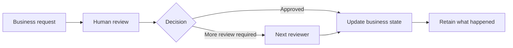

Across these processes, the recurring questions are similar:

- What happens next, and who can act?
- What information did the reviewer see and submit?
- Which process version and rules were used?
- What happens if two people act together or a response is lost?

The engine supplies reusable answers. APOLO supplies the meaning of the business process.

---

## 2. The high-level view

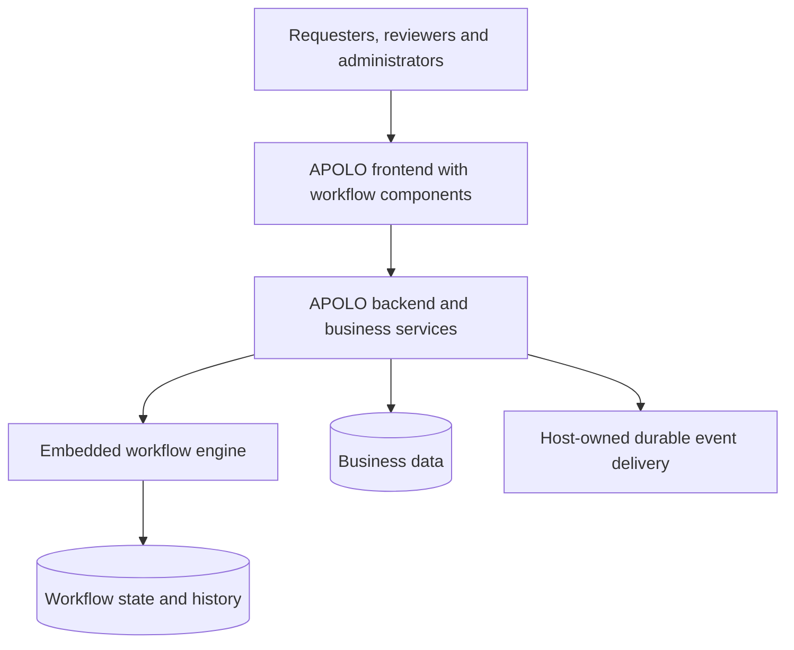

**APOLO owns the business. The engine owns process execution.**

The intended production integration embeds the libraries in APOLO's existing backend and frontend. The standalone development host demonstrates this boundary today; APOLO production integration remains separate work.

The two data boxes show logical ownership, not a requirement for separate databases. Required business and workflow writes share the host transaction.

---

## 3. What the project provides today

| Area | Delivered capability |
| --- | --- |
| Definition management | JSON definitions, validation, publication and version management |
| Execution | Human tasks, synchronous service tasks, conditional routing and sequential stages |
| Review | USER/GROUP/ROLE assignment, claiming, structured answers and fixed-roster ALL review |
| Traceability | Pinned versions, task input snapshots, original submissions and ordered history |
| Operations | Instance viewer, task administration, reassignment and whole-instance cancellation |
| Reuse | Core and web libraries, Angular components and an executable sandbox |

**Delivery status is scoped:** feature handovers contain actual verification and remaining gaps. These capabilities do not imply completed APOLO integration or production acceptance.

Source: [feature index](../features/README.md).

---

## 4. Architecture: three Maven modules and one Angular library

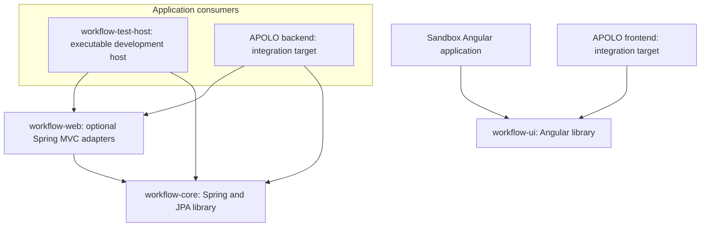

Arrows show **code dependencies**. The Angular applications communicate with their host APIs over HTTP.

Core has no dependency on APOLO implementation classes, web, UI or the test host. The test host stays outside APOLO's production dependency graph.

---

## 5. What belongs in each module?

| Module | Responsibility | Packaging |
| --- | --- | --- |
| `workflow-core` | Definition validation, execution, task state, variables, history, restricted expressions and neutral integration contracts | Ordinary library JAR |
| `workflow-web` | Reusable controllers, transport mapping and scoped errors; explicitly activated API groups | Optional library JAR depending on core |
| `workflow-test-host` | Sample business requests, adapters, security, datasource, transactions, migrations and local delivery | Executable Spring Boot application |
| `workflow-ui` | Shared administration, task pages, instance graph, variables and history | Angular library compiled into a host frontend |

**Current baseline:** Java 17 APIs/bytecode, JDK 21 build/runtime, Spring Boot 3.4.5 development baseline, SQL Server and Angular 19.2.

APOLO's effective dependencies still need integration verification. Core owns workflow migration resources; the host executes them through its Liquibase lifecycle.

Sources: [project README](../../README.md), [web integration](../../workflow-web/README.md), [UI integration](../../workflow-ui/README.md).

---

## 6. The most important boundary: engine versus host

| The engine decides | APOLO supplies or decides |
| --- | --- |
| Which configured node executes next | Whether the user can access the business object and perform the operation |
| Whether a task completion matches its pinned contract | Trusted identity, current group/role membership and business validation |
| How workflow state and history change | Business updates through registered actions |
| How published definitions and runtime evidence are retained | Datasource, transactions and migration execution |
| How commands are recorded and replayed | Durable event recording and external delivery |

For example, a definition may refer to a registered action that updates a request. **The host implements that action and checks the business rules.**

Definition authors reference named capabilities; they cannot provide arbitrary Java classes or access application beans.

Source: [constitution C03–C06](../constitution.md), [CON-03](../constraints.md#con-03--host-ownership-and-neutral-integration-contracts).

---

## 7. The engine's vocabulary

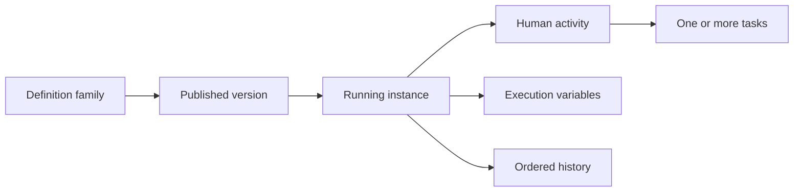

| Concept | Meaning in a request-review process |
| --- | --- |
| Definition family | The process identity across versions |
| Published version | An immutable set of nodes, routes and contracts |
| Instance | One execution linked by the host to a business request |
| Activity | One entered human-review stage |
| Task | One review obligation with an assignment and eventual decision |
| Variables / history | Working process data / retained execution facts |

An ALL activity has several tasks while the process remains at one human-review stage.

---

## 8. Definitions describe the process

| Node type | Purpose |
| --- | --- |
| `START` | Enter the process with validated inputs and explicit initialization |
| `HUMAN_TASK` | Wait for a permitted human decision and optional structured answer |
| `SERVICE_TASK` | Invoke a registered synchronous host action |
| `EXCLUSIVE_GATEWAY` | Select one route using restricted conditions |
| `END` | Finish the execution with a configured result |

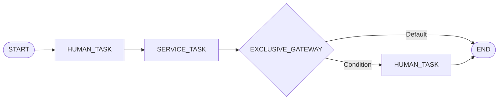

The current implementation supports **forward-only flows (acyclic graphs)**. Automatic steps run within bounded command execution until the process waits at a human stage or ends.

**Review and resubmission loops are future development, not an architectural limitation.** The broader design anticipates flows such as “Request changes → Revise → Review again.” Implementation requires further specification of review rounds, refreshed input snapshots and which round's submissions later steps use. Whether APOLO resubmission reuses the same workflow instance remains a business decision to resolve.

JSON is the executable definition format. Existing administration includes JSON/fragment editing and graph viewing; the visual designer is future development.

---

## 9. Publication makes execution predictable

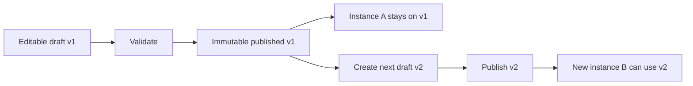

- Start by exact version, or let a family start select the highest-numbered published version.
- Every instance pins the selected version.
- Publishing v2 does not rewrite an existing v1 execution.
- A retried successful start recovers its original receipt; it does not select a newer version.

**Why it matters:** a reviewer and an auditor can understand the rules that actually governed a particular request.

Sources: [F023 version management](../features/F023-create-next-definition-version/spec.md), [F024 family starts](../features/F024-start-workflow-by-family/spec.md).

---

## 10. Example 1 — approve or reject a request

This is an existing **sandbox sample**, not a finalized APOLO business policy.

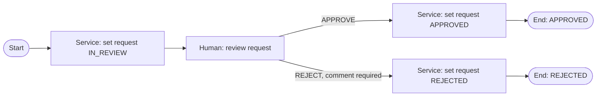

1. The host creates a business request in `DRAFT` and starts its linked workflow.
2. `sandbox.setRequestStatus` moves the request to `IN_REVIEW`.
3. The assigned reviewer selects an outcome.
4. An explicit service action applies the corresponding business status.

**Workflow status and business status are different:** both branches complete the workflow; the request ends as APPROVED or REJECTED.

Runnable definition: [request-status-review.json](../features/F006-test-host-definition-console/request-status-review.json).

---

## 11. Example 2 — add a review only when needed

The existing optional-stage sample routes on a quantity returned by a service action.

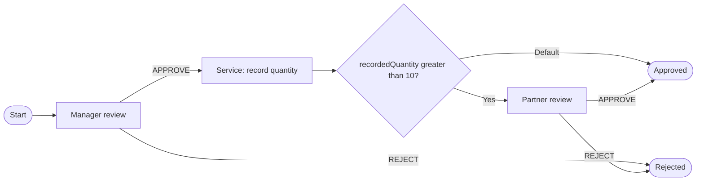

Exact condition from the sample:

```text
#vars.recordedQuantity > 10
```

With quantity `5`, manager approval skips partner review. With `15`, it opens the partner stage. These stage names are sample labels; the sample resolver supplies the reviewer.

Conditions are evaluated in transition order; the first true condition wins, otherwise the default applies. Evaluation failures fail and roll back the command.

Runnable definition: [optional-stage-review.json](../features/F011-sequential-human-stages/optional-stage-review.json).

---

## 12. Example 3 — collective review with ALL

**Illustrative configuration using implemented ALL behavior:** Finance and Legal must both approve; REJECT resolves the review immediately.

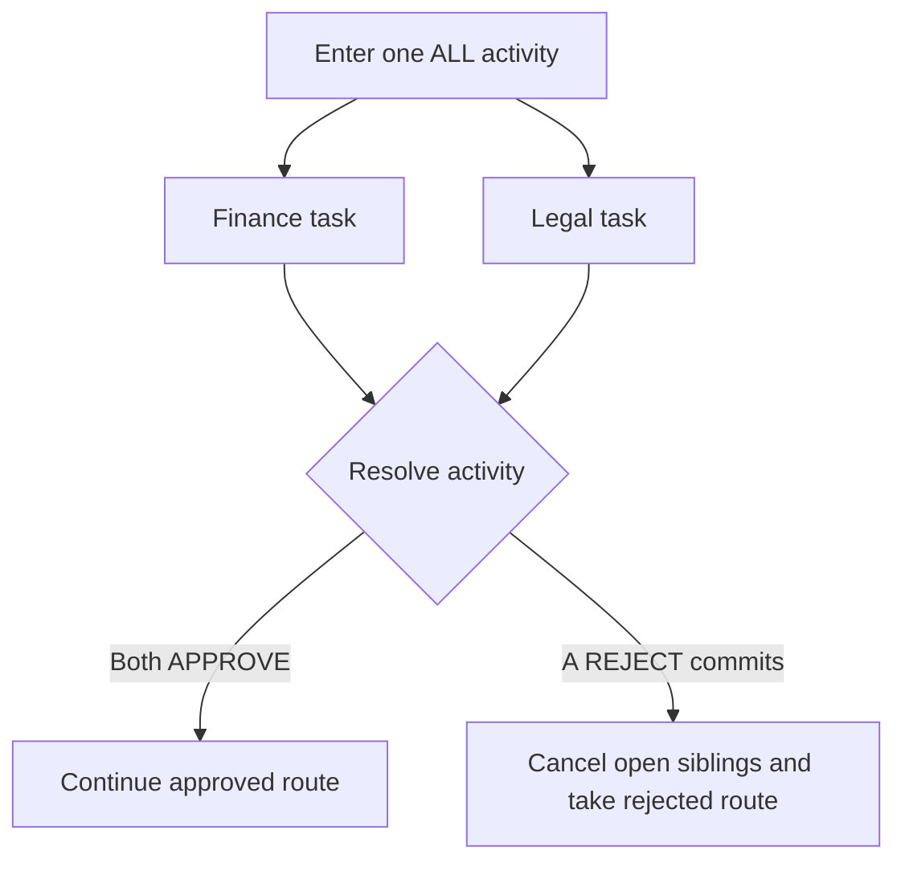

- The host resolves a fixed roster at entry; group membership does not expand it into one task per member.
- Every task receives the same immutable review-input snapshot.
- An APPROVE contribution waits while another required task remains open.
- The decisive completion resolves the activity atomically; earlier accepted answers remain retained.

This is several obligations within **one activity**, not general parallel workflow branches. Distinct-person requirements remain host policy.

Source: [F021 ALL collective review](../features/F021-all-collective-review/spec.md).

---

## 13. Review data: what was seen, answered and passed on

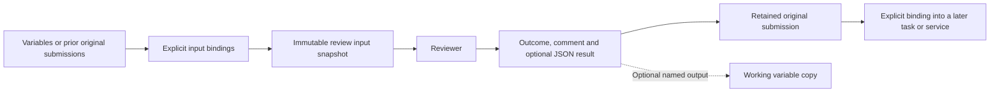

**Illustrative answer:** `{"approvedAmount":1000.00,"note":"Within budget"}`.

The pinned result contract validates the answer's supported JSON schema; an optional host validator applies business checks. A later working-variable replacement does not rewrite the original answer.

For ALL, the downstream original submission is a collection of accepted task answers, available when the activity resolves. Configured previous-decision context can also show comments to a later reviewer without granting access to the full source task.

Sources: [F018 submissions](../features/F018-structured-task-submissions/spec.md), [F019 outputs](../features/F019-named-task-output-variables/spec.md), [F020 inputs](../features/F020-human-task-input-bindings/spec.md), [F022 decision context](../features/F022-previous-decision-comments/spec.md).

---

## 14. Who can act on a task?

| Assignment | Normal behavior |
| --- | --- |
| USER | A directly assigned user can complete, subject to host authorization |
| GROUP or ROLE, unclaimed | Current eligible members may act; configured policy can require claiming first |
| GROUP or ROLE, claimed | Completion is exclusive to the claimant, who must still be eligible and authorized |

The host supplies current membership and business access. A visible button is only a hint; the backend authorizes the actual operation.

Administrators can use authorized reassignment to change an OPEN task's destination while preserving its identity, review inputs and original history. A shared destination clears ownership; a USER destination assigns directly.

Whole-instance cancellation stops outstanding work and retains prior decisions and committed business effects. It is not compensation for those effects.

Sources: [F017 claims](../features/F017-task-claim-release/spec.md), [F025 cancellation](../features/F025-workflow-cancellation/spec.md), [F026 administration](../features/F026-task-administration-reassignment/spec.md).

---

## 15. What happens when a reviewer clicks Approve?

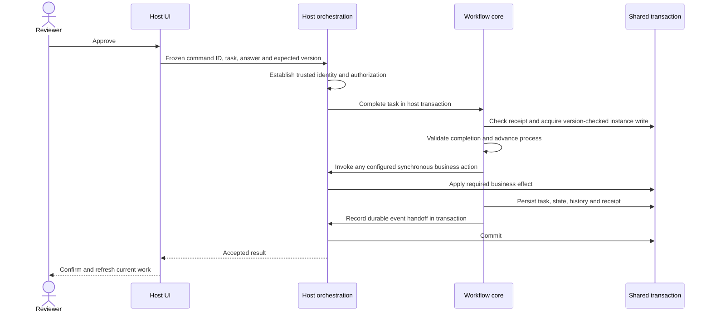

This is the successful new-command path. Authorized replay can return the prior receipt before effects execute again. Failure before commit rolls back the command's participating writes.

---

## 16. Reliability is part of the command contract

| Situation | Intended protection |
| --- | --- |
| Two users act on the same instance | Early version-checked aggregate mutation; a stale competitor fails before business effects |
| A successful response is lost | Authorized receipt recovery identifies the original committed result |
| A service action or required handoff fails | Participating command writes roll back together |
| Delivery fails after commit | The host's durable handoff supports later delivery |
| A definition changes | Existing instances retain their pinned published version |

**One transaction:** required synchronous business effects + workflow/task/variable changes + history + receipt + durable handoff.

External delivery happens through the host. Delivery is at least once, so downstream consumers need deduplication; this is not an exactly-once network guarantee. Business actions are not automatically retried.

Restricted expressions read explicitly supplied workflow data; they cannot invoke arbitrary application methods or mutate application objects.

Sources: [constitution C06–C09](../constitution.md), [constraints CON-06/07/09/10](../constraints.md).

---

## 17. What users and developers can inspect

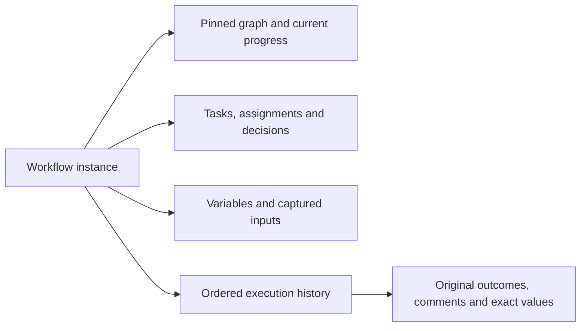

The shared UI provides administration, task work and instance inspection inside a host application shell.

The sandbox demonstrates these components with sample business requests and host adapters. It is also a place to investigate behavior before integrating the first APOLO process.

Access remains host-authorized. A graph or history page does not grant broader business access, and diagnostic command-recovery screens are separate from normal end-user flows.

---

## 18. Suggested live demo — one request, one decision, one history

**Preparation:** use an authorized, already configured sandbox with sample capabilities, the selectable `SANDBOX_REVIEW` task type and administrator/reviewer accounts. Import and publish the [request status sample](../features/F006-test-host-definition-console/request-status-review.json) in advance.

| Step | Show | Point to explain |
| --- | --- | --- |
| 1 | Published definition and graph | This version is the execution contract |
| 2 | Create a DRAFT request and start its workflow | The host links business data to an engine instance |
| 3 | Request becomes IN_REVIEW; review task appears | Service actions and human waiting are different steps |
| 4 | Reviewer approves or rejects with the required comment | Actions come from the pinned task contract |
| 5 | Final request status and completed instance | Business status and workflow status are separate |
| 6 | Graph and history | Show the actual path and retained decision |

**Optional extension:** run the optional-stage sample with quantities `5` and `15` to show conditional routing.

If a live environment is unavailable, walk through the same steps using slides 10 and 15. This presentation does not claim a fresh demo run.

---

## 19. What remains for APOLO integration?


1. **Choose the first process:** start conditions, reviewers, outcomes, business updates and access rules.
2. **Connect the host:** identity, authorization, assignment/membership, registered actions and durable handoff.
3. **Integrate infrastructure and UI:** dependency alignment, shared transaction, APOLO-owned migrations, routes and components.
4. **Verify the chosen slice:** real business behavior, its changed integration boundaries and operational acceptance.

Source integration into APOLO is the agreed direction. Timing, final coordinates and library source locations still need resolution; one authoritative implementation is retained.

Sources: [APOLO integration design](workflow-ui-web-integration.md), [assumptions ASM-01/02/04/06/09](../assumptions.md).

---

## 20. Scope and discussion

| Available in the current project | Integration and future development |
| --- | --- |
| Shared libraries and sandbox | APOLO production integration and acceptance |
| JSON/fragment administration and graph viewing | Later visual workflow designer |
| Sequential and conditional stages; fixed-roster ALL | Review and resubmission loops; general parallel orchestration and subprocesses |
| Claim/release, reassignment and whole-instance cancellation | General delegation, timers, expiration and compensation |
| Restricted workflow expressions | Independent business decision engine |
| Immutable versions and pinned executions | Live migration of active instances |

**Questions for the APOLO team:**

- Which business process should be the first integrated slice?
- Which decisions belong in the definition, and which must stay in business services?
- Who can review, inspect history, reassign work and cancel a process?
- What evidence will the team require before accepting that slice for production?

The proposed runtime read-policy separation in F027 is still a draft and is not presented here as delivered behavior.

---

## Reference map for the technical discussion

| Topic | Where to go next |
| --- | --- |
| Architecture and boundaries | [Consolidated design](workflow-engine-design.md), [constitution](../constitution.md) |
| Current behavior versus historical proposals | [Design-source precedence](../design-sources.md), [feature index and handovers](../features/README.md) |
| Definition language | [Workflow definition language design](workflow-definition-language-design.md), with newer owning feature specs taking precedence |
| Persistence | [Database design](Workflow_Engine_Database_Design_v1.md) |
| Host integration | [Web contract](../../workflow-web/README.md), [UI contract](../../workflow-ui/README.md), [APOLO integration record](workflow-ui-web-integration.md) |
| Runnable examples | [Request approval](../features/F006-test-host-definition-console/request-status-review.json), [conditional review](../features/F011-sequential-human-stages/optional-stage-review.json) |
| Delivery sequence | [Roadmap](../roadmap.md) |

**Presentation status:** documentation only, based on repository records reviewed on 16 November 2026. No new runtime, database or production verification is asserted.
